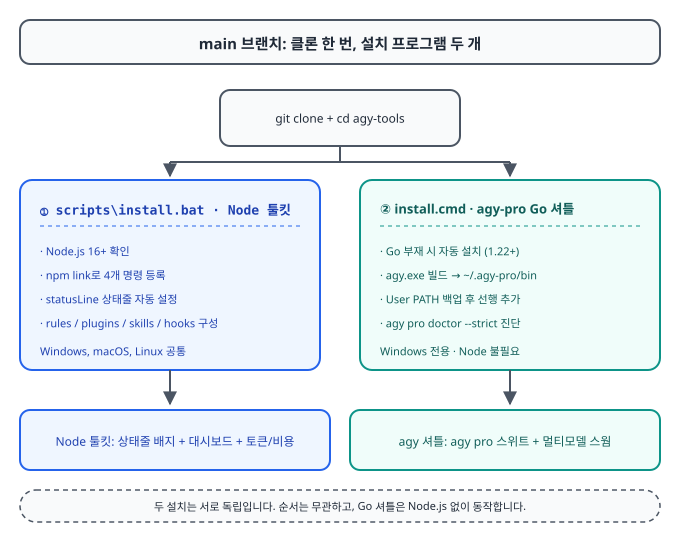
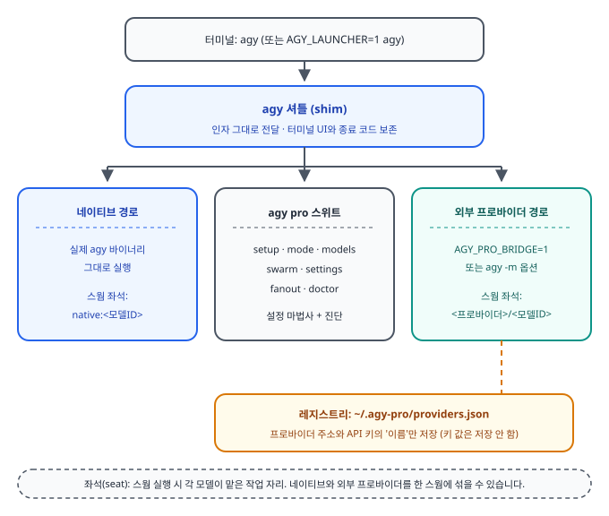
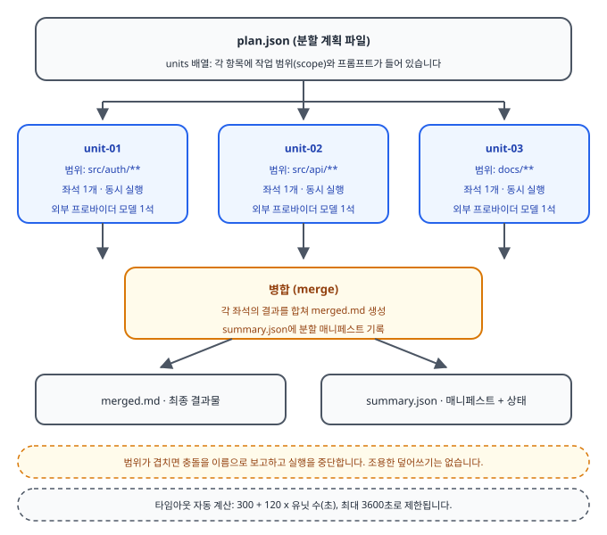
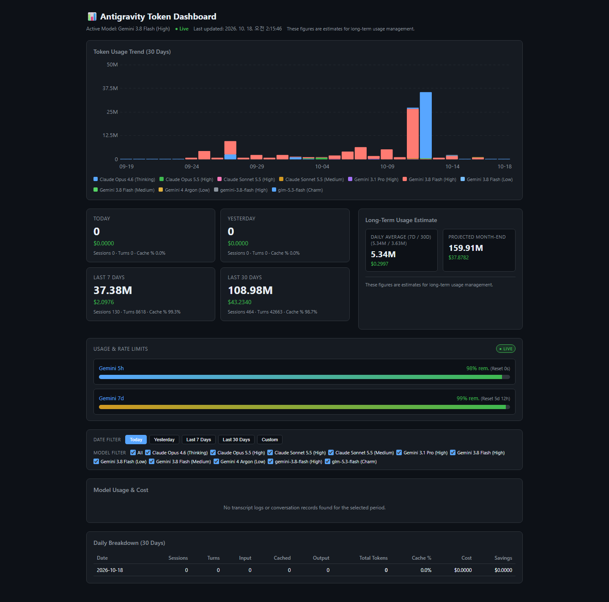

# Antigravity CLI 개발자 툴킷 사용 설명서 (한국어)

`agy-tools`와 `agy-pro`를 처음 쓰시는 분을 위한 설명서입니다.
한 번 설치하고, 바로 쓰는 것을 목표로 썼습니다.

> 이 설명서는 예전 텍스트 설명서(`manual.txt`)를 대체하는 새 설명서입니다.

---

## 목차

1. [한눈에 보기: 무엇을 얻게 되나요](#1-한눈에-보기-무엇을-얻게-되나요)
2. [원큐 설치: 한 줄로 끝내기](#2-원큐-설치-한-줄로-끝내기)
3. [설치 확인: 제대로 됐는지 알아보기](#3-설치-확인-제대로-됐는지-알아보기)
4. [agy-pro 기능 소개: 셔틀, 런처, 스웜](#4-agy-pro-기능-소개-셔틀-런처-스웜)
5. [Node 도구: 상태줄, 대시보드, 토큰 분석](#5-node-도구-상태줄-대시보드-토큰-분석)
6. [설정: 프로바이더 등록과 도구 허용](#6-설정-프로바이더-등록과-도구-허용)
7. [문제 해결](#7-문제-해결)
8. [제거: 깔끔하게 되돌리기](#8-제거-깔끔하게-되돌리기)

---

## 1. 한눈에 보기: 무엇을 얻게 되나요

`main` 브랜치에는 **두 가지 구성 요소**가 함께 들어 있습니다.

| 구성 요소 | 설치 프로그램 | 해주는 일 |
|---|---|---|
| Node.js 툴킷 | `scripts\install.bat` (또는 `install.sh`) | 상태줄 배지, 웹 대시보드, 토큰/비용 분석. Node.js 16 이상 필요 |
| agy-pro Go 셔틀 | `install.cmd` (Windows 전용) | `agy` 명령을 감싸는 셔틀과 멀티모델 스웜 도구. Node.js 불필요 |

용어를 먼저 정리합니다.

- **셔틀(shim)**: 원래 프로그램 앞에 얹는 얇은 대리인입니다. 명령을 그대로 넘기되, 부가 기능을 얹을 수 있습니다.
- **스웜(swarm)**: 여러 AI 모델에게 같은 작업을 나눠주고 결과를 모으는 실행 방식입니다.
- **좌석(seat)**: 스웜에서 각 모델이 맡는 작업 자리입니다.
- **프로바이더(provider)**: 외부 AI 모델 API를 파는 서비스입니다. 여기서는 구체적인 이름 대신 "외부 프로바이더"라고 부릅니다.
- **상태줄(statusline)**: 터미널 하단에 뜨는 한 줄짜리 정보 표시줄입니다.

---

## 2. 원큐 설치: 한 줄로 끝내기

### Windows: 설치 프로그램 두 개를 모두 실행

`main` 브랜치는 두 구성 요소를 모두 싣고 있으므로, **두 설치 프로그램을 모두** 실행합니다.
순서는 상관없습니다. Go 셔틀 쪽은 Node.js가 없어도 됩니다.

**명령 프롬프트에 붙여넣기:**

```cmd
git clone https://github.com/myk1yt/agy-tools.git && cd agy-tools && scripts\install.bat && install.cmd
```

**PowerShell에 붙여넣기** (PowerShell 5.1은 `&&`를 못 알아듣기 때문에 `cmd /c`로 감쌉니다):

```powershell
cmd /c "git clone https://github.com/myk1yt/agy-tools.git && cd agy-tools && scripts\install.bat && install.cmd"
```

하나가 오류를 낸 경우, 다른 쪽 설치 프로그램만 따로 실행할 수 있습니다.

```cmd
scripts\install.bat   :: Node 툴킷만
install.cmd           :: agy-pro Go 셔틀만 (Windows 전용)
```

각 설치 프로그램이 하는 일:



`install.cmd`는 Go가 없으면 먼저 Go를 깔고, `agy.exe`를 빌드해서 `사용자 폴더\.agy-pro\bin`에 넣은 뒤, 사용자 PATH의 맨 앞에 그 폴더를 추가합니다. 그리고 `agy pro doctor --strict`로 진단한 뒤, 외부 모델 설정 마법사를 제안합니다. 마법사를 건드리고 싶지 않으면 `install.cmd -NoWizard`를 쓰세요.

### macOS / Linux: Node 툴킷은 한 줄, Go 셔틀은 직접 빌드

**Node 툴킷 (한 줄):**

```bash
git clone https://github.com/myk1yt/agy-tools.git && cd agy-tools && bash scripts/install.sh
```

**agy-pro Go 셔틀:** 아직 자동 설치 프로그램은 Windows 전용입니다. Go 1.22 이상을 설치한 뒤 직접 빌드하세요.

```bash
cd agy-tools/agy-pro
go build -o ~/.agy-pro/bin/agy ./cmd/agy
```

빌드한 폴더를 PATH에 넣으면 `agy` 명령이 셔틀을 거치게 됩니다.

> 설치를 마쳤으면 **새 터미널 창**을 열어주세요. PATH 변경이 반영되려면 새 창이 필요합니다.

---

## 3. 설치 확인: 제대로 됐는지 알아보기

새 터미널에서 아래 명령을 차례로 쳐 보세요.

```powershell
agy-tokens --version      # Node 툴킷 버전이 나오면 OK
agy --version             # 셔틀이 살아 있으면 OK
agy pro status            # 현재 모드, 프로바이더, 진짜 agy 경로
agy pro doctor            # 등록된 프로바이더 키를 실제로 찔러 보는 진단
agy pro models --all      # 네이티브 + 외부 프로바이더 모델 통합 목록
agy agents                # 등록된 에이전트 목록
```

- `agy pro doctor`는 API 키를 전혀 쓰지 않고(`GET /models` 조회만) 유효성을 검사합니다. 결과는 항상 가려서(앞 5글자 + `****`)만 보여 줍니다.
- `agy pro doctor`에서 `SKIP`이 나오면 아직 외부 프로바이더를 등록하지 않은 것입니다. 6절을 참조하세요.

---

## 4. agy-pro 기능 소개: 셔틀, 런처, 스웜

### 4.1 전체 그림



`agy`라고 치면 셔틀이 받습니다. 일반 명령은 진짜 `agy` 바이너리로 그대로 넘깁니다. 터미널 화면에도, 종료 코드도 그대로 유지됩니다.

### 4.2 모델 런처 (선택 사항)

```powershell
# PowerShell
$env:AGY_LAUNCHER=1; agy
```

2초 동안 선택 화면이 뜹니다. ① 네이티브 모델, ② 외부 프로바이더 모델 목록, ③ 스웜 중에서 고릅니다. 아무것도 안 고른면 기본(네이티브)으로 갑니다. `AGY_LAUNCHER`를 설정하지 않으면 런처 없이 바로 네이티브로 들어갑니다. 매번 환경 변수 없이 런처를 켜 두고 싶으면 설정 TUI에서 저장할 수 있습니다(4.3.7절).

### 4.3 agy pro 스위트

| 명령 | 하는 일 |
|---|---|
| `agy pro setup` | 전체 화면 설정 TUI를 엶 (유일한 문). 프로바이더, 모델, 팬아웃 프리셋, 프롬프트, 언어를 한 화면에서 설정. 고전 줄 단위 마법사는 `agy pro setup --wizard` |
| `agy pro mode full` | 풀스택 오케스트레이터 모드로 전환 |
| `agy pro mode clean` | 깨끗한 모드로 전환 |
| `agy pro mode restore` | 전환 전 설정으로 복원 |
| `agy pro models --all` | 네이티브 + 외부 모델 통합 목록 (번호 매김) |
| `agy pro swarm` | 번호로 고르는 스웜 빌더 |
| `agy pro settings` | 전체 화면 설정 패널 (기존 CLI형 패널) |
| `agy pro doctor` | 진단 (`--strict`면 문제 있을 때 실패로 끝남) |
| `agy pro status` | 현재 상태 요약 |

`agy pro`만 치거나 `agy pro help`를 치면 도움말이 뜨는데, 맨 위에서
`agy pro setup`이 전체 화면 설정 TUI를 연다고 크게 알려 줍니다.

#### 4.3.1 설정 TUI 들어가기

```powershell
agy pro setup            # 전체 화면 설정 TUI (Windows 콘솔에서)
agy pro setup --wizard   # 어떤 환경에서든 고전 줄 단위 마법사
```

- TUI 문은 `agy pro setup` 하나뿐입니다. 인자 없이 치면 Windows 콘솔(Windows
  Terminal, cmd, PowerShell 창)에서는 전체 화면 TUI가 열리고, 파이프나 스크립트
  같은 콘솔이 아닌 환경에서는 기존 줄 단위 마법사로 자동 전환됩니다. 스크립트
  동작은 예전과 바이트 단위로 같습니다.
- `--wizard`(숨은 별칭 `wizard`)는 어떤 환경에서든 줄 단위 마법사를 강제합니다.
  마법사에는 언어 선택 단계가 없고 영어로만 진행됩니다.
- `agy pro settings providers add-interactive`는 예전처럼 같은 마법사로
  연결됩니다.
- 정체를 모르는 인자(예: `--tui`)는 인자를 가린 오류 한 줄과 도움말을 보여 주고
  종료 코드 2로 끝납니다. 예전처럼 조용히 무시하지 않습니다.

#### 4.3.2 첫 실행: 언어 선택

처음 `agy pro setup`을 열 때(아직 언어를 고른 적이 없을 때) 배너 바로 아래에서
언어 화면이 뜹니다. 12개 언어가 번호로 나열되고, 각 언어는 자기 이름으로
표시됩니다. 숫자 키로 고르거나 화살표로 움직여 Enter를 치면 됩니다. 고른 언어는
즉시 저장되고 다음 화면에 바로 그 언어로 그려집니다(재시작 불필요).

지원 언어 12개: English, 简体中文, 繁體中文, 한국어, 日本語, Русский,
हिन्दी, Deutsch, Français, Italiano, Tiếng Việt, العربية(아랍어).

나중에 언어를 바꾸는 곳: 설정 TUI의 설정 화면(모양(Appearance)의 Language)과
`agy pro settings set language <코드>` 명령이 있습니다.

솔직한 범위 공지:

- **아랍어**는 논리 순서(logical order) 문자열에 결정적인 레이아웃 미러링(오른쪽
  정렬, 오른쪽에 번호와 여백, 거꾸로 그려지는 푸터)까지 지원합니다. 단, 콘솔/
  터미널이 해 주는 일이 아닌 것은 약속하지 않습니다: 시각적 양방향(bidi) 재배열,
  아랍 문자 모양 연결(shaping), 아랍어 문자열 중간 자르기, 아랍어 자리에서의
  커서 편집은 지원하지 않습니다. 아랍어 목록에는 "(logical order)" 표기가
  붙습니다.
- **힌디어**는 한 줄짜리 행만 지원합니다. 고정 폭 데바나가리 칸 정렬과 칸 단위
  자르기는 없습니다(글꼴에 따라 너비가 달라지기 때문).
- **베트남어**는 조합형 문자 대신 미리 조합된 글자로만 저장됩니다.
- 언어 선택에 환경 변수 오버라이드는 아직 없습니다.

#### 4.3.3 화면 구성

배너 아래 허브(메인 메뉴)가 뜨고, 메뉴는 숫자와 화살표+Enter 둘 다 먹습니다.

1. 프로바이더 (등록, 연결 테스트, 이름 바꾸기, 삭제)
2. 모델 (프로바이더 안의 모델을 하나씩 추가/수정/삭제)
3. 팬아웃 프리셋 (좌석, 도구, 시간 제한 등 묶음 저장)
4. 프롬프트 (작업 프롬프트와 좌석 역할 프롬프트 작성)
5. 설정 (언어, 런처 메뉴, 프로필 등)
6. 진단 (doctor)
7. 도움말 (키 설명과 솔직한 범위 공지)
8. 언어 (현재 언어 표시와 변경)
9. 종료

#### 4.3.4 모델 추가/삭제와 승인 게이트

모델 화면에서 프로바이더를 고르면 그 안의 모델 목록이 나옵니다.

- **추가/수정**: 빈 칸에 모델 ID, 가족(family), 컨텍스트 길이, 도구 허용 목록
  같은 필드를 채우고 저장을 누릅니다.
- **삭제**: 모델 하나를 골라 삭제합니다.

중요: 저장/삭제 버튼을 눌러도 **즉시 파일에 쓰지 않습니다**. 바뀐 내용의 정확한
diff(어느 프로바이더, 몇 개에서 몇 개로, 어떤 필드가 추가/변경됐는지)를 보여 주는
승인 창이 뜨고, 거기서 `y`를 눌러야 레지스트리(`providers.json`)에 기록됩니다.
레지스트리에 닿는 모든 쓰기는 이 승인 창을 통하는 유일한 문입니다. 키 값은
여전히 어디에도 저장되지 않고 환경 변수 이름만 씁니다.

같은 기능의 CLI 명령도 있습니다: `agy pro settings providers model-add-json`,
`model-update`, `model-delete`.

#### 4.3.5 팬아웃 프리셋과 값 결정 사다리

팬아웃 프리셋 화면에서 좌석 구성, 모델, 도구, 시간 제한, 출력 폴더 등을 묶어
이름을 붙여 저장해 둘 수 있습니다. 저장된 프리셋은 `agy pro fanout --preset <이름>`
으로 쓰거나, `AGY_PRO_FANOUT_PRESET` 환경 변수로 고를 수 있고, 저장소의 기본
프리셋 지정도 가능합니다.

`agy pro fanout`의 각 값은 아래 사다리로 정해집니다(위가 강함):

1. 명령줄 플래그 (직접 적은 값)
2. 환경 변수 `AGY_PRO_FANOUT_PRESET` (프리셋 고르기)
3. 활성 프리셋 (`--preset` 또는 저장소 기본 프리셋)의 필드
4. `providers.json`의 defaults 블록 (`n`, `timeoutSeconds`, `maxTurns`, `tools`)
5. 엔진 기본값

defaults 블록은 읽기 전용으로만 소비됩니다. 저장된 값이 엔진 기본값과 다르면
(실제 파일에는 `timeoutSeconds: 120`이 있는데 엔진 기본은 `300`초) stderr에 한
줄 알림이 뜨고, 저장된 값이 그대로 이깁니다. 조용히 바꿔치기하지 않습니다.

#### 4.3.6 프롬프트 작성

프롬프트 화면에서 팬아웃 작업 프롬프트(review, security, plan-audit, research,
ideas, custom)와 네이티브 좌석 역할 프롬프트를 직접 써서 저장할 수 있습니다.
파일은 `사용자 폴더\.agy-pro\prompts\` 아래에 작업마다 하나씩(`review.txt`,
`security.txt`, ..., `seat.txt`) 저장됩니다. 파일이 없으면 내장된 기본
프롬프트를 바이트 단위로 그대로 쓰므로, 아무것도 안 건드렸다면 동작은 예전과
같습니다. 저장 디렉터리를 통째로 바꾸는 환경 변수 `AGY_PRO_PROMPTS_DIR`과,
좌석 프롬프트만 한 줄로 덮는 `AGY_PRO_SEAT_PREAMBLE`도 있습니다.

좌석 프롬프트에는 주의가 필요합니다. 여기에 쓴 지시는 **팬아웃 좌석의 행동
지침**입니다. 그대로 기술적 조사 지침(근거 파일 위치를 적을 것, 빈 수식어 금지
등)을 쓰는 것은 좋지만, 좌석이 해서는 안 될 일(인터넷 주소 가져오기, 파일
삭제 등)은 도구 허용 설정으로 막는 것이 원칙입니다. 프롬프트 문장 하나로
도구 금지를 우회하게 두지 마세요.

#### 4.3.7 런처 메뉴 켜기/끄기

4.2절의 2초 런처를 매번 `AGY_LAUNCHER=1` 없이 켜 두고 싶으면 설정 TUI의 설정
화면(모양의 Launcher menu)에서 show로 바꿉니다. 저장되면 `agy`를 인자 없이 칠
때마다 런처가 뜹니다.

우선순위는 환경 변수가 이깁니다. `AGY_LAUNCHER`가 비어 있지 않게 설정돼 있으면
그 값이 전부를 결정합니다(`1`이면 표시, 그 외는 숨김. 예전 옵트인 방식 그대로).
환경 변수가 없거나 비어 있을 때만 저장된 값이 쓰이고, 저장된 값도 없으면 꺼짐이
기본입니다. 설정 화면에는 값의 출처(환경 변수 override / state.json / 기본값)가
정직하게 표시됩니다.

#### 4.3.8 배너와 색 등급

TUI에 들어가면 별 모양 배너와 "AGY PRO" 워드마크가 뜹니다. 색은 사용 중인
터미널 능력에 따라 네 등급으로 알아서 전환됩니다.

- 24비트 진색(Windows Terminal 등)
- 256색
- 16색 (구형 콘솔의 기본. 실루엣만 살림)
- 무색 ASCII (파이프 출력처럼 색이 없는 환경. 배너 문자 자체가 그려지지 않음)

등급은 `AGY_PRO_COLOR` 환경 변수(`truecolor`, `256`, `16`, `off`)로 강제할 수
있고, `NO_COLOR`가 비어 있지 않으면 무색으로 갑니다. 창이 작으면 배너는 작은
형태로 줄어듭니다(행 22 이하 또는 열 30 이하이면 3줄, 그 아래이면 1줄 워드마크).

### 4.4 스웜 팬아웃과 크로스 검증

팬아웃(fanout)은 하나의 작업을 여러 좌석에 동시에 던지는 기능입니다.

```powershell
# 같은 프롬프트를 N개 좌석에 그대로 복사해서 던짐 (크로스 검증)
agy pro fanout --task review -n 3 --prompt "인증 흐름을 검토하고 문제점을 정리하세요"

# 네이티브 좌석과 외부 프로바이더 좌석을 한 스웜에 섞기
agy pro fanout --seats "native:<네이티브 모델ID>,<프로바이더>/<모델ID>" --prompt "..."
```

크로스 검증 모드에서는 **바이트 단위로 완전히 같은 프롬프트**가 N개 좌석에 전달됩니다. 외부 프로바이더 쪽 캐시 앞부분(prefix)을 좌석끼리 공유하게 되어 비용과 시간이 아낍니다.

좌석 문법: `native:<모델ID>`는 Antigravity 자체 모델, `<프로바이더>/<모델ID>`는 등록된 외부 프로바이더 모델입니다. 쉼표로 여러 개를 이어붙입니다.

아래는 실제 바이너리에서 뽑은 도움말 화면입니다.

> 실제 명령 출력 캡처입니다 (`<임시 폴더>\agypro.exe pro fanout --help`). 예시에 들어간 구체적인 모델 이름은 설명서 규칙에 따라 `<...>` 자리 표시자로 일반화했습니다.

```text
Usage: agy pro fanout [options]

Options:
  -allow-host value
    	Hostname allowed for the read_url_content tool (repeatable; port ignored, matched lowercase). Provider seats get read_url_content only when at least one host is listed
  -json
    	Output summary JSON to stdout
  -max-native int
    	Maximum concurrent native (real agy) seats; 0 uses state.json native_seat_concurrency or the default 2 (excess native seats queue)
  -max-turns int
    	Maximum turns for agentic tool loop (default 10)
  -models string
    	Comma-separated model identifiers (e.g. '<프로바이더>/<모델ID>,<프로바이더>/<모델ID>')
  -n int
    	Number of models to fan out across (default 3)
  -out string
    	Output directory for generated reports (default ./reports/fanout/<ts>)
  -preset string
    	Name of a saved fanout preset from ~/.agy-pro/fanout-presets.json (fields not set by explicit flags resolve from the preset, then the providers.json defaults block, then the engine default)
  -prompt string
    	Inline user prompt text
  -prompt-file string
    	Path to prompt file, or '-' for stdin
  -root string
    	Workspace root directory for tool execution (default ".")
  -search-endpoint string
    	Endpoint URL template for the search_web tool, containing one {query} placeholder (https only; http for loopback hosts). Provider seats get search_web only when this is set
  -search-key-env string
    	NAME of the environment variable holding the search endpoint's API key (the value is read at call time and never logged). Optional when the endpoint needs no key
  -seats string
    	Comma-separated seat specs mixing native and provider seats: 'native:<모델ID>' for a real agy (네이티브) subprocess seat, 'provider/model' or 'model' for an external provider seat (e.g. 'native:<네이티브 모델ID>,<프로바이더>/<모델ID>')
  -setup
    	Launch interactive provider setup wizard
  -task string
    	Task type: review|security|plan-audit|research|ideas|custom (default "review")
  -timeout int
    	Swarm execution timeout in seconds (with --units and no explicit --timeout, the default auto-scales: 300 + 120 per unit, capped at 3600) (default 300)
  -tools string
    	Allowed tools: read,search,write,exec (closed set; unknown tokens are rejected) (default "read,search")
  -units string
    	Path to a partition plan file (JSON array of units): PARTITION mode runs one seat per unit, each bounded to its unit's scope (mutually exclusive with --prompt, --prompt-file, --seats and --models)
```

### 4.5 파티션 모드: 큰 작업을 나눠서 병렬로

파티션(partition) 모드는 **하나의 계획 파일을 여러 조각(유닛)으로 나눠서, 조각마다 하나의 외부 프로바이더 좌석이 동시에 처리**하게 합니다. 끝나면 결과를 `merged.md` 하나로 합치고, `summary.json`에 어떤 유닛이 어떤 파일을 만들었는지(분할 매니페스트) 기록합니다.



계획 파일(`plan.json`) 예시:

```json
[
  {
    "id": "auth-review",
    "title": "인증 패키지 검토",
    "scope": ["src/auth/*.go"],
    "deliverable": "인증 패키지 검토 보고서"
  },
  {
    "id": "db-review",
    "title": "DB 패키지 검토",
    "scope": ["src/db/*.go"],
    "deliverable": "DB 패키지 검토 보고서"
  }
]
```

- `id`, `title`, `scope`, `deliverable`은 필수입니다. `seat`, `body`, `write`는 선택입니다.
- `scope`는 그 유닛이 건드릴 수 있는 파일 범위입니다. 전체 폴더를 가리키는 범위는 거부됩니다.
- 두 유닛의 범위가 겹치면 **실행이 중단**되고 충돌의 이름이 보고됩니다. 조용히 덮어 쓰는 일은 없습니다.
- 유닋은 최대 64개까지입니다.
- 실행:

```powershell
agy pro fanout --task review --units plan.json --root .
```

결과물은 `./reports/fanout/<타임스탬프>/` 아래에 생깁니다.

### 4.6 프로바이더 도구: 기본은 전부 꺼져 있습니다

스웜 좌석에게 파일 쓰기, URL 읽기, 웹 검색 도구를 쥐여줄 수 있습니다. 단, **전부 기본 OFF**이고 명시적으로 켜야 합니다.

| 도구 | 켜는 방법 | 제한 |
|---|---|---|
| 읽기/검색 (`read,search`) | `--tools read,search` (기본값) | 읽기 전용 |
| 파일 쓰기 (`write_file`, `replace_in_file`) | 계획 유닛에 `"write": true` 추가 | 유닛의 `scope` 안쪽 파일만. 네이티브 좌석은 거부. 명령줄 전역 스위치는 없음 |
| URL 읽기 (`read_url_content`) | `--allow-host example.com` (반복 가능) | GET만, https만(루프백은 http 예외), 인증 헤더 없음, 리다이렉트 3회까지 재검사, 512KiB 한도, 텍스트만. 허용 호스트가 하나도 없으면 모든 호출 거부 |
| 웹 검색 (`search_web`) | `--search-endpoint` + `--search-key-env` | 엔드포인트 URL에 `{query}` 자리가 있어야 함. 키는 환경 변수의 '이름'만 받음. 미설정 시 정직한 "설정 안 됨" 오류 |

현재 저장소 기본값에서는 일부 외부 프로바이더 모델에 읽기 도구와 파일 쓰기, URL 읽기가 이미 허용되어 있습니다. 웹 검색 도구는 아직 아무 모델에도 허용되지 않았습니다.

---

## 5. Node 도구: 상태줄, 대시보드, 토큰 분석

### 5.1 상태줄 배지

설치가 끝나면 Antigravity CLI(`agy`)를 **재시작**하세요. 터미널 하단에 이런 배지가 뜹니다.

```text
⚡ 이번 턴: 1.2k (₩0.3) | 오늘 누적: 45.8k (₩9.9) | 캐시: 82% | 5h: ▰▰▰▰▱ 79% (4h 10m) | 7d: ▱▱▱▱▱ 21% (3d 20h) | 📊 대시보드
```

- `5h`, `7d`: 네이티브 쿼터 풀의 실시간 잔여량입니다. 5시간과 7일 단위로 채워지는 사용 한도입니다.
- 쿼터 값은 로컬 Language Server에 직접 물어봅니다. 서버가 꺼져 있으면 지난 기록으로 추정해 표시합니다.

### 5.2 웹 대시보드

```powershell
agy-tokens --serve --open
```

브라우저에서 `http://127.0.0.1:8787`이 열립니다. 터미널 대신 웹 페이지로 보고 싶을 때 쓰세요. 서버는 내 컴퓨터(127.0.0.1)에서만 열립니다.

아래는 실제 대시보드 화면 캡처입니다.



> 캡처는 설명서 작성 시점의 실제 화면입니다. 30일 추이 차트, 오늘/어제/7일/30일 요약, 실시간 쿼터 바(5h, 7d), 날짜와 모델별 필터가 보입니다. 화면에 보이는 모델 이름은 실제 사용자 인터페이스 라벨 그대로입니다. 오늘/어제가 0으로 나오는 것은 캡처한 시각에 해당 날짜의 세션 로그가 없었기 때문입니다.

### 5.3 토큰/비용 분석 명령

```powershell
agy-tokens                 # 오늘 요약 (기본)
agy-tokens --7d            # 7일 일별 표
agy-tokens --30d --currency krw   # 30일, 원화 표시
agy-tokens --session       # 최근 대화 턴 단위 분석
agy-tokens --lang ko       # 한국어 강제
```

외부 의존성이 0개라서 실행이 즉시 끝납니다.

> 실제 명령 출력 캡처입니다 (`node bin/agy-tools.js --help`). 터미널 색상 코드(ANSI)는 제거했습니다.

```text

Antigravity CLI Developer Toolkit (agy-tools) - v0.10.3
Modular, zero-dependency developer tools for Antigravity CLI & LLM workflows

Usage:
  agy-tools [command] [options]
  agy-dashboard [options]
  agy-tokens [options]

Available Commands:
  dashboard, tokens, usage   Token & Cost Dashboard (usage breakdown, cache %, costs) [Default]
  prices, models             Display live official API pricing catalog for all /model choices
  sync-prices, sync          Synchronize latest official API pricing catalog from remote repo
  help                       Show this help screen
  version                    Display toolkit version

Dashboard Options:
  --today, -t                 Today's usage & cost summary (default)
  --yesterday, -y             Yesterday's usage & cost summary
  --7d, --week                7-day daily breakdown table and grand total
  --30d, --month              30-day daily breakdown table and grand total
  --range <start..end>        Custom date range aggregation (YYYY-MM-DD..YYYY-MM-DD)
  --session, -s [id]          Turn-by-turn breakdown for latest or specified conversation ID
  --all, -a                   All-time historical summary
  --currency <usd|krw|jpy|eur> Display currency
  --lang <en|ko|ja|zh>        Interface language
  --model <name>              Override model pricing
  --free, --no-cost           Display pure token metrics without dollar cost (free subscription)
  --hook, --badge             1-line real-time badge for lifecycle hooks (JSON output)
  --raw                       Print raw badge string without PostInvocation JSON wrapper
  --auto-sync                 Auto-sync pricing if older than 24 hours
  --json                      Raw JSON output

Examples:
  $ agy-tools prices --currency krw
  $ agy-tools prices --lang ko
  $ agy-tools sync-prices
  $ agy-tools dashboard --7d --currency krw
  $ agy-tools dashboard --range 2026-08-01..2026-08-27
  $ agy-tools dashboard --free
  $ agy-dashboard --today --lang ko
  $ agy-tokens --hook
```

---

## 6. 설정: 프로바이더 등록과 도구 허용

### 6.1 레지스트리 파일

외부 프로바이더 정보는 `사용자 폴더\.agy-pro\providers.json`에 저장됩니다.
**중요: 이 파일에는 API 키 값이 저장되지 않습니다.** 프로바이더 주소와, 키가 담긴 환경 변수의 **이름**만 저장합니다.

```json
{
  "providers": [
    {
      "name": "my-provider",
      "baseURL": "https://api.example.com/v1",
      "apiKeyEnv": "MY_PROVIDER_API_KEY",
      "models": [
        { "id": "external-model" }
      ]
    }
  ]
}
```

### 6.2 등록 방법

전체 화면 설정 TUI(권장):

```powershell
agy pro setup
```

TUI에서 프로바이더를 고르고 추가합니다. 주소와 키 환경 변수 이름을 넣고 저장을
누르면 diff 승인 창이 뜨고, `y`를 눌러야 레지스트리에 기록됩니다. 줄 단위
마법사를 선호하면 `agy pro setup --wizard`를 쓰세요. 마법사가 주소와 키를
물어보고, 등록 직후 실제 연결 테스트까지 해 줍니다.
수정은 파일을 직접 고치거나 `agy pro settings` 패널, 설정 TUI에서 합니다.

### 6.3 환경 변수에 키 값 넣기

`apiKeyEnv`에 적은 이름의 환경 변수에 실제 키 값을 넣어 두세요.

```powershell
# PowerShell (현재 창에만 적용)
$env:MY_PROVIDER_API_KEY = "여기에 실제 키"

# 영구 적용 (사용자 환경 변수)
[Environment]::SetEnvironmentVariable("MY_PROVIDER_API_KEY", "여기에 실제 키", "User")
```

키 값은 어디에도 기록되지 않습니다. `agy pro doctor`로 유효성을 확인하세요.

### 6.4 URL 읽기와 웹 검색 허용

```powershell
# URL 읽기: 허용할 호스트를 하나씩 나열 (반복 가능)
agy pro fanout --units plan.json --allow-host example.com --allow-host docs.example.com

# 웹 검색: 검색 엔드포인트 + 키 환경 변수 이름
agy pro fanout --task research -n 3 --search-endpoint "https://search.example.com/q={query}" --search-key-env MY_SEARCH_API_KEY
```

- `--allow-host`를 한 번도 안 쓰면 `read_url_content`는 전부 거부됩니다.
- `--search-endpoint`에 키를 직접 넣지 마세요. `--search-key-env`에는 변수 이름만 적고, 값은 환경 변수에 넣으세요.
- 엔드포인트는 https만 허용됩니다(내 컴퓨터 주소인 루프백은 http 예외).

---

## 7. 문제 해결

| 증상 | 확인할 것 | 해결 |
|---|---|---|
| `agy`를 인식하지 못함 | 새 터미널을 열었는가 | 설치 후 반드시 새 창. 그래도 안 되면 PATH에 `.agy-pro\bin`이 있는지 확인 |
| `scripts\install.bat`이 Node 오류로 끝남 | `node --version`이 16 이상인가 | Node.js LTS 설치 후 새 창에서 재실행 |
| 상태줄 배지가 안 보임 | `agy`를 재시작했는가 | `~/.gemini\antigravity-cli\settings.json`에 `statusLine` 블록이 있는지 확인 |
| `agy pro doctor`에서 `invalid` | 환경 변수 이름이 `apiKeyEnv`와 같은가 | 이름(대소문자 포함)이 같고, 값이 현재 창에 설정됐는지 확인 |
| `agy pro doctor`에서 `SKIP` | 프로바이더 미등록 | `agy pro setup`으로 등록 |
| 대시보드 포트가 이미 사용 중 | 8787을 다른 프로그램이 쓰는가 | `agy-tokens --serve --port 8790 --open`처럼 다른 포트 지정 |
| 스웜 좌석이 401/403 오류 | 프로바이더 키가 잘못됐는가 | 엔진이 자동으로 다른 등록 프로바이더로 넘어갑니다. 결과에 `degraded` 표시가 남음 |

---

## 8. 제거: 깔끔하게 되돌리기

### agy-pro Go 셔틀 제거 (Windows)

클론해 둔 저장소 폴더 안의 `uninstall.cmd`를 두 번 클릭하는 것이 제일 간단합니다. 저장소 폴더가 이미 없다면 아래 한 줄로 제거 프로그램을 받아 실행하세요.

```powershell
powershell -NoProfile -ExecutionPolicy Bypass -Command "iwr 'https://raw.githubusercontent.com/myk1yt/agy-tools/main/agy-pro/scripts/uninstall.ps1' -OutFile '$env:TEMP\agy-pro-uninstall.ps1' -UseBasicParsing; & '$env:TEMP\agy-pro-uninstall.ps1'"
```

제거 프로그램이 하는 일:

1. 사용자 PATH에서 `.agy-pro\bin` 항목을 제거합니다 (다른 항목은 손대지 않음).
2. `사용자 폴더\.agy-pro` 전체를 **휴지통**으로 옮깁니다 (영구 삭제 안 함).

옵션:

- `-KeepState`: 셔틀만 제거하고 `providers.json`, `state.json`, 백업은 유지.
- `-RestorePath`: 설치 전에 저장해 둔 사용자 PATH로 되돌림.
- `-DryRun`: 아무것도 바꾸지 않고 계획만 출력.

프로파일을 바꿔 썼다면(`agy pro mode full` 등) 먼저 `agy pro mode restore`를 실행한 뒤 제거하세요.

### Node 툴킷 제거

1. `~/.gemini/antigravity-cli/settings.json`에서 `statusLine` 블록을 지웁니다 (이 한 줄이 전부입니다).
2. 전역 명령을 해제합니다.

```powershell
npm unlink -g agy-tools
```

3. 클론해 둔 저장소 폴더를 지웁니다.

---

## 더 깊은 문서

- [README.md (English)](README.md), [README.ko.md](README.ko.md): 전체 기능 요약
- [docs/DASHBOARD.md](docs/DASHBOARD.md): 대시보드 상세 명세
- [docs/QUOTA_POOL.md](docs/QUOTA_POOL.md): 쿼터 풀 연동 명세
- [agy-pro/README.md](agy-pro/README.md): agy-pro 상세 레퍼런스
