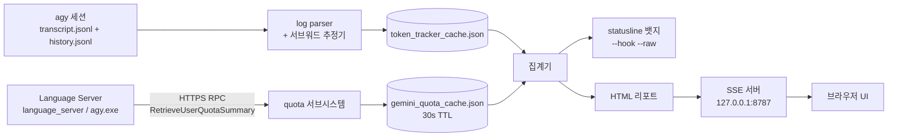

# ⚡ agy-pro & agy-tools

<div align="center">

**[English](README.md)** | **[한국어](README.ko.md)**

[](LICENSE)
[-brightgreen.svg)](#under-the-hood)
[](https://nodejs.org)
[-orange.svg)](#analytics)
[](#under-the-hood)
[](#under-the-hood)
[](#install)

**의존성 0의 Antigravity CLI 툴킷: 실시간 토큰·쿼터 분석(`agy-tokens`, `agy-dashboard`), 사용자 맞춤 커스터마이징(`hooks`, `agents`, `skills`, `rules`, `plugins`), 그리고 `agy` PATH 그림자(shadowing) 없는 깔끔한 게이트웨이 관리자(`agy-pro`).**

</div>

---

> [!WARNING]
> **사용 중단(Deprecation) 안내 — 레거시 Go `agy pro` 기능은 네이티브 `antigravity-cli`로 대체되었습니다**
>
> `agy-pro`의 레거시 Go shim(`~/.agy-pro/bin/agy.exe`) 및 Go 하위 명령(`agy pro swarm`, `agy pro fanout`, `agy pro code`, `agy pro hybrid`, `agy pro bridge`, `agy pro settings`, `agy pro mode`, `agy pro integrations`, 구 Go `agy pro setup`)은 **사용이 중단(deprecated)되었으므로 더 이상 사용하면 안 됩니다.**
>
> Google의 네이티브 **`antigravity-cli` (`agy`)** 가 이제 해당 기능을 기본으로 제공합니다:
> - 멀티 에이전트 스웜 및 협업 ➔ 네이티브 **`/swarm`**, **`/teamwork`** 사용
> - 전문 서브에이전트 ➔ 네이티브 커스텀 **`AGENT.md`** 서브에이전트(`agents/`) 사용
> - 수명주기 자동화 및 확장 ➔ 네이티브 **`hooks.json`**, **`/plugin`**, **`Auto`** 모드 사용
>
> 이 저장소 설치는 이제 **`agy.exe` PATH shadowing이 전혀 없는** 깔끔한 **Option 1 Node.js 설치 프로그램**(`install.cmd` / `scripts/install.bat` / `scripts/install.sh`)을 사용합니다. `agy` 명령은 항상 정품 네이티브 바이너리를 직접 실행합니다. 외부 LLM 게이트웨이 엔드포인트(`AGY_LLM_GATEWAY_*`)를 관리할 때만 새로 단순화된 Node.js **`agy-pro`** CLI(`agy-pro setup`, `agy-pro gateway on|off|status`)를 사용하세요.

---

<a id="toc"></a>

**목차:** [원큐 설치 및 제거](#one-line) · [설치되는 항목](#what-gets-installed) · [단순화된 `agy-pro` 게이트웨이 CLI](#gateway-cli) · [분석 (`agy-tokens` & `agy-dashboard`)](#analytics) · [설치 및 문제 해결](#install) · [내부 구조](#under-the-hood) · [레거시 Go `agy pro` (사용 중단)](#legacy-deprecated) · [문서](#docs)

> [!NOTE]
> 토큰과 비용 숫자는 이 프로젝트 자체 tokenizer와 휴리스틱 추정 엔진이 로컬에서 계산합니다. 프로바이더 청구서가 아니라 추정치입니다.

---

<a id="one-line"></a>

## ⚡ 원큐 설치 및 제거

사전 요구사항: **Node.js 16+** ([nodejs.org](https://nodejs.org)) 및 네이티브 **Antigravity CLI** (`agy`). **Go 툴체인은 필요하지 않습니다.**

**Windows (명령 프롬프트 또는 `install.cmd`):**

```cmd
git clone https://github.com/myk1yt/agy-pro.git && cd agy-pro && install.cmd
```

**Windows (PowerShell 5.1+):**

```powershell
cmd /c "git clone https://github.com/myk1yt/agy-pro.git && cd agy-pro && install.cmd"
```

**macOS / Linux:**

```bash
git clone https://github.com/myk1yt/agy-pro.git && cd agy-pro && bash scripts/install.sh
```

설치가 끝나면 `PATH` 변경이 반영되도록 **새 터미널 창**을 여세요. 네이티브 `agy` 바이너리는 **절대 가려지지(shadowing) 않습니다**(`agy.exe` shim을 설치하지 않습니다).

### 🧹 설치 제거 (Uninstall)

**Windows:**

```cmd
uninstall.cmd --yes
```

**크로스 플랫폼 (`scripts/lib/uninstall.js`):**

```bash
node scripts/lib/uninstall.js --dry-run   # 디스크를 변경하지 않고 실행 계획만 미리 보기
node scripts/lib/uninstall.js --yes       # 전체 정리 (npm unlink, 런처, statusLine, gateway env/파일 제거)
node scripts/lib/uninstall.js --yes --keep-state   # 활성 env 변수는 비활성화하면서 ~/.agy-pro/gateway.* 프로필 보존
```

이전 설치로 Windows에 레거시 Go shim(`~/.agy-pro/bin/agy.exe`)이 남아 있는 경우, 제거 스크립트가 이를 자동 감지하여 `agy-pro/scripts/uninstall.ps1` 정리까지 연계 실행합니다.

---

<a id="what-gets-installed"></a>

## 📦 설치되는 항목 (Option 1)

`install.cmd`(`scripts/install.bat`)와 `scripts/install.sh`는 순수 Node.js 내장 모듈만으로 다음 구성을 깔끔하게 배포합니다:

1. **전역 CLI 도구 및 자가 복구 런처** (`scripts/lib/make-launchers.js`):
   - `npm link`를 통해 `agy-tools`, `antigravity-tools`, `agy-tokens`, `agy-dashboard`, `agy-pro`를 전역 등록합니다.
   - 경로가 고정되지 않은 5개의 자가 복구 런처(Windows: `~/.gemini/antigravity-cli/bin/*.bat`, macOS/Linux: `~/.local/bin/*`)와 루트 마커를 생성하므로, 복제한 저장소 폴더를 이동해도 정상 동작합니다.
   - **`agy.exe` PATH shadowing 제로**: `agy`는 항상 Google의 네이티브 Antigravity CLI를 직접 실행합니다.

2. **Antigravity 커스터마이징 배포** (`scripts/lib/configure-customizations.js` ➔ `~/.gemini/config/`):
   - **`hooks/`**: 배포 시점에 탐색된 `agy-tokens` 런처 절대 경로로 `PostInvocation`을 고정(pinning)하여 `hooks/hooks.json`을 배포합니다.
   - **`agents/` & `references/`**: 9종의 전문 에이전트(`architect`, `blind-qa`, `code-reviewer`, `debug-specialist`, `designer`, `readiness-auditor`, `release-inspector`, `research`, `security-reviewer`)와 `references/visual-qa-rubric.md`를 배포합니다.
   - **`skills/`, `rules/`, 독립형 `plugins/`**: 43개 워크플로 스킬, 거버넌스 `rules/`(`AGENTS.md`, `GEMINI.md`, `agents-index.md`), 5개 독립 플러그인(`agy_help`, `code_reviewer`, `deep_investigator`, `designer`, `security_reviewer`)을 배포합니다. 선택적 `workflows/` 디렉터리가 있으면 함께 배포합니다.
   - **레거시 제외 목록 (`DEFAULT_EXCLUDES`)**: `plugins/agypro_swarm`, `plugins/agypro_settings`, `skills/mode`, `agents/agypro-search`는 레거시 호환성/참조용으로만 저장소에 남으며 **설치에서는 제외**됩니다.

3. **Statusline 연동** (`scripts/lib/configure-statusline.js` ➔ `~/.gemini/antigravity-cli/settings.json`):
   - `statusLine` 슬롯(`agy-tokens --hook --raw --write-dashboard`)을 원자적으로 생성·병합하며, 기존 사용자 키를 보존하고 수정 전 `settings.json.bak.<timestamp>` 백업을 생성합니다.

---

<a id="gateway-cli"></a>

## 🌐 단순화된 `agy-pro` 게이트웨이 CLI

새 Node.js `agy-pro` CLI(`bin/agy-pro.js`)는 네이티브 `agy` 바이너리를 감싸거나 건드리지 않고, 다중 프로바이더 프로필 기반으로 외부 LLM 게이트웨이 환경 변수(`AGY_LLM_GATEWAY_URL`, `AGY_LLM_GATEWAY_API_KEY`, `AGY_LLM_GATEWAY_WIRE_PROTOCOL`, `AGY_LLM_GATEWAY_MODELS`, `AGY_LLM_GATEWAY_CA_CERT`, `AGY_LLM_GATEWAY_HEADERS`)만 손쉽게 관리합니다.

### 명령어

```bash
agy-pro setup                          # 대화형 7단계 설정 마법사 (스크립트 자동화는 --yes)
agy-pro gateway on [<profile>]         # 저장된 프로필 활성화 (AGY_LLM_GATEWAY_* 영구 설정)
agy-pro gateway off                    # 게이트웨이 비활성화 (AGY_LLM_GATEWAY_* 해제 -> 네이티브 모델 복원)
agy-pro gateway status [--json]        # 현재 모드(NATIVE vs GATEWAY_XOR), 활성 프로필, MDM 상태 확인
agy-pro models [--remote] [--json]     # 설정된 모델 또는 원격 (/models) 게이트웨이 모델 목록 조회
agy-pro env [--shell sh|pwsh|cmd]      # 셸 export/unset 구문 출력 (--reveal 로 평문 키 확인)
agy-pro doctor [--json]                # Node >=16, agy PATH shadowing 없음, statusLine, hooks, gateway env 점검
```

### 다중 프로필 상태 관리 및 보안

- **다중 프로필 설정**: `~/.agy-pro/gateway.json` (v2 스키마, `0o600`, 원자적 쓰기)에 저장됩니다. 프로바이더 프리셋(`deepseek`, `openrouter`, `groq`, `openai`, `bigmodel`, `google`, `together`, `mistral`, `local-gateway`, `custom`), Base URL, wire protocol, 그리고 API 키 환경 변수 **이름**(`apiKeyEnv`)만 저장하며 **평문 API 키는 절대 `gateway.json`에 저장하지 않습니다**.
- **비밀 보호 OS 영구 저장**:
  - **Windows**: `powershell.exe -Command -`의 stdin 및 프로세스 환경 변수(`__AGY_ENV_MAP_JSON`)를 통해 `HKCU\Environment`에 저장하므로 **명령행 인자(`argv`)에 비밀이 전혀 노출되지 않으며**, UTF-8 BOM 오염 키도 자동 정리합니다.
  - **macOS / Linux**: `~/.agy-pro/gateway.env`(`0o600`)에 저장하고 셸 rc 파일의 `# >>> agy-pro gateway >>>` 블록을 관리합니다.
  - 명령행에 `--api-key`를 전달하면 즉시 거부(종료 코드 `2`)합니다. 마스킹된 대화형 입력(`abcde****`), `--api-key-stdin`, 또는 `AGY_PRO_API_KEY_INPUT`을 사용하세요.
- **루프백 URL API 키 생략 가능**: 로컬 게이트웨이(`http://127.0.0.1:11434/v1`, `http://localhost:...`, `http://[::1]:...` — Ollama, LiteLLM, vLLM 등)는 API 키 없이 설정할 수 있습니다. 원격 엔드포인트는 `https://`와 API 키가 필수입니다.

### 게이트웨이 중요 주의사항

> [!IMPORTANT]
> **XOR `/model` 카탈로그 대체 경고:** `AGY_LLM_GATEWAY_MODELS`(JSON이 아닌 쉼표 구분 모델 ID 문자열)를 설정하면 Antigravity CLI의 기본 `/model` 카탈로그 전체가 **"Enterprise Gateway Models"**로 대체(XOR)됩니다. 네이티브 Antigravity 모델과 게이트웨이 모델은 같은 `/model` 목록에 공존할 수 없습니다. 네이티브 모델로 돌아가려면 `agy-pro gateway off`를 실행하고 새 터미널을 여세요.

> [!NOTE]
> **`genai` vs `openai` Wire Protocol 주의:** Gemini-wire 브리지 없이 `AGY_LLM_GATEWAY_WIRE_PROTOCOL=openai`를 직접 사용하면 네이티브 `agy`가 tool declaration을 제거(strip)합니다. 네이티브 도구 호출이 필요한 Gemini/Vertex 게이트웨이에서는 `genai`(Google AI Studio 프리셋 기본값)를 사용하세요.

비대화형 로컬 Ollama 설정 예시:

```bash
agy-pro setup --yes --provider local-gateway --url http://127.0.0.1:11434/v1 --models llama3.2,qwen2.5
agy-pro gateway status
agy-pro gateway off
```

---

<a id="analytics"></a>

## 📈 분석: statusline, quota, dashboard

`agy-tokens`는 `~/.gemini/antigravity-cli/settings.json`의 `statusLine` 항목 하나만 필요로 하고, Antigravity 자체는 바꾸지 않습니다. Option 1 설치 프로그램(`install.cmd` / `scripts/install.bat` / `scripts/install.sh`)이 `scripts/lib/configure-statusline.js`로 이 항목을 원자적으로 기록하며(기존 파일 수정 시 `.bak.<timestamp>` 백업 생성), `uninstall.cmd`로 깔끔하게 제거할 수 있습니다.

```text
⚡ Turn: 1.2k ($0.0002) | Today: 45.8k ($0.0068) | Cache: 82% | 5h: ▰▰▰▰▱ 79% (4h 10m) | 7d: ▰▱▱▱▱ 21% (3d 20h) | 📊 Dashboard
```

```text
⚡ 이번 턴: 1.2k (₩0) | 오늘 누적: 45.8k (₩10) | 캐시: 82% | 5h: ▰▰▰▰▱ 79% (4h 10m) | 7d: ▰▱▱▱▱ 21% (3d 20h) | 📊 대시보드
```

원화 금액은 1원 단위로 반올림하므로, 턴 비용이 작으면 `₩0`으로, 같은 날 누적은 `₩10`으로 보이는 것이 정상입니다.

**1:1 Gemini quota.** quota 서브시스템은 로컬 Antigravity Language Server에 HTTPS/HTTP RPC(`RetrieveUserQuotaSummary`)로 질의해 실제 롤링 버킷 두 개를 보여줍니다. **5시간(`5h`)** 버스트 윈도우와 **7일(`7d`)** 주간 허용량이고, 각각 실시간 카운트다운이 붙습니다. 응답은 `~/.gemini/gemini_quota_cache.json`에 30초 캐시되므로 statusline 조회는 1ms 미만으로 유지되고, 갱신이 턴을 막지 않습니다.

**`statusLine` 항목 자체.** 직접 연결하는 편이 나은 경우(컨테이너 또는 잠긴 `PATH`)에는 `~/.gemini/antigravity-cli/settings.json`에 이 블록을 넣으세요:

```json
{
  "statusLine": {
    "type": "command",
    "command": "agy-tokens --hook --raw --write-dashboard",
    "enabled": true,
    "stack_with_default": true
  }
}
```

직접 Node 경로 지정: `"command": "node /path/to/agy-pro/bin/agy-tokens.js --hook --raw --write-dashboard"`. Windows에서 서브프로세스가 `PATH`를 물려받지 못하면 8.3 축약 경로를 쓰고 모든 역슬래시를 이스케이프하세요:

```text
"command": "C:\\PROGRA~1\\nodejs\\node.exe %APPDATA%\\npm\\NODE_M~1\\AGY-TO~1\\bin\\AGY-TO~1.JS --hook --raw --write-dashboard"
```

**8787 포트의 실시간 dashboard.** 루프백 서버 하나, `/events`의 Server-Sent Events, 반응형 순수 SVG 차트입니다. 30일 토큰 볼륨은 모델별로 쌓은 막대이고(입력·캐시·출력은 차트 조각이 아니라 표의 열입니다), Y축은 동적으로 스케일되며, 인터랙티브 툴팁, 날짜 범위(오늘, 7d, 30d, 사용자 지정)와 모델 기준 필터, reasoning effort까지 포함한 턴별 모델 기여도를 제공합니다. 같은 페이지가 스크립트 태그 폴링으로 `file://`에서도 CORS 오류 없이 동작합니다.

```bash
agy-tokens --serve --open     # 127.0.0.1:8787에 SSE 서버를 열고 브라우저 실행
agy-tokens --html --open      # 스스로 갱신하는 정적 HTML 산출물
agy-tokens --sync-quota       # 실시간 quota 풀을 지금 갱신
```

**데이터 경로, 처음부터 끝까지.**



**모델과 가격 matrix.** 서브워드 토큰 단가, 프롬프트 캐시 할인, 공식 가격 변경 동기화 엔진:

| 모델 ID | 표시 이름 | 제공사 | 컨텍스트 | 입력 / 1M | 캐시 / 1M | 출력 / 1M |
| :--- | :--- | :--- | :--- | :--- | :--- | :--- |
| `gemini-3.8-flash` | **Gemini 3.8 Flash** | Google | 1M | $0.15 | $0.0375 | $0.60 |
| `gemini-3.8-flash-thinking` | **Gemini 3.8 Flash Thinking** | Google | 1M | $0.15 | $0.0375 | $0.60 |
| `gemini-3.7-flash` | **Gemini 3.7 Flash** | Google | 1M | $0.15 | $0.0375 | $0.60 |
| `gemini-3.0-pro` | **Gemini 3.0 Pro** | Google | 2M | $1.25 | $0.3125 | $5.00 |
| `gemini-2.5-pro` | **Gemini 2.5 Pro** | Google | 2M | $1.25 | $0.3125 | $5.00 |
| `gemini-2.0-flash` | **Gemini 2.0 Flash** | Google | 1M | $0.10 | $0.0250 | $0.40 |
| `claude-opus-5.5` | **Claude Opus 5.5** | Anthropic | 200k | $15.00 | $1.50 | $75.00 |
| `claude-sonnet-5.5` | **Claude Sonnet 5.5** | Anthropic | 200k | $3.00 | $0.30 | $15.00 |
| `claude-3.5-haiku` | **Claude 3.5 Haiku** | Anthropic | 200k | $0.80 | $0.08 | $4.00 |
| `gpt-4o` | **GPT-4o** | OpenAI | 128k | $2.50 | $1.25 | $10.00 |
| `o3-mini` | **o3-mini** | OpenAI | 200k | $1.10 | $0.55 | $4.40 |
| `o1` | **o1** | OpenAI | 200k | $15.00 | $7.50 | $60.00 |

```bash
agy-tokens --prices --currency krw    # 공식 카탈로그를 표로
agy-tokens --sync-prices              # 최신 공식 가격을 가져옴
agy-tokens --auto-sync                # 로컬 카탈로그가 24시간보다 오래되면 동기화
```

표에 없는 모델(신규 릴리스, 로컬 모델)은 `flash`, `pro`, `mini`, `free`, `local`에 대한 정규식 휴리스틱으로 요금 티어를 고릅니다.

**21개 언어, RTL 포함.** 로케일은 호스트(`LANG`, `LC_ALL`)에서 감지하고, HTML 리포트와 dashboard 출력은 아랍어와 히브리어에서 `dir="rtl"`로 바뀝니다(터미널 뱃지는 양방향 재배치 없이 논리 순서로 그립니다).

| 지역 | 언어 |
| :--- | :--- |
| 동아시아 | English (`en`), 한국어 (`ko`), 日本語 (`ja`), 简体中文 (`zh`), 繁體中文 (`zh-TW`) |
| 남아시아·동남아시아 | हिन्दी (`hi`), Tiếng Việt (`vi`), Bahasa Indonesia (`id`), ภาษาไทย (`th`) |
| 유럽 | Deutsch (`de`), Français (`fr`), Español (`es`), Português (`pt`), Italiano (`it`), Nederlands (`nl`), Polski (`pl`), Svenska (`sv`), Русский (`ru`), Türkçe (`tr`) |
| 중동 (RTL) | العربية (`ar`), עברית (`he`) |

### `agy-tokens` CLI, 짧은 목록

`agy-tokens`, `agy-tools`, `agy-dashboard`는 CLI 엔진과 옵션 표면을 공유합니다. 인자 없는 `agy-dashboard`는 `--serve`를 앞에 붙이고(`--open`/`--no-open`을 직접 주지 않으면 `--open`도), `agy-tools`는 같은 옵션 앞에 하위 명령 계층을 둡니다.

| 옵션 | 제공하는 것 |
| :--- | :--- |
| *(없음)*, `--today`, `-t` | 오늘 사용량 요약 |
| `--yesterday`, `-y` / `--7d` / `--30d` / `--all` / `--range YYYY-MM-DD..YYYY-MM-DD` | 그 밖의 다른 기간 |
| `--session [id]`, `-s` | 최근 또는 이름을 지정한 대화의 턴별 내역 |
| `--currency <usd\|krw\|jpy\|eur\|gbp>` / `--lang <code>` | 표시 통화와 UI 언어 |
| `--free`, `--no-cost` | 금액을 숨기고 토큰만 표시(정액제 모드) |
| `--json` | 스크립트용 원본 JSON |
| `--hook`, `--badge` / `--raw` | statusline 페이로드 / 원본 뱃지 문자열 |
| `--fresh`, `--no-cache` | 캐시를 건너뛰고 트랜스크립트를 다시 파싱 |
| `--prices`, `--sync-prices`, `--auto-sync` | 가격 카탈로그, 동기화, 자동 동기화 |
| `--sync-quota` | 실시간 Gemini quota 풀 갱신 |
| `--html`, `--dashboard` / `--serve [port]` / `--open` / `--refresh <sec>` / `--port <n>` | 정적 리포트 / SSE 서버(기본 `8787`, `0`이면 임의 포트) / 브라우저 열기 / 폴링 간격 |
| `--write-dashboard` / `--no-link` / `--no-color` | statusline 쓰기 쪽, OSC 8 링크 끄기, 색 끄기 |
| `--model <name>` / `--help`, `-h` / `--version`, `-v` | 단가 재정의, 도움말, 버전 |

---

<a id="install"></a>

## 🚀 설치 및 문제 해결

**Windows:**

```cmd
git clone https://github.com/myk1yt/agy-pro.git && cd agy-pro && install.cmd
```

(`install.cmd`가 `scripts\install.bat`를 호출합니다.)

**macOS / Linux:**

```bash
git clone https://github.com/myk1yt/agy-pro.git && cd agy-pro && bash scripts/install.sh
```

**`git pull` 이후 업데이트:**

```bash
git pull
# Windows:
install.cmd
# macOS / Linux:
bash scripts/install.sh
```

**설치 상태 점검:**

```bash
agy-tokens --version
agy-pro doctor
```

| 증상 | 해결 |
|---|---|
| `agy-tokens` 또는 `agy-pro`가 인식되지 않음 | `%USERPROFILE%\.gemini\antigravity-cli\bin` (Windows) 또는 `$HOME/.local/bin` (POSIX)을 `PATH`에 추가하고 **새** 터미널 창을 여세요 |
| `agy-pro doctor`가 `~/.agy-pro/bin/agy.exe` shadowing을 경고함 | `uninstall.cmd --yes` 실행(또는 사용자 `PATH`에서 `~/.agy-pro/bin` 제거) 후 `install.cmd` 재실행 |
| `statusLine` 누락 또는 커스터마이징 불일치 | `node scripts/lib/configure-customizations.js` 및 `node scripts/lib/configure-statusline.js` 재실행 |
| 게이트웨이 테스트 후 네이티브 `/model` 목록 복원 필요 | `agy-pro gateway off` 실행 후 새 터미널 열기 |

---

<a id="under-the-hood"></a>

## 🔧 내부 구조

- **외부 의존성 0**: 순수 Node.js (>=16) 표준 라이브러리(`fs`, `path`, `os`, `http`, `https`, `net`, `crypto`, `child_process`, `readline`)만 사용합니다. 별도의 `npm install`이 필요 없습니다.
- **MCP 없음, 상주 데몬 없음**: `agy-tokens`는 캐시된 트랜스크립트와 quota 스냅샷을 1ms 미만으로 읽으며, `agy-dashboard`도 직접 실행했을 때만 `127.0.0.1`에 바인딩됩니다.
- **자가 복구 런처**: 생성된 `.bat` shim과 POSIX 셸 래퍼는 절대 경로를 하드코딩하지 않고 `~/.gemini/antigravity-cli/agy-root.txt`(Windows) 또는 `~/.local/share/agy-tools-root`(POSIX) 마커에서 실행 시점에 저장소 루트를 해석하며, 심볼릭 링크를 건너뛰는 깊이 제한 스캔으로 마커를 자동 복구합니다.
- **테스트 스위트**: `npm test` (`node test/run-tests.js`)로 의존성 0 전체 테스트 스위트를 실행합니다.

---

<a id="legacy-deprecated"></a>

## ⚠️ 레거시 Go `agy pro` (사용 중단 — 사용 금지)

<details>
<summary>Deprecated (레거시): Go shim (`agy-pro/`) 안내 — 네이티브 `antigravity-cli` 및 Option 1 Node 도구로 대체됨</summary>

이전 `agy-pro/` 하위에서 빌드하던 Go 바이너리(`PATH` 최상단에 넣던 `agy.exe`)와 Go 하위 명령(`agy pro fanout`, `agy pro code`, `agy pro hybrid`, `agy pro bridge`, `agy pro swarm`, `agy pro settings`, `agy pro mode`, `agy pro integrations`)은 **사용이 중단(deprecated) 및 동결(frozen)** 되었습니다.

- **사용 중단 이유:** 네이티브 `antigravity-cli`가 이제 `PATH`를 가리는 Go shim 없이도 `/swarm`, `/teamwork`, 커스텀 `AGENT.md` 서브에이전트, 네이티브 `hooks.json`, `/plugin`, `Auto` 모드를 직접 지원합니다.
- **대체 매핑:**
  - `agy pro swarm` / `agy pro fanout` ➔ 네이티브 `agy`의 `/swarm`, `/teamwork`, `agents/*.md`
  - `agy pro integrations` / `agy pro mode` ➔ Option 1 Node 설치 프로그램 (`scripts/lib/configure-customizations.js` & `scripts/lib/configure-statusline.js`)
  - `agy pro setup` / `agy pro bridge` / `agy pro hybrid` ➔ 단순화된 Node.js `agy-pro` CLI (`agy-pro setup`, `agy-pro gateway on|off|status`)로 네이티브 `AGY_LLM_GATEWAY_*` 환경 변수 직접 관리
  - `plugins/agypro_swarm`, `plugins/agypro_settings`, `skills/mode`, `agents/agypro-search` ➔ 레거시 Go 호환성 유지를 위해 저장소에만 남기며 Option 1 설치에서는 제외됩니다.

**레거시 Go `agy pro fanout` 네이티브 검색 동작(보존 기록):**
- 네이티브 검색 자식은 기본적으로 제한된 agy 에이전트로 실행됩니다. 배포된 `agypro-search` 에셋(`~/.gemini/config/agents/agypro-search/AGENT.md`, 리포 사본에서 배포)은 웹 도구 두 개(`search_web`, `read_url_content`)만 선언하므로, 자식에게 파일·셸·서브에이전트 도구가 없습니다.
- 에셋이 없거나 agy가 그 이름을 목록에 올리지 않으면, 자식은 자체 도구 표면을 가진 완전한 agy 에이전트로 폴백하고 제한은 검색 프롬프트뿐이며, 실행 줄이 그 사실을 알립니다.
- 동결된 Go 바이너리의 실행 줄 안내: `fanout[engine] search=agy-native (restricted child; subscription per search)`

과거 Go shim 문서는 [`agy-pro/README.md`](agy-pro/README.md)에 보존되어 있습니다.

</details>

---

<a id="docs"></a>

## 📚 심화 문서

- 📖 **[Gemini quota 풀](docs/QUOTA_POOL.md)**: RPC 탐색, 5h/7d 슬라이딩 윈도우, 원자적 캐싱, 1ms 미만 statusline 조회.
- 📊 **[SSE dashboard](docs/DASHBOARD.md)**: 이중 전송(SSE 푸시 + 스크립트 폴링), SVG 차트 엔진, VS Code 터미널 연동, 루프백 보안.
- 🧰 **[레거시 Go `agy-pro` README (사용 중단)](agy-pro/README.md)**: 동결된 Go shim의 보존 문서.
- 📘 **[한국어 설명서](MANUAL.ko.md)**: 상세 한국어 안내서.

---

<a id="license"></a>

## 📄 라이선스

MIT입니다. [`LICENSE`](LICENSE)를 참고하세요.

개발: **kim,yong-tai**.
