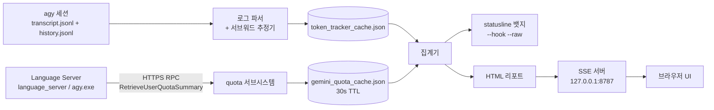

# ⚡ agy-pro

<div align="center">

**[English](README.md)** | **[한국어](README.ko.md)**

[](LICENSE)
[-brightgreen.svg)](#under-the-hood)
[](https://nodejs.org)
[-orange.svg)](#analytics)
[](#under-the-hood)
[](#under-the-hood)
[](#install)

**엔진 둘, 저장소 하나. `agy-tokens`는 매 턴의 비용을 알려주고, `agy pro`는 두 개 이상의 모델을 같은 `agy` 터미널 뒤에 세웁니다.**

</div>

---

<a id="toc"></a>

`agy-tokens`는 Antigravity CLI 로그와 로컬 Language Server를 읽어 토큰, 달러, 실제 5h/7d Gemini quota를 statusline과 브라우저 dashboard에 보여줍니다. `agy pro`는 실제 `agy` 바이너리를 감싼 Go shim입니다. 네이티브 Gemini와 Claude 좌석이 무료로 계획과 리뷰를 맡고, 외부 모델이 scope 안에서 실제 코드를 쓰며, 코딩 도어는 과금 write 전에 `y/N`을 묻습니다. 프리셋이 좌석을 정한 `agy pro fanout` 실행은 과금 좌석을 먼저 출력하고, 실행 여부는 호출 워크플로가 정합니다.

---

<a id="one-line"></a>

## ⚡ 원큐 설치

**Windows, 한 번에 (전체 도구: Node 분석 쪽과 Go shim):**

```cmd
cmd /c "git clone https://github.com/myk1yt/agy-pro.git && cd agy-pro && scripts\install.bat && install.cmd"
```

**Windows, PowerShell 5.1** (맨 `&&`을 받지 않으므로 같은 줄을 `cmd` 안에서 실행합니다):

```powershell
cmd /c "git clone https://github.com/myk1yt/agy-pro.git && cd agy-pro && scripts\install.bat && install.cmd"
```

**Linux / macOS** (Node 쪽입니다. Go shim은 `go build`로 빌드합니다. [브랜치](#branches) 참고):

```bash
git clone https://github.com/myk1yt/agy-pro.git && cd agy-pro && bash scripts/install.sh
```

설치가 끝나면 **새** 터미널을 열고(`PATH` 변경은 새 창에서 반영됩니다) `agy pro setup`을 실행하세요. 프로바이더, 모델, fanout 프리셋, 프롬프트, 언어를 다루는 전체 화면 허브입니다. 사전 요구사항은 [설치와 빠른 시작](#install)에 있습니다.

## 🧹 원큐 삭제

```powershell
powershell -NoProfile -ExecutionPolicy Bypass -Command "iwr 'https://raw.githubusercontent.com/myk1yt/agy-pro/main/agy-pro/scripts/uninstall.ps1' -OutFile '$env:TEMP\agy-pro-uninstall.ps1' -UseBasicParsing; & '$env:TEMP\agy-pro-uninstall.ps1'"
```

배포된 integration을 먼저 retract하고, 사용자 `PATH`에서 `~/.agy-pro/bin` 항목만 지우고, `~/.agy-pro`를 **휴지통**으로 옮깁니다. 플래그(`-KeepState`, `-DryRun`, `-RestorePath`) 설명은 [설치와 빠른 시작](#install)에 있습니다.

---

**목차:** [직접 느끼는 변화](#what-you-feel) · [`agy pro`에 들어 있는 것](#what-agy-pro-contains) · [코딩 도어](#coding-door) · [팬아웃 좌석 구성 고정](#fanout-seats) · [agy vs agy-pro](#difference) · [분석](#analytics) · [설치](#install) · [브랜치](#branches) · [내부 구조](#under-the-hood) · [안전](#safety) · [문서](#docs)

> [!NOTE]
> 토큰과 비용 숫자는 이 프로젝트 자체 tokenizer와 휴리스틱 추정 엔진이 로컬에서 계산합니다. 프로바이더 청구서가 아니라 추정치입니다.

---

<a id="what-you-feel"></a>

## 🎭 직접 느끼는 변화


터미널에서 바뀌는 것은 없습니다. `agy`는 여전히 `agy`입니다. 같은 TUI, 같은 키, 같은 종료 코드입니다. 요청이 커졌을 때 방 안에 누가 더 있는지가 달라집니다.

위쪽 레인에서는 모델 하나가 모든 것을 답합니다. `/model`은 한 세션에서 XOR이므로 네이티브 모델 **또는** 브리지 모델만 담고 둘 다 담지는 못합니다. 두뇌가 하나뿐이라 자기 답을 자기가 채점합니다. 아래쪽 레인에서는 같은 프롬프트가 Gemini master에 도착하고 master가 분배합니다. 구독에 포함된 무료 네이티브 좌석, 다른 모델 패밀리의 외부 프로바이더 좌석, 그리고 엔진이 먼저 snapshot을 뜬 scope 안에서만 과금 좌석이 쓸 수 있는 방어 경로입니다.

마찰이 없다고 느껴지는 이유는 이 경로들이 **슬래시 명령이 아니라 상시 지시**이기 때문입니다. `agy` 안의 master 에이전트가 워크스페이스 `AGENTS.md`에 라우팅 규칙을 들고 있으므로, 평범한 문장 하나로 발동합니다.

| 입력 (일반 채팅, 명령 아님) | 실행되는 것 |
|---|---|
| `review the auth flow across the repo` | 읽기 전용 `review` fanout. 서로 다른 모델 패밀리 좌석, severity가 붙은 reconciliation matrix 하나 |
| `audit this repo for leaked keys and OWASP issues` | 읽기 전용 `security` fanout, 같은 좌석 규칙 |
| `compare these two designs, which one breaks first?` | `research` fanout. 좌석들이 논쟁하고 master가 증거로 중재 |
| `audit my plan before I build it` | `plan-audit` fanout. 좌석이 모두 네이티브일 때만 추가 비용 `$0`이고, 프로바이더 좌석이 끼면 과금됩니다 |
| `fix the auth bug` | `agy pro code`: 무료 네이티브 plan, 그다음 scope 하나 안에서 과금 프로바이더 write, 엔진 검증, 트리를 되돌려야 하면 snapshot rollback |
| `just answer` / `no swarm` | 아무것도 fanout하지 않음. 단일 파일 수준의 질문은 바로 답변 |

한국어는 별도 모드가 아니라 같은 문장입니다. `"인증 버그 고쳐줘"`와 `"리뷰해줘"`가 동일한 경로를 발동합니다.

리뷰 좌석들은 서로를 보지 못합니다. 어떤 좌석도 다른 좌석의 프롬프트, 도구 출력, 가설을 받지 않습니다. 그래서 두 모델의 일치는 한 모델이 다른 모델을 따라 말한 것이 아니라, 정말로 둘이 같은 결론에 도달했다는 뜻입니다.

---

<a id="what-agy-pro-contains"></a>

## 🧩 `agy pro`에 들어 있는 것


동사 열네 개, 바이너리 하나. 나머지(`agy agents`, `agy -m ...`, `agy -p ...`)는 실제 바이너리로 그대로 전달됩니다. argv는 그대로 도착하지만 `-m` / `-m=`가 `--model` / `--model=`로 정규화되고, shim 자신의 플래그인 `--bridge` / `-b`는 전달되지 않고 소비되며, 자식 환경에 `AGY_PRO_ACTIVE=1`이 추가됩니다.

| 동사 | 하는 일 | 언제 쓰는가 |
|---|---|---|
| `setup` | 전체 화면 설정 TUI: 프로바이더, 모델, fanout 프리셋, 프롬프트, UI 언어. 고전 줄 단위 마법사는 `--wizard` | 첫 실행, 그리고 registry가 바뀔 때마다 |
| `mode` | 프로필을 `full`(full-stack 오케스트레이터)과 `clean` 사이에서 전환하거나 `restore` | 같은 바이너리, 다른 배포 내용 |
| `status` | 활성 모드, 등록된 프로바이더, 실제 `agy` 경로 | 뭔가 이상할 때 치는 명령 하나 |
| `models` | 설정된 프로바이더와 모델. `--all`은 네이티브와 외부를 합친 번호 목록을 더 보여줌 | 이름이 아니라 번호로 좌석을 고를 때 |
| `swarm` | 번호 기반 빌더: 템플릿과 좌석을 번호로 고르고, 좌석별 비용을 붙인 dry-run echo 뒤 실행 | 좌석 문법을 외우지 않고 하이브리드 스웜을 돌릴 때 |
| `settings` | 전체 화면 설정 패널, 그리고 `show` / `set` | JSON을 열지 않고 설정 하나를 바꿀 때 |
| `integrations` | 배포되는 다섯 기능(`statusline`, `hook`, `rules`, `plugins`, `skills`)을 위한 `status`, `apply`, `retract`, `preset`, `adopt`, `rollback`, `repair` | agy-pro가 디스크에 놓는 모든 파일의 단일 소유자 |
| `hybrid` | 네이티브 공존 프로필 (`on p1`, `on p2`, `off`, `status`, `check`) | 네이티브 설정과 agy-pro 설정을 나란히 둘 때 |
| `doctor` | 툴체인, 경로, 키. `--strict`, `--fix-keys`, `--rollback-keys` | 토큰을 쓰지 않는 업스트림 키 probe와 마스킹된 판정 |
| `fanout` | 멀티모델 스웜 엔진: `review`, `security`, `plan-audit`, `research`, `ideas`, `custom`, 그리고 파티션 모드(`--units`) | 다른 모든 멀티모델 표면 아래에 있는 엔진 |
| `code` | `plan`, `write`, `review`, `rollback`, `run` | 코딩 도어([다음 절](#coding-door)) |
| `config` | 영구 기본값: `default-profile`, `bridge-tools` | 시작 동작을 한 번만 정할 때 |
| `version` | agy-pro 버전과 그 아래 `agy` 버전 | 버그 리포트 |
| `help` | 사용법 텍스트, TUI 먼저 | 기능 탐색 |

쓰기를 하는 모든 동사(`config`, `mode`, `doctor --fix-keys`, 설정 허브의 프로바이더·모델 편집 각각, integration apply 각각)는 정확한 diff를 출력하고 `y/N`을 기다립니다. 스크립트 호출자는 `--yes`를 붙입니다. 답할 수 없는 입력은 추측하지 않고 거부합니다.

동사를 직접 치고 싶지 않다면, 나머지 런처 표면:

```bash
agy pro setup                            # 전체 화면 허브, 첫 실행에 권장
AGY_LAUNCHER=1 agy                       # 옵트인 2초 픽커: [1] 네이티브 Gemini [2] 외부 [3] 스웜
agy pro models --all                     # 번호 목록, 네이티브 행과 프로바이더 행
agy pro swarm                            # TTY에서 도는 번호 기반 빌더
agy pro code --help                      # 코딩 도어의 전체 표면
```

인자 없이 `AGY_LAUNCHER=1` 없이 실행한 `agy`는 기본 상태에서 추가 지연 0으로 네이티브 Gemini로 바로 갑니다. 옵트인 설정 세 가지가 이 실행 경로를 바꿉니다. 저장된 런처 토글을 켜면(`agy pro settings set launcher_menu on --yes`) 2초 픽커가 열리고, `gateway` 기본 프로필(`agy pro config default-profile gateway --yes`)은 브리지로 보내며, 활성 하이브리드 `p1`/`p2` 프로필은 해당 프로필의 front door를 씁니다. 환경 변수 `AGY_BRIDGE=1`도 브리지를 켭니다. 픽커는 인자 없는 `agy`에만 붙습니다. 인자가 하나라도 있으면 건너뜁니다.

---

<a id="coding-door"></a>

## 🛠 코딩 도어: `agy pro code`


여러 모델이 나눠 처리하는, 범위가 정해진 변경 하나를 위한 명령 하나입니다. 네이티브 좌석이 구독 안에서 plan과 review를 맡고(추가 비용 `$0`), 외부 프로바이더 좌석 하나가 scope 안의 파일을 씁니다(과금 API). 엔진이 첫 write 전에 트리 snapshot을 뜨고, 검증을 직접 실행하고, 범위가 정해진 repair를 한 번 허용하고, 트리를 바이트 단위로 되돌릴 수 있습니다.

```bash
# 1. plan만: 네이티브 좌석, 무료. 실행 디렉터리를 쓰고 멈춥니다.
agy pro code plan --ask-file q.txt

# 2. plan을 읽고, 범위가 정해진 scope 하나로 실행합니다.
#    --writer는 프로바이더 좌석이므로 이 단계는 과금이며 y/N을 묻습니다.
agy pro code run --ask-file q.txt --scope "internal/x" \
  --writer <provider/model> --verify "go build ./..." --yes

# 3. 검증이 실패했다면(exit 1), 리포트가 정확한 되돌리기 명령을 알려줍니다:
agy pro code rollback --run reports/code/<ts>
```

각 phase가 실제로 하는 일:

- **plan과 review는 네이티브 좌석에서 돌고 기본이 무료입니다.** 기본 라인업은 `native:gemini-3.8-flash-high,native:claude-sonnet-5-5-high`입니다. 네이티브만 쓰는 phase는 구독 외에 드는 비용이 없으므로 동의를 묻지 않습니다.
- **write phase는 과금이고 동의를 묻습니다.** writer는 프로바이더 좌석만 될 수 있습니다. 네이티브 좌석은 scope가 걸린 도구 러너를 만들지 않으므로, 이 동사는 실행 전 사용법 단계에서 네이티브 `--writer`를 거부합니다.
- **검증은 좌석이 아니라 엔진의 것입니다.** 컴파일 검사는 자동입니다(scope가 `go.mod` 아래 `.go` 파일을 가리키면 `go build` + `go vet`). 테스트 러너를 포함한 다른 검증기는 `--verify`로 직접 지정할 때만 실행됩니다.
- **실행 디렉터리가 감사 기록입니다.** `reports/code/<ts>/phases.log`(phase마다 한 줄), `report.txt`(리뷰가 읽는 변경 리포트), phase별 `summary.json` / `reconciliation.md` / `seat-*.md`, `verify/attempt-<attempt>-<index>.log`(시도마다 검증기 하나당 파일 하나. `<index>`는 그 시도 안에서 1부터 시작하는 명령 번호이고 명령 이름이 아닙니다), 그리고 snapshot 자체입니다.

`--dry-run`은 조합된 정확한 argv(fanout 호출, 모든 검증기, rollback 줄)를 출력하고 아무것도 띄우지 않은 채 exit 0으로 끝납니다. 토큰을 쓰기 전에 과금 실행을 미리 볼 수 있습니다.

### 안전 모델, 그대로 적으면

- **scope가 걸린 프로바이더 write.** write는 대상의 두 경로가 모두 unit의 scope glob 안에 있어야 합니다. 어휘적 루트 상대 경로 AND symlink를 해석한 실제 경로이고, 둘 중 하나라도 scope 밖이면 거부합니다(그래서 scope 안의 symlink가 scope 밖이지만 루트 안에 있는 파일을 가리켜도 scope를 세탁하지 못합니다). snapshot은 두 경로 중 하나라도 scope 안이면 그 파일을 자기 것으로 기록하므로, rollback 집합은 쓸 수 있는 집합의 상위 집합입니다. 좌석이 쓸 수 없었던 파일을 복원하는 쪽은 될 수 있어도 그 반대는 아닙니다.
- **거버넌스 파일은 모든 좌석 write를 거부합니다.** `AGENTS.md`, `gemini.md`, `claude.md`, `providers.json`과 그 형제 별칭들, `state.json`, `state-fanout.json`, `fanout-presets.json`, `integrations.json`, `settings.json`, 그리고 깊이와 무관하게 `rules/`, `.agy-pro/`, `.gemini/` 디렉터리 구성 요소입니다. `.git/**`는 snapshot 시점에 거부됩니다. 검사는 해석된 디렉터리 체인을 따라가므로 symlink로 거버넌스 경로를 세탁할 수 없고, Windows에서는 Win32 표준 이름으로 비교하므로 `AGENTS.md.`와 `AGENTS.md:stream`도 거부됩니다.
- **rollback은 삭제하지도, git을 실행하지도 않습니다.** snapshot은 바이트 복사본입니다(`manifest.json` 더하기 `snapshot/<relpath>`). rollback은 제자리에서 복원하고, 실행이 만들어낸 파일은 `<out>/rollback-archive/`로 옮깁니다. 잠긴 파일은 있던 자리에 그대로 두고 `rollback.json`에 이름을 남깁니다. 이 경로 어디에서도 `git`을 호출하거나 import하거나 파싱하지 않습니다.
- **원장은 자기 실행에 묶여 있습니다.** 모든 `manifest.json`은 `manifest.sig`를 함께 가지며, 이는 실행별 키로 manifest 바이트에 계산한 HMAC-SHA256입니다. 그 키는 모든 작업 루트 밖에 보관합니다. 손으로 고치거나 위조한 원장은 바이트 하나가 쓰이기 전에 통째로 거부됩니다.
- **비용 규칙은 하나입니다. 먼저 echo, 그다음 승인.** 과금 좌석은 모두 마스킹된 echo에 이름이 나오고, 그 echo는 상한이 없다고 분명히 적고, `y/N`이나 `--yes` 없이는 아무것도 실행되지 않습니다.
- **일부만 실패한 좌석은 `degraded`로 적고 `ok`로 적지 않습니다.** 이 도어는 엔진 자신의 좌석별 행을 다시 읽습니다. 일부 좌석이 실패하고 나머지가 결과를 냈다면 그 phase는 `degraded`이고, 리포트는 그 사실을 세 가지 방식으로 적습니다. 모든 좌석이 실패하면 exit 1입니다.
- **솔직한 단서: 네이티브 좌석은 측정 대상이지 격리 대상이 아닙니다.** 네이티브 좌석은 자체 도구 표면을 가진 진짜 `agy` 서브프로세스이므로 plan이나 review 좌석도 쓸 수 있습니다. `--scope`가 있는 실행(뒤에 write가 올 수 있는 실행)만 snapshot을 뜨고, 그 snapshot은 plan phase 전에 뜹니다. 단독 `code plan`이나 `--scope` 없는 `run`은 기준선을 남기지 않으므로, 그런 실행에서 네이티브 좌석이 고친 내용은 측정되지도 복원되지도 않습니다. snapshot이 있는 실행에서는 네이티브 phase가 끝날 때마다 scope를 다시 훑고 그 차이를 `native-drift`로 보고합니다(거버넌스 파일이면 `governance-drift`도). 소유하지 않은 sandbox를 주장하는 대신 실제로 일어난 일을 적습니다.

형용사 없이 적는 비용 사실: 이 도어 어디에도 토큰이나 달러 상한은 없습니다. 실행을 묶는 것은 엔진의 좌석별 반복 한도와 실제 시간(wall clock)이고, 리포트는 엔진의 `summary.json`이 토큰 수를 담고 있을 때만 그 수치를 출력합니다. 예산 미터는 앞으로의 결정 사항이지, 이미 출시된 기능이 아닙니다.

---

<a id="fanout-seats"></a>

## 🎯 팬아웃 좌석 구성을 고정하기

자동 스웜 실행은 등록된 프로바이더 모델에서 좌석을 스스로 고르고, 모델 패밀리를 돌아가며 씁니다. 네이티브 좌석은 이 엔진 경로에서 나오지 않습니다. 명시적인 `native:<id>` 지정이나 프리셋의 `seats` 고정으로만 좌석 구성에 들어옵니다(네이티브 우선 폴백 라인업은 워크스페이스 `AGENTS.md`에 있는 오케스트레이션 에이전트의 상시 규칙이지 엔진 동작이 아닙니다). 한 번 정해 두려면 행 [1] `(built-in defaults)`를 직접 편집하거나 별도 프리셋을 기본값으로 지정하세요. `--seats`, `--preset`, `AGY_PRO_FANOUT_PRESET`, 저장된 `default_preset` 키 중 어느 것도 없는 `agy pro fanout`은 행 [1]에 저장된 레코드가 있으면 그것을 쓰고, 없으면 위의 엔진 자동 선택으로 내려갑니다. 명시적으로 고른 좌석이나 이름을 댄 프리셋이 항상 먼저입니다.

1. 터미널에 `agy pro setup`을 입력하고 Enter를 누릅니다. 전체 화면 설정 허브가 열립니다.
2. 목록 둘째 줄 `팬아웃 프리셋`으로 이동해 Enter를 누릅니다.
3. 행 [1] `(built-in defaults)`에서 Enter를 눌러 바로 편집합니다. 별도 프리셋을 쓰려면 `새 프리셋`을 눌러 만들거나 기존 프리셋을 편집합니다. `(built-in defaults)`라는 이름은 행 [1] 전용이라 다른 프리셋에는 쓸 수 없습니다.
4. 편집기에서 좌석 구역으로 내려가 `+ 좌석 추가`를 누릅니다. `좌석에 쓸 모델 고르기` 창이 열리면 숫자 키나 화살표로 모델을 고르고 Enter를 누릅니다. 좌석 하나가 추가됩니다. 두 번째, 세 번째 좌석도 같은 방법으로 넣습니다. 모든 좌석 줄은 선택되면 `[x] `, 선택되지 않으면 `[ ] `로 시작합니다. Enter는 좌석 줄을 선택하고, Space는 선택하거나 선택을 해제합니다. 순서를 바꾸거나 지우려면 좌석 줄을 선택한 뒤 `▲ 좌석 위로` / `▼ 좌석 아래로` 또는 `✕ 좌석 삭제`를 누릅니다. 좌석 줄을 하나도 남기지 않으면 화면에 자동 선택 상태라는 안내가 보이고, 그 경우 엔진이 등록된 프로바이더 모델에서 좌석을 자동으로 고릅니다.
5. `Ctrl+S`로 저장하고 오른쪽 화살표로 편집기를 닫습니다. 별도 프리셋이면 목록에서 그 프리셋 줄로 커서를 옮기면 앞에 `●` 표시가 붙고(그게 "선택됨"이라는 뜻입니다), 목록 맨 아래 `기본값으로 설정` 줄에서 Enter를 눌러 표시되는 diff를 승인합니다(아직 `default_preset` 키가 없으면 `+` 한 줄, 기존 키를 바꾸면 `-old` / `+new` 두 줄). 행 [1]의 `기본값으로 설정`은 시드 레코드가 저장된 뒤에는 허용되지만 중복 동작이고, 행 [1]을 한 번도 저장하지 않았으면 `먼저 프리셋 행을 선택하세요.`로 거부됩니다. `Ctrl+A`는 보이는 기본값을 새 프리셋으로 복사하고, `삭제` 동작 행은 확인을 거쳐 행 [1]을 엔진 기본값으로 초기화합니다.
6. 저장된 좌석 구성이 있는 행에는 `좌석 고정: 3개` 같은 메모가 보입니다.

프리셋 목록에서 `d`나 `D`를 입력하면 콘솔 직접 입력과 라인 모드 모두에서 고정된 현재 선택에 같은 동작을 적용합니다. 행 [1]은 초기화 확인 창, 일반 프리셋 행은 삭제 확인 창이 열리고, 선택이 없으면 `먼저 프리셋 행을 선택하세요.`라는 안내가 나옵니다.

비워 둔 필드는 각각 엔진 기본값을 그대로 따르고, 직접 설정한 필드만 고정됩니다. 건드리지 않은 설정은 전과 같이 동작합니다.

어떤 좌석이 이기는지(위가 강함): 직접 지정한 좌석(`--seats`, 채팅에서 부른 좌석, 스웜 빌더에서 고른 좌석) 또는 `--preset` / `AGY_PRO_FANOUT_PRESET`로 이름을 댄 프리셋 > `default_preset` 키가 가리키는 프리셋 > 행 [1]에 저장된 레코드 > 엔진의 자동 선택(등록된 프로바이더 모델만, 패밀리를 돌아가며 선택. `native:<id>` 좌석은 직접 지정하거나 프리셋에 고정해야만 좌석 구성에 존재합니다). `providers.json`의 `defaults` 블록은 좌석 사다리의 단계가 아닙니다. 이 블록은 `n`, `timeoutSeconds`, `maxTurns`, `tools`, `tokenBudget` 같은 필드별 값과 제외 필터만 공급합니다. 고정 좌석은 아무도 좌석을 부르지 않았을 때만 채워집니다. 즉 좌석을 넘기지 않은 `agy pro fanout` 실행과, 그래서 `--seats`가 없어도 되는 `agy pro swarm` 실행이 그 대상입니다.

고정해 둔 모델이 프로바이더 목록에서 사라져도, 그 프리셋이 기본값일 때는 실행이 죽지 않습니다(단, 고정한 좌석이 전부 사라졌다면 실행은 프리셋 이름을 대는 오류 한 번으로 멈춥니다. 실행할 좌석이 하나도 없기 때문입니다). 그 좌석만 경고 한 줄과 함께 건너뛰고 나머지 좌석으로 끝까지 갑니다. 결과 파일 `summary.json`에 `skipped_seats`(건너뛴 좌석 수)와 `degraded: true`가 적히고, `seat_lineup`이 어느 프리셋의 어느 선택 경로로 온 좌석인지 적으므로 "전 좌석 성공"으로 읽히지 않습니다. 반대로 내가 직접 `--seats`로 부른 모델이 사라졌다면 그건 오류입니다. 그 실행을 위해 내가 이름을 댄 좌석이기 때문입니다. 한 번만 이름을 대는 `--preset`이나 `AGY_PRO_FANOUT_PRESET`도 같은 이유로 오류 쪽입니다(그건 저장해 둔 기본값이 아니라 그 실행만의 선택입니다). 네이티브 좌석 ID는 레지스트리 대조 대상이 아니므로, 없는 `native:<id>`는 건너뛰지 않고 그대로 실행되다가 실패하며 실행은 저하됨(degraded)으로 끝납니다.

비용: 기본값으로 저장한 프리셋의 좌석 안에 있는 프로바이더 좌석은 이미 내가 승인해 둔 선택으로 봅니다. 그래서 돈을 쓰기 전에 같은 질문을 다시 하지 않습니다. 대신 실행은 언제나 먼저 한 줄을 찍습니다: `fanout: seat lineup from preset "<이름>" (<경로> rung): N seat(s), M metered provider seat(s) (<좌석>)`. 저장소에 `default_preset` 키가 없어 행 [1]의 시드가 적용되면 경로는 `(default_preset rung, no key set)`이며, 실제 출력은 `fanout: seat lineup from preset "(built-in defaults)" (default_preset rung, no key set): 1 seat(s), 0 metered provider seats (native:no-key)`입니다. 저장소 키가 있는 기본 프리셋은 접미사 없이 `(default_preset rung)`를 유지합니다. 이 줄은 기본값 프리셋에서는 알림이고, 그 실행에서만 이름을 댄 프리셋에서는 지출 전에 읽어야 하는 문장입니다. `fanout-presets.json`을 손으로 고친 경우는 승인으로 보지 않습니다(그 좌석에 `seats_sha256` 표식이 없거나, 표식이 실제 좌석 값과 다르면 실행이 알림 한 줄로 그 사실을 밝힙니다. 알림일 뿐 실행을 막지 않고, 그 프리셋의 좌석이 이번 실행에 실제로 쓰일 때만 나옵니다. `--seats` 또는 `--units` 실행에서는 나오지 않습니다). 편집기로 행 [1]을 저장하면 값을 고쳤는지와 상관없이 표식이 갱신되고 안내가 사라집니다. 다른 프리셋을 저장하면 행 [1]의 표식이 바뀌지 않으므로 손으로 심어 둔 좌석 구성은 계속 드러납니다. 표식이 없거나 다르면 알림일 뿐이며 실행도 저장도 편집도 막지 않고, 값과 맞게 직접 붙여 넣은 표식은 표식 자체가 밝혀진 증거라 조용한 것이 원래 설계입니다. 그 안내는 그 좌석 구성이 이번 실행에 실제로 쓰일 때만 나옵니다.

---

<a id="operating-guide"></a>

## 🧭 실제 사용 안내: 설정부터 매일 쓰는 흐름까지

전체 플래그 설명은 [`manual.txt`](manual.txt)(영어)와 [`MANUAL.ko.md`](MANUAL.ko.md)(한국어)에 있습니다. 여기서는 현재 바이너리에 있는 모든 기능군을 작업 순서대로 짚습니다. 앞으로 만들 기능이 아니라 지금 실행되는 명령만 적습니다.

### 설정 허브, 프로바이더, 모델, 설정

Windows 콘솔에서 `agy pro setup`을 실행합니다. stdin과 stdout이 모두 콘솔이어야 전체 화면 UI가 열립니다. 파이프, CI, non-Windows TTY, mintty는 영어 줄 마법사로 바뀝니다. `agy pro setup --wizard`는 그 마법사를 강제하고, `--yes`는 비대화형 쓰기 동의입니다. 모르는 setup 인자는 종료 코드 2입니다.

```text
                         agy pro setup
                              │
       ┌──────────────────────┼──────────────────────┐
       │                      │                      │
 [1] 프로바이더          [2] 팬아웃 프리셋         [3] 프롬프트
       │                      │                      │
 추가/편집/테스트,       [1] built-in defaults   작업별 문장과
 모델과 기능              별도 프리셋              네이티브 좌석 역할
       │                      │
       │                 Enter: 고른 행 편집
       │                 Ctrl+S: 저장
       │                 Ctrl+A: 행 [1]을 새 프리셋으로 복사
       │                 삭제 행: 확인 후 행 [1] 초기화
       │
 [4] 설정               [5] 진단                [6] 도움말 / 설명서
 [7] 언어               [8] 대시보드            [9] 통합
 [10] 종료
```

허브는 열 개 행을 `[1]`..`[10]`으로 표시하고 마지막 행의 이름은 `종료(Quit)`입니다. 숫자 1-9는 행을 바로 고르고, 10번 행은 화살표+Enter 또는 `0`으로 시작하는 다자릿수 조합(`0`, `1`, `0`)으로 갑니다. 편집기에서는 Tab이 구역을 바꾸고, Ctrl+S가 저장하고, 오른쪽 화살표는 프리셋 편집기를 닫습니다(프로바이더·모델·프롬프트 편집기에서는 Esc가 닫기 키입니다). 저장하지 않은 상태에서 Esc를 누르면 버릴지 묻습니다. 프리셋 편집기에서 task 칸의 Enter는 작업 선택 창을 엽니다. 좌석 행은 선택되면 `[x] `, 선택되지 않으면 `[ ] `로 시작합니다. Enter는 좌석 행을 선택하고, Space는 선택하거나 선택을 해제합니다. Delete는 지우고, 네 동작 행으로 추가·이동·삭제합니다.

프로바이더 레지스트리는 `~/.agy-pro/providers.json`입니다. 주소와 환경 변수 **이름**을 저장하고 키 값은 저장하지 않습니다. 프로바이더와 모델 쓰기는 정확한 diff를 보여 주고 `y/N`을 기다립니다. 비대화형 호출은 그 diff를 검토한 뒤 `--yes`를 붙여야 합니다.

```json
{
  "providers": [
    {
      "name": "acme",
      "baseURL": "https://api.example.com/v1",
      "apiKeyEnv": "ACME_API_KEY",
      "models": [
        {
          "id": "fast-reasoner",
          "family": "reasoner",
          "contextLength": 200000,
          "maxOutputTokens": 32768,
          "capabilities": {
            "supportsTools": true,
            "supportsThinking": true,
            "reasoningEffort": "high",
            "supportsVision": true,
            "allowedTools": ["read_file", "list_dir", "grep", "glob"]
          }
        }
      ]
    }
  ]
}
```

일반 편집은 허브가 편합니다. 검토한 자동화에는 CLI도 있습니다.

```bash
agy pro settings providers list
agy pro settings providers add-json provider.json --yes
agy pro settings providers test acme
agy pro settings providers model-add-json acme model.json --yes
agy pro settings providers model-update acme fast-reasoner model.json --yes
agy pro settings providers model-delete acme fast-reasoner --yes
```

추론 강도는 `default`, `none`, `low`, `medium`, `high`, `xhigh`, `max` 중 하나입니다. 비우면 런타임 기본값입니다. 도구 허용 목록을 비우면 도구 차단이 아니라 모든 도구 허용으로 읽히고, 이것을 막는 곳은 허브 편집기뿐입니다. 모델 폼과 모델 목록의 도구 오버레이는 마지막 허용 항목을 지우는 것을 거부하지만, 줄 마법사와 `model-add-json` / `model-update`는 빈 목록을 그대로 저장하며 런타임에서는 모든 도구가 허용됩니다. 도구 오버레이는 런타임이 실제로 제공하는 9개 도구 전체를 행 순서대로 보여줍니다: `read_file`, `list_dir`, `grep`, `glob`, `write_file`, `replace_in_file`, `run_command`, `search_web`, `read_url_content`. 앞의 일곱 개는 fanout `--tools` 토큰이 펼쳐지는 이름과 같고(`read` = `read_file,list_dir`, `search` = `grep,glob`, `write` = `write_file,replace_in_file`, `exec` = `run_command`), `search_web`과 `read_url_content`는 토큰이 없어 엔진이 실행마다(`--search-endpoint`, `--allow-host`) 제공하며, 러너의 모델 단위 필터는 좌석의 허용 목록에 그 이름이 있을 때만 호출을 통과시킵니다. 키처럼 생긴 값은 값 자체를 출력하지 않고 거부합니다.

`agy pro models`는 등록된 프로바이더를 보여줍니다. `agy pro models --all`은 스웜 빌더가 쓰는 네이티브+외부 번호 목록이고, `agy pro models --json`은 같은 항목을 JSON으로 냅니다. 키 환경 변수가 비어 있으면 표시되고, 제외 대상은 `excluded (exclusion list)`로 나타납니다. 사용자 소유 제외 목록은 **설정 허브 > 설정 > 모델 제외 목록**에서 고칩니다. 자동 배정과 페일오버는 이 행을 걸러뛰지만, 직접 고른 모델은 경고와 함께 실행됩니다.

기존 `agy pro settings` 패널은 아직 동작하지만 허브로 대체 예정(deprecated)입니다. 비대화형 명령은 계속 쓸 수 있습니다.

```bash
agy pro settings show [--json]
agy pro settings set native-seat-concurrency 4 --yes   # 허용 범위 1..8
agy pro settings set language ko --yes
agy pro settings set launcher_menu on --yes
agy pro settings --panel p4
```

`set` 키 전체는 `default-profile`, `bridge-tools`, `native-seat-concurrency`, `language`, `launcher_menu`, `integration-preset`, `integration-statusline`, `integration-hook`, `integration-rules`, `integration-plugins`, `integration-skills`입니다. 마지막 키가 스킬 토글이고 `manual.txt`에 설명되어 있습니다.

### 프롬프트, 런처, 브리지 도구

허브의 프롬프트 화면은 여섯 fanout 작업 프롬프트와 네이티브 좌석 서문을 고칩니다. 파일은 `~/.agy-pro/prompts/`에 있고, 파일이 없으면 내장 문장을 그대로 씁니다. `AGY_PRO_PROMPTS_DIR`은 디렉터리를 바꾸고, `AGY_PRO_SEAT_PREAMBLE`은 좌석 서문만 바꿉니다. 재정의 파일이 비어 있으면 빈 프롬프트로 진행하지 않고 오류로 처리합니다.

인자 없는 `agy`는 `AGY_LAUNCHER=1`이거나 저장된 런처 토글이 켜져 있을 때만 2초 런처를 엽니다. 인자가 있거나, stdin이 파이프이거나, `-p`/`--print`이거나, `AGY_LAUNCHER=0`이면 걸러뜁니다. 선택지는 네이티브, 외부 모델 목록, 스웜입니다. 세션 안 `/model` 선택기는 여전히 네이티브 XOR 브리지입니다.

```bash
agy pro config show
agy pro config default-profile native --yes    # prompt | native | gateway
agy pro config bridge-tools read,search --yes
agy pro config bridge-tools read,search,write --yes
agy pro config bridge-tools none --yes
```

토큰과 실제 도구 연결은 `read` = `read_file,list_dir`, `search` = `grep,glob`, `write` = `write_file,replace_in_file`, `exec` = `run_command`입니다. `AGY_PRO_BRIDGE_TOOLS`가 저장값보다 우선합니다. 고정 예산은 반복 8회, 전체 240초, 업스트림 턴당 60초, 도구당 30초, 턴당 도구 호출 16회입니다. `write`와 `exec`는 실제 컴퓨터를 바꾸므로 리뷰 작업에서는 꺼 두세요.

### 팬아웃: 독립 좌석과 종합 결과

여러 모델이 같은 질문을 서로 보지 않고 검토하게 할 때 씁니다. 프로바이더 좌석은 과금 API를 부르고, 네이티브 좌석은 실제 `agy` 서브프로세스로 Antigravity 구독 쿼터를 씁니다. `--tools`는 프로바이더 좌석만 제한하고, 네이티브 좌석은 agy 자체 도구 표면을 유지합니다.

```bash
agy pro fanout --task review --n 3 --prompt-file review-request.txt \
  --root . --tools read,search --timeout 900 --max-native 3

agy pro fanout --task security \
  --seats "native:gemini-3.8-flash-high,acme/fast-reasoner" \
  --prompt-file security-request.txt --tools read,search
```

```text
설정 해석 -> 좌석 해석 -> 좌석 병렬 실행
       │             │
       │             ├─ 프로바이더는 가능하면 페일오버
       │             └─ 네이티브 실패는 기록, 다른 모델로 대체하지 않음
       ▼
좌석 리포트 + summary.json -> findings 파서 -> reconciliation matrix
```

| 플래그 | 뜻과 예외 동작 |
|---|---|
| `--task` | `review`, `security`, `plan-audit`, `research`, `ideas`, `custom`. 기본 `review` |
| `--prompt`, `--prompt-file` | 직접 문장 또는 파일. 파일 `-`는 stdin |
| `--n` | 자동 좌석 수, 기본 3. 좌석 목록이나 계획 파일이 있으면 그 수가 실제 좌석 수 |
| `--seats` | `native:<id>`와 `provider/model`. `model` 단독도 허용 |
| `--max-native` | 동시 네이티브 좌석, 1..8로 제한. 0이면 state.json, 다시 기본 1 |
| `--root` | 도구 작업 공간, 기본 `.` |
| `--tools` | `read,search,write,exec` 닫힌 집합. 기본 `read,search` |
| `--max-turns` | 프로바이더 도구 루프 상한, 기본 500 |
| `--timeout` | 초, 기본 300. 파티션은 300 + 유닛당 120, 최대 3600 |
| `--out` | 산출물 폴터, 기본 `./reports/fanout/<ts>` |
| `--json` | stdout에 요약 JSON 하나. 진행 줄은 stderr로 이동 |
| `--preset` | 이름 있는 fanout 프리셋. 아래 사다리 참조 |
| `--allow-host` | `read_url_content`용 호스트/IP, 반복 가능. 스킴·와일드카드·경로 불가 |
| `--search-endpoint` | `{query}`가 있는 검색 URL. HTTPS, 루프백만 HTTP 허용. 비우면 `--search-native=off`가 아닌 한 네이티브 폴백 사용 |
| `--search-key-env` | 검색 키 값이 아니라 그 값을 담은 환경 변수 **이름**. 엔드포인트 없이 이름만 있어도 네이티브 폴백 사용 |
| `--search-native` | 기본 `auto`는 엔드포인트가 빈 검색마다 네이티브 agy 1턴을 실행. `off`는 기존의 검색 없음 동작 유지 |
| `--setup`, `--yes` | 프로바이더 마법사. `--yes`는 `--setup`과만 사용 |

프로바이더 좌석에서 `search_endpoint`를 설정하면 기존의 명시 HTTP 동작을 유지합니다. 이 값을 비우는 것은 더 이상 "웹 검색 없음"을 뜻하지 않습니다. 기본값 `--search-native=auto`이고 실제 agy를 찾을 수 있으면, 엔진이 `search_web`을 제공하고 검색할 때마다 헤드리스 실제 agy 1턴을 실행해 Antigravity 구독 쿼터를 씁니다. `search_key_env`만 있어도 명시 모드로 바뀌지 않습니다. `--search-native=off`이거나 agy 폴백을 쓸 수 없으면 기존의 검색 없음 동작을 유지합니다. 네이티브 폴백 체인은 실제 검색이 아니라 스텁 agy 실행 파일로 검증했습니다.

네이티브 검색 자식은 기본적으로 제한된 agy 에이전트로 실행됩니다. 배포된 `agypro-search` 에셋(`~/.gemini/config/agents/agypro-search/AGENT.md`, 리포 사본에서 배포)은 웹 도구 두 개(`search_web`, `read_url_content`)만 선언하므로, 자식에게 파일·셸·서브에이전트 도구가 없습니다. 설치 스크립트(`install.ps1` 4/6단계)가 이 에셋을 배포하고 두 내장 프로필이 모두 이 에셋을 담고 있어서, `agy pro mode` 프로필 전환으로 이 경로가 사라지지 않습니다. 에셋이 없거나 agy가 그 이름을 목록에 올리지 않으면, 자식은 자체 도구 표면을 가진 완전한 agy 에이전트로 폴백하고 제한은 검색 프롬프트뿐이며, 실행 줄이 그 사실을 알립니다. 어느 경로든 자식은 실행의 `--allow-host` 목록이나 좌석의 읽기 전용 도구 집합에 묶이지 않고, 검색 프롬프트가 웹 검색과 URL 읽기만 쓰도록 요청합니다.

실제 fanout CLI 실행은 좌석을 시작하기 전에 결정된 검색 경로를 항상 공개합니다. 단계 라벨은 `flag`, `engine`, `preset`이고, `restricted child` 조항이 기본 배포 경로이며 `full agy agent child`는 폴백에서만 나옵니다.

```text
fanout[flag] search=endpoint(api.example.com)
fanout[engine] search=agy-native (restricted child; subscription per search)
fanout[flag] search=agy-native (full agy agent child; subscription per search)
fanout[flag] search=off
```

대신 직접 검색 API를 연결할 수 있습니다. `--search-endpoint`는 `{query}`를 정확히 하나 담은 URL 템플릿을 받고, `--search-key-env`는 키를 담은 환경 변수 **이름**을 받습니다(값은 호출 시점에 읽고 저장하지 않습니다). 엔드포인트를 비우면 위의 네이티브 헤드리스 agy 폴백이 경로가 되고, `--search-native=off`는 검색을 완전히 끕니다.

터미널 출력 필드 배치는 다음과 같습니다. 실제 실행을 꾸며낸 기록이 아니라 출력 모양 설명입니다.

```text
Task:                  <작업>
Seats Evaluated:       <완료> / <요청>
Degraded Mode:         <true|false>
Confirmed Issues:      <개수>
Disputed Issues:       <개수>
Artifacts Generated:
  Reconciliation:      <출력>/reconciliation.md
  Machine Summary:     <출력>/summary.json
```

두 좌석이 같은 발견을 보고하면 `CONFIRMED`입니다. 한 좌석만 `BLOCKER`나 `HIGH`를 보고하면 `DISPUTED`이고 master가 판정해야 합니다. 한 좌석의 `MEDIUM`, `LOW`, `INFO`는 `OBSERVATION`입니다. 성공했지만 발견이 없는 좌석은 `thin`으로 합의 분모에서 빠집니다. 좌석이 걸러뛰거나 실패하면 `degraded`이고, 깨끗한 "all findings verified" 문구를 쓰지 않습니다.

산출물은 소유자만 읽는 `summary.json`, `reconciliation.md`, `progress.log`, `seat-*.md`입니다. 워크스페이스와 모델이 만든 비신뢰 텍스트가 들어 있으므로 지시가 아니라 증거로 읽어야 합니다.

서로 겹치지 않는 작업은 파티션 모드로 나눕니다.

```json
[
  {
    "id": "auth",
    "title": "인증 검토",
    "scope": ["internal/auth/*.go"],
    "deliverable": "file:line 근거가 있는 발견",
    "seat": "acme/fast-reasoner"
  },
  {
    "id": "store",
    "title": "저장소 검토",
    "scope": ["internal/store/*.go"],
    "deliverable": "file:line 근거가 있는 발견"
  }
]
```

```bash
agy pro fanout --task review --units plan.json --root .
```

필수 필드는 `id`, `title`, `scope`, `deliverable`이고, `seat`, `body`, `write`는 선택입니다. 최대 64유닛입니다. 중복 ID, 루트 전체 scope, 발견 가능한 겹침은 거부합니다. 네이티브 서브프로세스는 쓸 수 없고 프로바이더 좌석만 씁니다. 전역 `--tools write/exec`는 거부되고, `"write": true`인 유닛만 범위가 정해진 쓰기를 받습니다. 결과는 `merged.md`와 `summary.json`의 `partition` 블록입니다. 충돌이나 병합 검증 실패는 실행을 실패시키지만 검사용 산출물은 남습니다.

### 프리셋과 값 결정 사다리

fanout 프리셋은 프롬프트가 아니라 실행 설정을 저장합니다. 13개 항목은 `task`, `n`, `timeout_seconds`, `tools`, `max_turns`, `max_native`, `allow_hosts`, `search_endpoint`, `search_key_env`, `out_dir`, `root`, `seats`, `json`입니다. 빈 칸은 화면의 기본값으로 굳지 않고 다음 단계로 넘어갑니다. 프리셋 편집기 B구역은 이제 `search_endpoint`, `search_key_env`, `out_dir`, `root`, `json`의 5행입니다.

```text
가장 강함
   │
   ├─ 명시한 CLI 값, 채팅 선택, 빌더 선택
   ├─ --preset 이름
   ├─ AGY_PRO_FANOUT_PRESET=이름
   ├─ fanout-presets.json의 default_preset 키
   ├─ 행 [1] (built-in defaults) 저장 레코드
   ├─ providers.json의 defaults 블록(필드별 값이며 좌석 구성이 아님)
   └─ 엔진 기본값 / 자동 프로바이더 선택(네이티브는 들어오지 않음)
가장 약함
```

`default_preset`이 설정됐지만 대상이 없으면 경고하고 행 [1]로 낮춰가지 않습니다. 명시한 프리셋이 없으면 종료 코드 2입니다. `max_native`만 예외적으로 플래그 > 프리셋 > state.json > 1 순서입니다. `seats`가 유일한 프리셋 좌석 출처이며, 빈 값이면 엔진이 자동 선택합니다. 예전 fanout `models` 필드와 플래그는 제거됐습니다. 저장된 프리셋 레코드에 예전 `models` 키가 있으면 레코드마다 advisory 한 줄을 출력하고 값은 무시하며, 그 값을 절대 출력하지 않습니다.

```text
warning: preset "legacy": the legacy models field is removed; use seats (ignoring the stored value)
```

좌석 출처에 따라 누락과 비용 동작이 다릅니다.

| 좌석 출처 | 프로바이더 좌석이 사라짐 | 과금 동작 |
|---|---|---|
| `--seats`, 채팅/빌더 직접 선택 | 오류로 중단 | 호출하는 에이전트가 실행 전 승인을 받아야 함 |
| `--preset`, `AGY_PRO_FANOUT_PRESET` | 오류로 중단 | 일회성 echo. 호출하는 에이전트가 승인을 받아야 함 |
| `default_preset`, 행 [1] 시드 | 경고 후 걸러뛰고 `degraded` | 저장된 상시 승인. 좌석 echo는 항상 출력 |
| 프리셋 좌석 없음 | 엔진이 등록된 프로바이더 모델에서 자동 선택(네이티브는 고르지 않음). 유효한 키가 없으면 오류 | 선택된 좌석과 호출 워크플로에 따름 |

fanout 바이너리 자체에는 일반 프로바이더 좌석용 `y/N` 관문이 없습니다. 승인은 이를 호출하는 에이전트, 스웜 플러그인, `agy pro code`가 담당합니다. 좌석 echo만으로 사용자가 승인했다고 읽으면 안 됩니다.

프리셋 선택 경로에서 나오는 실제 안내 문장입니다.

```text
fanout: tools="read,search,write", search_endpoint="https://search.example/{query}", search_key_env="P6_SEARCH_KEY", root="/workspace/review", out_dir="reports/review" (privilege/egress knobs: preset "(built-in defaults)")
fanout: tools="read,search,write", search_endpoint="https://search.example/{query}", search_key_env="P6_SEARCH_KEY", root="/workspace/review", out_dir="reports/review" (privilege/egress knobs: standing preset "(built-in defaults)")
fanout: notice: preset "(built-in defaults)" pins a seat lineup with NO provenance marker (hand-authored or pre-marker record); using it as the store default lineup anyway - advisory only, and a hand-authored pin is not standing approval
fanout: notice: preset "(built-in defaults)" seats were edited outside the preset editor (stored hash mismatch); using the on-disk lineup anyway - this is advisory, not a seal, and a hand-edited pin is not standing approval
warning: fanout-presets.json holds more than one record named "(built-in defaults)"; keeping the first and ignoring 1 later duplicate record(s)
```

이 문장들은 경고이지 실행 차단이 아닙니다. privilege/egress 줄은 실제 적용된 프리셋 값 `tools`, `search_endpoint`, `search_key_env`, `root`, `out_dir`만 나열합니다. 명시 플래그가 이기면 해당 항목은 빠집니다. 출처 advisory는 그 좌석을 실제 채택할 때만 나오고, `--seats`나 `--units`가 이기면 나오지 않습니다. 예약 이름 중복은 첫 레코드만 남깁니다.

프리셋 `root`와 `out_dir`은 절대 경로를 허용하지만, 어느 슬래시를 써도 완전한 `..` 구성 요소는 거부합니다. `..cache`나 `...`은 허용합니다. `(built-in defaults)`라는 이름은 일반 프리셋으로 만들거나 바꿀 수 없고, 행 [1]만 별도 시드 저장 경로를 씁니다.

### 스웜 빌더

TTY에서 `agy pro swarm`은 번호 기반 대화형 빌더입니다. 비대화형 플래그를 하나라도 주면 TTY에서도 질문이 없어집니다. 이때 `--template`은 필수이고, `--seats`는 상시 fanout 프리셋이 좌석을 줄 때만 생략할 수 있습니다.

```bash
agy pro swarm --template code-review --seats "1,3,5" --root . \
  --prompt-file review-request.txt --tools read,search --timeout 900 --dry-run

agy pro swarm --template security-audit \
  --seats "native:gemini-3.8-flash-high,acme/fast-reasoner" \
  --prompt-file security-request.txt --dry-run
```

템플릿은 `code-review`, `security-audit`, `custom`입니다. 좌석은 번호(`1,3,5`), 범위(`2-4`), `p1`..`p3`, 저장한 스웜 좌석 프리셋 이름, 명시 좌석 스펙으로 고릅니다. 저장 위치는 `~/.agy-pro/swarm-state.json`이며 fanout 프리셋과 다른 것입니다. `--task`와 `--tools`는 템플릿 기본값을 덮습니다. `--dry-run`은 조합된 fanout 명령만 출력하고 좌석 없이 종료 코드 0으로 끝납니다.

실제 dry-run 캡처입니다. 네이티브 좌석 하나를 지정했고 모델 호출은 없었습니다.

```console
$ agy pro swarm --template code-review --seats "native:gemini-3.8-flash-high" --root . --prompt-file README.md --tools read,search --timeout 300 --dry-run
agy pro fanout --task review --seats native:gemini-3.8-flash-high --root . --timeout 300 --tools read,search --prompt-file README.md --json
```

이 echo는 정보이지 붙여넣을 셸 명령이 아닙니다. 좌석 비용을 확인한 뒤 `agy pro swarm` 형태에서 `--dry-run`만 빼고 실행하세요.

### `agy pro code`: 계획, 범위 제한 쓰기, 검증, 리뷰, 복원

과금 writer가 시작하기 전에 쓸 파일을 한정할 수 있는 실제 변경에 씁니다. 먼저 계획을 읽고, 그 파일 목록에서 `--scope`를 정하세요. `--scope .`은 쓰지 마세요.

```bash
agy pro code plan --ask-file request.txt

agy pro code run --ask-file request.txt \
  --scope "internal/parser" --writer acme/fast-reasoner \
  --verify "go build ./..." --verify "go test ./internal/parser" --yes

agy pro code review --run reports/code/<ts>
agy pro code rollback --run reports/code/<ts>
```

```text
요청 -> 네이티브 계획 좌석 -> 사용자가 파일 범위를 정함
                         │
                         ▼
스냅샷 -> 프로바이더 쓰기 -> 엔진 검증 -> 기본 최대 1회 repair
                         │                     │
                         │                     └─ 실패: 종료 1 + rollback 안내
                         ▼
                 네이티브 리뷰 좌석 -> report.txt / JSON
```

| 옵션 | 적용 대상 | 뜻 |
|---|---|---|
| `--ask`, `--ask-file` | plan, write 조합, run | 요청 문장. 파일 `-`는 stdin. 둘 중 하나만 선택 |
| `--plan` | write, run | 기존 파티션 계획. run에서는 `--skip-plan`과 같음 |
| `--scope` | write, run | 반복 가능한 제한 경로/glob. 조합 write에 필수 |
| `--writer` | write, run | 정확히 프로바이더 좌석 하나. 네이티브 writer는 사용법 오류 2 |
| `--seats` | plan, review, run | 읽기 전용 좌석. run에서는 계획과 리뷰에 같이 적용 |
| `--verify` | write, run | 반복 가능한 argv 문자열. 모두 통과해야 함 |
| `--max-repairs` | write, run | 기본 1. 0이면 첫 검증 실패를 보고하고 중단 |
| `--run` | review, rollback | 기존 실행 폴터. 산출물의 유일한 출처 |
| `--skip-plan` | run | 계획 생략. scope가 없으면 사용법 오류 |
| `--root`, `--out`, `--timeout` | 전체 | 작업 공간, 실행 폴터, fanout 제한 시간 |
| `--json` | 전체 | stdout에 기계 판독 리포트 하나 |
| `--dry-run` | 전체 | 실제 명령만 출력, 아무것도 실행하지 않고 종료 0 |
| `--yes` | write/review/run, 과금 plan | echo 검토 후 동의. rollback은 받지만 무시 |

`--scope`가 없는 run은 계획 뒤에 멈추고 다음 명령을 안내합니다. 단독 `code write`는 `--plan`, 또는 `--ask` + `--scope` + `--writer`를 받습니다. review는 `report.txt`가 필요하고 rollback은 `manifest.json`과 `snapshot/`이 필요합니다. `--out`과 `--run`이 다르면 거부합니다.

자리 표시 프로바이더로 캡처한 실제 dry-run 발췌입니다. 타임스탬프와 마스킹된 scope도 실제 출력입니다.

```console
$ agy pro code run --ask "Add input validation to internal/example" --scope "internal/example" --writer acme/model --verify "go test ./internal/example" --dry-run
agy pro code plan: dry-run (nothing executed)
agy pro code write: 1 metered seat(s) - this run spends money
  seat 1  [provider]  acme/model  (metered API)
  note: no token/cost cap is enforced on this run
agy pro code write: dry-run (nothing executed)
  scope: inter****
  disclosure: verify executes commands over the working tree, which may include code created by the writer seat in this run
  budget: 1 verification command(s), 10m0s per command, 1800s for the whole run
  verify: go test ./internal/example
  rollback: agy pro code rollback --run reports\code\20261025-214149
agy pro code review: dry-run (nothing executed)
agy pro code: dry-run
files: none changed
artifacts: reports/code/20261025-214149
```

자동 검증은 컴파일만 합니다. `go.mod`가 있고 scope가 `.go` 파일을 가리키면 `go build`와 `go vet`을 찾습니다. 디렉터리 scope만으로는 찾지 않습니다. 테스트와 스크립트는 `--verify`로 명시할 때만 실행합니다. 명령 하나는 600초, 전체 검증은 1800초가 상한입니다. Go 명령에는 `GOPROXY=off`, `GOTOOLCHAIN=local`, `CGO_ENABLED=0`을 넣지만, 검증 프로그램 자체를 네트워크 샌드박스에 넣는 것은 아닙니다.

rollback은 기록된 바이트를 복원하고 실행이 만든 파일을 `rollback-archive/`로 옮깁니다. git은 실행하지 않습니다. 잠긴 파일은 `rollback.json`에 적습니다. 종료 코드는 성공과 degraded phase 0, 실행·검증 실패 1, 사용법·동의·scope 거부 2입니다.

### 하이브리드 P1/P2

하이브리드는 예전 gateway 브리지와 다릅니다. 등록한 외부 모델을 세션 하나에서 agy의 네이티브 모델 장치에 넣습니다.

| 프로필 | 언제 쓰는가 | 실제 경계 |
|---|---|---|
| `p1` | 외부 모델을 agy의 `/model` 목록에서 고르고 싶을 때 | `CLOUD_CODE_URL`의 `/v1internal` mesh. 이 경로는 subagent 생성 없음 |
| `p2` | subagent를 포함한 전체 도구가 필요할 때 | 세션별 app-data + `/v1beta` mesh. 실행할 때 외부 모델 선택. 세션 내 구독 Gemini는 꺼짐 |

```bash
agy pro hybrid on p1 --yes
agy pro hybrid status
agy pro hybrid check
agy pro hybrid off --yes
AGY_PRO_HYBRID=p2 agy       # 한 번만 오버라이드: 환경 변수 > 저장값
```

`on`과 `off`는 정확한 diff 동의 뒤 state를 씁니다. `status`는 저장값, 환경 변수, 실제 적용 프로필과 wirecheck를 보여줍니다. `check`는 적용 프로필이 NOGO이면 종료 코드 1입니다. `on`은 저장 전에 선택한 산출물을 검증합니다. P1과 P2를 한 세션에서 동시에 켤 수는 없습니다.

### 통합, 모드, 진단, 복구

integrations는 배포된 규칙, 스킬, 플러그인, 훅, `statusLine`을 관리합니다. `status`는 읽기 전용입니다. 다른 동사는 하나의 정확한 diff를 만들고 한 번만 묻습니다. 비대화형 쓰기는 `--yes`가 필요합니다.

```bash
agy pro integrations status
agy pro integrations apply tools --yes
agy pro integrations apply rules --yes
agy pro integrations retract plugins --yes
agy pro integrations preset native --yes
agy pro integrations adopt --yes
agy pro integrations rollback --yes          # settings.json 스냅샷
agy pro integrations rollback rules --yes   # 내용 트리 하나
agy pro integrations repair --yes
```

기능은 `statusline`, `hook`, `rules`, `plugins`, `skills`이고 프리셋은 `native`, `tools`입니다. `custom`은 조합 결과이지 인자가 아닙니다. `rollback statusline`은 종료 코드 2로 인자 없는 형태를 안내합니다. 프리셋 전체는 하나의 트리로 되돌릴 수 없습니다. 한 컴퓨터에서 integrations 명령은 한 번에 하나만 실행하세요. 동시 실행은 매니페스트를 직렬화하지 않습니다. foreign 파일은 건드리지 않고, repair는 기록된 drift와 누락만 맞춥니다.

`agy pro mode full|clean|restore`는 실행 바이너리가 아니라 배포 프로필을 바꿉니다. `mode list`/`backups`, `mode status`는 읽기 전용입니다. `mode restore`는 `agents`, `references`, `profile.json`, `config.json`만 담당하고 나머지 트리는 integrations가 담당합니다.

`agy pro doctor`는 실제 바이너리, 설치된 shim 경로, 상태, 프로바이더 키 probe, Go를 점검합니다. `--strict`는 구조 문제만 종료 코드 1로 만들고, 잘못되거나 없는 프로바이더 키는 실패로 세지 않습니다. Windows 키 이름 복구는 별도 명시 명령입니다.

```bash
agy pro doctor --strict
agy pro doctor --fix-keys=all --yes
agy pro doctor --rollback-keys <backup-dir> --yes
```

### 플러그인, 훅, 세션 내 명령

`agy pro integrations apply tools`가 번들 내용을 배포합니다. 로컬 플러그인을 직접 설치할 때는 `agy plugin install <경로>`를 쓰고, 새 명령을 찾도록 agy 세션을 다시 시작하세요.

| 표면 | 호출 | 용도 |
|---|---|---|
| `agypro_swarm` | `/agypro_swarm:swarm` | 에이전트 중개 번호 선택 스웜, dry-run과 비용 확인, 산출물 보고 |
| `agypro_settings` | `/setting_agypro` | 에이전트 중개 비대화형 설정 명령. 전체 화면 TUI가 아님 |
| `agy_help` | `/agy_help` 또는 `@agy_help` | Antigravity 생태계 참조와 읽기 전용 실행 환경 조사 |
| `code_reviewer` | `@code-reviewer` | 읽기 전용 병합 전 리뷰, 8개 분류와 P0-P3 게이트 |
| `security_reviewer` | `@security-reviewer` | 앱 취약점, 클라우드 IAM, 자격 증명, 공급망/MCP 검사관 4개 |
| `designer` | `@designer` | SVG, 인터랙티브 HTML, WebGL/GLSL, 시각 QA |
| `deep_investigator` | `@deep-investigator` | 읽기 전용 웹 조사와 시스템 검증 |

번들 `hooks/hooks.json`은 턴 뱃지를 위한 `PostInvocation` 명령 `agy-tokens --hook` 하나를 정의합니다. integrations가 쓰는 `statusLine` 명령은 `agy-tokens --hook --raw --write-dashboard`입니다. 둘은 integrations가 소유하는 설정이며, agy 바이너리의 플러그인 슬래시 명령과는 다른 표면입니다.

---

<a id="difference"></a>

## ⚖️ `agy` 단독 vs `agy` + agy-pro

| | `agy` 단독 | `agy` + agy-pro |
|---|---|---|
| **모델 선택** | `/model` 픽커는 XOR: 한 번에 한 패밀리, 네이티브 또는 브리지 | 모든 패밀리가 한 스웜에서 함께 동작. 네이티브 좌석과 프로바이더 좌석이 같은 실행에 |
| **코딩 손** | 네이티브 에이전트만 | 외부 프로바이더 모델이 범위가 정해진 scope 하나 안에서 실제 코드를 씀 |
| **아이디어 다양성** | 두뇌 하나, 계획 하나 | plan과 review 좌석이 병렬로 돌고 하나의 matrix로 조정됨 |
| **리뷰** | 자기 리뷰 | severity와 합의/불일치 구분이 있는 독립 멀티모델 fanout |
| **비용 가시성** | 없음 | 5h/7d quota 버킷 실시간, 매 턴 statusline, 실행별 좌석 사용량, 지출 전 마스킹 echo |
| **설정** | 파일 직접 편집 | 설정 허브 TUI, integration apply마다 동의 한 번 |
| **폴백** | 없음 | `mode clean` / `mode full`, `restore`, `doctor`, snapshot rollback, 좌석이 빠지면 `degraded` 상태 |

agy-pro가 바꾸지 않는 단 하나: 세션 안 `/model` 팝오버는 한 세션에 한 패밀리, 즉 네이티브 아니면 브리지로 그대로 XOR입니다. 합쳐진 목록은 한 계층 위에 있습니다(`agy pro models --all`, 런처 `[2]`, `agy pro swarm`).

---

<a id="analytics"></a>

## 📈 분석: statusline, quota, dashboard

`agy-tokens`는 `~/.gemini/antigravity-cli/settings.json`의 `statusLine` 항목 하나만 필요로 하고, Antigravity 자체는 바꾸지 않습니다. `agy pro integrations apply tools`가 그 항목을 쓰고(쓰기 전에 파일을 먼저 snapshot), `agy pro integrations status`가 아직 일치하는지 보여주며, `agy pro integrations rollback`이 snapshot을 복원합니다.

```text
⚡ Turn: 1.2k ($0.0002) | Today: 45.8k ($0.0068) | Cache: 82% | 5h: ▰▰▰▰▱ 79% (4h 10m) | 7d: ▰▱▱▱▱ 21% (3d 20h) | 📊 Dashboard
```

```text
⚡ 이번 턴: 1.2k (₩0) | 오늘 누적: 45.8k (₩10) | 캐시: 82% | 5h: ▰▰▰▰▱ 79% (4h 10m) | 7d: ▰▱▱▱▱ 21% (3d 20h) | 📊 대시보드
```

원화 금액은 1원 단위로 반올림하므로, 턴 비용이 작으면 `₩0`으로, 같은 날 누적은 `₩10`으로 보이는 것이 정상입니다.

**1:1 Gemini quota.** quota 서브시스템은 로컬 Antigravity Language Server에 HTTPS/HTTP RPC(`RetrieveUserQuotaSummary`)로 질의해 실제 롤링 버킷 두 개를 보여줍니다. **5시간(`5h`)** 버스트 윈도우와 **7일(`7d`)** 주간 허용량이고, 각각 실시간 카운트다운이 붙습니다. 응답은 `~/.gemini/gemini_quota_cache.json`에 30초 캐시되므로 statusline 조회는 1ms 미만으로 유지되고, 갱신이 턴을 막지 않습니다.

**`statusLine` 항목 자체.** 직접 연결하는 편이 나은 경우(컨테이너, 잠긴 `PATH`, 또는 엔진이 호출할 `agy`가 `PATH`에 없는 환경)에는 `~/.gemini/antigravity-cli/settings.json`에 이 블록을 넣으세요:

```json
{
  "statusLine": {
    "type": "command",
    "command": "agy-tokens --hook --raw --write-dashboard",
    "enabled": true,
    "stack_with_default": true
  }
}
```

직접 Node 경로 지정: `"command": "node /path/to/agy-pro/bin/agy-tokens.js --hook --raw --write-dashboard"`. Windows에서 서브프로세스가 `PATH`를 물려받지 못하면 8.3 축약 경로를 쓰고 모든 역슬래시를 이스케이프하세요:

```text
"command": "C:\\PROGRA~1\\nodejs\\node.exe %APPDATA%\\npm\\NODE_M~1\\AGY-TO~1\\bin\\AGY-TO~1.JS --hook --raw --write-dashboard"
```

**8787 포트의 실시간 dashboard.** 루프백 서버 하나, `/events`의 Server-Sent Events, 반응형 순수 SVG 차트입니다. 30일 토큰 볼륨은 모델별로 쌓은 막대이고(입력·캐시·출력은 차트 조각이 아니라 표의 열입니다), Y축은 동적으로 스케일되며, 인터랙티브 툴팁, 날짜 범위(오늘, 7d, 30d, 사용자 지정)와 모델 기준 필터, reasoning effort까지 포함한 턴별 모델 기여도를 제공합니다. 같은 페이지가 스크립트 태그 폴링으로 `file://`에서도 CORS 오류 없이 동작합니다.

```bash
agy-tokens --serve --open     # 127.0.0.1:8787에 SSE 서버를 열고 브라우저 실행
agy-tokens --html --open      # 스스로 갱신하는 정적 HTML 산출물
agy-tokens --sync-quota       # 실시간 quota 풀을 지금 갱신
```

**데이터 경로, 처음부터 끝까지.**



**모델과 가격 matrix.** 서브워드 토큰 단가, 프롬프트 캐시 할인, 공식 가격 변경 동기화 엔진:

| 모델 ID | 표시 이름 | 제공사 | 컨텍스트 | 입력 / 1M | 캐시 / 1M | 출력 / 1M |
| :--- | :--- | :--- | :--- | :--- | :--- | :--- |
| `gemini-3.8-flash` | **Gemini 3.8 Flash** | Google | 1M | $0.15 | $0.0375 | $0.60 |
| `gemini-3.8-flash-thinking` | **Gemini 3.8 Flash Thinking** | Google | 1M | $0.15 | $0.0375 | $0.60 |
| `gemini-3.7-flash` | **Gemini 3.7 Flash** | Google | 1M | $0.15 | $0.0375 | $0.60 |
| `gemini-3.0-pro` | **Gemini 3.0 Pro** | Google | 2M | $1.25 | $0.3125 | $5.00 |
| `gemini-2.5-pro` | **Gemini 2.5 Pro** | Google | 2M | $1.25 | $0.3125 | $5.00 |
| `gemini-2.0-flash` | **Gemini 2.0 Flash** | Google | 1M | $0.10 | $0.0250 | $0.40 |
| `claude-opus-5.5` | **Claude Opus 5.5** | Anthropic | 200k | $15.00 | $1.50 | $75.00 |
| `claude-sonnet-5.5` | **Claude Sonnet 5.5** | Anthropic | 200k | $3.00 | $0.30 | $15.00 |
| `claude-3.5-haiku` | **Claude 3.5 Haiku** | Anthropic | 200k | $0.80 | $0.08 | $4.00 |
| `gpt-4o` | **GPT-4o** | OpenAI | 128k | $2.50 | $1.25 | $10.00 |
| `o3-mini` | **o3-mini** | OpenAI | 200k | $1.10 | $0.55 | $4.40 |
| `o1` | **o1** | OpenAI | 200k | $15.00 | $7.50 | $60.00 |

```bash
agy-tokens --prices --currency krw    # 공식 카탈로그를 표로
agy-tokens --sync-prices              # 최신 공식 가격을 가져옴
agy-tokens --auto-sync                # 로컬 카탈로그가 24시간보다 오래되면 동기화
```

표에 없는 모델(신규 릴리스, 로컬 모델)은 `flash`, `pro`, `mini`, `free`, `local`에 대한 정규식 휴리스틱으로 요금 티어를 고릅니다.

**21개 언어, RTL 포함.** 로케일은 호스트(`LANG`, `LC_ALL`)에서 감지하고, HTML 리포트와 dashboard 출력은 아랍어와 히브리어에서 `dir="rtl"`로 바뀝니다(터미널 뱃지는 양방향 재배치 없이 논리 순서로 그립니다).

| 지역 | 언어 |
| :--- | :--- |
| 동아시아 | English (`en`), 한국어 (`ko`), 日本語 (`ja`), 简体中文 (`zh`), 繁體中文 (`zh-TW`) |
| 남아시아·동남아시아 | हिन्दी (`hi`), Tiếng Việt (`vi`), Bahasa Indonesia (`id`), ภาษาไทย (`th`) |
| 유럽 | Deutsch (`de`), Français (`fr`), Español (`es`), Português (`pt`), Italiano (`it`), Nederlands (`nl`), Polski (`pl`), Svenska (`sv`), Русский (`ru`), Türkçe (`tr`) |
| 중동 (RTL) | العربية (`ar`), עברית (`he`) |

`agy pro setup` 허브는 자체 12개 언어 UI를 제공하며, 아랍어는 터미널에 bidi 셰이핑이 없으므로 논리 순서까지만 정직하게 지원합니다.

### `agy-tokens` CLI, 짧은 목록

`agy-tokens`, `agy-tools`, `agy-dashboard`는 CLI 엔진과 옵션 표면을 공유합니다. 인자 없는 `agy-dashboard`는 `--serve`를 앞에 붙이고(`--open`/`--no-open`을 직접 주지 않으면 `--open`도), `agy-tools`는 같은 옵션 앞에 하위 명령 계층을 둡니다.

| 옵션 | 제공하는 것 |
| :--- | :--- |
| *(없음)*, `--today`, `-t` | 오늘 사용량 요약 |
| `--yesterday`, `-y` / `--7d` / `--30d` / `--all` / `--range YYYY-MM-DD..YYYY-MM-DD` | 그 밖의 다른 기간 |
| `--session [id]`, `-s` | 최근 또는 이름을 지정한 대화의 턴별 내역 |
| `--currency <usd\|krw\|jpy\|eur\|gbp>` / `--lang <code>` | 표시 통화와 UI 언어 |
| `--free`, `--no-cost` | 금액을 숨기고 토큰만 표시(정액제 모드) |
| `--json` | 스크립트용 원본 JSON |
| `--hook`, `--badge` / `--raw` | statusline 페이로드 / 원본 뱃지 문자열 |
| `--fresh`, `--no-cache` | 캐시를 건너뛰고 트랜스크립트를 다시 파싱 |
| `--prices`, `--sync-prices`, `--auto-sync` | 가격 카탈로그, 동기화, 자동 동기화 |
| `--sync-quota` | 실시간 Gemini quota 풀 갱신 |
| `--html`, `--dashboard` / `--serve [port]` / `--open` / `--refresh <sec>` / `--port <n>` | 정적 리포트 / SSE 서버(기본 `8787`, `0`이면 임의 포트) / 브라우저 열기 / 폴링 간격 |
| `--write-dashboard` / `--no-link` / `--no-color` | statusline 쓰기 쪽, OSC 8 링크 끄기, 색 끄기 |
| `--model <name>` / `--help`, `-h` / `--version`, `-v` | 단가 재정의, 도움말, 버전 |

---

<a id="install"></a>

## 🚀 설치와 빠른 시작

사전 요구사항: 분석 쪽을 위한 **Node.js 16+**([nodejs.org](https://nodejs.org)), **Antigravity CLI**(`agy`), shim을 위한 **Go 1.22+**(없으면 설치 프로그램이 준비합니다).

**Windows, 명령 프롬프트:**

```cmd
git clone https://github.com/myk1yt/agy-pro.git && cd agy-pro && scripts\install.bat
```

**Windows, PowerShell (5.1은 맨 `&&`을 받지 않으므로 `cmd /c`로 감쌉니다):**

```powershell
cmd /c "git clone https://github.com/myk1yt/agy-pro.git && cd agy-pro && scripts\install.bat"
```

**Linux / macOS:**

```bash
git clone https://github.com/myk1yt/agy-pro.git && cd agy-pro && bash scripts/install.sh
```

Node 설치 프로그램은 `npm link`로 전역 명령을 등록하고, `agy`가 `PATH`에서 잡히면 Antigravity 배포를 Go 엔진에 한 번에 넘깁니다(`agy pro integrations apply tools --yes`). `agy-tokens` 런처가 없으면 statusline 단계를 사유 한 줄과 함께 건너뛰고 그래도 exit 0으로 끝납니다. 나중에 `agy pro integrations repair`가 그 단계를 완료합니다.

**이제 shim을 추가합니다(git이 있든 없든 동작하는 한 줄):**

```powershell
powershell -NoProfile -ExecutionPolicy Bypass -Command "if (Get-Command git -ErrorAction SilentlyContinue) { cmd /c 'git clone -b main https://github.com/myk1yt/agy-pro.git && cd agy-pro && install.cmd' } else { iwr 'https://codeload.github.com/myk1yt/agy-pro/zip/refs/heads/main' -OutFile '$env:TEMP\agy-pro-src.zip' -UseBasicParsing; Expand-Archive -Path '$env:TEMP\agy-pro-src.zip' -DestinationPath '$env:TEMP\agy-pro-src' -Force; & (Resolve-Path '$env:TEMP\agy-pro-src\*\install.ps1').Path }"
```

설치 프로그램은 `agy.exe`를 `~/.agy-pro/bin/`에 빌드하고, 그 디렉터리를 사용자 `PATH` 앞에 붙이고, `agy pro doctor --strict`를 실행합니다(구조 문제가 있으면 크게 실패합니다). 설치 후 새 터미널을 열어야 `PATH` 변경이 반영됩니다.

**첫 실행:**

```bash
agy pro setup            # 전체 화면 허브: 프로바이더, 모델, fanout 프리셋, 프롬프트, 언어
agy                      # 네이티브 Gemini, 추가 지연 0
AGY_LAUNCHER=1 agy       # 옵트인: 2초 픽커 [1] 네이티브 [2] 외부 [3] 스웜
agy pro code --help      # 코딩 도어 전체를 한 화면에
agy pro status           # 활성 모드, 프로바이더, 실제 agy 경로
```

**npm 전역 사본 갱신(런타임은 클론이 아니라 전역 사본을 씁니다):**

```cmd
cd agy-pro
npm install -g .
```

`git pull`을 할 때마다 다시 실행하세요. `agy-tokens --version`과 `where agy-tokens`가 어느 사본이 살아 있는지 알려줍니다. `where`가 `AppData\Roaming\npm`을 가리키지 않으면 터미널을 다시 열고 재링크하세요.

**설치 제거, 한 줄:**

```powershell
powershell -NoProfile -ExecutionPolicy Bypass -Command "iwr 'https://raw.githubusercontent.com/myk1yt/agy-pro/main/agy-pro/scripts/uninstall.ps1' -OutFile '$env:TEMP\agy-pro-uninstall.ps1' -UseBasicParsing; & '$env:TEMP\agy-pro-uninstall.ps1'"
```

배포된 integration을 먼저 retract하고(`<AGY_PRO_HOME>/backups/<ts>_retract/`로 옮김), 사용자 `PATH`에서 `~/.agy-pro/bin` 항목만 지우고, `~/.agy-pro`를 **휴지통**으로 옮깁니다. `-KeepState`는 `providers.json`, `state.json`, `backups/`를 남기고(`bin/` shim 폴더만 휴지통으로 갑니다), `-DryRun`은 계획만 출력하며, `-RestorePath`는 설치 전에 저장한 `PATH`를 되돌립니다.

statusline 슬롯만 되돌리려면 `agy pro integrations retract --yes`가 `statusLine` 항목을 제거하고 덮어쓴 바이트를 보관합니다.

### 뭔가 이상해 보이면

| 증상 | 해결 |
|---|---|
| `agy`가 인식되지 않음 | Antigravity CLI를 설치한 뒤 **새** 터미널 창을 엽니다(새 창이 `PATH`를 다시 읽습니다) |
| PowerShell이 스크립트 실행이 비활성이라고 함 | 여기 적힌 그대로 `powershell -ExecutionPolicy Bypass -File scripts\...ps1`로 실행하세요 |
| 설치 직후 끊이지 않는 `TLS handshake` 출력 | 최신 `main`으로 갱신하세요(probe 쿨다운 가드가 있습니다). 또는 `agy pro integrations retract --yes`를 실행하세요 |
| 설정이 꼬임 | `agy pro doctor`, 그다음 `agy pro status`, 그다음 `agy pro integrations repair` |

---

<a id="branches"></a>

## 🧵 나머지 브랜치

추가 기능은 각자 자기 브랜치에 있으므로, `git clone -b <branch>`가 클론하는 동안 그 브랜치로 체크아웃합니다. 빠뜨릴 수 있는 수동 `git checkout` 단계가 남지 않습니다.

| 브랜치 | 추가하는 것 | 원큐 설치 (Windows PowerShell) |
|---|---|---|
| [`main`](https://github.com/myk1yt/agy-pro/tree/main) | 전부: 분석, dashboard, shim, 스웜, 코딩 도어 | `cmd /c "git clone https://github.com/myk1yt/agy-pro.git && cd agy-pro && scripts\install.bat && install.cmd"` |
| [`Agent/designer`](https://github.com/myk1yt/agy-pro/tree/Agent/designer) | `@designer`: MCP 없는 디자인 전문가(SVG, 3D 캔버스, 사이버펑크, 샌드박스, QA 하네스) | `cmd /c "git clone -b Agent/designer https://github.com/myk1yt/agy-pro.git && cd agy-pro && powershell -ExecutionPolicy Bypass -File scripts\install-designer.ps1"` |
| [`Agent/security-reviewer`](https://github.com/myk1yt/agy-pro/tree/Agent/security-reviewer) | `@security-reviewer`: 오케스트레이터 + 도메인 인스펙터 4개(OWASP, IAM, 자격 증명, 공급망) | `cmd /c "git clone -b Agent/security-reviewer https://github.com/myk1yt/agy-pro.git && cd agy-pro && powershell -ExecutionPolicy Bypass -File scripts\install-security-reviewer.ps1"` |
| [`Agent/code-reviewer`](https://github.com/myk1yt/agy-pro/tree/Agent/code-reviewer) | `@code-reviewer`: 병합 전 diff 리뷰, 8개 카테고리 택사노미, P0-P3 게이트 | `cmd /c "git clone -b Agent/code-reviewer https://github.com/myk1yt/agy-pro.git && cd agy-pro && powershell -ExecutionPolicy Bypass -File scripts\install-code-reviewer.ps1"` |
| [`gemini-config`](https://github.com/myk1yt/agy-pro/tree/gemini-config) | 거버넌스 규칙과 7단계 멀티 에이전트 라이프사이클, `~/.gemini`에 배포 | `cmd /c "git clone -b gemini-config https://github.com/myk1yt/agy-pro.git && cd agy-pro && scripts\install.bat"` |
| [`main`](https://github.com/myk1yt/agy-pro/tree/main) | 같은 트리; 원라이너는 Go shim만 설치합니다 | `cmd /c "git clone -b main https://github.com/myk1yt/agy-pro.git && cd agy-pro && install.cmd"` |

macOS와 Linux에서는 `bash scripts/install.sh`가 Node 쪽을 담당합니다. Go shim은 `go build`로 직접 빌드합니다(자세한 내용은 [한국어 설명서](MANUAL.ko.md)).

---

<a id="under-the-hood"></a>

## 🔧 내부 구조

**shim 하나, 추가 프로세스 하나, 패치된 바이너리 없음.**

```text
agy                  ->  실제 agy 바이너리, 이전과 완전히 동일
agy agents           ->  그대로 전달
agy -m "..."         ->  그대로 전달
agy pro <verb>       ->  agy-pro 자체 엔진
```

`agy pro`는 자기 동사 공간만 가로챕니다. shim이 정품 바이너리를 다시 구현하지 않고 exec하기 때문에 네이티브 TUI, stdio 핸들, 종료 코드는 그대로입니다. `AGY_LAUNCHER=1`은 인자 없는 `agy`에 2초 모델 픽커를 더할 뿐, 다른 것은 바뀌지 않습니다.

**양쪽 모두 의존성 0.**

- Go: `module agypro`, `go 1.22`, 표준 라이브러리만. `agy.exe` 바이너리 하나.
- Node: 표준 라이브러리만(`http`, `fs`, `path`, `net`, `child_process`), Node 16+. statusline 조회는 캐시 적중이고 다시 파싱하지 않습니다.

**MCP 없음, 상주 daemon 없음.** 오케스트레이션 경로 전체가 자식 프로세스를 띄우고 파일을 읽고 씁니다. dashboard를 열기 전까지 어떤 포트도 열리지 않고, 터미널을 닫으면 도는 것이 없습니다.

**테스트 기준선.** `go test ./...`가 Go 패키지 28개를 덮고, `npm test`가 JavaScript 테스트 309개를 실행합니다(실패 0). 이 두 명령이 모든 변경이 통과해야 하는 게이트입니다.

**산출물은 그냥 읽을 수 있는 파일입니다.**

```text
reports/fanout/<ts>/   summary.json, reconciliation.md, progress.log, seat-*.md
reports/code/<ts>/     phases.log, report.txt, plan/, write/, review/,
                       verify/attempt-*.log, manifest.json, snapshot/, rollback-archive/
~/.agy-pro/            providers.json, state.json, backups/, ledger-keys/
```

리포트나 콘솔로 흘러든 키 모양 값은 마스킹되어 표시되며, 뒤쪽 일부를 노출하는 일은 없습니다. 마스킹 권한을 쓰는 경로에서는 앞 5글자 + `****`, redactor를 지나는 경로(자식 프로세스 stderr 등 자유 텍스트)에서는 `[REDACTED]`, 좌석 토큰처럼 다른 값과 붙어 있는 슬롯에서는 슬롯의 앞 5글자(`native:sk_live_...`는 `nativ****`)로 가려집니다. 즉 마스킹된 토큰은 읽히지 않는 하나의 값입니다.

---

<a id="safety"></a>

## 🔒 안전과 동의 모델


규칙 세 개로 거의 전부를 덮습니다:

1. **동의는 계획 하나당 한 번, 파일당이 아닙니다.** `agy pro integrations apply tools`가 계획 하나(`statusLine` 슬롯, 내용 트리, 의도 행)를 만들어 정확한 diff를 출력하고 한 번만 묻습니다. `status`는 읽기 전용이고 절대 묻지 않습니다. 비대화형 stdin은 `--yes`를 붙여야 하며, 없으면 그 동사는 거부하고 아무것도 쓰지 않습니다.
2. **유료라는 말은 echo와, 워크플로가 담당하는 승인을 뜻합니다.** 프로바이더 좌석은 토큰·비용 상한이 없는 과금 API 호출입니다. `agy pro code`는 과금 좌석을 마스킹해 보여 주고 상한이 없다고 밝힌 뒤, `y/N`이나 `--yes` 없이는 write를 실행하지 않습니다. 네이티브만 쓰는 phase는 묻지 않습니다. 직접 실행한 `agy pro fanout`에는 일반 프로바이더 좌석 동의 관문이 없으므로, 이를 호출하는 에이전트나 플러그인이 지출 전 승인을 받아야 합니다.
3. **비밀은 산출물에 들어가지 않습니다.** registry는 환경 변수 이름만 선언하고 값은 절대 담지 않습니다. echo는 자격 증명이 들어갈 수 있는 인자(좌석/모델 토큰, 프리셋 이름, 경로)를 마스킹하고 무해한 값은 그대로 보여 줍니다. 요청 텍스트는 화면에 찍지 않고 `ask.txt`로 저장하며, 로그는 redactor를 통과합니다.

`agy pro mode full|clean`과 `agy pro integrations preset`은 **무엇이 배포되는지**만 바꾸고, 어떤 바이너리가 도는지는 바꾸지 않습니다. 이 분리 덕분에 배포가 깨져도 `retract`나 `rollback` 한 번이면 깨끗해지고, `agy pro doctor`가 툴체인과 경로와 키를 한 화면에 보고할 수 있습니다.

---

<a id="docs"></a>

## 📚 심화 문서

- 📖 **[Gemini quota 풀](docs/QUOTA_POOL.md)**: RPC 탐색, 5h/7d 슬라이딩 윈도우, 원자적 캐싱, 1ms 미만 statusline 조회.
- 📊 **[SSE dashboard](docs/DASHBOARD.md)**: 이중 전송(SSE 푸시 + 스크립트 폴링), SVG 차트 엔진, VS Code 터미널 연동, 루프백 보안.
- 🛠 **[`agy pro code` 계약](agy-pro/docs/code.md)**: 명령 표면, 종료 코드, 이름 붙은 거부 사유가 있는 안전 모델, 그리고 알려진 한계(이 도어가 풀지 않은 것 포함).
- 🌊 **[fanout 엔진](agy-pro/docs/fanout.md)**: 좌석 문법, reconciliation, 파티션 모드(`--units`), 도구 sandbox.
- 🔀 **[하이브리드 좌석](agy-pro/docs/swarm-hybrid.md)**: 한 실행에 네이티브 좌석과 프로바이더 좌석, failover 동작.
- 🌉 **[브리지 아키텍처](agy-pro/docs/bridge-architecture.md)**: 외부 모델이 네이티브 `agy` 세션에 닿는 방법.
- 📘 **[한국어 설명서](MANUAL.ko.md)**: 두 설치 프로그램, 검증, 설정, 문제 해결, 설치 제거까지 그림으로 설명한 안내서.
- 🧰 **[agy-pro README](agy-pro/README.md)**: shim 자체의 레퍼런스.

---

<a id="license"></a>

## 📄 라이선스

MIT입니다. [`LICENSE`](LICENSE)를 참고하세요.

개발: **kim,yong-tai**.
