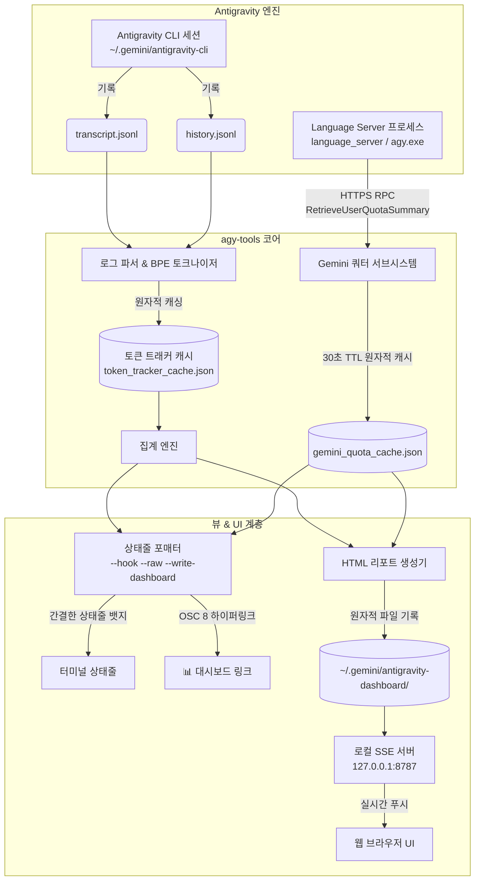
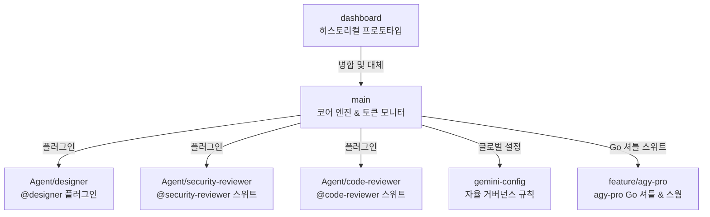

# ⚡ Antigravity CLI 개발자 툴킷 (`agy-tools`)

<div align="center">

**[English](README.md)** | **[한국어](README.ko.md)**

[](LICENSE)
[-brightgreen.svg)](#무의존성-아키텍처)
[](https://nodejs.org)
[-orange.svg)](#-다국어-지원-i18n--21개-언어)
[](#-설치-및-빠른-시작)

**Antigravity CLI를 위한 무의존성(Zero-dependency) 실시간 토큰 & 비용 분석 개발자 툴킷**

</div>

---

> [!NOTE]
> **토큰 사용량은 자체 토크나이저 및 휴리스틱 추정 엔진을 통해 직접 계산된 추정치입니다.**

---

## 🌟 개요

**Antigravity 개발자 툴킷 (`agy-tools`)**은 **Antigravity CLI** 환경에 최적화된 고정밀 무의존성 CLI 및 웹 대시보드 스위트입니다. 핵심 명령어인 **`agy-tokens`** (`agy-tools`, `agy-dashboard` 별칭 지원)는 초경량 상태줄 뱃지, 실시간 1:1 레이트 리밋 쿼터 풀 추적, 브라우저 기반 실시간 웹 대시보드를 제공합니다.

### 왜 `agy-tools`인가요?
- **Antigravity 코드 수정 0%**: 이 툴킷이 필요한 것은 `~/.gemini/antigravity-cli/settings.json`의 `statusLine` 설정 한 줄이고, Antigravity 소스는 손대지 않습니다. 선택 사항인 `agy pro` Go 셔틀은 여기서 한 걸음 더 나아가 요청 시 규칙·플러그인·스킬 폴더와 턴 전 훅까지 배포하며, `agy pro integrations status`가 셔틀이 소유한 모든 대상을 나열합니다. 그 전부가 같은 동의 게이트 하나를 지납니다.
- **1:1 실시간 Gemini 쿼터 풀 연동**: 로컬 Language Server와 HTTPS/HTTP RPC로 직접 통신하여 **5시간(5h)** 및 **7일(7d)** 롤링 쿼터 잔여량과 리셋 카운트다운을 표시합니다.
- **실시간 SSE 웹 대시보드**: `http://127.0.0.1:8787`에서 Server-Sent Events(SSE)와 동적 SVG 벡터 차트 기반의 반응형 대시보드를 제공합니다.
- **2026 최신 플래그십 모델 완벽 지원**: **Gemini 3.7 Flash**, **Gemini 3.6 Flash**, **Gemini 3.5 Flash**, **Claude Opus 4.6**, **Claude Sonnet 4.6** 등 최신 모델을 완벽하게 인식하고 단가를 계산합니다.
- **외부 의존성 제로(Zero-Dependency)**: Node.js 내장 모듈(`http`, `fs`, `path`, `net`, `child_process`)만으로 작성되어 마이크로초 단위의 즉각적인 실행 속도를 자랑합니다.
- **완벽한 다국어(i18n) 지원**: 시스템 로케일 자동 감지와 아랍어/히브리어 등 RTL(우에서 좌로 쓰기)을 포함한 21개 언어를 기본 지원합니다.

---

## 🏗 시스템 아키텍처



---

## 🌐 Agy-Tools 에코시스템 & 브랜치 카탈로그

이 저장소는 토큰 추적기를 넘어 **Antigravity CLI**를 위한 개발자 도구, 에이전트 플러그인, 거버넌스 설정을 포함하는 통합 에코시스템입니다. 각 기능은 **독립 브랜치**로 관리되며, 필요한 모듈만 선택적으로 설치할 수 있습니다.



| 브랜치 | 설명 | 주요 기능 | 원큐 설치 (**명령 프롬프트**에 붙여넣기) | 원큐 설치 (**PowerShell**에 붙여넣기) | 원큐 설치 (**macOS / Linux 터미널**에 붙여넣기) |
|---|---|---|---|---|---|
| [`main`](https://github.com/myk1yt/agy-pro/tree/main) | **코어 엔진 & 개발자 툴킷 + agy-pro Go 셔틀** | 상태줄 배지, SSE 웹 대시보드, 1:1 Gemini 쿼터 풀 RPC, 동적 단가 계산, 21개 언어, agy-pro 스위트 (투명 `agy` 셔틀, 멀티모델 스웜, 파티션 모드 팬아웃, 프로바이더 쓰기/URL/검색 도구) | `git clone https://github.com/myk1yt/agy-pro.git && cd agy-pro && scripts\install.bat && install.cmd` | `cmd /c "git clone https://github.com/myk1yt/agy-pro.git && cd agy-pro && scripts\install.bat && install.cmd"` | `git clone https://github.com/myk1yt/agy-pro.git && cd agy-pro && bash scripts/install.sh` |
| [`Agent/designer`](https://github.com/myk1yt/agy-pro/tree/Agent/designer) | **Zero-MCP 디자인 전문가** | `@designer` 에이전트, 5개 모듈형 스킬 (SVG, 3D 캔버스, 사이버펑크, 샌드박스, QA 하네스) | `git clone -b Agent/designer https://github.com/myk1yt/agy-pro.git && cd agy-pro && powershell -ExecutionPolicy Bypass -File scripts\install-designer.ps1` | `cmd /c "git clone -b Agent/designer https://github.com/myk1yt/agy-pro.git && cd agy-pro && powershell -ExecutionPolicy Bypass -File scripts\install-designer.ps1"` | `git clone -b Agent/designer https://github.com/myk1yt/agy-pro.git && cd agy-pro && bash scripts/install-designer.sh` |
| [`Agent/security-reviewer`](https://github.com/myk1yt/agy-pro/tree/Agent/security-reviewer) | **엔터프라이즈 멀티 에이전트 보안 감사** | `@security-reviewer` 오케스트레이터 + 4개 도메인 인스펙터 (OWASP, IAM, 자격 증명, 공급망) | `git clone -b Agent/security-reviewer https://github.com/myk1yt/agy-pro.git && cd agy-pro && powershell -ExecutionPolicy Bypass -File scripts\install-security-reviewer.ps1` | `cmd /c "git clone -b Agent/security-reviewer https://github.com/myk1yt/agy-pro.git && cd agy-pro && powershell -ExecutionPolicy Bypass -File scripts\install-security-reviewer.ps1"` | `git clone -b Agent/security-reviewer https://github.com/myk1yt/agy-pro.git && cd agy-pro && bash scripts/install-security-reviewer.sh` |
| [`Agent/code-reviewer`](https://github.com/myk1yt/agy-pro/tree/Agent/code-reviewer) | **Pre-Merge 코드 리뷰 & 퀄리티 게이트** | `@code-reviewer` 에이전트, 4단계 파이프라인, 8개 텍사노미, P0-P3 무관용 판정 게이트 | `git clone -b Agent/code-reviewer https://github.com/myk1yt/agy-pro.git && cd agy-pro && powershell -ExecutionPolicy Bypass -File scripts\install-code-reviewer.ps1` | `cmd /c "git clone -b Agent/code-reviewer https://github.com/myk1yt/agy-pro.git && cd agy-pro && powershell -ExecutionPolicy Bypass -File scripts\install-code-reviewer.ps1"` | `git clone -b Agent/code-reviewer https://github.com/myk1yt/agy-pro.git && cd agy-pro && bash scripts/install-code-reviewer.sh` |
| [`gemini-config`](https://github.com/myk1yt/agy-pro/tree/gemini-config) | **자율 멀티 에이전트 거버넌스** | 7단계 라이프사이클 프로토콜, Master Zero-Source-Edit 불변성, 오케스트레이터 스킬 | `git clone -b gemini-config https://github.com/myk1yt/agy-pro.git && cd agy-pro && scripts\install.bat` | `cmd /c "git clone -b gemini-config https://github.com/myk1yt/agy-pro.git && cd agy-pro && scripts\install.bat"` | `git clone -b gemini-config https://github.com/myk1yt/agy-pro.git && cd agy-pro && bash scripts/install.sh` |
| [`feature/agy-pro`](https://github.com/myk1yt/agy-pro/tree/feature/agy-pro) | **Go 셔틀 & 멀티모델 스웜 (`agy-pro`)** | 투명 `agy` 셔틀, 네이티브+외부 통합 모델 목록을 보여주는 옵트인 2초 런처(`AGY_LAUNCHER=1`), 외부 모델 브릿지, 하이브리드 네이티브 좌석을 번호로 고르는 스웜 빌더, `agy pro` 스위트 (setup / mode / models / swarm / settings / fanout / doctor), 원큐 Windows 설치·설치 제거 (Windows 전용) | `git clone -b feature/agy-pro https://github.com/myk1yt/agy-pro.git && cd agy-pro && install.cmd` | `cmd /c "git clone -b feature/agy-pro https://github.com/myk1yt/agy-pro.git && cd agy-pro && install.cmd"` | - |
| [`dashboard`](https://github.com/myk1yt/agy-pro/tree/dashboard) | **히스토리컬 프로토타입** | 최초 토큰 추적기 기반 (현재 `main`에 완전 병합됨) | - | - | - |

> [!TIP]
> 위 표의 각 줄은 **새 컴퓨터에서 한 번에 끝나는 완전한 설치 명령어**입니다. `git clone -b <브랜치>`는 클론하는 동안 해당 브랜치로 체크아웃이 자동으로 되므로, 별도로 `git checkout`을 치다가 빠뜨려 "plugin.json not found"가 나는 함정이 원천 차단됩니다. `&&` 연결은 명령 프롬프트와 macOS/Linux bash에서는 그대로 동작하지만, 기본 설치된 **Windows PowerShell 5.1은 `&&`을 구문 오류로 거부**합니다 — 그래서 PowerShell 열용례를 위해 `cmd /c "..."`로 감싼 버전을 함께 실었습니다. PowerShell 창에 해당 한 줄만 붙여넣으면 끝까지 실행됩니다.

> [!NOTE]
> `main` 줄의 명령은 설치 프로그램을 **두 개** 연달아 실행합니다. `main` 브랜치에는 **두 구성 요소**가 모두 들어 있기 때문입니다. `scripts\install.bat` (Node.js 툴킷, Node.js 16+ 필요)와 `install.cmd` (agy-pro Go 셔틀, **Windows 전용**, Node.js 불필요)입니다. Windows 사용자는 둘 다 실행하세요. 순서는 상관없고, 하나가 오류를 낸 경우에도 다른 설치 프로그램만 따로 실행하면 됩니다. macOS/Linux에서는 `install.sh`가 Node 툴킷만 설치하며, Go 셔틀은 `go build`로 직접 빌드합니다 (자세한 내용은 [한국어 사용자 설명서](MANUAL.ko.md) 참조).

#### 사전 요구사항 (git + Node.js) 먼저 설치 — 이것도 한 줄로

`git`은 Visual Studio Code를 설치했다면 함께 들어 있습니다. 정말 없다면 `winget install --id Git.Git -e --accept-source-agreements --accept-package-agreements`로 먼저 설치하세요. Node.js는 **`main` 브랜치에만 필요**합니다 (`Agent/*` 플러그인 브랜치는 `node`가 아니라 `agy`를 호출합니다). 플랫폼별 한 줄 설치:

```powershell
# Windows — Node.js LTS 설치 (`node --version`이 이미 되면 생략)
winget install --id OpenJS.NodeJS.LTS -e --accept-source-agreements --accept-package-agreements
```

```bash
# macOS (Homebrew)
brew install node

# Debian / Ubuntu
sudo apt-get update && sudo apt-get install -y nodejs npm
```

winget으로 설치한 후에는 반드시 **새 터미널 창을 열고** 설치 원큐 명령어를 실행하세요 — 새 창이 PATH를 다시 읽어 `node`가 인식됩니다.

---

## 🎨 에이전트 플러그인

### `@designer` — Zero-MCP 자급형 디자인 전문가

> **브랜치**: [`Agent/designer`](https://github.com/myk1yt/agy-pro/tree/Agent/designer) · **작성자**: myk1yt · **버전**: 1.0.0

Figma, Blender, 외부 MCP 도구 없이 순수 웹 표준(HTML5, CSS3, SVG, WebGL/GLSL)만으로 수학적으로 검증된 UI/UX 디자인, 인터랙티브 위젯, 3D 그래픽을 Antigravity 채팅 카드에 직접 생성하는 자율 디자인 에이전트입니다.

**5개 번들 모듈형 스킬:**

| 스킬 | 설명 |
|---|---|
| `design-core-harness` | Visual QA 검증 루프, 4차원 결함 체크리스트 (어센더 클리핑, z-index 충돌, 플레이스홀더 잔류, WCAG AAA 대비) |
| `design-vector-svg` | 고정 680px 좌표 SVG 레이아웃 엔진, 문자 너비 공식, 9계열 4티어 컬러 매트릭스 |
| `design-interactive-sandbox` | 인챗 실시간 인터랙티브 HTML sci-위젯, 파라미터 컨트롤, 60fps 캔버스 애니메이션 |
| `design-3d-canvas` | WebGL 2.0 절차적 3D 지오메트리 및 GLSL 버텍스/프래그먼트 셰이더 (외부 의존성 없음) |
| `design-cyberpunk-brainmap` | 사이버펑크 CRT 스캔라인 토폴로지 UI, DOM/SVG 신경 펄스 DAG 네트워크 |

**설치 및 사용법:**
```bash
# 새 컴퓨터 — 원큐 설치 (macOS / Linux 터미널; 클론 중에 브랜치 전환이 자동으로 됨):
git clone -b Agent/designer https://github.com/myk1yt/agy-pro.git && cd agy-pro && bash scripts/install-designer.sh
```

```powershell
# 새 컴퓨터 — 원큐 설치 (Windows, PowerShell 또는 명령 프롬프트에 붙여넣기):
cmd /c "git clone -b Agent/designer https://github.com/myk1yt/agy-pro.git && cd agy-pro && powershell -ExecutionPolicy Bypass -File scripts\install-designer.ps1"
```

```bash
# 이미 클론한 적이 있는 경우? 브랜치로 전환한 뒤 설치:
git checkout Agent/designer
powershell -ExecutionPolicy Bypass -File scripts/install-designer.ps1   # Windows
bash scripts/install-designer.sh                                        # Linux / macOS
```

Antigravity CLI에서 호출: `/agent` → `designer` 선택, 또는 `@designer`를 직접 호출하세요.

---

### `@security-reviewer` — 엔터프라이즈 멀티 에이전트 보안 감사 스위트

> **브랜치**: [`Agent/security-reviewer`](https://github.com/myk1yt/agy-pro/tree/Agent/security-reviewer) · **작성자**: myk1yt · **버전**: 1.0.0

OWASP Top 10, CWE Top 25, Google Cloud `roles/iam.securityReviewer` 최소 권한 원칙을 기반으로 한 엔터프라이즈급 보안 감사 스위트입니다. 리드 오케스트레이터가 4개의 전문 도메인 인스펙터를 동시에 디스패치하여 종합적인 보안 감사를 수행합니다.

**4개 도메인 인스펙터 서브에이전트:**

| 서브에이전트 | 커버리지 |
|---|---|
| `sec-app-vuln` | OWASP Top 10 (2021) & CWE Top 25 — SQL Injection, XSS, Path Traversal, SSRF, Prompt Injection, ReDoS |
| `sec-cloud-iam` | GCP IAM 최소 권한, Terraform/K8s/Dockerfile 보안, 방화벽 규칙 (`0.0.0.0/0`, `allUsers`) |
| `sec-credential-scanner` | 하드코딩된 API 키, 비공개 인증서, JWT 토큰, `.env` 유출, PII 노출 탐지 |
| `sec-supply-mcp` | 공급망 CVE, MCP 도구 권한 에스컬레이션, CORS/CSP 헤더 |

**표준화된 감사 보고서:** 4파트 EGC 형식 — Philosophy Alignment → Scope → Consolidated Findings (Critical/High/Med/Low + 익스플로잇 PoC & 수정 diff) → Quality Gate Verdict (PASS / CONDITIONAL PASS / FAIL).

**설치 및 사용법:**
```bash
# 새 컴퓨터 — 원큐 설치 (macOS / Linux 터미널; 클론 중에 브랜치 전환이 자동으로 됨):
git clone -b Agent/security-reviewer https://github.com/myk1yt/agy-pro.git && cd agy-pro && bash scripts/install-security-reviewer.sh
```

```powershell
# 새 컴퓨터 — 원큐 설치 (Windows, PowerShell 또는 명령 프롬프트에 붙여넣기):
cmd /c "git clone -b Agent/security-reviewer https://github.com/myk1yt/agy-pro.git && cd agy-pro && powershell -ExecutionPolicy Bypass -File scripts\install-security-reviewer.ps1"
```

```bash
# 이미 클론한 적이 있는 경우? 브랜치로 전환한 뒤 설치:
git checkout Agent/security-reviewer
powershell -ExecutionPolicy Bypass -File scripts/install-security-reviewer.ps1   # Windows
bash scripts/install-security-reviewer.sh                                        # Linux / macOS
```

Antigravity CLI에서 호출: `/agent` → `security-reviewer` 선택, 또는 `@security-reviewer`를 직접 호출하세요.

---

### `@code-reviewer` — Pre-Merge 코드 리뷰 & 퀄리티 게이트

> **브랜치**: [`Agent/code-reviewer`](https://github.com/myk1yt/agy-pro/tree/Agent/code-reviewer) · **작성자**: myk1yt · **버전**: 1.0.0

Google Antigravity CLI를 위한 자율 사전 병합(Pre-Merge) diff 리뷰어 및 결정론적 퀄리티 게이트 플러그인입니다. 엄격한 **하드웨어 읽기 전용 제약조건**(코드 쓰기/수정 도구 완전 배제)으로 설계되어, PR이나 작업 중인 변경 사항(diff)을 4단계 파이프라인으로 정밀 감사하고, 버그, 보안 취약점, 안정성 결함, 포맷 문제를 프로덕션 병합 전에 원천 차단합니다.

**2개 번들 모듈형 스킬:**

| 스킬 | 설명 |
|---|---|
| `code-review-taxonomy` | 8대 분류 체계(정확성, 보안, 안정성, 데이터 정합성, 성능, 유지보수성, 테스트 커버리지, 스타일/문서) 스캔 및 P0-P3 심각도/0-100 신뢰도 채점 |
| `quality-gate` | 변경된 파일 대상 린터, 타입체크, 포맷팅, 정적 보안 스캐너를 실행하는 범용 결정론적 퀄리티 게이트 |

**설치 및 사용법:**
```bash
# 새 컴퓨터 — 원큐 설치 (macOS / Linux 터미널; 클론 중에 브랜치 전환이 자동으로 됨):
git clone -b Agent/code-reviewer https://github.com/myk1yt/agy-pro.git && cd agy-pro && bash scripts/install-code-reviewer.sh
```

```powershell
# 새 컴퓨터 — 원큐 설치 (Windows, PowerShell 또는 명령 프롬프트에 붙여넣기):
cmd /c "git clone -b Agent/code-reviewer https://github.com/myk1yt/agy-pro.git && cd agy-pro && powershell -ExecutionPolicy Bypass -File scripts\install-code-reviewer.ps1"
```

```bash
# 이미 클론한 적이 있는 경우? 브랜치로 전환한 뒤 설치:
git checkout Agent/code-reviewer
powershell -ExecutionPolicy Bypass -File scripts/install-code-reviewer.ps1   # Windows
bash scripts/install-code-reviewer.sh                                        # Linux / macOS
```

Antigravity CLI에서 호출: `/agent` → `code-reviewer` 선택, 또는 `@code-reviewer`를 직접 호출하세요.

---

## 📜 자율 멀티 에이전트 거버넌스 (`gemini-config`)

> **브랜치**: [`gemini-config`](https://github.com/myk1yt/agy-pro/tree/gemini-config)

**7단계 멀티 에이전트 라이프사이클 프로토콜**과 엔지니어링 거버넌스 규칙을 `~/.gemini` 디렉터리에 직접 프로비저닝하는 공유 가능한 글로벌 설정 번들입니다.

**핵심 구성 요소:**
- **`rules/AGENTS.md`**: Master Zero-Source-Edit & Zero-Monolithic-Execution 불변성, 7단계 라이프사이클 (`Intent → Decompose → Strategy → Adversarial Audit → SRP Plan → Worker Exec → Blind QA → Delivery`)
- **`rules/GEMINI.md`**: 크로스 플랫폼, 무의존성 엔지니어링 표준
- **`skills/autonomous-orchestrator`**: 멀티 에이전트 위임 및 이중 블라인드 QA 런북
- **`skills/usage`**: 슬래시 명령 `/usage`를 통한 실시간 토큰 및 비용 분석
- **`hooks/hooks.json`**: Antigravity PostInvocation 턴 배지 후크

**설치:**
```bash
# 새 컴퓨터 — 원큐 설치 (macOS / Linux 터미널; 클론 중에 브랜치 전환이 자동으로 됨):
git clone -b gemini-config https://github.com/myk1yt/agy-pro.git && cd agy-pro && bash scripts/install.sh
```

```powershell
# 새 컴퓨터 — 원큐 설치 (Windows, PowerShell 또는 명령 프롬프트에 붙여넣기):
cmd /c "git clone -b gemini-config https://github.com/myk1yt/agy-pro.git && cd agy-pro && scripts\install.bat"
```

```bash
# 이미 클론한 적이 있는 경우? 브랜치로 전환한 뒤 설치:
git checkout gemini-config
scripts\install.bat                              # Windows
chmod +x scripts/install.sh && ./scripts/install.sh   # Linux / macOS
```

---

## 📦 초간단 설치 (Quick Start)

사전 요구사항: **Node.js 16 이상** ([nodejs.org](https://nodejs.org)) 및 **Antigravity CLI**

### 1️⃣ 원클릭 설치 (가장 추천)

터미널에서 아래 **한 줄**만 실행하면 (본인 셸에 맞는 열 선택) **전역 명령어 등록 + Antigravity 통합 배포(상태줄 `statusLine` 포함)**까지 한 번에 완료됩니다. 배포는 Go 엔진이 맡습니다(`agy pro integrations apply tools --yes`). `agy-tokens` 런처가 없는 컴퓨터에서는 상태줄 단계를 건너뛰고 그 사유를 한 줄로 알려 주며, 호출 자체는 종료 코드 0으로 끝납니다. `agy pro integrations status`가 그 상태를 보여 주고, 런처가 생기면 `agy pro integrations repair`가 이 단계를 마저 완료합니다.

**Windows — 명령 프롬프트:**
```cmd
git clone https://github.com/myk1yt/agy-pro.git && cd agy-pro && scripts\install.bat
```

**Windows — PowerShell (5.1은 맨 `&&`을 받지 않으므로 `cmd /c`로 감쌈):**
```powershell
cmd /c "git clone https://github.com/myk1yt/agy-pro.git && cd agy-pro && scripts\install.bat"
```

**Linux / macOS:**
```bash
git clone https://github.com/myk1yt/agy-pro.git && cd agy-pro && bash scripts/install.sh
```

설치 스크립트가 `npm link`로 전역 명령어를 등록하므로, 새 컴퓨터에서는 별도 `npm install -g .` 단계가 필요 없습니다. 나중에 `git pull`로 코드를 갱신한 후에는 `agy-pro` 폴더에서 `npm install -g .`를 한 번 실행해 전역 사본을 최신화하세요 (런타임은 클론 폴더가 아니라 npm 전역 사본에서 실행됩니다).

설치 스크립트(`install.bat` / `install.sh`)는 더 이상 자체 설정 기록기를 쓰지 않습니다. `agy`가 `PATH`에서 잡히면 Go 엔진에 배포를 한 번에 넘깁니다. 그 호출이 `agy pro integrations apply tools --yes`이고, `settings.json`의 `statusLine` 항목과 규칙·플러그인·스킬·훅을 함께 배포합니다. `agy-tokens` 런처가 없는 컴퓨터에서는 상태줄 단계를 건너뛰고 그 사유를 한 줄로 알려 주며, 호출 자체는 종료 코드 0으로 끝납니다. `agy pro integrations status`가 그 상태를 보여 주고, 런처가 생기면 `agy pro integrations repair`가 이 단계를 마저 완료합니다. `agy`가 아직 `PATH`에 없으면 설치 스크립트가 위 명령을 그대로 화면에 출력하고 계속 진행하며, 호출이 실패하면 `[ERROR]`를 출력하고 0이 아닌 종료 코드로 멈춥니다. 반쯤 배포된 상태를 성공으로 보고하지 않습니다.

### 2️⃣ 설치 후 바로 시작하기
1. 실행 중인 **Antigravity CLI (`agy`)를 종료 후 다시 시작**합니다.
2. 터미널 상태줄에 실시간 토큰 사용량 및 Gemini 쿼터가 즉시 표시됩니다! (`agy-tokens` 런처가 있어야 합니다. 런처가 없으면 상태줄 단계를 건너뛰고 그 사유를 한 줄로 알려 주며, `agy pro integrations status`가 그 상태를 보여 줍니다)
3. 브라우저 대시보드를 열려면 터미널의 `📊 대시보드`를 클릭하거나 아래 명령어를 실행하세요:
```bash
agy-tokens --html --open
```

---

## 🚀 agy-pro: Go 셔틀, 모델 런처 & 스웜 오케스트레이터

`agy-pro/`는 정품 `agy` 바이너리를 감싸는 Go 셔틀입니다. 네이티브 TUI와 표준 입출력 핸들, 종료 코드는 그대로 두고, 네이티브+외부 통합 모델 목록을 보여주는 옵트인 모델 런처(`AGY_LAUNCHER=1`), 외부 OpenAI 호환 모델용 로컬 브릿지, 프로필 전환, 하이브리드 네이티브 좌석을 번호로 고르는 스웜 빌더, 모든 설정을 한곳에서 다루는 설정 패널을 더합니다. Go 표준 라이브러리만 사용합니다.

### 📋 복사-붙여넣기 설치 (Windows)

PowerShell 창(Windows PowerShell 5.1 또는 PowerShell 7)에 아래 **한 줄**을 그대로 붙여넣으세요. git이 있으면 `feature/agy-pro` 브랜치를 클론해 `install.cmd`를 실행하고, git이 없으면 브랜치 ZIP을 `%TEMP%`에 내려받아 `install.ps1`을 실행하는 경로로 자동 분기합니다.

```powershell
powershell -NoProfile -ExecutionPolicy Bypass -Command "if (Get-Command git -ErrorAction SilentlyContinue) { cmd /c 'git clone -b feature/agy-pro https://github.com/myk1yt/agy-pro.git && cd agy-pro && install.cmd' } else { iwr 'https://codeload.github.com/myk1yt/agy-pro/zip/refs/heads/feature/agy-pro' -OutFile '$env:TEMP\agy-pro-src.zip' -UseBasicParsing; Expand-Archive -Path '$env:TEMP\agy-pro-src.zip' -DestinationPath '$env:TEMP\agy-pro-src' -Force; & (Resolve-Path '$env:TEMP\agy-pro-src\*\install.ps1').Path }"
```

> 이 문서의 모든 원라인 명령은 GitHub의 `feature/agy-pro` 브랜치 **현재 상태**를 내려받습니다. 아직 push하지 않은 로컬 커밋은 내려받는 내용에 포함되지 않습니다.

명령 프롬프트에서는 감싸는 부분 없이 클론 한 줄만 실행하면 됩니다: `git clone -b feature/agy-pro https://github.com/myk1yt/agy-pro.git && cd agy-pro && install.cmd`. 이미 클론해 둔 경우에는 저장소 루트에서 `install.cmd`를 실행하거나, `powershell -NoProfile -ExecutionPolicy Bypass -File agy-pro\scripts\install.ps1`로 설치 스크립트를 직접 호출하면 됩니다.

설치 스크립트는 Go 툴체인이 없으면 설치하고, `agy.exe`를 `~/.agy-pro/bin/`에 빌드하고, 그 디렉터리를 사용자 `PATH` 맨 앞에 추가한 뒤 `agy pro doctor`를 실행합니다. 설치 후에는 새 터미널을 열어야 PATH 변경이 반영됩니다.

### 🧹 지우기 (Windows, 한 줄)

PowerShell 창에 아래 **한 줄**을 붙여넣으세요. 설치 제거 스크립트를 내려받아 실행하고, 무엇을 지울지 먼저 보여준 뒤 `y/N` 확인을 기다립니다:

```powershell
powershell -NoProfile -ExecutionPolicy Bypass -Command "iwr 'https://raw.githubusercontent.com/myk1yt/agy-pro/feature/agy-pro/agy-pro/scripts/uninstall.ps1' -OutFile '$env:TEMP\agy-pro-uninstall.ps1' -UseBasicParsing; & '$env:TEMP\agy-pro-uninstall.ps1'"
```

설치기가 추가한 것만 정확히 되돌립니다:

1. 사용자 `PATH`에서 `~/.agy-pro/bin` 항목만 제거 (다른 항목과 레지스트리 값 종류는 그대로 유지)
2. `~/.agy-pro` 폴더 전체를 **휴지통**으로 이동 (영구 삭제하지 않음)

두 단계 전에 배포된 통합을 먼저 되돌립니다. 그 파일들을 소유한 것은 shim뿐이므로, 설치 제거 스크립트는 `agy`가 아직 남아 있는 동안 `agy pro integrations retract --yes`를 실행합니다. 그러면 엔진이 Gemini 설정 트리에 배포한 규칙·플러그인·스킬·훅·statusLine 항목이 고아 파일로 남지 않고 `<AGY_PRO_HOME>/backups/<ts>_retract/`로 옮겨집니다. `-KeepState`를 줘도 이 되돌리기는 그대로 실행됩니다(배포 파일에 대한 단계이고 프로바이더 상태와는 무관합니다). `agy`를 찾지 못하면 설치 제거 스크립트가 그 사실을 알리고, 다음 제거 전에 정상 설치본에서 `agy pro integrations retract --yes`를 먼저 실행하라고 안내합니다.

같은 줄 뒤에 붙이거나 클론 폴더에서 실행할 수 있는 옵션: `-KeepState`는 shim만 지우고 `providers.json`, `state.json`, 백업을 남깁니다. `-DryRun`은 계획만 출력하고 아무것도 바꾸지 않습니다. `-RestorePath`는 설치 전에 저장해 둔 사용자 `PATH`(가장 최근 `~/.agy-pro/backups/path-*.json`)를 되돌립니다. `-Force`는 스크립트용으로 `y/N` 확인을 건너뜁니다. 이미 클론해 둔 경우에는 저장소 루트의 `uninstall.cmd`를 더블클릭하거나 `.\uninstall.cmd`를 실행하세요. `agy pro mode`로 프로필을 바꿨다면 지우기 **전에** `agy pro mode restore`를 실행하세요(프로필 백업이 있으면 설치 제거 스크립트가 이 안내를 출력합니다). 콘솔이 없는 실행(파이프 입력, 예약 작업)에서는 `y/N`이 자동으로 `no`가 되므로 실수로 설치가 지워지지 않습니다.

### 첫 실행

```bash
agy pro setup          # 전체 화면 설정 TUI: 프로바이더, 모델, 팬아웃 프리셋, 프롬프트, 언어
agy pro setup --wizard # 어떤 환경에서든 고전 줄 단위 마법사
agy                    # 기본: 지연 없이 네이티브 Gemini로 바로 실행
AGY_LAUNCHER=1 agy     # 옵트인: 2초 픽커 [1] 네이티브 Gemini  [2] 외부 모델  [3] 스웜
```

`agy pro setup`은 설정 TUI의 유일한 문입니다(Windows 콘솔에서). 파이프나 스크립트 환경에서는 예전과 바이트 단위로 같은 줄 단위 마법사로 자동 전환됩니다. 처음 열 때는 UI 언어를 고릅니다(12개 언어; 아랍어는 논리 순서 범위를 정직하게 표시). 허브에서 프로바이더 등록, diff 승인 게이트를 통한 모델 추가/수정/삭제, 팬아웃 프리셋, 프롬프트 작성까지 한 화면에서 처리합니다. `agy pro help` 맨 위에 이 TUI가 크게 안내됩니다.

픽커는 **인자 없는** `agy`에 `AGY_LAUNCHER=1`을 설정했을 때만 뜹니다. 옵트인이 없으면 기본 실행은 메뉴 없이 지연 없이 네이티브로 바로 진행되고, 인자를 하나라도 주면 픽커를 건너뛰고 실제 바이너리로 바로 실행됩니다. 런처가 뜰 때는 커뮤니티 안내가 한 줄 함께 출력됩니다(`Visit https://www.reddit.com/r/GoogleAntigravityCLI/! A space for antigravity-cli users. Remember r/GoogleAntigravityCLI`). 이 줄은 대화형 런처에서만 나오고, `-p` 일회성 실행·파이프 입력·기계 판독 출력에는 나오지 않습니다. 외부 모델과 스웜은 런처 없이도 `AGY_PRO_BRIDGE=1 agy`, `agy pro swarm`, `agypro_swarm` 플러그인으로 사용할 수 있습니다. 프로필·실행 단위 오버라이드:

```bash
agy pro config default-profile gateway   # 모든 `agy` 실행이 등록된 외부 모델을 /model에 노출
agy pro config default-profile native    # 항상 네이티브 Gemini, 프롬프트 없음
agy -m "gemini-2.5-flash (google)"       # 이번 실행에만 외부 모델 하나 사용
agy pro config bridge-tools read,search  # 게이트웨이 도구 루프: 기본 읽기 전용
agy pro config bridge-tools none         # 도구 루프 끄기 (순수 패스스루)
agy pro mode full                        # full-stack 오케스트레이터 프로필로 전환
agy pro status                           # 현재 모드, 프로바이더, 실제 agy 경로
```

쓰기를 하는 명령(`agy pro config ...`, `agy pro mode ...`, `agy pro doctor --fix-keys`, 그리고 설정 허브의 프로바이더·모델 편집)은 바꿀 내용을 먼저 정확히 출력하고 `y/N` 확인을 받습니다. 스크립트에서는 `--yes`를 붙여 프롬프트 없이 동의할 수 있습니다.

일상적으로 쓰는 화면:

```bash
agy pro models --all                     # 네이티브+외부 통합 모델 목록 (번호 표시)
agy pro swarm                            # 번호로 템플릿·좌석을 고르는 스웜 빌더
agy pro fanout --seats "native:gemini-3.8-flash-high,nw/glm-5.3-flash"   # 하이브리드 스웜
agy pro settings                         # 전체 화면 설정 패널 (TUI)
```

### 통합 배포: 무엇이 배포되는지를 한 곳에서 관리

```bash
agy pro integrations status              # 읽기 전용: 의도와 디스크 상태를 나란히 표시, 게이트 없음
agy pro integrations apply tools         # 프리셋 전체: statusLine 항목, 규칙, 플러그인, 스킬, 훅 (agy-tokens 런처가 없으면 상태줄 단계는 사유와 함께 건너뜀)
agy pro integrations apply rules         # 기능 하나; 인자를 빼면 대기 중인 것만 배포
agy pro integrations retract             # 배포한 것 제거; 인자를 빼면 전부 제거
agy pro integrations preset native|tools # 그 프리셋 상태로 맞추고 기록
agy pro integrations adopt               # 이미 디스크에 있는 것을 기록 (파일 쓰기 없음)
agy pro integrations rollback            # settings.json 최신 스냅샷 복원
agy pro integrations rollback rules      # 기능 하나를 설치 전 배포 트리로 되돌림
agy pro integrations repair              # 드리프트·누락된 대상 재배포
```

기능은 `statusline`, `hook`, `rules`, `plugins`, `skills` 다섯 개이고, 프리셋은 `native`와 `tools`입니다(`custom`은 기능 토글에서 파생되는 값이라 인자로 받지 않습니다). 쓰기 동사는 계획 하나를 만들어 정확한 diff를 출력한 뒤 한 번만 묻습니다. 그래서 프리셋 배포는 파일 배포, `settings.json` 항목, `state.json` 의도 행을 합쳐 `y/N` 한 번입니다. 파이프나 CI처럼 콘솔이 없는 입력은 `--yes`를 붙여야 하고, 없으면 아무것도 쓰지 않고 거부합니다. 종료 코드는 0(성공), 1(실행 오류·거부), 2(사용법 오류)입니다. 제거 전에 `retract`를 실행하면 배포 파일이 고아로 남지 않고 `<AGY_PRO_HOME>/backups/<ts>_retract/`로 옮겨집니다.

`rollback`은 인자를 하나 받거나 아예 받지 않습니다. 인자가 없으면 `settings.json`을 스냅샷 체인에서 되돌리고, `rollback <기능>`은 그 기능 하나의 배포 트리를 설치 전 상태로 되돌립니다. 둘 다 동의는 한 번이고, 트리 되돌리기는 의도 행을 기록하지 않습니다(되돌린 바이트는 사용자가 선언한 상태가 아니기 때문입니다). `rollback statusline`은 종료 코드 2로 인자 없는 settings.json 문을 안내하고, 프리셋 인자(`native`, `tools`, `custom`)는 프리셋 전체에는 단일한 설치 전 트리가 없으므로 거부되며, 인자를 두 개 주면 사용법 오류입니다.

프리셋은 **무엇이 배포되는지**(규칙·스킬·플러그인·훅·statusLine 내용)만 바꾸고, 어떤 바이너리가 실행되는지는 바꾸지 않습니다. `agy pro mode full|clean`도 같은 종류의 스위치입니다. 배포 내용만 바뀌고, 실행되는 agy 바이너리는 하나입니다.

### 하이브리드 스웜: 네이티브 모델과 외부 프로바이더 모델을 한 번에

한 스웜에서 Antigravity 네이티브 모델과 등록해 둔 외부 프로바이더 모델을 함께 쓸 수 있고, 좌석마다 별개 에이전트로 실행됩니다. 2026-10-13에 좌석 2개(네이티브 1 + 외부 1)로 실검증했습니다. 외부 프로바이더가 HTTP 401을 반환하자 다른 등록 프로바이더로 failover했고, 최종 2/2 좌석이 완료됐습니다.

```bash
# 1. 배정 가능한 전부: 네이티브 모델 + 등록된 프로바이더
agy pro models --all
#   [ 1] gemini-3.8-flash-high     Gemini 3.8 Flash (High)          [native]
#   [11] glm-5.3-flash-flex        tools, vision, thinking(default) [NW]
#   [13] glm-5.3-flash             tools, vision, thinking(default) [Charm]

# 2. 먼저 dry-run: 실제로는 아무것도 돌리지 않고 정확한 fanout 명령만 출력
agy pro swarm --template code-review --seats "1,13" --dry-run
#   agy pro fanout --task review --seats native:gemini-3.8-flash-high,Charm/glm-5.3-flash \
#     --root . --timeout 120 --tools read,search --prompt "..." --json

# 3. 실제 실행: 좌석마다 에이전트 1개; 결과물은 ./reports/fanout/<타임스탬프>/ 에 저장
#    (--timeout 305 는 네이티브 좌석의 agy --print-timeout 을 300초로 고정)
agy pro fanout --task review --seats "native:gemini-3.8-flash-high,NW/glm-5.3-flash-flex" \
  --root . --timeout 305 --tools read --prompt "Review the auth flow" --json
```

좌석 문법: Antigravity 네이티브 모드는 `native:<모델-id>`, 등록한 외부 프로바이더는 `<프로바이더>/<모델-id>`, 쉼표로 구분. `agy pro swarm --seats` 는 위 목록의 번호("1,13", "2-4", 프리셋 "p1".."p3")도 받고, 인터랙티브 빌더(TTY에서 플래그 없이 `agy pro swarm`, 또는 런처 `[3]`)도 같은 번호 선택으로 진행됩니다. 프로바이더 좌석이 401/403을 받으면 다른 등록 프로바이더로 failover하고, 요약에는 그 hop 과 `degraded` 표시가 남습니다(실예: NW 가 401 "Invalid API key", 좌석은 Charm/qwen3.8-flash 로 완료, 2/2 성공).

생성되는 산출물(`summary.json`, `reconciliation.md`, 좌석별 리포트)은 모두 소유자 전용 권한으로 쓰이고, 키 모양 값이 리포트나 콘솔에 들어가면 앞 5글자 + `****` 로만 표시됩니다(뒤쪽 부분은 절대 노출 안 함).

### agy TUI 안에서 스웜 실행하기 (`/agypro_swarm:swarm`)

스웜은 `agy` 채팅 세션 안에서도 `agypro_swarm` 플러그인 명령으로 실행합니다. agy 의 플러그인 시스템은 플러그인 명령에 네임스페이스를 붙이므로 호출은 `/agypro_swarm:swarm` 입니다(코어 `/swarm` 은 없고, 어디서나 "플러그인 명령"이라고 정직하게 부릅니다). 이 명령은 에이전트가 대신 수행하는 워크플로입니다: 통합 목록(`agy pro models --all`)을 읽고, 번호 메뉴로 템플릿/좌석/도구/타임아웃/작업을 모으고, 확정된 `agy pro swarm --dry-run` 명령을 좌석별 비용 안내와 함께 보여준 뒤 명시적 확인을 받고, 그 다음에 실제 스웜을 돌려 `summary.json`·`reconciliation.md`·좌석별 리포트를 채팅에 요약해 보여줍니다.

명령 본문이 강제하는 비용 규칙: 좌석 하나 = 에이전트 턴 하나. 네이티브 좌석은 Antigravity 구독을, 프로바이더 좌석은 해당 프로바이더 API 크레딧을 씁니다. 드라이런 echo 에 대한 명시적 확인 없이 실제 실행은 없습니다. 작업 프롬프트는 `--prompt-file`(임시 파일)로 전달되고 셸 줄에 raw 로 붙지 않으며, API 키 값은 채팅에서 요구하거나 출력하지 않습니다.

XOR 경계는 그대로이고 명령 본문에 plainly 명시됩니다: 이건 별도 서브프로세스를 돌리는 명령/도구 동작이며, 세션의 `/model` 팝업에 외부 모델을 추가하지 않습니다(네이티브 XOR 브리지, 둘 다 never).

### 네이티브 공존: agy 자체 세션 안에서 외부 프로바이더 쓰기 (`agy pro hybrid`)

등록해 둔 외부 프로바이더를 **agy 자체 네이티브 세션 안에서**, 에이전트 중개 없이 쓸 수 있습니다. 사용자가 모델을 고르면 agy가 직접 구동하고, 로컬 메시가 와이어만 변환합니다. MCP 서버나 부채널은 없습니다(2026-10-14 사용자 결정).

agy 바이너리의 클라이언트 경로가 갈리기 때문에, **세션 하나에 프로필 하나**만 고를 수 있습니다(프로브로 증명된 바이너리 사실입니다). `agy pro hybrid`로 고릅니다:

```bash
agy pro hybrid on p1     # 피커 공존 프로필
agy pro hybrid on p2     # 서브에이전트 프로필
agy pro hybrid off       # 저장한 프로필 해제
agy pro hybrid status    # 실제 적용 프로필(env 오버라이드 vs 저장값) + wirecheck 판정
agy pro hybrid check     # wirecheck 리포트 출력; 효과 프로필이 NOGO면 exit 1
```

`AGY_PRO_HYBRID=p1|p2|off` 환경 변수가 저장값보다 우선합니다(한 번만 쓰는 오버라이드). 형식이 잘못된 오버라이드는 무시하고 저장값을 씁니다.

**P1 피커 공존.** agy 뒤에 세션용 로컬 메시를 띄우고 `CLOUD_CODE_URL`로 연결합니다. agy가 `/model` 카탈로그를 메시의 `fetchAvailableModels`에서 구성하므로, 등록한 외부 모델이 **agy 자체 `/model`**에 뜨고 agy 자체 11개 도구 엔진에서 도구를 로컬 실행합니다. 설정 파일은 쓰지 않습니다(`CLOUD_CODE_URL` 하나만 주입). 대가: 이 경로에는 서브에이전트 도구 패밀리가 없어 P1 세션에서는 서브에이전트를 전혀 띄울 수 없습니다(메시가 낸 `invoke_subagent`는 agy가 로컬에서 unknown tool로 거부). 메시가 서비스하는 카탈로그는 외부 전용(P1-lite)입니다.

**P2 서브에이전트.** agy를 gemini 모드로 띄웁니다. 세션용 `--app_data_dir`를 만들고 그 안의 settings 파일에만 `modelProvider:"gemini"`와 `customModels`를 씁니다(전역 settings는 그대로). `GOOGLE_GEMINI_BASE_URL`과 스폰별 논스 `GEMINI_API_KEY`로 agy를 실행합니다. 외부는 **런처 시점**에 고릅니다(인자 없는 TTY 세션은 런처 피커, 아니면 `--model <key/id>`). 13개 도구(서브에이전트 패밀리 포함)가 붙고, 기본 `inherit`으로 띄운 서브에이전트는 **외부 세션 모델**에서 돕니다(R6 증명). 대가: 외부가 세션 중 `/model`에는 안 뜨고(11개 static Gemini 기본값만 나열), 이 세션에서는 구독 Gemini가 꺼집니다. 네이티브 static id는 레지스트리에 그 id가 있을 때만 서비스(설정된 프로바이더 과금)하고, 없으면 모델명을 명시한 404를 돌려줍니다. 조용한 대체는 없습니다.

**자격 증명 안전.** 프로바이더 키는 프로세스 안에서 **이름으로만** 해석되고, 자식 환경·로그·settings에는 절대 들어가지 않습니다. exec 전에 자식 환경에서 `*_API_KEY` 형태 이름과 레지스트리 키 이름을 모두 지웁니다. P2 메시는 자식을 스폰별 64-hex 논스로 인증합니다(실제 키 아님). P1에서 agy의 키링 bearer는 메시가 수동적으로 받고 버리며, 절대 전달하지 않습니다. 게이트 G4/G5/G6에서 프로바이더 키 값은 모든 로컬 싱크(자식 env, 메시 감사, agy 로그, settings)에 0회인 것이 확인됐습니다.

**솔직한 한계(숨기지 않습니다).**
1. 세션 하나에 피커(P1)와 서브에이전트(P2)를 함께 쓸 수 없습니다. 세션마다 하나를 고릅니다.
2. 서브에이전트별 외부 모델 지정은 agy 1.3.5에서 불가능합니다(티어 enum이 닫혀 있음). `inherit`이 메커니즘입니다.
3. 구독 Gemini + 외부를 한 피커에 넣으려면 M1 릴레이가 필요한데, 명시적 사용자 승인이 필요하고 이번 릴리스에 없습니다.
4. P1의 `/v1internal` 자세는 수동적입니다(받은 bearer를 버림). 루프백 + 임시 포트 + 60 req/min + 세션 수명 + 이름 전용 감사로 제한됩니다.
5. `go test -race`는 개발 머신에서 실행할 수 없습니다(C 컴파일러 없음). 환경 저하이지 PASS가 아닙니다.
6. 대화 제목(housekeeping) 턴은 메시가 로컬에서 답해 프로바이더 quota를 쓰지 않습니다(G10 수정).
7. agy 자동 업데이터는 `AGY_CLI_DISABLE_AUTO_UPDATE=1`이 있어도 Google Cloud 엔드포인트로 비생성 네트워크 접촉을 합니다. 생성 트래픽은 모두 루프백이므로 "Google 트래픽 0"은 생성에 한정합니다.
8. G8 TUI 게이트는 시각 미검증(UNVERIFIED)입니다. 자동 게이트 G4/G5/G6/G10는 print 모드 실증거를, G11(자동업데이트 재시작)는 이유와 함께 NOT-TESTED입니다.
9. **P2 외부 세션에서 서브에이전트 티어 지정은 외부 세션 모델에서 돕니다.** P2 외부 세션에서 명시한 서브에이전트 티어(예: `model="flash"`)는 외부 세션 모델에서 실행됩니다(agy 자신의 해석이며, 메시는 대체하지 않습니다). 네이티브 static id는 레지스트리에 그 id가 정확히 등록되어 있을 때만 서비스되고, 없으면 모델명을 명시한 404를 돌려줍니다. 즉 티어를 고른다고 그 세션에서 더 싼 네이티브 모델로 떨어지지는 않습니다.
10. **순수 네이티브 경로는 의도적으로 환경 변수의 키를 그대로 씁니다.** 하이브리드 프로필도 브리지도 없는 평범한 `agy`는 자식 프로세스에 ambient 환경(네이티브 AI-Studio 키 포함)을 그대로 물려줍니다. 이것은 shim을 끼우지 않은 네이티브 agy의 본래 동작이며, 공존 경로(P1, P2, 두 네이티브 폴백, 피커, `agy models`, fanout 네이티브 좌석)는 대신 자식 환경을 정리합니다.
11. **P2의 `context_window`는 라우팅에 영향을 주지 않습니다.** 메시는 customModels 키에서 나온 bare slug로 라우팅하고, 실제 컨텍스트 윈도우는 외부 프로바이더가 정합니다. P1 카탈로그의 `max_tokens` 하한은 P1에 나열된 모델에 대한 실행 하드실패 가드이며, 레지스트리 `contextLength`가 0이거나 매우 작은 P2 실행은 미검증(G5에서 다루지 않음)이므로 0에 가까운 값은 피하는 것이 좋습니다.

### 추가되는 기능

| 기능 | 명령 |
|---|---|
| 2초 인터랙티브 모델 런처 (옵트인) | `AGY_LAUNCHER=1 agy` |
| 네이티브+외부 통합 모델 목록 | `agy pro models --all`, 런처 `[2]` |
| 네이티브 `/model` 픽커 안의 외부 모델 | `agy -b`, `agy -m "<모델> (<프로바이더>)"`, `AGY_PRO_BRIDGE=1` |
| agy 자체 세션 안에서 외부 프로바이더 (피커 공존, 서브에이전트 불가) | `agy pro hybrid on p1` |
| agy 자체 세션 안에서 외부 + 서브에이전트 (세션 중 `/model` 미노출) | `agy pro hybrid on p2` |
| 시작 프로필 고정 (native / gateway / prompt) | `agy pro config default-profile <값>` |
| 외부 모델용 게이트웨이 도구 루프 (기본 읽기 전용) | `agy pro config bridge-tools read,search`, `agy pro config show` |
| 프로필 전환 (full-stack / clean) | `agy pro mode full`, `agy pro mode clean` |
| 전체 화면 설정 TUI (프로바이더, 모델, 프리셋, 프롬프트, 언어) | `agy pro setup` (고전 마법사는 `--wizard`) |
| 번호로 고르는 스웜 빌더 (네이티브+외부 하이브리드 좌석) | `agy pro swarm`, `agy pro fanout --seats "native:<모델>,<프로바이더>/<모델>"` |
| 멀티 모델 팬아웃 스웜 | `agy pro fanout -task=security -n=3` |
| 설정 패널 / 세션 내 설정 | `agy pro settings`(TUI), `/setting_agypro`(플러그인 명령) |
| 배포된 통합 (statusLine 항목, 규칙, 플러그인, 스킬, 훅) | `agy pro integrations status`, `agy pro integrations apply tools`, `agy pro integrations retract` |
| 채팅 안에서 스웜 실행 | `/agypro_swarm:swarm`(플러그인 슬래시 명령; 번호 좌석 선택, 드라이런 echo + 비용 확인, 산출물 요약을 채팅에) |
| 진단 | `agy pro doctor`, `agy pro status`, `agy pro models` |

`agy pro doctor`는 등록된 프로바이더 키를 토큰을 쓰지 않고 업스트림으로 probe(`GET <baseURL>/models`, 5초 타임아웃)하여 프로바이더별 결과를 마스킹해 표시합니다 (`valid` / `invalid` / `indeterminate` / `SKIP`). 키 값은 항상 앞 5글자 + `****` 형태로만 표시됩니다(5글자 이하는 `****`, 뒤쪽 일부를 노출하는 일은 없습니다). `agy pro doctor --fix-keys`는 probe를 `valid`로 통과한 BOM 변형 이름을 정상 이름으로 복원하고(실행 전 백업 생성), `agy pro doctor --rollback-keys <디렉터리>`는 그 복원을 되돌립니다.

`agy` 세션 안의 `/model` 팝업은 게이트웨이 기준으로 여전히 전부 아니면 전무(네이티브 XOR 외부)입니다. 다만 네이티브 공존 프로필 P1(`agy pro hybrid on p1`)을 쓰면 등록한 외부 모델이 agy 자체 `/model` 카탈로그에 올라 agy 자체 도구 엔진에서 돕니다(단, 메시가 서비스하는 카탈로그는 외부 전용 P1-lite이고 이 경로에서는 서브에이전트를 쓸 수 없으며, 자세한 내용은 위 "네이티브 공존" 절을 참고). 네이티브와 외부를 한 팝업에 병합하는 것은 이번 릴리스의 더 큰 비전으로 G8 TUI 게이트에서만 검증되므로 시각 미검증(UNVERIFIED)으로 남습니다. 세션 안에서 가장 가까운 방법은 `google`(AI Studio) 프리셋을 등록한 뒤 `default_profile = gateway`로 두는 것이고(Gemini 2.5 + 외부 모델 동시 표시), 네이티브까지 포함한 전체 목록은 agy-pro 계층(`agy pro models --all`, 런처 `[2]`, `agy pro swarm`)에서 확인합니다.

자세한 내용: [`agy-pro/README.md`](agy-pro/README.md), [`agy-pro/docs/bridge-architecture.md`](agy-pro/docs/bridge-architecture.md), [`agy-pro/docs/swarm-hybrid.md`](agy-pro/docs/swarm-hybrid.md).

### 게이트웨이 도구 루프 (외부 모델이 파일을 읽고 검색하게 하기)

`agy`의 게이트웨이 클라이언트는 `tools`를 보내지 않고 응답의 `tool_calls`도 버립니다. 그래서 외부 모델은 그대로는 워크스페이스를 건드릴 수 없습니다. `agy-pro`는 브릿지 안에 도구 루프를 넣어 이 문제를 해결합니다. 모델에 도구 정의를 붙여 호출하고, 돌아온 도구 호출을 로컬에서 실행한 뒤 결과를 다시 먹여서, `agy`에는 최종 텍스트만 돌려줍니다.

- 기본값은 `read,search`입니다. 모델은 `read_file`, `list_dir`, `grep`, `glob`으로 워크스페이스를 읽고 검색할 수 있지만 바꿀 수는 없습니다.
- `write`(`write_file`, `replace_in_file`)와 `exec`(`run_command`)는 opt-in입니다. 실제 파일을 고치고 실제 명령을 실행하므로 필요한 세션에서만 켜세요: `agy pro config bridge-tools read,search,write,exec`.
- `none`은 도구 루프를 완전히 끄고 기존 패스스루로 돌립니다.
- 작업 기준 폴더는 `agy`를 실행한 디렉터리입니다. 세션마다 shim 프로세스가 하나씩이므로 두 세션의 워크스페이스는 섞이지 않습니다.
- 한도는 업스트림 8턴, 턴당 60초, 전체 240초입니다. 모든 종료 경로가 비어 있지 않은 텍스트로 끝나므로 `agy`의 무한 재시도가 생기지 않습니다.
- 도구 턴은 기본 출력 타임아웃보다 길어질 수 있습니다. 일회성 실행에는 `agy --print-timeout 300s`를 권장합니다(루프 자체 상한 240초).
- 우선순위: `AGY_PRO_BRIDGE_TOOLS` 환경변수 > `~/.agy-pro/state.json`의 `bridge_tools` > 기본 `read,search`. 알 수 없는 토큰은 설정 시 거부되고, 실행 시에는 루프를 끄는 쪽으로 처리됩니다(허용 목록을 넓히지 않음).

---

## ⚡ 상태줄 연동 및 동작 원리

`agy-tokens`는 터미널 상태줄을 통해 실시간 토큰 사용량과 쿼터 상태를 표시합니다. **Antigravity 내부 코드를 전혀 수정할 필요가 없습니다.**

설치 스크립트(`install.bat` / `install.sh`)는 이 항목의 기록을 Go 엔진에 넘깁니다. `agy pro integrations apply tools --yes`가 기존 설정을 보존한 채 `~/.gemini/antigravity-cli/settings.json`에 `statusLine` 객체를 쓰고, 원자적 쓰기 전에 원장이 `settings.json.bak.<ts>`로 파일을 스냅샷해 둡니다. `agy-tokens` 런처가 없는 컴퓨터에서는 상태줄 단계를 건너뛰고 그 사유를 한 줄로 알려 주며, 호출 자체는 종료 코드 0으로 끝납니다. `agy pro integrations status`가 그 상태를 보여 주고, 런처가 생기면 `agy pro integrations repair`가 이 단계를 마저 완료합니다. 같은 명령을 언제든 직접 실행할 수 있고, `agy pro integrations status`로 항목이 아직 일치하는지 확인하고, `agy pro integrations rollback`으로 최신 스냅샷을 되돌립니다. 설치 전 상태로 되돌리는 일도 이제 수동 편집이 아닙니다. `agy pro integrations retract`가 항목을 제거하고 덮어쓴 바이트를 보관합니다.

### 간결하고 직관적인 상태줄 형식
불필요한 접두어를 제거하여 깔끔하고 정보 밀도가 높은 상태줄을 제공합니다:

**한국어 상태줄:**
```text
⚡ 이번 턴: 1.2k (₩0.3) | 오늘 누적: 45.8k (₩9.9) | 캐시: 82% | 5h: ▰▰▰▰▱ 79% (4h 10m) | 7d: ▰▱▱▱▱ 21% (3d 20h) | 📊 대시보드
```

**영어 상태줄:**
```text
⚡ Turn: 1.2k ($0.0002) | Today: 45.8k ($0.0068) | Cache: 82% | 5h: ▰▰▰▰▱ 79% (4h 10m) | 7d: ▰▱▱▱▱ 21% (3d 20h) | 📊 Dashboard
```

- `--hook`: Antigravity의 `PostInvocation` 훅 규격에 맞는 페이로드를 생성합니다.
- `--raw`: 터미널 상태줄에 직접 출력하기 위해 JSON 래퍼를 벗겨낸 순수 텍스트를 출력합니다.
- `--write-dashboard`: 턴이 실행될 때마다 대시보드 데이터 파일을 원자적으로 최신화합니다.

### 🔧 수동 설정 및 문제 해결 (Troubleshooting)

자동 설치 대신 수동으로 설정하거나, 특별한 환경에서 연동해야 하는 경우 아래 방법을 참조하세요.

#### 수동 `settings.json` 설정
`~/.gemini/antigravity-cli/settings.json`에 직접 `statusLine` 항목을 추가합니다:
```json
{
  "statusLine": {
    "type": "command",
    "command": "agy-tokens --hook --raw --write-dashboard",
    "enabled": true,
    "stack_with_default": true
  }
}
```

- **직접 Node 경로 지정 시**: `"command": "node /경로/agy-pro/bin/agy-tokens.js --hook --raw --write-dashboard"`
- **Windows 8.3 축약 경로 (PATH가 자식 프로세스에 상속되지 않는 경우)**:
  `"command": "C:\\PROGRA~1\\nodejs\\node.exe %APPDATA%\\npm\\NODE_M~1\\AGY-TO~1\\bin\\AGY-TO~1.JS --hook --raw --write-dashboard"` (역슬래시는 `\\`로 이스케이프)

---

## 🤖 지원 AI 모델 및 공식 가격표

`agy-tools`는 Antigravity CLI(`/model`)에서 선택 가능한 모든 2026 플래그십 AI 모델을 지원하며, 프롬프트 캐싱 할인율과 원격 가격 동기화를 지원합니다:

| 모델 ID | 모델 표시명 | 제공사 | 컨텍스트 크기 | 입력 / 1M | 캐시 입력 / 1M | 출력 / 1M |
| :--- | :--- | :--- | :--- | :--- | :--- | :--- |
| `gemini-3.7-flash` | **Gemini 3.7 Flash** | Google | 1M | $0.15 | $0.0375 | $0.60 |
| `gemini-3.7-flash-thinking` | **Gemini 3.7 Flash (Thinking)** | Google | 1M | $0.15 | $0.0375 | $0.60 |
| `gemini-3.6-flash` | **Gemini 3.6 Flash** | Google | 1M | $0.15 | $0.0375 | $0.60 |
| `gemini-3.5-flash` | **Gemini 3.5 Flash** | Google | 1M | $0.15 | $0.0375 | $0.60 |
| `gemini-2.5-pro` | **Gemini 2.5 Pro** | Google | 2M | $1.25 | $0.3125 | $5.00 |
| `gemini-2.0-flash` | **Gemini 2.0 Flash** | Google | 1M | $0.10 | $0.0250 | $0.40 |
| `claude-opus-4.6` (`claude-3-opus`) | **Claude Opus 4.6** | Anthropic | 200k | $15.00 | $1.50 | $75.00 |
| `claude-sonnet-4.6` (`claude-3.7-sonnet`, `claude-3.5-sonnet`) | **Claude Sonnet 4.6** | Anthropic | 200k | $3.00 | $0.30 | $15.00 |
| `claude-3.5-haiku` | **Claude 3.5 Haiku** | Anthropic | 200k | $0.80 | $0.08 | $4.00 |
| `gpt-4o` | **GPT-4o** | OpenAI | 128k | $2.50 | $1.25 | $10.00 |
| `o3-mini` | **o3-mini** | OpenAI | 200k | $1.10 | $0.55 | $4.40 |
| `o1` | **o1** | OpenAI | 200k | $15.00 | $7.50 | $60.00 |

### 동적 가격 동기화 엔진
공식 API 단가 변동 시 언제든지 최신 가격 카탈로그를 동기화할 수 있습니다:
```bash
# 공식 API 가격표 전체 출력 (원화 환산)
agy-tokens --prices --currency krw

# 원격 저장소에서 최신 가격 정보 즉시 동기화
agy-tokens --sync-prices

# 24시간 이상 지난 가격 캐시 자동 동기화
agy-tokens --auto-sync
```

### 스마트 퍼지 휴리스틱 요금제 추정
등록되지 않은 신규 모델이나 커스텀 모델이 로그에서 발견되면 정규식 휴리스틱(`flash`, `pro`, `mini`, `free`, `local`)을 기반으로 적절한 요금 티어를 자동으로 부여합니다.

---

## 📊 실시간 SSE 웹 대시보드

웹 브라우저에서 직관적으로 사용할 수 있는 오프라인 지원 실시간 분석 대시보드입니다:

```bash
# 로컬 SSE 대시보드 서버를 시작하고 브라우저에서 바로 열기
agy-tokens --serve --open

# 정적 HTML 대시보드를 생성하고 브라우저에서 바로 열기
agy-tokens --html --open
```

### 주요 기능
- **듀얼 트랜스포트 프로토콜**: `http://127.0.0.1:8787` 환경에서는 실시간 Server-Sent Events(`/events`)로 동작하며, `file://` 로컬 파일 환경에서는 CORS 제한 없이 스크립트 태그 인젝션 폴링으로 매끄럽게 동작합니다.
- **동적 순수 SVG 차트**: 입력 토큰, 캐시 토큰, 출력 토큰을 구분하는 30일 누적 스택 바 차트, 인터랙티브 툴팁, 동적 Y축 스케일링을 지원합니다.
- **턴 단위 모델 기여도 분석**: 사고(Thinking) 모드, 세션 중 모델 변경, 도구 호출 비용을 정밀하게 분리 추적합니다.
- **인터랙티브 필터링**: 오늘, 어제, 7일, 30일, 사용자 지정 날짜 범위 및 특정 AI 모델별 필터링을 지원합니다.
- **VS Code 터미널 OSC 8 연동**: VS Code 내부 터미널에서 상태줄의 `📊 대시보드` 링크를 클릭하면 백그라운드 서버를 자동 기동하여 브라우저로 연결합니다.

👉 **자세한 기술 문서는 [docs/DASHBOARD.md](docs/DASHBOARD.md)에서 확인하세요.**

---

## ⏱ 1:1 실시간 Gemini 쿼터 풀 연동

`agy-tools`는 **Antigravity Language Server**와 로컬 HTTPS/HTTP RPC(`RetrieveUserQuotaSummary`)로 직접 통신하여 실제 사용량 쿼터를 측정합니다:

- **5시간 제한 (`5h`)**: 단기 버스트 쿼터 잔여율 측정.
- **7일 제한 (`7d`)**: 주간 누적 쿼터 잔여율 측정.
- **실시간 리셋 카운트다운**: 리셋 시점까지 남은 시간 실시간 포맷팅 (`4h 10m`, `3d 20h` 등).
- **30초 원자적 캐시**: `~/.gemini/gemini_quota_cache.json`에 저장되어 상태줄 평가 시 1ms 미만의 초고속 응답을 보장합니다.

```bash
# 실시간 Gemini 쿼터 상태 수동 조회 및 동기화
agy-tokens --sync-quota
```

👉 **자세한 기술 문서는 [docs/QUOTA_POOL.md](docs/QUOTA_POOL.md)에서 확인하세요.**

---

## 🚀 CLI 명령어 및 옵션 전체 레퍼런스

모든 기능은 `agy-tools`, `agy-dashboard`, `agy-tokens` 중 편한 명령어로 호출할 수 있습니다:

### 주요 사용 예시

```bash
# 오늘의 사용량 요약 (기본값)
agy-tokens

# 최근 7일간의 사용량 표 (원화 KRW 기준)
agy-tokens --7d --currency krw

# 최근 30일간의 사용량 표 (달러 USD 기준)
agy-tokens --30d --currency usd

# 사용자 지정 날짜 범위 사용량 조회 (유로 EUR 기준)
agy-tokens --range 2026-08-01..2026-08-29 --currency eur

# 가장 최근 세션의 턴별 상세 내역 확인
agy-tokens --session

# 특정 세션 UUID의 턴별 상세 내역 확인
agy-tokens --session <세션-UUID>

# 무료 티어 / 정액제 모드 (비용 숨김, 순수 토큰량만 표시)
agy-tokens --free

# 스크립트 연동을 위한 순수 JSON 출력
agy-tokens --today --json
```

### 🎛 CLI 전체 옵션 테이블

| 옵션 | 단축 옵션 | 설명 |
| :--- | :--- | :--- |
| `--today` | `-t` | 오늘의 토큰 및 비용 요약 표시 *(기본값)* |
| `--yesterday` | `-y` | 어제의 토큰 및 비용 요약 표시 |
| `--7d`, `--week` | | 최근 7일간의 일별 상세 내역 및 합계 표시 |
| `--30d`, `--month` | | 최근 30일간의 일별 상세 내역 및 합계 표시 |
| `--range <start..end>` | | 사용자 지정 날짜 범위 통계 (`YYYY-MM-DD..YYYY-MM-DD`) |
| `--all` | `-a` | 전체 기록에 대한 종합 통계 표시 |
| `--session [id]` | `-s` | 최근 또는 지정 세션의 턴별 상세 내역 표시 |
| `--currency <code\>` | | 표시 통화 지정: `usd`, `krw`, `jpy`, `eur`, `gbp` |
| `--lang <code\>` | | 인터페이스 언어 지정 (아래 21개 언어 지원) |
| `--model <name>` | | 적용 단가 모델 수동 지정 (예: `gemini-3.7-flash`, `claude-3.7-sonnet`) |
| `--free`, `--no-cost` | | 무료/정액 요금제 모드 (금액을 숨기고 토큰량만 표시) |
| `--json` | | 프로그램 연동을 위한 순수 JSON 데이터 출력 |
| `--hook`, `--badge` | | Antigravity PostInvocation 훅용 상태줄 뱃지 페이로드 출력 |
| `--raw` | | JSON 래퍼 없이 순수 뱃지 문자열만 출력 |
| `--fresh`, `--no-cache` | | 캐시를 무시하고 모든 대화 로그를 완전히 새로 파싱 |
| `--prices`, `--models` | | 공식 API 가격표 카탈로그 출력 |
| `--sync`, `--sync-prices` | | 최신 공식 API 가격 카탈로그 동기화 |
| `--sync-quota` | | Language Server에서 실시간 Gemini 쿼터 풀 동기화 |
| `--auto-sync` | | 가격 캐시가 24시간 이상 지난 경우 자동 동기화 |
| `--html`, `--dashboard` | | 자동 갱신 HTML 대시보드 아티팩트 생성 |
| `--serve [port]` | | 로컬 실시간 SSE 대시보드 서버 시작 (기본 포트: `8787`) |
| `--port <n>` | | `--serve`용 포트 지정 (`0` 지정 시 빈 임의 포트 자동 할당) |
| `--open` | | `--html`/`--serve` 실행 후 기본 브라우저에서 대시보드 자동 열기 |
| `--write-dashboard` | | 상태줄 실행 시 대시보드 데이터 파일 자동 갱신 |
| `--no-link` | | 상태줄 뱃지에서 클릭 가능한 대시보드 링크 제외 |
| `--refresh <sec>` | | 대시보드 폴링 간격(초) 설정 (기본값: `5`) |
| `--no-color` | | 터미널 ANSI 컬러 코드 비활성화 |
| `--help`, `-h` | | 도움말 화면 표시 |
| `--version`, `-v` | | 버전 정보 표시 |

---

## 🌐 다국어 지원 (i18n) — 21개 언어

`agy-tools`는 운영체제 로케일(`LANG`, `LC_ALL` 등)을 자동으로 감지하며, 21개 언어 및 아랍어/히브리어 등 우에서 좌로 읽는 RTL(Right-to-Left) 환경을 완벽 지원합니다:

| 지역 | 지원 언어 및 로케일 코드 |
| :--- | :--- |
| **동아시아** | 한국어 (`ko`), English (`en`), 日本語 (`ja`), 简体中文 (`zh`), 繁體中文 (`zh-TW`) |
| **남아시아 & 동남아시아** | हिन्दी (`hi`), Tiếng Việt (`vi`), Bahasa Indonesia (`id`), ภาษาไทย (`th`) |
| **유럽** | Deutsch (`de`), Français (`fr`), Español (`es`), Português (`pt`), Italiano (`it`), Nederlands (`nl`), Polski (`pl`), Svenska (`sv`), Русский (`ru`), Türkçe (`tr`) |
| **중동 (RTL 지원)** | العربية (`ar`), עברית (`he`) |

```bash
# 한국어로 출력 고정
agy-tokens --7d --lang ko

# 일본어로 출력 고정
agy-tokens --30d --lang ja

# 아랍어(RTL)로 출력 고정
agy-tokens --lang ar
```

---

## 📚 상세 기술 문서 안내

자세한 내부 아키텍처, 시퀀스 다이어그램 및 프로토콜 규격은 `docs/` 디렉터리의 상세 가이드를 참조하세요:

- 📖 **[Gemini 쿼터 풀 연동 아키텍처 (docs/QUOTA_POOL.md)](docs/QUOTA_POOL.md)**: HTTPS/HTTP RPC 프로세스 탐색, 5h/7d 슬라이딩 윈도우, 원자적 캐싱 및 1ms 미만 상태줄 조회 메커니즘을 다룹니다.
- 📊 **[실시간 SSE 웹 대시보드 아키텍처 (docs/DASHBOARD.md)](docs/DASHBOARD.md)**: 듀얼 트랜스포트(SSE 푸시 + 스크립트 인젝션 폴링), SVG 벡터 차트 엔진, VS Code 터미널 연동 및 루프백 보안을 다룹니다.
- 📘 **[한국어 사용자 설명서 (MANUAL.ko.md)](MANUAL.ko.md)**: 두 원큐 설치 프로그램, 설치 확인, agy-pro 스위트 (셔틀, 런처, 스웜, 파티션 팬아웃, 프로바이더 도구), Node 도구, 설정, 문제 해결, 제거까지를 그림과 실제 화면으로 설명하는 한국어 안내서입니다.

---

## 📄 라이선스

이 프로젝트는 **MIT 라이선스**에 따라 배포됩니다. 자세한 내용은 [`LICENSE`](LICENSE) 파일을 참조하세요.

Developed with ❤️ by **kim,yong-tai**.
