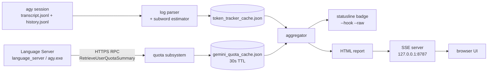

# ⚡ agy-pro & agy-tools

<div align="center">

**[English](README.md)** | **[한국어](README.ko.md)**

[](LICENSE)
[-brightgreen.svg)](#under-the-hood)
[](https://nodejs.org)
[-orange.svg)](#analytics)
[](#under-the-hood)
[](#under-the-hood)
[](#install)

**Zero-dependency Antigravity CLI toolkit: real-time token & quota analytics (`agy-tokens`, `agy-dashboard`), user-tuned customizations (`hooks`, `agents`, `skills`, `rules`, `plugins`), and a clean gateway manager (`agy-pro`) with zero `agy` PATH shadowing.**

</div>

---

> [!WARNING]
> **Deprecation Notice — Legacy Go `agy pro` Features Superseded by Native `antigravity-cli`**
>
> `agy-pro`'s legacy Go shim (`~/.agy-pro/bin/agy.exe`) and its Go subcommands (`agy pro swarm`, `agy pro fanout`, `agy pro code`, `agy pro hybrid`, `agy pro bridge`, `agy pro settings`, `agy pro mode`, `agy pro integrations`, and the old Go `agy pro setup`) are **deprecated and must no longer be used**.
>
> Google's native **`antigravity-cli` (`agy`)** now ships first-class equivalents natively:
> - Multi-agent swarms & collaboration ➔ use native **`/swarm`** and **`/teamwork`**
> - Specialist subagents ➔ use native custom **`AGENT.md`** subagents (`agents/`)
> - Lifecycle automation & extensions ➔ use native **`hooks.json`**, **`/plugin`**, and **`Auto`** mode
>
> Installing this repository now uses the **Option 1 Node.js installer** (`install.cmd` / `scripts/install.bat` / `scripts/install.sh`) with **zero `agy.exe` PATH shadowing** — `agy` always runs the authentic native binary directly. Use the new simplified Node.js **`agy-pro`** CLI (`agy-pro setup`, `agy-pro gateway on|off|status`) solely when you want to configure external LLM gateway endpoints (`AGY_LLM_GATEWAY_*`).

---

<a id="toc"></a>

**Contents:** [One-line install & uninstall](#one-line) · [What gets installed](#what-gets-installed) · [Simplified `agy-pro` Gateway CLI](#gateway-cli) · [Analytics (`agy-tokens` & `agy-dashboard`)](#analytics) · [Install & Troubleshooting](#install) · [Under the hood](#under-the-hood) · [Legacy Go `agy pro` (Deprecated)](#legacy-deprecated) · [Docs](#docs)

> [!NOTE]
> Token and cost numbers are calculated locally by this project's own tokenizer and heuristic estimation engine. They are estimates, not a provider invoice.

---

<a id="one-line"></a>

## ⚡ One-line install & uninstall

Prerequisites: **Node.js 16+** ([nodejs.org](https://nodejs.org)) and native **Antigravity CLI** (`agy`). **No Go toolchain is required.**

**Windows (Command Prompt or `install.cmd`):**

```cmd
git clone https://github.com/myk1yt/agy-pro.git && cd agy-pro && install.cmd
```

**Windows (PowerShell 5.1+):**

```powershell
cmd /c "git clone https://github.com/myk1yt/agy-pro.git && cd agy-pro && install.cmd"
```

**macOS / Linux:**

```bash
git clone https://github.com/myk1yt/agy-pro.git && cd agy-pro && bash scripts/install.sh
```

After installing, open a **new** terminal window so `PATH` changes take effect. Your native `agy` binary is **never shadowed** (nothing installs an `agy.exe` shim).

### 🧹 Uninstall

**Windows:**

```cmd
uninstall.cmd --yes
```

**Cross-platform (`scripts/lib/uninstall.js`):**

```bash
node scripts/lib/uninstall.js --dry-run   # preview without modifying disk
node scripts/lib/uninstall.js --yes       # full cleanup (unlinks npm, removes shims, statusLine, gateway env/files)
node scripts/lib/uninstall.js --yes --keep-state   # keep ~/.agy-pro/gateway.* profiles while deactivating env vars
```

If an older installation left a legacy Go shim at `~/.agy-pro/bin/agy.exe` on Windows, the uninstaller automatically detects it and delegates cleanup to `agy-pro/scripts/uninstall.ps1` as well.

---

<a id="what-gets-installed"></a>

## 📦 What gets installed (Option 1)

`install.cmd` (`scripts/install.bat`) and `scripts/install.sh` deploy everything cleanly using pure Node.js built-ins:

1. **Global CLI Tools & Self-Healing Launchers** (`scripts/lib/make-launchers.js`):
   - Links `agy-tools`, `antigravity-tools`, `agy-tokens`, `agy-dashboard`, and `agy-pro` globally via `npm link`.
   - Creates 5 path-free self-healing launchers (`~/.gemini/antigravity-cli/bin/*.bat` on Windows; `~/.local/bin/*` on macOS/Linux) backed by a root marker so they keep working even if you move the cloned repository folder.
   - **Zero `agy.exe` PATH shadowing**: `agy` resolves directly to Google's native Antigravity CLI.

2. **Antigravity Customizations** (`scripts/lib/configure-customizations.js` ➔ `~/.gemini/config/`):
   - **`hooks/`**: Deploys `hooks/hooks.json` with `PostInvocation` pinned at deploy time to your resolved `agy-tokens` launcher path.
   - **`agents/` & `references/`**: Deploys the 9 specialist agents (`architect`, `blind-qa`, `code-reviewer`, `debug-specialist`, `designer`, `readiness-auditor`, `release-inspector`, `research`, `security-reviewer`) and `references/visual-qa-rubric.md`.
   - **`skills/`, `rules/`, & standalone `plugins/`**: Deploys the 43 workflow skills, governance `rules/` (`AGENTS.md`, `GEMINI.md`, `agents-index.md`), and 5 standalone plugins (`agy_help`, `code_reviewer`, `deep_investigator`, `designer`, `security_reviewer`). Optional `workflows/` is supported when present.
   - **Legacy Exclusions (`DEFAULT_EXCLUDES`)**: `plugins/agypro_swarm`, `plugins/agypro_settings`, `skills/mode`, and `agents/agypro-search` remain in the repository for legacy compatibility/reference only and are **excluded from installation**.

3. **Statusline Integration** (`scripts/lib/configure-statusline.js` ➔ `~/.gemini/antigravity-cli/settings.json`):
   - Atomically creates or merges the `statusLine` slot (`agy-tokens --hook --raw --write-dashboard`), preserving all unmanaged user keys and backing up existing files to `settings.json.bak.<timestamp>`.

---

<a id="gateway-cli"></a>

## 🌐 Simplified `agy-pro` Gateway CLI

The new Node.js `agy-pro` CLI (`bin/agy-pro.js`) manages external LLM gateway environment variables (`AGY_LLM_GATEWAY_URL`, `AGY_LLM_GATEWAY_API_KEY`, `AGY_LLM_GATEWAY_WIRE_PROTOCOL`, `AGY_LLM_GATEWAY_MODELS`, `AGY_LLM_GATEWAY_CA_CERT`, `AGY_LLM_GATEWAY_HEADERS`) across multi-provider profiles without touching or wrapping the native `agy` binary.

### Commands

```bash
agy-pro setup                          # Interactive 7-step setup wizard (or --yes for scripted setup)
agy-pro gateway on [<profile>]         # Activate a saved profile (persists AGY_LLM_GATEWAY_*)
agy-pro gateway off                    # Deactivate gateway (clears AGY_LLM_GATEWAY_* -> restores native models)
agy-pro gateway status [--json]        # Show active mode (NATIVE vs GATEWAY_XOR), profile, & MDM overrides
agy-pro models [--remote] [--json]     # List configured or live remote (/models) gateway models
agy-pro env [--shell sh|pwsh|cmd]      # Print shell export/unset lines (--reveal to unmask API key)
agy-pro doctor [--json]                # Verify Node >=16, zero agy PATH shadowing, statusLine, hooks, & gateway env
```

### Multi-Profile State & Security

- **Multi-profile config**: Saved in `~/.agy-pro/gateway.json` (v2 schema, `0o600`, atomic writes). Stores provider presets (`deepseek`, `openrouter`, `groq`, `openai`, `bigmodel`, `google`, `together`, `mistral`, `local-gateway`, `custom`), Base URLs, wire protocol, and the **name** of the API key env var (`apiKeyEnv`) — **plaintext API keys are never written to `gateway.json`**.
- **Secret-safe OS persistence**:
  - **Windows**: Writes `HKCU\Environment` via `powershell.exe -Command -` reading `__AGY_ENV_MAP_JSON` from process env (**zero secrets in `argv`**, plus automatic UTF-8 BOM key cleanup).
  - **macOS / Linux**: Writes `~/.agy-pro/gateway.env` (`0o600`) and manages a `# >>> agy-pro gateway >>>` source block in your shell rc file.
  - Passing `--api-key` on `argv` is explicitly refused (exit code `2`). Use the masked interactive prompt (`abcde****`), `--api-key-stdin`, or `AGY_PRO_API_KEY_INPUT`.
- **Loopback URLs (Optional Key)**: Local gateways (`http://127.0.0.1:11434/v1`, `http://localhost:...`, `http://[::1]:...` for Ollama, LiteLLM, or vLLM) do not require an API key. Remote URLs require `https://` and an API key.

### Important Gateway Notes

> [!IMPORTANT]
> **XOR `/model` Catalog Replacement:** Setting `AGY_LLM_GATEWAY_MODELS` (comma-separated model IDs, never JSON) replaces Antigravity CLI's entire built-in `/model` catalog with **"Enterprise Gateway Models"** (XOR). Native Antigravity models and gateway models cannot share the same `/model` picker simultaneously. Run `agy-pro gateway off` and open a new terminal to restore native Antigravity models.

> [!NOTE]
> **`genai` vs `openai` Wire Protocol:** Native `agy` strips tool declarations when `AGY_LLM_GATEWAY_WIRE_PROTOCOL=openai` is used directly against OpenAI-compatible endpoints without a Gemini-wire bridge. Use `genai` (default for the `google` AI Studio preset) for Gemini/Vertex gateways when native tool calling is required.

Non-interactive example (local Ollama loopback):

```bash
agy-pro setup --yes --provider local-gateway --url http://127.0.0.1:11434/v1 --models llama3.2,qwen2.5
agy-pro gateway status
agy-pro gateway off
```

---

<a id="analytics"></a>

## 📈 Analytics: statusline, quota, dashboard

`agy-tokens` needs one `statusLine` entry in `~/.gemini/antigravity-cli/settings.json` and no change to Antigravity itself. The Option 1 installer (`install.cmd` / `scripts/install.bat` / `scripts/install.sh`) writes this entry atomically via `scripts/lib/configure-statusline.js` (creating `.bak.<timestamp>` backups before updating existing files), and `uninstall.cmd` removes it cleanly.

```text
⚡ Turn: 1.2k ($0.0002) | Today: 45.8k ($0.0068) | Cache: 82% | 5h: ▰▰▰▰▱ 79% (4h 10m) | 7d: ▰▱▱▱▱ 21% (3d 20h) | 📊 Dashboard
```

```text
⚡ 이번 턴: 1.2k (₩0) | 오늘 누적: 45.8k (₩10) | 캐시: 82% | 5h: ▰▰▰▰▱ 79% (4h 10m) | 7d: ▰▱▱▱▱ 21% (3d 20h) | 📊 대시보드
```

Won amounts round to whole won, so a small per-turn cost can legitimately read `₩0` while the same day's total reads `₩10`.

**1:1 Gemini quota.** The quota subsystem queries the local Antigravity Language Server over HTTPS/HTTP RPC (`RetrieveUserQuotaSummary`) and shows the two real rolling buckets: **5-Hour (`5h`)** burst window and **7-Day (`7d`)** weekly allowance, each with a live countdown. The answer is cached for 30 seconds at `~/.gemini/gemini_quota_cache.json`, so the statusline read stays sub-millisecond and the refresh never blocks the turn.

**The `statusLine` entry itself.** If you prefer to wire it by hand (a container or a locked-down `PATH`), add this block to `~/.gemini/antigravity-cli/settings.json`:

```json
{
  "statusLine": {
    "type": "command",
    "command": "agy-tokens --hook --raw --write-dashboard",
    "enabled": true,
    "stack_with_default": true
  }
}
```

Direct Node path: `"command": "node /path/to/agy-pro/bin/agy-tokens.js --hook --raw --write-dashboard"`. On Windows, if the subprocess does not inherit `PATH`, use 8.3 short paths and escape every backslash:

```text
"command": "C:\\PROGRA~1\\nodejs\\node.exe %APPDATA%\\npm\\NODE_M~1\\AGY-TO~1\\bin\\AGY-TO~1.JS --hook --raw --write-dashboard"
```

**Real-time dashboard on port 8787.** One loopback server, Server-Sent Events on `/events`, and responsive pure-SVG charts: 30-day token volume as bars stacked per model (input, cached and output are table columns, not chart segments), dynamic Y-axis scaling, interactive tooltips, filters by date range (today, 7d, 30d, custom) and by model, and turn-by-turn model attribution including reasoning effort. The same page works from `file://` through script-tag polling, without CORS errors.

```bash
agy-tokens --serve --open     # SSE server on 127.0.0.1:8787 and open the browser
agy-tokens --html --open      # static self-refreshing HTML artifact
agy-tokens --sync-quota       # refresh the live quota pool now
```

**Data path, end to end.**



**Model and pricing matrix.** Subword token pricing, prompt-cache discounts, and a sync engine for official price changes:

| Model ID | Display Name | Provider | Context | Input / 1M | Cached / 1M | Output / 1M |
| :--- | :--- | :--- | :--- | :--- | :--- | :--- |
| `gemini-3.8-flash` | **Gemini 3.8 Flash** | Google | 1M | $0.15 | $0.0375 | $0.60 |
| `gemini-3.8-flash-thinking` | **Gemini 3.8 Flash Thinking** | Google | 1M | $0.15 | $0.0375 | $0.60 |
| `gemini-3.7-flash` | **Gemini 3.7 Flash** | Google | 1M | $0.15 | $0.0375 | $0.60 |
| `gemini-3.0-pro` | **Gemini 3.0 Pro** | Google | 2M | $1.25 | $0.3125 | $5.00 |
| `gemini-2.5-pro` | **Gemini 2.5 Pro** | Google | 2M | $1.25 | $0.3125 | $5.00 |
| `gemini-2.0-flash` | **Gemini 2.0 Flash** | Google | 1M | $0.10 | $0.0250 | $0.40 |
| `claude-opus-5.5` | **Claude Opus 5.5** | Anthropic | 200k | $15.00 | $1.50 | $75.00 |
| `claude-sonnet-5.5` | **Claude Sonnet 5.5** | Anthropic | 200k | $3.00 | $0.30 | $15.00 |
| `claude-3.5-haiku` | **Claude 3.5 Haiku** | Anthropic | 200k | $0.80 | $0.08 | $4.00 |
| `gpt-4o` | **GPT-4o** | OpenAI | 128k | $2.50 | $1.25 | $10.00 |
| `o3-mini` | **o3-mini** | OpenAI | 200k | $1.10 | $0.55 | $4.40 |
| `o1` | **o1** | OpenAI | 200k | $15.00 | $7.50 | $60.00 |

```bash
agy-tokens --prices --currency krw    # the official catalogue as a table
agy-tokens --sync-prices              # pull the newest official prices
agy-tokens --auto-sync                # sync when the local catalogue is older than 24h
```

A model that is not in the table (a new release, a local model) falls back to regex heuristics on `flash`, `pro`, `mini`, `free` and `local` to pick a rate tier.

**21 languages, RTL included.** Locale is detected from the host (`LANG`, `LC_ALL`), and the HTML report and dashboard output switches to `dir="rtl"` for Arabic and Hebrew (the terminal badge renders in logical order, with no bidi reordering).

| Region | Languages |
| :--- | :--- |
| East Asia | English (`en`), 한국어 (`ko`), 日本語 (`ja`), 简体中文 (`zh`), 繁體中文 (`zh-TW`) |
| South and Southeast Asia | हिन्दी (`hi`), Tiếng Việt (`vi`), Bahasa Indonesia (`id`), ภาษาไทย (`th`) |
| Europe | Deutsch (`de`), Français (`fr`), Español (`es`), Português (`pt`), Italiano (`it`), Nederlands (`nl`), Polski (`pl`), Svenska (`sv`), Русский (`ru`), Türkçe (`tr`) |
| Middle East (RTL) | العربية (`ar`), עברית (`he`) |

### `agy-tokens` CLI, the short list

`agy-tokens`, `agy-tools` and `agy-dashboard` share one CLI engine and one option surface. Bare `agy-dashboard` prepends `--serve` (and `--open` unless you pass `--open`/`--no-open`), and `agy-tools` puts a subcommand layer in front of the same options.

| Option | What it gives you |
| :--- | :--- |
| *(none)*, `--today`, `-t` | Today's usage summary |
| `--yesterday`, `-y` / `--7d` / `--30d` / `--all` / `--range YYYY-MM-DD..YYYY-MM-DD` | Any other window |
| `--session [id]`, `-s` | Turn-by-turn breakdown for the latest or a named conversation |
| `--currency <usd\|krw\|jpy\|eur\|gbp>` / `--lang <code>` | Display currency and UI language |
| `--free`, `--no-cost` | Hide dollars, show tokens only (flat-subscription mode) |
| `--json` | Raw JSON for scripts |
| `--hook`, `--badge` / `--raw` | Statusline payload / raw badge string |
| `--fresh`, `--no-cache` | Bypass the cache and re-parse transcripts |
| `--prices`, `--sync-prices`, `--auto-sync` | Price catalogue, sync, auto-sync |
| `--sync-quota` | Refresh the live Gemini quota pool |
| `--html`, `--dashboard` / `--serve [port]` / `--open` / `--refresh <sec>` / `--port <n>` | Static report / SSE server (default `8787`, `0` for a random port) / open the browser / poll interval |
| `--write-dashboard` / `--no-link` / `--no-color` | Statusline write side, OSC 8 link off, colour off |
| `--model <name>` / `--help`, `-h` / `--version`, `-v` | Price override, help, version |

---

<a id="install"></a>

## 🚀 Install & Troubleshooting

**Windows:**

```cmd
git clone https://github.com/myk1yt/agy-pro.git && cd agy-pro && install.cmd
```

(`install.cmd` invokes `scripts\install.bat`.)

**macOS / Linux:**

```bash
git clone https://github.com/myk1yt/agy-pro.git && cd agy-pro && bash scripts/install.sh
```

**Updating after `git pull`:**

```bash
git pull
# Windows:
install.cmd
# macOS / Linux:
bash scripts/install.sh
```

**Verify installation:**

```bash
agy-tokens --version
agy-pro doctor
```

| Symptom | Fix |
|---|---|
| `agy-tokens` or `agy-pro` is not recognized | Add `%USERPROFILE%\.gemini\antigravity-cli\bin` (Windows) or `$HOME/.local/bin` (POSIX) to `PATH` and open a **new** terminal |
| `agy-pro doctor` warns `agy` is shadowed by `~/.agy-pro/bin/agy.exe` | Run `uninstall.cmd --yes` (or remove `~/.agy-pro/bin` from your User `PATH`) and re-run `install.cmd` |
| `statusLine` missing or customizations out of date | Re-run `node scripts/lib/configure-customizations.js` and `node scripts/lib/configure-statusline.js` |
| Need native `/model` list back after gateway testing | Run `agy-pro gateway off` and open a new terminal |

---

<a id="under-the-hood"></a>

## 🔧 Under the hood

- **Zero external dependencies**: Pure Node.js (>=16) standard library (`fs`, `path`, `os`, `http`, `https`, `net`, `crypto`, `child_process`, `readline`). Zero `npm install` needed.
- **No MCP, no resident daemon**: `agy-tokens` reads cached session transcripts and quota snapshots in sub-millisecond time; `agy-dashboard` binds `127.0.0.1` only when you run it.
- **Self-healing launchers**: Generated `.bat` shims and POSIX shell wrappers hold no frozen repo path — they resolve the repository root dynamically via `~/.gemini/antigravity-cli/agy-root.txt` (Windows) or `~/.local/share/agy-tools-root` (POSIX) and repair stale markers via depth-bounded symlink-safe scans.
- **Test suite**: `npm test` (`node test/run-tests.js`) runs the full zero-dependency test suite.

---

<a id="legacy-deprecated"></a>

## ⚠️ Legacy Go `agy pro` (Deprecated — Do Not Use)

<details>
<summary>Deprecated (Legacy): Go shim (`agy-pro/`) reference — superseded by native `antigravity-cli` and Option 1 Node tools</summary>

The Go binary previously built under `agy-pro/` (`agy.exe` prepended to `PATH`) and its Go verbs (`agy pro fanout`, `agy pro code`, `agy pro hybrid`, `agy pro bridge`, `agy pro swarm`, `agy pro settings`, `agy pro mode`, `agy pro integrations`) are **deprecated and frozen**.

- **Why deprecated?** Native `antigravity-cli` now directly implements `/swarm`, `/teamwork`, custom `AGENT.md` subagents, native `hooks.json`, `/plugin`, and `Auto` mode without needing a `PATH`-shadowing Go shim.
- **What replaced what?**
  - `agy pro swarm` / `agy pro fanout` ➔ Native `agy` `/swarm`, `/teamwork`, and `agents/*.md`
  - `agy pro integrations` / `agy pro mode` ➔ Option 1 Node installer (`scripts/lib/configure-customizations.js` & `scripts/lib/configure-statusline.js`)
  - `agy pro setup` / `agy pro bridge` / `agy pro hybrid` ➔ Simplified Node.js `agy-pro` CLI (`agy-pro setup`, `agy-pro gateway on|off|status`) managing native `AGY_LLM_GATEWAY_*` environment variables
  - `plugins/agypro_swarm`, `plugins/agypro_settings`, `skills/mode`, `agents/agypro-search` ➔ Kept in repo solely for legacy Go compatibility; excluded from Option 1 installation.

**Legacy Go `agy pro fanout` native-search behavior (archived):**
- The native search child runs as a restricted agy agent by default: the deployed `agypro-search` asset (`~/.gemini/config/agents/agypro-search/AGENT.md`, deployed from the repo copy) declares only the two web tools `search_web` and `read_url_content`, so the child holds no file, shell or subagent tools.
- When the asset is absent or agy does not list its name, the child falls back to a full agy agent with its own tool surface, restricted only by the search prompt, and the run line says so.
- Run-line notice emitted by the frozen Go binary: `fanout[engine] search=agy-native (restricted child; subscription per search)`

Historical Go documentation remains archived in [`agy-pro/README.md`](agy-pro/README.md).

</details>

---

<a id="docs"></a>

## 📚 Deep-dive documentation

- 📖 **[Gemini quota pool](docs/QUOTA_POOL.md)**: RPC discovery, 5h/7d sliding windows, atomic caching, sub-millisecond statusline reads.
- 📊 **[SSE dashboard](docs/DASHBOARD.md)**: dual transport (SSE push plus script polling), SVG chart engine, VS Code terminal integration, loopback security.
- 🧰 **[Legacy Go `agy-pro` README (Deprecated)](agy-pro/README.md)**: archived reference for the deprecated Go shim.
- 📘 **[Korean manual](MANUAL.ko.md)**: detailed Korean guide.

---

<a id="license"></a>

## 📄 License

MIT. See [`LICENSE`](LICENSE).

Developed by **kim,yong-tai**.
