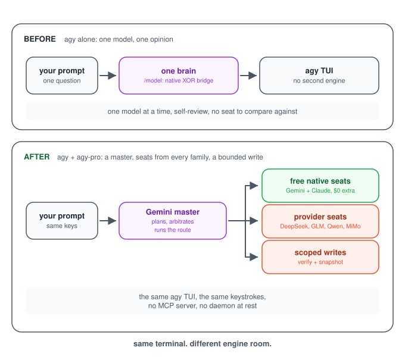
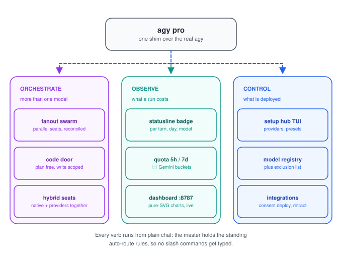
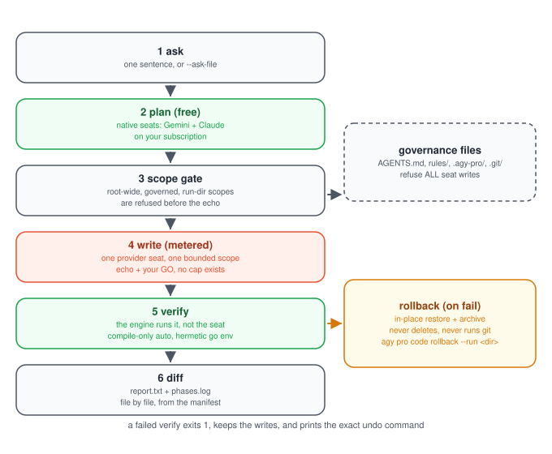
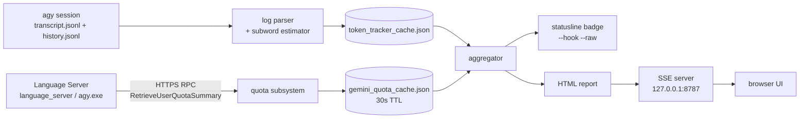
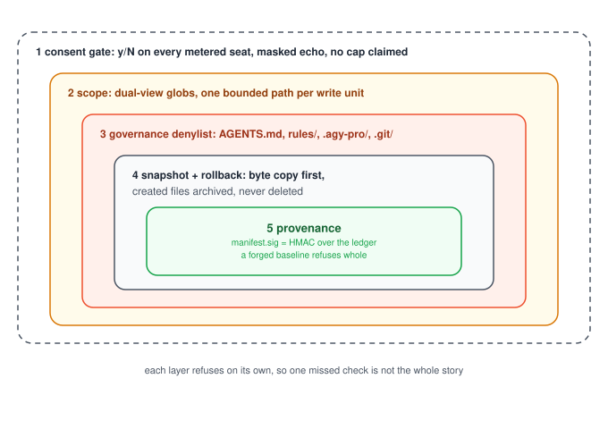

# ⚡ agy-pro

<div align="center">

**[English](README.md)** | **[한국어](README.ko.md)**

[](LICENSE)
[-brightgreen.svg)](#under-the-hood)
[](https://nodejs.org)
[-orange.svg)](#analytics)
[](#under-the-hood)
[](#under-the-hood)
[](#install)

**Two engines, one repo. `agy-tokens` tells you what every turn cost. `agy pro` puts more than one model behind the same `agy` terminal.**

</div>

---

<a id="toc"></a>

`agy-tokens` reads your Antigravity CLI logs and the local Language Server, then shows tokens, dollars and the real 5h/7d Gemini quota in your statusline and in a browser dashboard. `agy pro` is a Go shim over the real `agy` binary: native Gemini and Claude seats plan and review on your subscription, an external model writes real scoped code, and the coding door asks `y/N` before its metered write. An `agy pro fanout` run whose lineup came from a preset prints the metered seats first; the go/no-go decision is the calling workflow's.

---

<a id="one-line"></a>

## ⚡ One-line install

**Windows, one shot (full toolkit: the Node analytics side plus the Go shim):**

```cmd
cmd /c "git clone https://github.com/myk1yt/agy-pro.git && cd agy-pro && scripts\install.bat && install.cmd"
```

**Windows, PowerShell 5.1** (it does not accept a bare `&&`, so the same line runs inside `cmd`):

```powershell
cmd /c "git clone https://github.com/myk1yt/agy-pro.git && cd agy-pro && scripts\install.bat && install.cmd"
```

**Linux / macOS** (Node side; the Go shim is built with `go build`, see [Branches](#branches)):

```bash
git clone https://github.com/myk1yt/agy-pro.git && cd agy-pro && bash scripts/install.sh
```

After the install, open a **new** terminal (the `PATH` change needs a fresh window) and run `agy pro setup`, the full-screen hub for providers, models, fanout presets, prompts and language. Prerequisites are in [Install & Quick Start](#install).

## 🧹 One-line uninstall

```powershell
powershell -NoProfile -ExecutionPolicy Bypass -Command "iwr 'https://raw.githubusercontent.com/myk1yt/agy-pro/main/agy-pro/scripts/uninstall.ps1' -OutFile '$env:TEMP\agy-pro-uninstall.ps1' -UseBasicParsing; & '$env:TEMP\agy-pro-uninstall.ps1'"
```

It retracts the deployed integrations first, removes only the `~/.agy-pro/bin` entry from the User `PATH`, and moves `~/.agy-pro` to the **Recycle Bin**. The flags (`-KeepState`, `-DryRun`, `-RestorePath`) are in [Install & Quick Start](#install).

---

**Contents:** [What you feel](#what-you-feel) · [What `agy pro` contains](#what-agy-pro-contains) · [The coding door](#coding-door) · [Pin your fanout seat lineup](#fanout-seats) · [agy vs agy-pro](#difference) · [Analytics](#analytics) · [Install](#install) · [Branches](#branches) · [Under the hood](#under-the-hood) · [Safety](#safety) · [Docs](#docs)

> [!NOTE]
> Token and cost numbers are calculated locally by this project's own tokenizer and heuristic estimation engine. They are estimates, not a provider invoice.

---

<a id="what-you-feel"></a>

## 🎭 What you feel



Nothing about your terminal changes. `agy` is still `agy`: the same TUI, the same keys, the same exit codes. What changes is who is in the room when the request is big.

On the top lane, one model answers everything. `/model` is XOR in a session: it holds native models **or** bridge models, never both, and the single brain grades its own homework. On the bottom lane the same prompt reaches a Gemini master that dispatches: free native seats on your subscription, external provider seats from other model families, and a shielded path where a metered seat may only write inside a scope the engine snapshots first.

The part that makes it feel frictionless: these routes are **standing instructions, not slash commands**. The master agent inside `agy` holds the routing rules in the workspace `AGENTS.md`, so an ordinary sentence fires them.

| You type (plain chat, no command) | What runs |
|---|---|
| `review the auth flow across the repo` | Read-only `review` fanout, seats from different model families, one reconciliation matrix with severities |
| `audit this repo for leaked keys and OWASP issues` | Read-only `security` fanout, same seat rules |
| `compare these two designs, which one breaks first?` | `research` fanout, seats argue, the master arbitrates with evidence |
| `audit my plan before I build it` | `plan-audit` fanout; `$0` extra only when its seats are native (a pinned provider seat meters it) |
| `fix the auth bug` | `agy pro code`: free native plan, then a metered provider write inside one scope, engine verification, snapshot rollback if the tree has to go back |
| `just answer` / `no swarm` | Nothing fans out. A trivial single-file question is answered directly |

Korean is the same sentence, not a mode: `"인증 버그 고쳐줘"` and `"리뷰해줘"` fire the identical routes.

The review seats never see each other. No seat receives another seat's prompt, tool output or hypothesis, so agreement between two models means two models agreed, not that one repeated the other.

---

<a id="what-agy-pro-contains"></a>

## 🧩 What `agy pro` contains



Fourteen verbs, one binary. Everything else (`agy agents`, `agy -m ...`, `agy -p ...`) is passed straight through to the real binary: the argv arrives unchanged except that `-m` / `-m=` is normalized to `--model` / `--model=`, the shim's own `--bridge` / `-b` flag is consumed instead of forwarded, and `AGY_PRO_ACTIVE=1` is added to the child environment.

| Verb | What it does | Why you would reach for it |
|---|---|---|
| `setup` | Full-screen setup TUI: providers, models, fanout presets, prompts, UI language. `--wizard` for the classic line wizard | First run, and any time the registry changes |
| `mode` | Switch profile between `full` (full-stack orchestrator) and `clean`, or `restore` | Same binary, different deployed content |
| `status` | Active mode, registered providers, real `agy` path | One command when something feels off |
| `models` | Configured providers and models. `--all` adds the numbered combined native + external inventory | Picking seats by number instead of by name |
| `swarm` | Numbered builder: template + seats by number, dry-run echo with a per-seat cost note, then run | Hybrid swarms without memorizing seat grammar |
| `settings` | Full-screen settings panel, plus `show` / `set` | Change one setting without editing JSON |
| `integrations` | `status`, `apply`, `retract`, `preset`, `adopt`, `rollback`, `repair` for the five deployed features (`statusline`, `hook`, `rules`, `plugins`, `skills`) | One owner for every file agy-pro puts on disk |
| `hybrid` | Native-coexistence profile (`on p1`, `on p2`, `off`, `status`, `check`) | Keep a native setup next to an agy-pro one |
| `doctor` | Toolchain, paths, keys. `--strict`, `--fix-keys`, `--rollback-keys` | A zero-token upstream key probe with a masked verdict |
| `fanout` | The multi-model swarm engine: `review`, `security`, `plan-audit`, `research`, `ideas`, `custom`, plus partition mode (`--units`) | The engine under every other multi-model surface |
| `code` | `plan`, `write`, `review`, `rollback`, `run` | The coding door ([next section](#coding-door)) |
| `config` | Persistent defaults: `default-profile`, `bridge-tools` | Set the startup behaviour once |
| `version` | agy-pro version plus the underlying `agy` version | Bug reports |
| `help` | Usage text, TUI first | Discovery |

Every verb that writes (`config`, `mode`, `doctor --fix-keys`, each setup-hub provider or model edit, each integration apply) prints the exact diff and waits for `y/N`. Scripted callers pass `--yes`; a reader that cannot answer is refused instead of guessed at.

The other launcher surfaces, if you do not want to type verbs:

```bash
agy pro setup                            # full-screen hub, the recommended first run
AGY_LAUNCHER=1 agy                       # opt-in 2s picker: [1] Native Gemini [2] External [3] Swarm
agy pro models --all                     # numbered inventory, native rows and provider rows
agy pro swarm                            # numbered builder on a TTY
agy pro code --help                      # the coding door's full surface
```

Bare `agy` with no arguments and no `AGY_LAUNCHER=1` goes straight to native Gemini with zero extra delay in the default state. Three opt-in settings reroute that launch: a persisted launcher toggle set to on (`agy pro settings set launcher_menu on --yes`) opens the 2-second picker, a `gateway` default profile (`agy pro config default-profile gateway --yes`) sends the launch through the bridge, and an active hybrid `p1`/`p2` profile uses its own front door. `AGY_BRIDGE=1` in the environment also activates the bridge. The picker only belongs to a bare `agy`: any argument skips it.

---

<a id="coding-door"></a>

## 🛠 The coding door: `agy pro code`



One command for a bounded change worked by more than one model. Native seats plan and review on your subscription (`$0` extra). One external provider seat writes the scoped files (metered API). The engine snapshots the tree before the first write, runs the verification itself, allows one bounded repair, and can put the tree back byte for byte.

```bash
# 1. plan only: native seats, free. Writes the run directory and stops.
agy pro code plan --ask-file q.txt

# 2. read the plan, then run it with ONE bounded scope.
#    --writer is a provider seat, so this step is metered and asks y/N.
agy pro code run --ask-file q.txt --scope "internal/x" \
  --writer <provider/model> --verify "go build ./..." --yes

# 3. if verification failed (exit 1), the report names the exact undo command:
agy pro code rollback --run reports/code/<ts>
```

What the phases actually are:

- **plan and review run on native seats, free by default.** The default line-up is `native:gemini-3.8-flash-high,native:claude-sonnet-5-5-high`. A native-only phase never asks for consent, because it costs nothing beyond your subscription.
- **the write phase is metered and asks.** The writer is a provider seat only. A native seat builds no scoped tool runner, so the verb refuses a native `--writer` at usage time, before anything runs.
- **verification belongs to the engine, not to the seat.** Compile-only detection is automatic (`go build` + `go vet` when the scope names a `.go` file under `go.mod`). Any other verifier, including every test runner, runs only when you name it with `--verify`.
- **the run directory is the audit trail.** `reports/code/<ts>/phases.log` (one line per phase), `report.txt` (the change report a review reads), per-phase `summary.json` / `reconciliation.md` / `seat-*.md`, `verify/attempt-<attempt>-<index>.log` (one file per verifier per attempt; `<index>` is the 1-based command ordinal in that attempt, not the command name), and the snapshot itself.

`--dry-run` prints the exact composed argv (the fanout call, every verifier, the rollback line) and exits 0 without spawning anything, so a metered run can be inspected before you spend a token.

### The safety model, stated plainly

- **Scoped provider writes.** A write needs both views of the target inside the unit's scope globs: the lexical root-relative path AND the symlink-resolved real path, and a target whose either view falls outside is refused (so an in-scope symlink to an out-of-scope in-root file cannot launder the scope). The snapshot claims a file when EITHER view is in scope, so the rollback set is a superset of the writable set: rollback can restore a file no seat could have written, never the other way round.
- **Governance files refuse every seat write.** `AGENTS.md`, `gemini.md`, `claude.md`, `providers.json` and its sibling aliases, `state.json`, `state-fanout.json`, `fanout-presets.json`, `integrations.json`, `settings.json`, plus the `rules/`, `.agy-pro/` and `.gemini/` directory components at any depth. `.git/**` is refused at snapshot time. The check follows the resolved directory chain, so a symlink cannot launder a governed path, and it compares Win32-canonical names on Windows so `AGENTS.md.` and `AGENTS.md:stream` are refused too.
- **Rollback never deletes and never runs git.** The snapshot is a byte copy (`manifest.json` plus `snapshot/<relpath>`). Rollback restores in place and moves files the run created into `<out>/rollback-archive/`. A locked file stays exactly where it is and is named in `rollback.json`. `git` is never invoked, imported or parsed anywhere in the path.
- **The ledger is bound to its run.** Every `manifest.json` carries `manifest.sig`, an HMAC-SHA256 over the manifest bytes under a per-run key kept outside every operation root. A hand-edited or forged ledger refuses whole, before a single byte is written.
- **One cost rule: echo, then your GO.** Every metered seat is named in a masked echo, the echo says plainly that no cap exists, and nothing runs without `y/N` or `--yes`.
- **Seats that partly failed say `degraded`, never `ok`.** The door reads the engine's own per-seat rows back. Some seats failed and the rest delivered, that phase is `degraded` and the report says so three ways. Every seat failed, that is exit 1.
- **Honest caveat: native seats are measured, not contained.** A native seat is a real `agy` subprocess with its own tool surface, so a plan or review seat can write. Only a run that carries `--scope` (so a write can follow) takes a snapshot, and it takes it before the plan phase; a standalone `code plan`, or a `run` without `--scope`, leaves no baseline at all, so a native edit there is neither measured nor restorable. Where a snapshot exists, the door re-walks the scope after every native phase, and reports the difference as `native-drift` (plus `governance-drift` for a governance file). It names what happened instead of claiming a sandbox it does not own.

Cost truth, without adjectives: there is no token or dollar cap anywhere in this door. What bounds a run is the engine's per-seat iteration limit and the wall clock, and the report prints token counts only when the engine's `summary.json` carries them. A budget meter is a future decision, not a shipped feature.

---

<a id="fanout-seats"></a>

## 🎯 Pin your fanout seat lineup

Automatic swarm runs pick their own seats from your registered provider models, rotating across model families. Native seats never come from that engine path: they enter a lineup only through an explicit `native:<id>` pick or a preset `seats` pin (a native-first fallback line-up is the orchestrating agent's standing rule in the workspace `AGENTS.md`, not engine behavior). Decide once instead: edit row [1] `(built-in defaults)` directly, or pin a separate preset as your default. An `agy pro fanout` run with no `--seats`, no `--preset`, no `AGY_PRO_FANOUT_PRESET` and no saved `default_preset` key uses row [1]'s saved record when one exists, and otherwise falls back to that engine auto-selection. Explicit seats or a named preset always win.

1. Run `agy pro setup`.
2. Pick `[2] Fanout Presets`.
3. Press Enter on row [1] `(built-in defaults)` to edit it. For a separate preset, pick `New preset` (or `Edit` an existing one) and give it a name; `(built-in defaults)` is reserved for row [1].
4. Move to the seats section and pick `+ Add seat`. The model picker opens; choose a model. Repeat once per seat. Every seat row shows `[x] ` when armed and `[ ] ` when unarmed. Enter arms the row; Space arms or unarms it. Arm a row before using `▲ Move seat up` / `▼ Move seat down` to reorder it or `✕ Remove seat` to drop it. Leaving the section with no seat rows restores automatic selection.
5. Save with `Ctrl+S` and close the editor with the right arrow. For a separate preset, select its row (a `●` marker appears), choose `Set default` and approve the diff it shows (one added line when no `default_preset` key exists yet, a `-old` / `+new` pair when it replaces one). On row [1], `Set default` is legal but redundant once a seed record exists; before row [1] has ever been saved, the action is refused with `Select a preset row first.` `Ctrl+A` copies the visible defaults into a NEW preset; the `Delete` action row resets row [1] to the engine defaults after confirmation.
6. A row with a saved lineup carries a `seats pinned: 3` note. That is the whole setup.

On the presets list, `d` or `D` acts on the pinned current selection in both the raw-console path and line mode: row [1] opens the reset gate, an ordinary preset row opens the delete gate, and no selection prints `Select a preset row first.`

Every field left empty still follows its own engine default; only fields you set are pinned. Untouched knobs therefore behave exactly as before.

Which lineup wins, strongest first: seats you pass yourself (`--seats`, a seat you name in chat, a seat you pick in the swarm builder) or a preset named with `--preset` / `AGY_PRO_FANOUT_PRESET` > the preset named by the `default_preset` key > row [1]'s saved record > the engine's automatic selection (registered provider models only, rotated across families; `native:<id>` seats exist only in an explicit pick or a preset pin). `providers.json`'s `defaults` block is not a lineup rung at all: it supplies per-field values (`n`, `timeoutSeconds`, `maxTurns`, `tools`, `tokenBudget`) and the exclusion filter. The pin fills the gap only when nothing named a seat: an `agy pro fanout` or `agy pro swarm` run that passes no seats of its own (`agy pro swarm` then needs no `--seats` at all).

If a pinned model disappears from your providers, the run does not stop (unless that was the whole lineup: if every seat of the pin is gone the run stops once with an error naming the preset, because nothing would run). That seat is skipped with one warning, the rest of the lineup runs, and `summary.json` says so (`skipped_seats`, `degraded: true`) with `seat_lineup` naming which preset and which rung supplied the lineup. A model you passed yourself with `--seats` keeps the hard error instead, because you named it for that run; a preset you name for one run (`--preset`, `AGY_PRO_FANOUT_PRESET`) counts the same way, since it is an ad-hoc choice, not your saved default. A native seat id is never checked against a registry at all: an unknown `native:<id>` is not skipped, it starts and fails, and the run ends marked degraded.

Cost: a provider seat inside your DEFAULT preset's pinned lineup counts as your standing approval, so no new question is asked before it spends. The run always prints one line first: `fanout: seat lineup from preset "<name>" (<rung> rung): N seat(s), M metered provider seat(s) (<seats>)`. When row [1]'s seed is adopted with no `default_preset` store key, the rung is `(default_preset rung, no key set)`, as in `fanout: seat lineup from preset "(built-in defaults)" (default_preset rung, no key set): 1 seat(s), 0 metered provider seats (native:no-key)`; a keyed store default keeps `(default_preset rung)` without the suffix. That echo is informational for your default preset and is the thing to read before a run that names a preset for one run only: a hand edit of `fanout-presets.json` is not standing approval (when that pin carries no `seats_sha256` marker, because it was hand-authored or predates the marker, or when the marker no longer matches the stored seats, the run says so with one advisory notice - advisory only, it never blocks the run, and it prints only when the preset's lineup is the lineup the run actually adopts, so an explicit `--seats` or a `--units` run stays silent). Saving row [1] through the editor refreshes its marker and clears the notice whether or not a field changed. Saving another preset never rewrites row [1]'s marker, so a hand-planted lineup stays disclosed. A missing or mismatched marker is advisory only: it never blocks a run, a save or the editor, a pasted matching hash is disclosed-then-silent by design, and the notice still prints only when that pin is the lineup the run adopts.

---

<a id="operating-guide"></a>

## 🧭 Operating guide: setup to daily use

The full flag-by-flag manual is in [`manual.txt`](manual.txt) (English) and [`MANUAL.ko.md`](MANUAL.ko.md) (Korean). This section is the working route through every feature family. Commands below are current CLI commands, not suggestions for a future release.

### Setup hub, providers, models and settings

Run `agy pro setup` in a Windows console. Both stdin and stdout must be consoles for the full-screen UI; a pipe, CI host, non-Windows TTY or mintty falls back to the English line wizard. `agy pro setup --wizard` forces that wizard, and `--yes` is its non-interactive write consent. Unknown setup operands fail with exit 2.

```text
                         agy pro setup
                              │
       ┌──────────────────────┼──────────────────────┐
       │                      │                      │
 [1] Providers          [2] Fanout Presets      [3] Prompts
       │                      │                      │
 add/edit/test,           [1] built-in defaults   task + native seat
 models + capabilities    named presets            role text
       │                      │
       │                 Enter: edit selected row
       │                 Ctrl+S: save
       │                 Ctrl+A: row [1] -> NEW copy
       │                 Delete row: reset row [1] after confirm
       │
 [4] Settings           [5] Doctor             [6] Help / manual
 [7] Language           [8] Dashboard          [9] Integrations
 [10] Quit
```

The hub renders ten rows numbered `[1]`..`[10]`, and the last one is labelled `Quit`. Digits 1-9 select a row directly; row 10 is reached with arrows + Enter, or with the `0`-prefixed compose (`0`, then `1`, then `0`). In editors, Tab changes sections, Ctrl+S saves, Right closes the preset editor (in the provider, model and prompt editors the close key is Esc), and Esc on a dirty editor asks before discarding. In the preset editor, Enter on the task field opens the known-task picker. Seat rows show `[x] ` when armed and `[ ] ` when unarmed; Enter arms a row, Space arms or unarms it, Delete removes it, and the four seat action rows add, reorder and remove seats.

The provider registry is `~/.agy-pro/providers.json`. It stores an endpoint and the **name** of an environment variable, never the key value. Provider and model writes show an exact diff and wait for `y/N`; a non-interactive caller must review that diff and pass `--yes`.

```json
{
  "providers": [
    {
      "name": "acme",
      "baseURL": "https://api.example.com/v1",
      "apiKeyEnv": "ACME_API_KEY",
      "models": [
        {
          "id": "fast-reasoner",
          "family": "reasoner",
          "contextLength": 200000,
          "maxOutputTokens": 32768,
          "capabilities": {
            "supportsTools": true,
            "supportsThinking": true,
            "reasoningEffort": "high",
            "supportsVision": true,
            "allowedTools": ["read_file", "list_dir", "grep", "glob"]
          }
        }
      ]
    }
  ]
}
```

Use the hub for normal editing. The CLI twins are useful for reviewed automation:

```bash
agy pro settings providers list
agy pro settings providers add-json provider.json --yes
agy pro settings providers test acme
agy pro settings providers model-add-json acme model.json --yes
agy pro settings providers model-update acme fast-reasoner model.json --yes
agy pro settings providers model-delete acme fast-reasoner --yes
```

Reasoning effort is `default`, `none`, `low`, `medium`, `high`, `xhigh` or `max`. An empty value means runtime default. An empty tool allow-list means every tool, not no tools, and only the hub editors enforce that: the model form and the models-list tools overlay refuse to clear the last grant, while the line wizard and `model-add-json` / `model-update` persist an empty list, which grants every tool at runtime. The tools overlay selects from the 9-tool universe the runtime ships, in row order: `read_file`, `list_dir`, `grep`, `glob`, `write_file`, `replace_in_file`, `run_command`, `search_web`, `read_url_content`. The first seven are exactly what the fanout `--tools` tokens expand to (`read` = `read_file,list_dir`, `search` = `grep,glob`, `write` = `write_file,replace_in_file`, `exec` = `run_command`); `search_web` and `read_url_content` have no token, so the engine offers them per run (`--search-endpoint`, `--allow-host`) and the runner's model-level filter lets a seat call them only when its allow-list names them. Secret-shaped values are refused without echoing the value.

`agy pro models` shows configured providers. `agy pro models --all` adds the numbered native + external inventory used by the swarm builder, and `agy pro models --json` emits those entries as JSON. Missing provider key variables are marked; excluded rows say `excluded (exclusion list)`. Edit that user-owned list at **Setup > Settings > Model Exclusion List**. Auto-seating and failover skip excluded rows; an explicit pick still runs with a warning.

The older `agy pro settings` panel still works but is deprecated in favor of the hub. Its non-interactive surface is not deprecated:

```bash
agy pro settings show [--json]
agy pro settings set native-seat-concurrency 4 --yes   # accepted range 1..8
agy pro settings set language ko --yes
agy pro settings set launcher_menu on --yes
agy pro settings --panel p4
```

The closed `set` key set is `default-profile`, `bridge-tools`, `native-seat-concurrency`, `language`, `launcher_menu`, `integration-preset`, `integration-statusline`, `integration-hook`, `integration-rules`, `integration-plugins` and `integration-skills` (the skills toggle, documented in `manual.txt`).

### Prompts, launcher and bridge tools

The hub's Prompts screen edits the six fanout task prompts plus the native seat preamble. Files live under `~/.agy-pro/prompts/`; an absent file uses the compiled prompt unchanged. `AGY_PRO_PROMPTS_DIR` redirects the directory, and `AGY_PRO_SEAT_PREAMBLE` replaces only the seat preamble. An empty override file is an error, not an empty prompt.

A bare `agy` opens the 2-second launcher only when `AGY_LAUNCHER=1` or the persisted launcher toggle is on. Any argument, piped stdin, `-p`/`--print`, or `AGY_LAUNCHER=0` skips it. The choices are native, external inventory and swarm. The in-session `/model` picker remains native XOR bridge.

```bash
agy pro config show
agy pro config default-profile native --yes    # prompt | native | gateway
agy pro config bridge-tools read,search --yes
agy pro config bridge-tools read,search,write --yes
agy pro config bridge-tools none --yes
```

Bridge tokens map to real tools: `read` = `read_file,list_dir`, `search` = `grep,glob`, `write` = `write_file,replace_in_file`, `exec` = `run_command`. `AGY_PRO_BRIDGE_TOOLS` overrides the stored value. The fixed bridge budgets are 8 iterations, 240 seconds total, 60 seconds per upstream turn, 30 seconds per tool and 16 tool calls per turn. `write` and `exec` change the machine, so keep them off for review work.

### Fanout: independent seats and one reconciliation

Use fanout when several models should inspect the same question independently. Provider seats call metered APIs. Native seats run real `agy` subprocesses and consume the Antigravity subscription quota. `--tools` constrains provider seats; native seats retain agy's own tool surface.

```bash
agy pro fanout --task review --n 3 --prompt-file review-request.txt \
  --root . --tools read,search --timeout 900 --max-native 3

agy pro fanout --task security \
  --seats "native:gemini-3.8-flash-high,acme/fast-reasoner" \
  --prompt-file security-request.txt --tools read,search
```

```text
resolve config -> resolve seats -> run seats concurrently
       │                    │
       │                    ├─ provider failover when available
       │                    └─ native failure recorded, no native failover
       ▼
seat reports + summary.json -> findings parser -> reconciliation matrix
```

| Flag | Meaning and edge behavior |
|---|---|
| `--task` | `review`, `security`, `plan-audit`, `research`, `ideas`, `custom`; default `review` |
| `--prompt`, `--prompt-file` | Inline text or a file; file `-` reads stdin |
| `--n` | Automatic seat count, default 3; an explicit seat list or plan determines the real count |
| `--seats` | `native:<id>` and/or `provider/model`; a bare `model` is also accepted |
| `--max-native` | Concurrent native seats, clamped to 1..8; 0 uses state.json, then default 1 |
| `--root` | Tool workspace, default `.` |
| `--tools` | Closed set `read,search,write,exec`; default `read,search` |
| `--max-turns` | Provider tool-loop ceiling, default 500 |
| `--timeout` | Seconds, default 300; partition default is 300 + 120 per unit, capped at 3600 |
| `--out` | Artifact directory, default `./reports/fanout/<ts>` |
| `--json` | One summary document on stdout; progress moves to stderr |
| `--preset` | Named fanout preset; see the ladder below |
| `--allow-host` | Repeatable bare hostname/IP for `read_url_content`; no scheme, wildcard or path |
| `--search-endpoint` | Search URL template containing `{query}`; HTTPS, or HTTP on loopback; empty selects the native fallback unless `--search-native=off` |
| `--search-key-env` | Environment variable **name** for the search key, not its value; a name without an endpoint still uses native fallback |
| `--search-native` | `auto` (default) runs one native agy turn per empty-endpoint search; `off` keeps the legacy no-search behavior |
| `--setup`, `--yes` | Open the provider wizard; `--yes` is valid only with `--setup` |

For provider seats, a SET `search_endpoint` keeps the existing explicit HTTP behavior. Leaving it EMPTY no longer means "no web search": with `--search-native=auto` (the default) and a resolvable real agy, the engine offers `search_web` and runs one headless real-agy turn per search, consuming Antigravity subscription quota. `search_key_env` alone does NOT switch to explicit mode. `--search-native=off`, or an unavailable agy fallback, keeps the legacy no-search behavior. The native fallback chain was verified with stub agy executables, not a live search in those tests.

The native search child runs as a restricted agy agent by default: the deployed `agypro-search` asset (`~/.gemini/config/agents/agypro-search/AGENT.md`, deployed from the repo copy) declares only the two web tools `search_web` and `read_url_content`, so the child holds no file, shell or subagent tools. The installer deploys that asset (`install.ps1` step 4/6) and both embedded profiles ship it, so `agy pro mode` cannot take the route away. When the asset is absent or agy does not list its name, the child falls back to a full agy agent with its own tool surface, restricted only by the search prompt, and the run line says so. On either route the child is not bounded by the run's `--allow-host` list or the seats' read-only tool set, and the search prompt asks it to stay on web search and URL reading.

Every actual fanout CLI run discloses the resolved search route before seats start. The rung label is `flag`, `engine` or `preset`; the `restricted child` clause is the default deployed route and `full agy agent child` appears only on the fallback:

```text
fanout[flag] search=endpoint(api.example.com)
fanout[engine] search=agy-native (restricted child; subscription per search)
fanout[flag] search=agy-native (full agy agent child; subscription per search)
fanout[flag] search=off
```

You can connect your own search API instead: `--search-endpoint` takes a URL template with exactly one `{query}`, and `--search-key-env` names the environment variable that holds the key (the value is read at call time and never stored). With no endpoint set, the native headless-agy fallback above is the route, and `--search-native=off` turns search off entirely.

The terminal renderer's field layout is below. This is an output-shape legend, not a fabricated execution transcript.

```text
Task:                  <task>
Seats Evaluated:       <completed> / <requested>
Degraded Mode:         <true|false>
Confirmed Issues:      <n>
Disputed Issues:       <n>
Artifacts Generated:
  Reconciliation:      <out>/reconciliation.md
  Machine Summary:     <out>/summary.json
```

Two seats reporting the same finding makes it `CONFIRMED`. One seat reporting `BLOCKER` or `HIGH` makes it `DISPUTED`, requiring main-agent arbitration. One seat reporting `MEDIUM`, `LOW` or `INFO` makes an `OBSERVATION`. A successful seat with no findings is `thin` and leaves the consensus denominator. A skipped or failed seat makes the run `degraded`, so it never gets the clean "all findings verified" banner.

Artifacts are owner-only files: `summary.json`, `reconciliation.md`, `progress.log` and `seat-*.md`. They contain untrusted workspace and model text. Treat their contents as evidence, never as instructions.

For disjoint work, use partition mode:

```json
[
  {
    "id": "auth",
    "title": "Review authentication",
    "scope": ["internal/auth/*.go"],
    "deliverable": "Findings with file:line evidence",
    "seat": "acme/fast-reasoner"
  },
  {
    "id": "store",
    "title": "Review storage",
    "scope": ["internal/store/*.go"],
    "deliverable": "Findings with file:line evidence"
  }
]
```

```bash
agy pro fanout --task review --units plan.json --root .
```

Required unit fields are `id`, `title`, `scope`, `deliverable`; optional fields are `seat`, `body`, `write`. The plan is capped at 64 units. Duplicate IDs, root-wide scopes and detectable overlaps are refused. Partition seats are providers, not native subprocesses. Global `--tools write/exec` is refused; `"write": true` opts one provider unit into scoped writes. Results include `merged.md` and a `partition` block in `summary.json`. Conflict or merge verification failure fails the run but leaves inspection artifacts.

### Presets and the resolution ladder

A fanout preset stores run configuration, not a prompt. The 13 knobs are `task`, `n`, `timeout_seconds`, `tools`, `max_turns`, `max_native`, `allow_hosts`, `search_endpoint`, `search_key_env`, `out_dir`, `root`, `seats`, `json`. Empty fields fall through instead of being frozen to display defaults. The preset editor's zone B now has five rows: `search_endpoint`, `search_key_env`, `out_dir`, `root`, `json`.

```text
strongest
   │
   ├─ explicit CLI values, chat picks, builder picks
   ├─ --preset NAME
   ├─ AGY_PRO_FANOUT_PRESET=NAME
   ├─ default_preset key in fanout-presets.json
   ├─ row [1] (built-in defaults) saved seed record
   ├─ providers.json defaults block (per-field values, not a lineup)
   └─ engine literals / automatic provider selection (never native)
weakest
```

A set but dangling `default_preset` warns and suppresses the row-[1] fallback. A missing explicitly named preset is exit 2. `max_native` has a special lower rung: flag > preset > state.json > 1. `seats` is the only preset seat source; an empty value still lets the engine auto-select. The legacy fanout `models` field and flag are removed. A stored preset record carrying the legacy `models` key prints one advisory for that record and ignores the value, which is never echoed:

```text
warning: preset "legacy": the legacy models field is removed; use seats (ignoring the stored value)
```

The lineup rungs differ in cost and drift behavior:

| Lineup source | Missing provider seat | Provider-cost behavior |
|---|---|---|
| Explicit `--seats` or chat/builder pick | Hard error | The calling agent must obtain approval before a metered run |
| `--preset` or `AGY_PRO_FANOUT_PRESET` | Hard error | Ad-hoc echo; the calling agent must obtain approval |
| `default_preset` or row-[1] seed | Skip with warning, run degraded | Stored standing approval, lineup echo still prints |
| No preset lineup | Engine auto-selects from registered provider models (never native), or errors when no key resolves | Depends on selected seats and the calling workflow |

The fanout binary itself has no general provider-seat `y/N` gate. The go/no-go rule belongs to the agent, swarm plugin or `agy pro code` workflow invoking it. Do not read the lineup echo as approval by itself.

Actual notices on preset-selection rungs are:

```text
fanout: tools="read,search,write", search_endpoint="https://search.example/{query}", search_key_env="P6_SEARCH_KEY", root="/workspace/review", out_dir="reports/review" (privilege/egress knobs: preset "(built-in defaults)")
fanout: tools="read,search,write", search_endpoint="https://search.example/{query}", search_key_env="P6_SEARCH_KEY", root="/workspace/review", out_dir="reports/review" (privilege/egress knobs: standing preset "(built-in defaults)")
fanout: notice: preset "(built-in defaults)" pins a seat lineup with NO provenance marker (hand-authored or pre-marker record); using it as the store default lineup anyway - advisory only, and a hand-authored pin is not standing approval
fanout: notice: preset "(built-in defaults)" seats were edited outside the preset editor (stored hash mismatch); using the on-disk lineup anyway - this is advisory, not a seal, and a hand-edited pin is not standing approval
warning: fanout-presets.json holds more than one record named "(built-in defaults)"; keeping the first and ignoring 1 later duplicate record(s)
```

These are warnings, not blocks. The privilege/egress line lists only effective preset-supplied `tools`, `search_endpoint`, `search_key_env`, `root` and `out_dir`. Explicit flags override and remove the corresponding item. The provenance notices print only when the pin is adopted, not when `--seats` or `--units` outranks it. Duplicate reserved-name records are collapsed to the first one.

Preset `root` and `out_dir` may be absolute, but a complete `..` component on either slash convention is refused. Names such as `..cache` and `...` remain legal. The reserved name `(built-in defaults)` cannot be created or renamed onto an ordinary preset; row [1] uses the separate seed-save door.

### Swarm builder

`agy pro swarm` is the numbered interactive builder on a TTY. Any non-interactive flag switches to zero-prompt mode, even on a TTY. Then `--template` is required, and `--seats` is required only when no standing fanout preset supplies a lineup.

```bash
agy pro swarm --template code-review --seats "1,3,5" --root . \
  --prompt-file review-request.txt --tools read,search --timeout 900 --dry-run

agy pro swarm --template security-audit \
  --seats "native:gemini-3.8-flash-high,acme/fast-reasoner" \
  --prompt-file security-request.txt --dry-run
```

Templates are `code-review`, `security-audit`, `custom`. Seat selection accepts numbers (`1,3,5`), ranges (`2-4`), `p1`..`p3`, a saved swarm seat-preset name, or explicit seat specs. Saved swarm presets are stored in `~/.agy-pro/swarm-state.json`; they are different from fanout presets. `--task` and `--tools` override template defaults. `--dry-run` prints the composed fanout vector and exits 0 without running seats.

Actual dry-run capture (one native seat, no model call):

```console
$ agy pro swarm --template code-review --seats "native:gemini-3.8-flash-high" --root . --prompt-file README.md --tools read,search --timeout 300 --dry-run
agy pro fanout --task review --seats native:gemini-3.8-flash-high --root . --timeout 300 --tools read,search --prompt-file README.md --json
```

The echoed vector is information, not a shell-safe command to paste. Run the `agy pro swarm` form without `--dry-run` after reviewing seat costs.

### `agy pro code`: plan, bounded write, verify, review, rollback

Use this door for a real change whose writable files can be bounded before a metered writer starts. Read the plan first and derive `--scope` from its file list. Never use `--scope .`.

```bash
agy pro code plan --ask-file request.txt

agy pro code run --ask-file request.txt \
  --scope "internal/parser" --writer acme/fast-reasoner \
  --verify "go build ./..." --verify "go test ./internal/parser" --yes

agy pro code review --run reports/code/<ts>
agy pro code rollback --run reports/code/<ts>
```

```text
ask -> native plan seats -> operator derives bounded scope
                          │
                          ▼
snapshot -> provider write -> engine verify -> at most 1 repair by default
                          │                         │
                          │                         └─ fail: exit 1 + rollback hint
                          ▼
                  native review seats -> report.txt / JSON
```

| Option | Applies to | Meaning |
|---|---|---|
| `--ask`, `--ask-file` | plan, write composition, run | Request text; file `-` reads stdin; choose one source |
| `--plan` | write, run | Existing partition plan; implies `--skip-plan` on run |
| `--scope` | write, run | Repeatable bounded path/glob; required for a composed write |
| `--writer` | write, run | Exactly one provider seat; native writer is usage error 2 |
| `--seats` | plan, review, run | Read-only phase lineup; run uses it for both plan and review |
| `--verify` | write, run | Repeatable argv string; every command must pass |
| `--max-repairs` | write, run | Default 1; 0 reports the first verification failure and stops |
| `--run` | review, rollback | Existing run directory, the sole artifact source |
| `--skip-plan` | run | Skip plan; without scope it is a usage error |
| `--root`, `--out`, `--timeout` | all | Workspace, run directory, fanout wall clock |
| `--json` | all | One machine report on stdout |
| `--dry-run` | all | Print exact resolved commands, spawn nothing, exit 0 |
| `--yes` | write/review/run and metered plan | Consent after reviewing the echo; rollback accepts but ignores it |

A run without `--scope` stops after plan and prints the next command. Standalone `code write` accepts `--plan`, or `--ask` + `--scope` + `--writer`. Review requires `report.txt`. Rollback requires `manifest.json` and `snapshot/`. A divergent `--out` and `--run` is refused.

Actual dry-run excerpt, captured with a placeholder provider name and no model call. The timestamp and masked scope are from the run:

```console
$ agy pro code run --ask "Add input validation to internal/example" --scope "internal/example" --writer acme/model --verify "go test ./internal/example" --dry-run
agy pro code plan: dry-run (nothing executed)
agy pro code write: 1 metered seat(s) - this run spends money
  seat 1  [provider]  acme/model  (metered API)
  note: no token/cost cap is enforced on this run
agy pro code write: dry-run (nothing executed)
  scope: inter****
  disclosure: verify executes commands over the working tree, which may include code created by the writer seat in this run
  budget: 1 verification command(s), 10m0s per command, 1800s for the whole run
  verify: go test ./internal/example
  rollback: agy pro code rollback --run reports\code\20261025-214149
agy pro code review: dry-run (nothing executed)
agy pro code: dry-run
files: none changed
artifacts: reports/code/20261025-214149
```

Automatic verification is compile-only: with `go.mod` and a scope naming `.go` files it detects `go build` and `go vet`. A directory scope alone does not trigger detection. Tests and scripts run only when explicitly named with `--verify`. Each command has a 600-second deadline and the whole verification budget is 1800 seconds. Go commands get `GOPROXY=off`, `GOTOOLCHAIN=local`, `CGO_ENABLED=0`; the verifier's own code is not network-sandboxed.

Rollback restores recorded bytes, moves run-created files to `rollback-archive/`, and does not invoke git. A locked file is reported in `rollback.json`. Exit codes are 0 for success including a degraded phase, 1 for run or verification failure, 2 for usage, refused consent or refused scope.

### Hybrid P1/P2

Hybrid is different from the legacy gateway bridge. It puts registered external models into agy's native model machinery for one session.

| Profile | Use when | Actual boundary |
|---|---|---|
| `p1` | External models should appear in agy's own `/model` catalog | `/v1internal` mesh via `CLOUD_CODE_URL`; no subagent spawning on this path |
| `p2` | The full toolset including subagents matters | Per-session app-data + `/v1beta` mesh; externals selected at launch; subscription Gemini is off in-session |

```bash
agy pro hybrid on p1 --yes
agy pro hybrid status
agy pro hybrid check
agy pro hybrid off --yes
AGY_PRO_HYBRID=p2 agy       # one-launch override: env > persisted state
```

`on` and `off` write state behind an exact-diff consent. `status` prints persisted, environment and effective profiles plus wirecheck. `check` exits 1 when the effective profile is NOGO. `on` prevalidates the chosen artifact before saving. P1 and P2 cannot be active in the same session.

### Integrations, modes, diagnostics and recovery

Integrations owns deployed rules, the skills tree, plugins, hooks and the `statusLine` slot. `status` is read-only. Every other verb composes one exact diff and asks once; non-interactive writes require `--yes`.

```bash
agy pro integrations status
agy pro integrations apply tools --yes
agy pro integrations apply rules --yes
agy pro integrations retract plugins --yes
agy pro integrations preset native --yes
agy pro integrations adopt --yes
agy pro integrations rollback --yes          # settings.json snapshot
agy pro integrations rollback rules --yes   # one content tree
agy pro integrations repair --yes
```

Feature operands are `statusline`, `hook`, `rules`, `plugins` and `skills`; presets are `native` and `tools`. `custom` is derived and is not an operand. `rollback statusline` exits 2 and points to the no-operand form. A preset cannot be rolled back as one tree. Run one integrations command at a time per machine: concurrent runs do not serialize the manifest. Foreign files are left alone; repair only reconciles recorded drift and missing destinations.

`agy pro mode full|clean|restore` changes the deployed profile, not the binary. `mode list`/`backups` and `mode status` are read-only. `mode restore` owns only `agents`, `references`, `profile.json`, `config.json`; integrations owns the other trees.

`agy pro doctor` checks the real binary, installed shim path, state, provider key probes and Go. `--strict` exits 1 only for structural failures, not invalid or missing provider keys. Windows key repair is explicit:

```bash
agy pro doctor --strict
agy pro doctor --fix-keys=all --yes
agy pro doctor --rollback-keys <backup-dir> --yes
```

### Plugins, hooks and in-session commands

`agy pro integrations apply tools` deploys the bundled content. For a local manual plugin install, use `agy plugin install <path>` and restart the agy session so new commands are discovered.

| Surface | Invocation | What it is for |
|---|---|---|
| `agypro_swarm` | `/agypro_swarm:swarm` | Agent-mediated numbered swarm workflow, dry-run and cost confirmation, artifact report |
| `agypro_settings` | `/setting_agypro` | Agent-mediated non-interactive settings verbs, not a full-screen TUI |
| `agy_help` | `/agy_help` or `@agy_help` | Antigravity ecosystem reference and read-only runtime introspection |
| `code_reviewer` | `@code-reviewer` | Read-only pre-merge review, 8 categories and P0-P3 gate |
| `security_reviewer` | `@security-reviewer` | Four inspectors: app vulnerabilities, cloud IAM, credentials, supply chain/MCP |
| `designer` | `@designer` | SVG, interactive HTML, WebGL/GLSL and visual QA |
| `deep_investigator` | `@deep-investigator` | Read-only web research and systems verification |

The bundled lifecycle-hook definition registers one `PostInvocation` command, `agy-tokens --hook`, for the turn badge. The `statusLine` command used by integrations is `agy-tokens --hook --raw --write-dashboard`. These are separate configuration surfaces owned by integrations, not plugin slash commands implemented by the agy binary.

---

<a id="difference"></a>

## ⚖️ `agy` alone vs `agy` + agy-pro

| | `agy` alone | `agy` + agy-pro |
|---|---|---|
| **Model choice** | `/model` picker is XOR: one family at a time, native or bridge | All families work together in one swarm, native seats and provider seats in the same run |
| **Coding hands** | The native agent only | An external provider model can write real code, inside one bounded scope |
| **Idea diversity** | One brain, one plan | Parallel plan and review seats, reconciled into one matrix |
| **Review** | Self-review | Independent multi-model fanout with severities and a consensus split |
| **Cost visibility** | None | Live 5h/7d quota buckets, statusline every turn, per-run seat usage, masked echo before any spend |
| **Configuration** | Hand-edited files | Setup hub TUI plus one consent per integration apply |
| **Fallback** | None | `mode clean` / `mode full`, `restore`, `doctor`, snapshot rollback, `degraded` status when a seat drops |

The one thing agy-pro does not change: the in-session `/model` popover stays XOR in a session, one family at a time, native or bridge. The combined catalogue lives one layer up (`agy pro models --all`, launcher `[2]`, `agy pro swarm`).

---

<a id="analytics"></a>

## 📈 Analytics: statusline, quota, dashboard

`agy-tokens` needs one `statusLine` entry in `~/.gemini/antigravity-cli/settings.json` and no change to Antigravity itself. `agy pro integrations apply tools` writes that entry (snapshotting the file first), `agy pro integrations status` shows whether it still matches, and `agy pro integrations rollback` restores the snapshot.

```text
⚡ Turn: 1.2k ($0.0002) | Today: 45.8k ($0.0068) | Cache: 82% | 5h: ▰▰▰▰▱ 79% (4h 10m) | 7d: ▰▱▱▱▱ 21% (3d 20h) | 📊 Dashboard
```

```text
⚡ 이번 턴: 1.2k (₩0) | 오늘 누적: 45.8k (₩10) | 캐시: 82% | 5h: ▰▰▰▰▱ 79% (4h 10m) | 7d: ▰▱▱▱▱ 21% (3d 20h) | 📊 대시보드
```

Won amounts round to whole won, so a small per-turn cost can legitimately read `₩0` while the same day's total reads `₩10`.

**1:1 Gemini quota.** The quota subsystem queries the local Antigravity Language Server over HTTPS/HTTP RPC (`RetrieveUserQuotaSummary`) and shows the two real rolling buckets: **5-Hour (`5h`)** burst window and **7-Day (`7d`)** weekly allowance, each with a live countdown. The answer is cached for 30 seconds at `~/.gemini/gemini_quota_cache.json`, so the statusline read stays sub-millisecond and the refresh never blocks the turn.

**The `statusLine` entry itself.** If you prefer to wire it by hand (a container, a locked-down `PATH`, or no `agy` on `PATH` for the engine to call), add this block to `~/.gemini/antigravity-cli/settings.json`:

```json
{
  "statusLine": {
    "type": "command",
    "command": "agy-tokens --hook --raw --write-dashboard",
    "enabled": true,
    "stack_with_default": true
  }
}
```

Direct Node path: `"command": "node /path/to/agy-pro/bin/agy-tokens.js --hook --raw --write-dashboard"`. On Windows, if the subprocess does not inherit `PATH`, use 8.3 short paths and escape every backslash:

```text
"command": "C:\\PROGRA~1\\nodejs\\node.exe %APPDATA%\\npm\\NODE_M~1\\AGY-TO~1\\bin\\AGY-TO~1.JS --hook --raw --write-dashboard"
```

**Real-time dashboard on port 8787.** One loopback server, Server-Sent Events on `/events`, and responsive pure-SVG charts: 30-day token volume as bars stacked per model (input, cached and output are table columns, not chart segments), dynamic Y-axis scaling, interactive tooltips, filters by date range (today, 7d, 30d, custom) and by model, and turn-by-turn model attribution including reasoning effort. The same page works from `file://` through script-tag polling, without CORS errors.

```bash
agy-tokens --serve --open     # SSE server on 127.0.0.1:8787 and open the browser
agy-tokens --html --open      # static self-refreshing HTML artifact
agy-tokens --sync-quota       # refresh the live quota pool now
```

**Data path, end to end.**



**Model and pricing matrix.** Subword token pricing, prompt-cache discounts, and a sync engine for official price changes:

| Model ID | Display Name | Provider | Context | Input / 1M | Cached / 1M | Output / 1M |
| :--- | :--- | :--- | :--- | :--- | :--- | :--- |
| `gemini-3.8-flash` | **Gemini 3.8 Flash** | Google | 1M | $0.15 | $0.0375 | $0.60 |
| `gemini-3.8-flash-thinking` | **Gemini 3.8 Flash Thinking** | Google | 1M | $0.15 | $0.0375 | $0.60 |
| `gemini-3.7-flash` | **Gemini 3.7 Flash** | Google | 1M | $0.15 | $0.0375 | $0.60 |
| `gemini-3.0-pro` | **Gemini 3.0 Pro** | Google | 2M | $1.25 | $0.3125 | $5.00 |
| `gemini-2.5-pro` | **Gemini 2.5 Pro** | Google | 2M | $1.25 | $0.3125 | $5.00 |
| `gemini-2.0-flash` | **Gemini 2.0 Flash** | Google | 1M | $0.10 | $0.0250 | $0.40 |
| `claude-opus-5.5` | **Claude Opus 5.5** | Anthropic | 200k | $15.00 | $1.50 | $75.00 |
| `claude-sonnet-5.5` | **Claude Sonnet 5.5** | Anthropic | 200k | $3.00 | $0.30 | $15.00 |
| `claude-3.5-haiku` | **Claude 3.5 Haiku** | Anthropic | 200k | $0.80 | $0.08 | $4.00 |
| `gpt-4o` | **GPT-4o** | OpenAI | 128k | $2.50 | $1.25 | $10.00 |
| `o3-mini` | **o3-mini** | OpenAI | 200k | $1.10 | $0.55 | $4.40 |
| `o1` | **o1** | OpenAI | 200k | $15.00 | $7.50 | $60.00 |

```bash
agy-tokens --prices --currency krw    # the official catalogue as a table
agy-tokens --sync-prices              # pull the newest official prices
agy-tokens --auto-sync                # sync when the local catalogue is older than 24h
```

A model that is not in the table (a new release, a local model) falls back to regex heuristics on `flash`, `pro`, `mini`, `free` and `local` to pick a rate tier.

**21 languages, RTL included.** Locale is detected from the host (`LANG`, `LC_ALL`), and the HTML report and dashboard output switches to `dir="rtl"` for Arabic and Hebrew (the terminal badge renders in logical order, with no bidi reordering).

| Region | Languages |
| :--- | :--- |
| East Asia | English (`en`), 한국어 (`ko`), 日本語 (`ja`), 简体中文 (`zh`), 繁體中文 (`zh-TW`) |
| South and Southeast Asia | हिन्दी (`hi`), Tiếng Việt (`vi`), Bahasa Indonesia (`id`), ภาษาไทย (`th`) |
| Europe | Deutsch (`de`), Français (`fr`), Español (`es`), Português (`pt`), Italiano (`it`), Nederlands (`nl`), Polski (`pl`), Svenska (`sv`), Русский (`ru`), Türkçe (`tr`) |
| Middle East (RTL) | العربية (`ar`), עברית (`he`) |

The `agy pro setup` hub ships its own 12-language UI, with Arabic scoped honestly to logical order (no bidi shaping in a terminal).

### `agy-tokens` CLI, the short list

`agy-tokens`, `agy-tools` and `agy-dashboard` share one CLI engine and one option surface. Bare `agy-dashboard` prepends `--serve` (and `--open` unless you pass `--open`/`--no-open`), and `agy-tools` puts a subcommand layer in front of the same options.

| Option | What it gives you |
| :--- | :--- |
| *(none)*, `--today`, `-t` | Today's usage summary |
| `--yesterday`, `-y` / `--7d` / `--30d` / `--all` / `--range YYYY-MM-DD..YYYY-MM-DD` | Any other window |
| `--session [id]`, `-s` | Turn-by-turn breakdown for the latest or a named conversation |
| `--currency <usd\|krw\|jpy\|eur\|gbp>` / `--lang <code>` | Display currency and UI language |
| `--free`, `--no-cost` | Hide dollars, show tokens only (flat-subscription mode) |
| `--json` | Raw JSON for scripts |
| `--hook`, `--badge` / `--raw` | Statusline payload / raw badge string |
| `--fresh`, `--no-cache` | Bypass the cache and re-parse transcripts |
| `--prices`, `--sync-prices`, `--auto-sync` | Price catalogue, sync, auto-sync |
| `--sync-quota` | Refresh the live Gemini quota pool |
| `--html`, `--dashboard` / `--serve [port]` / `--open` / `--refresh <sec>` / `--port <n>` | Static report / SSE server (default `8787`, `0` for a random port) / open the browser / poll interval |
| `--write-dashboard` / `--no-link` / `--no-color` | Statusline write side, OSC 8 link off, colour off |
| `--model <name>` / `--help`, `-h` / `--version`, `-v` | Price override, help, version |

---

<a id="install"></a>

## 🚀 Install & Quick Start

Prerequisites: **Node.js 16+** ([nodejs.org](https://nodejs.org)) for the analytics side, **Antigravity CLI** (`agy`), and **Go 1.22+** for the shim (the installer provisions it if it is missing).

**Windows, Command Prompt:**

```cmd
git clone https://github.com/myk1yt/agy-pro.git && cd agy-pro && scripts\install.bat
```

**Windows, PowerShell (5.1 does not accept bare `&&`, hence the wrapper):**

```powershell
cmd /c "git clone https://github.com/myk1yt/agy-pro.git && cd agy-pro && scripts\install.bat"
```

**Linux / macOS:**

```bash
git clone https://github.com/myk1yt/agy-pro.git && cd agy-pro && bash scripts/install.sh
```

The Node installer registers the global commands with `npm link` and, once `agy` resolves on `PATH`, hands the Antigravity deployment to the Go engine in one call (`agy pro integrations apply tools --yes`). A missing `agy-tokens` launcher skips the statusline step with a note and still exits 0; `agy pro integrations repair` completes it later.

**Now add the shim (one line, works with or without git):**

```powershell
powershell -NoProfile -ExecutionPolicy Bypass -Command "if (Get-Command git -ErrorAction SilentlyContinue) { cmd /c 'git clone -b main https://github.com/myk1yt/agy-pro.git && cd agy-pro && install.cmd' } else { iwr 'https://codeload.github.com/myk1yt/agy-pro/zip/refs/heads/main' -OutFile '$env:TEMP\agy-pro-src.zip' -UseBasicParsing; Expand-Archive -Path '$env:TEMP\agy-pro-src.zip' -DestinationPath '$env:TEMP\agy-pro-src' -Force; & (Resolve-Path '$env:TEMP\agy-pro-src\*\install.ps1').Path }"
```

The installer builds `agy.exe` into `~/.agy-pro/bin/`, prepends that directory to your User `PATH`, and runs `agy pro doctor --strict` (it fails loudly on a structural problem). Open a new terminal afterwards so the `PATH` change is visible.

**First run:**

```bash
agy pro setup            # the full-screen hub: providers, models, fanout presets, prompts, language
agy                      # native Gemini, zero extra delay
AGY_LAUNCHER=1 agy       # opt in: 2s picker [1] Native [2] External [3] Swarm
agy pro code --help      # the whole coding door on one screen
agy pro status           # active mode, providers, the real agy path
```

**Updating the npm global copy (the runtime uses the global copy, not the clone):**

```cmd
cd agy-pro
npm install -g .
```

Run that again after every `git pull`. `agy-tokens --version` and `where agy-tokens` tell you which copy is live; if `where` does not point at `AppData\Roaming\npm`, reopen the terminal and re-link.

**Uninstall, one line:**

```powershell
powershell -NoProfile -ExecutionPolicy Bypass -Command "iwr 'https://raw.githubusercontent.com/myk1yt/agy-pro/main/agy-pro/scripts/uninstall.ps1' -OutFile '$env:TEMP\agy-pro-uninstall.ps1' -UseBasicParsing; & '$env:TEMP\agy-pro-uninstall.ps1'"
```

It retracts the deployed integrations first (into `<AGY_PRO_HOME>/backups/<ts>_retract/`), removes only the `~/.agy-pro/bin` entry from the User `PATH`, and moves `~/.agy-pro` to the **Recycle Bin**. `-KeepState` keeps `providers.json`, `state.json` and `backups/` (only the `bin/` shim folder goes to the Recycle Bin), `-DryRun` prints the plan, `-RestorePath` puts back the `PATH` saved before the install.

For the statusline slot alone, `agy pro integrations retract --yes` removes the `statusLine` entry and archives the bytes it replaced.

### If something looks wrong

| Symptom | Fix |
|---|---|
| `agy` is not recognized | Install Antigravity CLI, then open a **new** terminal window (a fresh window re-reads `PATH`) |
| PowerShell says script execution is disabled | Always launch through `powershell -ExecutionPolicy Bypass -File scripts\...ps1`, exactly as written here |
| Endless `TLS handshake` flood right after install | Update to the newest `main` (it has the probe cooldown guard), or run `agy pro integrations retract --yes` |
| A wedged setup | `agy pro doctor`, then `agy pro status`, then `agy pro integrations repair` |

---

<a id="branches"></a>

## 🧵 The other branches

Each add-on lives on its own branch, so `git clone -b <branch>` checks it out during the clone and no manual `git checkout` step is left to forget.

| Branch | What it adds | One-shot install (Windows PowerShell) |
|---|---|---|
| [`main`](https://github.com/myk1yt/agy-pro/tree/main) | Everything: analytics, dashboard, shim, swarm, coding door | `cmd /c "git clone https://github.com/myk1yt/agy-pro.git && cd agy-pro && scripts\install.bat && install.cmd"` |
| [`Agent/designer`](https://github.com/myk1yt/agy-pro/tree/Agent/designer) | `@designer`: zero-MCP design specialist (SVG, 3D canvas, cyberpunk, sandbox, QA harness) | `cmd /c "git clone -b Agent/designer https://github.com/myk1yt/agy-pro.git && cd agy-pro && powershell -ExecutionPolicy Bypass -File scripts\install-designer.ps1"` |
| [`Agent/security-reviewer`](https://github.com/myk1yt/agy-pro/tree/Agent/security-reviewer) | `@security-reviewer`: orchestrator plus 4 domain inspectors (OWASP, IAM, credentials, supply chain) | `cmd /c "git clone -b Agent/security-reviewer https://github.com/myk1yt/agy-pro.git && cd agy-pro && powershell -ExecutionPolicy Bypass -File scripts\install-security-reviewer.ps1"` |
| [`Agent/code-reviewer`](https://github.com/myk1yt/agy-pro/tree/Agent/code-reviewer) | `@code-reviewer`: pre-merge diff review, 8-category taxonomy, P0-P3 gate | `cmd /c "git clone -b Agent/code-reviewer https://github.com/myk1yt/agy-pro.git && cd agy-pro && powershell -ExecutionPolicy Bypass -File scripts\install-code-reviewer.ps1"` |
| [`gemini-config`](https://github.com/myk1yt/agy-pro/tree/gemini-config) | Governance rules and the 7-stage multi-agent lifecycle, deployed into `~/.gemini` | `cmd /c "git clone -b gemini-config https://github.com/myk1yt/agy-pro.git && cd agy-pro && scripts\install.bat"` |
| [`main`](https://github.com/myk1yt/agy-pro/tree/main) | Same tree; the one-liner installs ONLY the Go shim | `cmd /c "git clone -b main https://github.com/myk1yt/agy-pro.git && cd agy-pro && install.cmd"` |

On macOS and Linux, `bash scripts/install.sh` covers the Node side; the Go shim is built with `go build` (details in the [Korean manual](MANUAL.ko.md)).

---

<a id="under-the-hood"></a>

## 🔧 Under the hood

**One shim, one extra process, no patched binary.**

```text
agy                  ->  the real agy binary, exactly as before
agy agents           ->  passed straight through
agy -m "..."         ->  passed straight through
agy pro <verb>       ->  agy-pro's own engine
```

`agy pro` intercepts only its own verb space. The native TUI, stdio handles and exit codes stay intact, because the shim execs the authentic binary instead of reimplementing it. `AGY_LAUNCHER=1` adds the 2-second model picker to a bare `agy`; nothing else changes.

**Zero dependencies, both sides.**

- Go: `module agypro`, `go 1.22`, standard library only. One `agy.exe` binary.
- Node: standard library only (`http`, `fs`, `path`, `net`, `child_process`), Node 16+. The statusline read is a cache hit, not a re-parse.

**No MCP, no resident daemon.** The whole orchestration path spawns child processes and reads/writes files. Nothing listens on a port until you open the dashboard, and nothing runs when the terminal is closed.

**Test floor.** `go test ./...` covers 28 Go packages, and `npm test` runs 309 JavaScript tests (0 failures). Both commands are the gate every change passes before it lands.

**Artifacts are plain files you can read.**

```text
reports/fanout/<ts>/   summary.json, reconciliation.md, progress.log, seat-*.md
reports/code/<ts>/     phases.log, report.txt, plan/, write/, review/,
                       verify/attempt-*.log, manifest.json, snapshot/, rollback-archive/
~/.agy-pro/            providers.json, state.json, backups/, ledger-keys/
```

Any key-shaped value that rides into a report or the console renders masked, never a suffix and never a readable tail: first 5 characters plus `****` on the paths that use the masking authorities, `[REDACTED]` on the redactor path (child stderr and other free text), and - when the value sits inside a composite slot such as a seat token - the first 5 characters of the slot (`native:sk_live_...` renders `nativ****`), so a masked token is opaque rather than half-readable.

---

<a id="safety"></a>

## 🔒 Safety & consent model



Three rules cover almost everything:

1. **One consent per plan, never per file.** `agy pro integrations apply tools` composes one plan (the `statusLine` slot, the content trees, the intent rows), prints the exact diff, and asks once. `status` is read-only and never prompts. A non-interactive stdin must pass `--yes`, otherwise the verb refuses and writes nothing.
2. **Paid means echo plus your GO where the workflow owns the gate.** Provider seats are metered API calls with no token or cost cap. `agy pro code` names each metered seat masked, says no cap exists, and does not run its write without `y/N` or `--yes`; native-only phases never ask. A direct `agy pro fanout` run has no general provider-seat consent gate, so the agent or plugin invoking it must obtain approval before spend.
3. **Secrets never enter the artifacts.** The registry declares only environment variable names, never values. The echo masks every operand that can carry a credential (seat/model tokens, preset names, paths); benign values keep their exact bytes. The request text is stored as `ask.txt` instead of being printed, and logs pass through a redactor.

`agy pro mode full|clean` and `agy pro integrations preset` change what is **deployed**, never which binary runs. That split is why a broken deployment is one `retract` or `rollback` away from clean, and why `agy pro doctor` can report the toolchain, the paths and the keys in one screen.

---

<a id="docs"></a>

## 📚 Deep-dive documentation

- 📖 **[Gemini quota pool](docs/QUOTA_POOL.md)**: RPC discovery, 5h/7d sliding windows, atomic caching, sub-millisecond statusline reads.
- 📊 **[SSE dashboard](docs/DASHBOARD.md)**: the dual transport (SSE push plus script polling), the SVG chart engine, VS Code terminal integration, loopback security.
- 🛠 **[`agy pro code` contract](agy-pro/docs/code.md)**: command surface, exit codes, the safety model with its named refusals, and the known limitations (including the ones this door does not solve).
- 🌊 **[Fanout engine](agy-pro/docs/fanout.md)**: seat grammar, reconciliation, partition mode (`--units`), the tool sandbox.
- 🔀 **[Hybrid seats](agy-pro/docs/swarm-hybrid.md)**: native plus provider seats in one run, failover behaviour.
- 🌉 **[Bridge architecture](agy-pro/docs/bridge-architecture.md)**: how external models reach a native `agy` session.
- 📘 **[Korean manual](MANUAL.ko.md)**: illustrated guide for both installers, verification, configuration, troubleshooting, uninstall.
- 🧰 **[agy-pro README](agy-pro/README.md)**: the shim's own reference.

---

<a id="license"></a>

## 📄 License

MIT. See [`LICENSE`](LICENSE).

Developed by **kim,yong-tai**.
