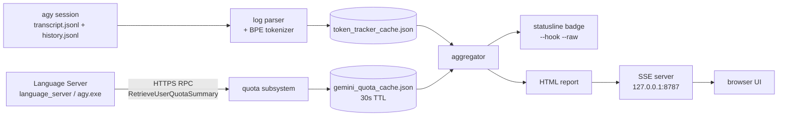

# ⚡ agy-pro

<div align="center">

**[English](README.md)** | **[한국어](README.ko.md)**

[](LICENSE)
[-brightgreen.svg)](#under-the-hood)
[](https://nodejs.org)
[-orange.svg)](#analytics)
[](#under-the-hood)
[](#under-the-hood)
[](#install)

**Two engines, one repo. `agy-tokens` tells you what every turn cost. `agy pro` puts more than one model behind the same `agy` terminal.**

</div>

---

<a id="toc"></a>

`agy-tokens` reads your Antigravity CLI logs and the local Language Server, then shows tokens, dollars and the real 5h/7d Gemini quota in your statusline and in a browser dashboard. `agy pro` is a Go shim over the real `agy` binary: native Gemini and Claude seats plan and review for free, an external model writes real scoped code, and nothing is charged without a `y/N`.

**Contents:** [What you feel](#what-you-feel) · [What `agy pro` contains](#what-agy-pro-contains) · [The coding door](#coding-door) · [agy vs agy-pro](#difference) · [Analytics](#analytics) · [Install](#install) · [Branches](#branches) · [Under the hood](#under-the-hood) · [Safety](#safety) · [Docs](#docs)

> [!NOTE]
> Token and cost numbers are calculated locally by this project's own tokenizer and heuristic estimation engine. They are estimates, not a provider invoice.

---

<a id="what-you-feel"></a>

## 🎭 What you feel


Nothing about your terminal changes. `agy` is still `agy`: the same TUI, the same keys, the same exit codes. What changes is who is in the room when the request is big.

On the top lane, one model answers everything. `/model` is XOR at the binary level, so a session holds native models **or** bridge models, never both, and the single brain grades its own homework. On the bottom lane the same prompt reaches a Gemini master that dispatches: free native seats on your subscription, external provider seats from other model families, and a shielded path where a metered seat may only write inside a scope the engine snapshots first.

The part that makes it feel frictionless: these routes are **standing instructions, not slash commands**. The master agent inside `agy` holds the routing rules in the workspace `AGENTS.md`, so an ordinary sentence fires them.

| You type (plain chat, no command) | What runs |
|---|---|
| `review the auth flow across the repo` | Read-only `review` fanout, seats from different model families, one reconciliation matrix with severities |
| `audit this repo for leaked keys and OWASP issues` | Read-only `security` fanout, same seat rules |
| `compare these two designs, which one breaks first?` | `research` fanout, seats argue, the master arbitrates with evidence |
| `audit my plan before I build it` | `plan-audit` fanout, native seats, `$0` extra |
| `fix the auth bug` | `agy pro code`: free native plan, then a metered provider write inside one scope, engine verification, snapshot rollback if the tree has to go back |
| `just answer` / `no swarm` | Nothing fans out. A trivial single-file question is answered directly |

Korean is the same sentence, not a mode: `"인증 버그 고쳐줘"` and `"리뷰해줘"` fire the identical routes.

The review seats never see each other. No seat receives another seat's prompt, tool output or hypothesis, so agreement between two models means two models agreed, not that one repeated the other.

---

<a id="what-agy-pro-contains"></a>

## 🧩 What `agy pro` contains


Fourteen verbs, one binary. Everything else (`agy agents`, `agy -m ...`, `agy -p ...`) is passed straight through to the real binary, byte for byte.

| Verb | What it does | Why you would reach for it |
|---|---|---|
| `setup` | Full-screen setup TUI: providers, models, fanout presets, prompts, UI language. `--wizard` for the classic line wizard | First run, and any time the registry changes |
| `mode` | Switch profile between `full` (full-stack orchestrator) and `clean`, or `restore` | Same binary, different deployed content |
| `status` | Active mode, registered providers, real `agy` path | One command when something feels off |
| `models` | Configured providers and models. `--all` adds the numbered combined native + external inventory | Picking seats by number instead of by name |
| `swarm` | Numbered builder: template + seats by number, dry-run echo with a per-seat cost note, then run | Hybrid swarms without memorizing seat grammar |
| `settings` | Full-screen settings panel, plus `show` / `set` | Change one setting without editing JSON |
| `integrations` | `status`, `apply`, `retract`, `preset`, `adopt`, `rollback`, `repair` for the deployed rules, plugins, capability folders and the `statusLine` slot | One owner for every file agy-pro puts on disk |
| `hybrid` | Native-coexistence profile (`on p1`, `on p2`, `off`, `status`, `check`) | Keep a native setup next to an agy-pro one |
| `doctor` | Toolchain, paths, keys. `--strict`, `--fix-keys`, `--rollback-keys` | A zero-token upstream key probe with a masked verdict |
| `fanout` | The multi-model swarm engine: `review`, `security`, `research`, `plan-audit`, plus partition mode (`--units`) | The engine under every other multi-model surface |
| `code` | `plan`, `write`, `review`, `rollback`, `run` | The coding door ([next section](#coding-door)) |
| `config` | Persistent defaults: `default-profile`, `bridge-tools` | Set the startup behaviour once |
| `version` | agy-pro version plus the underlying `agy` version | Bug reports |
| `help` | Usage text, TUI first | Discovery |

Every verb that writes (`config`, `mode`, `doctor --fix-keys`, each setup-hub provider or model edit, each integration apply) prints the exact diff and waits for `y/N`. Scripted callers pass `--yes`; a reader that cannot answer is refused instead of guessed at.

The other launcher surfaces, if you do not want to type verbs:

```bash
agy pro setup                            # full-screen hub, the recommended first run
AGY_LAUNCHER=1 agy                       # opt-in 2s picker: [1] Native Gemini [2] External [3] Swarm
agy pro models --all                     # numbered inventory, native rows and provider rows
agy pro swarm                            # numbered builder on a TTY
agy pro code --help                      # the coding door's full surface
```

Bare `agy` with no arguments and no `AGY_LAUNCHER=1` goes straight to native Gemini with zero extra delay. The picker only belongs to a bare `agy`: any argument skips it.

---

<a id="coding-door"></a>

## 🛠 The coding door: `agy pro code`


One command for a bounded change worked by more than one model. Native seats plan and review on your subscription (`$0` extra). One external provider seat writes the scoped files (metered API). The engine snapshots the tree before the first write, runs the verification itself, allows one bounded repair, and can put the tree back byte for byte.

```bash
# 1. plan only: native seats, free. Writes the run directory and stops.
agy pro code plan --ask-file q.txt

# 2. read the plan, then run it with ONE bounded scope.
#    --writer is a provider seat, so this step is metered and asks y/N.
agy pro code run --ask-file q.txt --scope "internal/x" \
  --writer <provider/model> --verify "go build ./..." --yes

# 3. if verification failed (exit 1), the report names the exact undo command:
agy pro code rollback --run reports/code/<ts>
```

What the phases actually are:

- **plan and review run on native seats, free by default.** The default line-up is `native:gemini-3.8-flash-high,native:claude-sonnet-5-5-high`. A native-only phase never asks for consent, because it costs nothing beyond your subscription.
- **the write phase is metered and asks.** The writer is a provider seat only. A native seat builds no scoped tool runner, so the verb refuses a native `--writer` at usage time, before anything runs.
- **verification belongs to the engine, not to the seat.** Compile-only detection is automatic (`go build` + `go vet` when the scope names a `.go` file under `go.mod`). Any other verifier, including every test runner, runs only when you name it with `--verify`.
- **the run directory is the audit trail.** `reports/code/<ts>/phases.log` (one line per phase), `report.txt` (the change report a review reads), per-phase `summary.json` / `reconciliation.md` / `seat-*.md`, `verify/attempt-<n>-<cmd>.log` per attempt, and the snapshot itself.

`--dry-run` prints the exact composed argv (the fanout call, every verifier, the rollback line) and exits 0 without spawning anything, so a metered run can be inspected before you spend a token.

### The safety model, stated plainly

- **Scoped provider writes.** A write target is in scope only when either its lexical root-relative path or its resolved real path sits inside the unit's scope globs. The same dual view decides what the snapshot claims, so the file a seat can write and the file rollback can restore are the same set.
- **Governance files refuse every seat write.** `AGENTS.md`, `gemini.md`, `claude.md`, `providers.json` and its sibling aliases, `state.json`, `state-fanout.json`, `fanout-presets.json`, `integrations.json`, `settings.json`, plus the `rules/`, `.agy-pro/` and `.gemini/` directory components at any depth. `.git/**` is refused at snapshot time. The check follows the resolved directory chain, so a symlink cannot launder a governed path, and it compares Win32-canonical names on Windows so `AGENTS.md.` and `AGENTS.md:stream` are refused too.
- **Rollback never deletes and never runs git.** The snapshot is a byte copy (`manifest.json` plus `snapshot/<relpath>`). Rollback restores in place and moves files the run created into `<out>/rollback-archive/`. A locked file stays exactly where it is and is named in `rollback.json`. `git` is never invoked, imported or parsed anywhere in the path.
- **The ledger is bound to its run.** Every `manifest.json` carries `manifest.sig`, an HMAC-SHA256 over the manifest bytes under a per-run key kept outside every operation root. A hand-edited or forged ledger refuses whole, before a single byte is written.
- **One cost rule: echo, then your GO.** Every metered seat is named in a masked echo, the echo says plainly that no cap exists, and nothing runs without `y/N` or `--yes`.
- **Seats that partly failed say `degraded`, never `ok`.** The door reads the engine's own per-seat rows back. Some seats failed and the rest delivered, that phase is `degraded` and the report says so three ways. Every seat failed, that is exit 1.
- **Honest caveat: native seats are measured, not contained.** A native seat is a real `agy` subprocess with its own tool surface, so a plan or review seat can write. The door snapshots before the plan phase, re-walks the scope after every native phase, and reports the difference as `native-drift` (plus `governance-drift` for a governance file). It names what happened instead of claiming a sandbox it does not own.

Cost truth, without adjectives: there is no token or dollar cap anywhere in this door. What bounds a run is the engine's per-seat iteration limit and the wall clock, and the report prints token counts only when the engine's `summary.json` carries them. A budget meter is a future decision, not a shipped feature.

---

<a id="difference"></a>

## ⚖️ `agy` alone vs `agy` + agy-pro

| | `agy` alone | `agy` + agy-pro |
|---|---|---|
| **Model choice** | `/model` picker is XOR: one family at a time, native or bridge | All families work together in one swarm, native seats and provider seats in the same run |
| **Coding hands** | The native agent only | An external provider model can write real code, inside one bounded scope |
| **Idea diversity** | One brain, one plan | Parallel plan and review seats, reconciled into one matrix |
| **Review** | Self-review | Independent multi-model fanout with severities and a consensus split |
| **Cost visibility** | None | Live 5h/7d quota buckets, statusline every turn, per-run seat usage, masked echo before any spend |
| **Configuration** | Hand-edited files | Setup hub TUI plus one consent per integration apply |
| **Fallback** | None | `mode clean` / `mode full`, `restore`, `doctor`, snapshot rollback, `degraded` status when a seat drops |

The one thing agy-pro does not change: the in-session `/model` popover stays XOR, because that constraint lives in the binary. The combined catalogue lives one layer up (`agy pro models --all`, launcher `[2]`, `agy pro swarm`).

---

<a id="analytics"></a>

## 📈 Analytics: statusline, quota, dashboard

`agy-tokens` needs one `statusLine` entry in `~/.gemini/antigravity-cli/settings.json` and no change to Antigravity itself. `agy pro integrations apply tools` writes that entry (snapshotting the file first), `agy pro integrations status` shows whether it still matches, and `agy pro integrations rollback` restores the snapshot.

```text
⚡ Turn: 1.2k ($0.0002) | Today: 45.8k ($0.0068) | Cache: 82% | 5h: ▰▰▰▰▱ 79% (4h 10m) | 7d: ▰▱▱▱▱ 21% (3d 20h) | 📊 Dashboard
```

```text
⚡ 이번 턴: 1.2k (₩0.3) | 오늘 누적: 45.8k (₩9.9) | 캐시: 82% | 5h: ▰▰▰▰▱ 79% (4h 10m) | 7d: ▰▱▱▱▱ 21% (3d 20h) | 📊 대시보드
```

**1:1 Gemini quota.** The quota subsystem queries the local Antigravity Language Server over HTTPS/HTTP RPC (`RetrieveUserQuotaSummary`) and shows the two real rolling buckets: **5-Hour (`5h`)** burst window and **7-Day (`7d`)** weekly allowance, each with a live countdown. The answer is cached for 30 seconds at `~/.gemini/gemini_quota_cache.json`, so the statusline read stays sub-millisecond and the refresh never blocks the turn.

**The `statusLine` entry itself.** If you prefer to wire it by hand (a container, a locked-down `PATH`, or no `agy` on `PATH` for the engine to call), add this block to `~/.gemini/antigravity-cli/settings.json`:

```json
{
  "statusLine": {
    "type": "command",
    "command": "agy-tokens --hook --raw --write-dashboard",
    "enabled": true,
    "stack_with_default": true
  }
}
```

Direct Node path: `"command": "node /path/to/agy-pro/bin/agy-tokens.js --hook --raw --write-dashboard"`. On Windows, if the subprocess does not inherit `PATH`, use 8.3 short paths and escape every backslash:

```text
"command": "C:\\PROGRA~1\\nodejs\\node.exe %APPDATA%\\npm\\NODE_M~1\\AGY-TO~1\\bin\\AGY-TO~1.JS --hook --raw --write-dashboard"
```

**Real-time dashboard on port 8787.** One loopback server, Server-Sent Events on `/events`, and responsive pure-SVG charts: 30-day token volume as stacked bars (input, cached, output), dynamic Y-axis scaling, interactive tooltips, filters by date range (today, 7d, 30d, custom) and by model, and turn-by-turn model attribution including reasoning effort. The same page works from `file://` through script-tag polling, without CORS errors.

```bash
agy-tokens --serve --open     # SSE server on 127.0.0.1:8787 and open the browser
agy-tokens --html --open      # static self-refreshing HTML artifact
agy-tokens --sync-quota       # refresh the live quota pool now
```

**Data path, end to end.**



**Model and pricing matrix.** Subword token pricing, prompt-cache discounts, and a sync engine for official price changes:

| Model ID | Display Name | Provider | Context | Input / 1M | Cached / 1M | Output / 1M |
| :--- | :--- | :--- | :--- | :--- | :--- | :--- |
| `gemini-3.7-flash` | **Gemini 3.7 Flash** | Google | 1M | $0.15 | $0.0375 | $0.60 |
| `gemini-3.7-flash-thinking` | **Gemini 3.7 Flash (Thinking)** | Google | 1M | $0.15 | $0.0375 | $0.60 |
| `gemini-3.6-flash` | **Gemini 3.6 Flash** | Google | 1M | $0.15 | $0.0375 | $0.60 |
| `gemini-3.5-flash` | **Gemini 3.5 Flash** | Google | 1M | $0.15 | $0.0375 | $0.60 |
| `gemini-2.5-pro` | **Gemini 2.5 Pro** | Google | 2M | $1.25 | $0.3125 | $5.00 |
| `gemini-2.0-flash` | **Gemini 2.0 Flash** | Google | 1M | $0.10 | $0.0250 | $0.40 |
| `claude-opus-4.6` | **Claude Opus 4.6** | Anthropic | 200k | $15.00 | $1.50 | $75.00 |
| `claude-sonnet-4.6` | **Claude Sonnet 4.6** | Anthropic | 200k | $3.00 | $0.30 | $15.00 |
| `claude-3.5-haiku` | **Claude 3.5 Haiku** | Anthropic | 200k | $0.80 | $0.08 | $4.00 |
| `gpt-4o` | **GPT-4o** | OpenAI | 128k | $2.50 | $1.25 | $10.00 |
| `o3-mini` | **o3-mini** | OpenAI | 200k | $1.10 | $0.55 | $4.40 |
| `o1` | **o1** | OpenAI | 200k | $15.00 | $7.50 | $60.00 |

```bash
agy-tokens --prices --currency krw    # the official catalogue as a table
agy-tokens --sync-prices              # pull the newest official prices
agy-tokens --auto-sync                # sync when the local catalogue is older than 24h
```

A model that is not in the table (a new release, a local model) falls back to regex heuristics on `flash`, `pro`, `mini`, `free` and `local` to pick a rate tier.

**21 languages, RTL included.** Locale is detected from the host (`LANG`, `LC_ALL`), and the output layout has dedicated bidirectional handling for Arabic and Hebrew.

| Region | Languages |
| :--- | :--- |
| East Asia | English (`en`), 한국어 (`ko`), 日本語 (`ja`), 简体中文 (`zh`), 繁體中文 (`zh-TW`) |
| South and Southeast Asia | हिन्दी (`hi`), Tiếng Việt (`vi`), Bahasa Indonesia (`id`), ภาษาไทย (`th`) |
| Europe | Deutsch (`de`), Français (`fr`), Español (`es`), Português (`pt`), Italiano (`it`), Nederlands (`nl`), Polski (`pl`), Svenska (`sv`), Русский (`ru`), Türkçe (`tr`) |
| Middle East (RTL) | العربية (`ar`), עברית (`he`) |

The `agy pro setup` hub ships its own 12-language UI, with Arabic scoped honestly to logical order (no bidi shaping in a terminal).

### `agy-tokens` CLI, the short list

`agy-tokens`, `agy-tools` and `agy-dashboard` are the same command.

| Option | What it gives you |
| :--- | :--- |
| *(none)*, `--today`, `-t` | Today's usage summary |
| `--yesterday`, `-y` / `--7d` / `--30d` / `--all` / `--range YYYY-MM-DD..YYYY-MM-DD` | Any other window |
| `--session [id]`, `-s` | Turn-by-turn breakdown for the latest or a named conversation |
| `--currency <usd\|krw\|jpy\|eur\|gbp>` / `--lang <code>` | Display currency and UI language |
| `--free`, `--no-cost` | Hide dollars, show tokens only (flat-subscription mode) |
| `--json` | Raw JSON for scripts |
| `--hook`, `--badge` / `--raw` | Statusline payload / raw badge string |
| `--fresh`, `--no-cache` | Bypass the cache and re-parse transcripts |
| `--prices`, `--sync-prices`, `--auto-sync` | Price catalogue, sync, auto-sync |
| `--sync-quota` | Refresh the live Gemini quota pool |
| `--html`, `--dashboard` / `--serve [port]` / `--open` / `--refresh <sec>` / `--port <n>` | Static report / SSE server (default `8787`, `0` for a random port) / open the browser / poll interval |
| `--write-dashboard` / `--no-link` / `--no-color` | Statusline write side, OSC 8 link off, colour off |
| `--model <name>` / `--help`, `-h` / `--version`, `-v` | Price override, help, version |

---

<a id="install"></a>

## 🚀 Install & Quick Start

Prerequisites: **Node.js 16+** ([nodejs.org](https://nodejs.org)) for the analytics side, **Antigravity CLI** (`agy`), and **Go 1.22+** for the shim (the installer provisions it if it is missing).

**Windows, Command Prompt:**

```cmd
git clone https://github.com/myk1yt/agy-pro.git && cd agy-pro && scripts\install.bat
```

**Windows, PowerShell (5.1 does not accept bare `&&`, hence the wrapper):**

```powershell
cmd /c "git clone https://github.com/myk1yt/agy-pro.git && cd agy-pro && scripts\install.bat"
```

**Linux / macOS:**

```bash
git clone https://github.com/myk1yt/agy-pro.git && cd agy-pro && bash scripts/install.sh
```

The Node installer registers the global commands with `npm link` and, once `agy` resolves on `PATH`, hands the Antigravity deployment to the Go engine in one call (`agy pro integrations apply tools --yes`). A missing `agy-tokens` launcher skips the statusline step with a note and still exits 0; `agy pro integrations repair` completes it later.

**Now add the shim (one line, works with or without git):**

```powershell
powershell -NoProfile -ExecutionPolicy Bypass -Command "if (Get-Command git -ErrorAction SilentlyContinue) { cmd /c 'git clone -b feature/agy-pro https://github.com/myk1yt/agy-pro.git && cd agy-pro && install.cmd' } else { iwr 'https://codeload.github.com/myk1yt/agy-pro/zip/refs/heads/feature/agy-pro' -OutFile '$env:TEMP\agy-pro-src.zip' -UseBasicParsing; Expand-Archive -Path '$env:TEMP\agy-pro-src.zip' -DestinationPath '$env:TEMP\agy-pro-src' -Force; & (Resolve-Path '$env:TEMP\agy-pro-src\*\install.ps1').Path }"
```

The installer builds `agy.exe` into `~/.agy-pro/bin/`, prepends that directory to your User `PATH`, and runs `agy pro doctor`. Open a new terminal afterwards so the `PATH` change is visible.

**First run:**

```bash
agy pro setup            # the full-screen hub: providers, models, fanout presets, prompts, language
agy                      # native Gemini, zero extra delay
AGY_LAUNCHER=1 agy       # opt in: 2s picker [1] Native [2] External [3] Swarm
agy pro code --help      # the whole coding door on one screen
agy pro status           # active mode, providers, the real agy path
```

**Updating the npm global copy (the runtime uses the global copy, not the clone):**

```cmd
cd agy-pro
npm install -g .
```

Run that again after every `git pull`. `agy-tokens --version` and `where agy-tokens` tell you which copy is live; if `where` does not point at `AppData\Roaming\npm`, reopen the terminal and re-link.

**Uninstall, one line:**

```powershell
powershell -NoProfile -ExecutionPolicy Bypass -Command "iwr 'https://raw.githubusercontent.com/myk1yt/agy-pro/feature/agy-pro/agy-pro/scripts/uninstall.ps1' -OutFile '$env:TEMP\agy-pro-uninstall.ps1' -UseBasicParsing; & '$env:TEMP\agy-pro-uninstall.ps1'"
```

It retracts the deployed integrations first (into `<AGY_PRO_HOME>/backups/<ts>_retract/`), removes only the `~/.agy-pro/bin` entry from the User `PATH`, and moves `~/.agy-pro` to the **Recycle Bin**. `-KeepState` keeps `providers.json` and the backups, `-DryRun` prints the plan, `-RestorePath` puts back the `PATH` saved before the install.

For the statusline slot alone, `agy pro integrations retract --yes` removes the `statusLine` entry and archives the bytes it replaced.

### If something looks wrong

| Symptom | Fix |
|---|---|
| `agy` is not recognized | Install Antigravity CLI, then open a **new** terminal window (a fresh window re-reads `PATH`) |
| `plugin.json not found` during an installer | The clone is on the wrong branch: re-run the one-shot line, which checks out the branch inside the clone |
| PowerShell says script execution is disabled | Always launch through `powershell -ExecutionPolicy Bypass -File scripts\...ps1`, exactly as written here |
| Endless `TLS handshake` flood right after install | Update to the newest `main` (it has the probe cooldown guard), or run `agy pro integrations retract --yes` |
| A wedged setup | `agy pro doctor`, then `agy pro status`, then `agy pro integrations repair` |

---

<a id="branches"></a>

## 🧵 The other branches

Each add-on lives on its own branch, so `git clone -b <branch>` checks it out during the clone and no manual `git checkout` step is left to forget.

| Branch | What it adds | One-shot install (Windows PowerShell) |
|---|---|---|
| [`main`](https://github.com/myk1yt/agy-pro/tree/main) | Everything: analytics, dashboard, shim, swarm, coding door | `cmd /c "git clone https://github.com/myk1yt/agy-pro.git && cd agy-pro && scripts\install.bat && install.cmd"` |
| [`Agent/designer`](https://github.com/myk1yt/agy-pro/tree/Agent/designer) | `@designer`: zero-MCP design specialist (SVG, 3D canvas, cyberpunk, sandbox, QA harness) | `cmd /c "git clone -b Agent/designer https://github.com/myk1yt/agy-pro.git && cd agy-pro && powershell -ExecutionPolicy Bypass -File scripts\install-designer.ps1"` |
| [`Agent/security-reviewer`](https://github.com/myk1yt/agy-pro/tree/Agent/security-reviewer) | `@security-reviewer`: orchestrator plus 4 domain inspectors (OWASP, IAM, credentials, supply chain) | `cmd /c "git clone -b Agent/security-reviewer https://github.com/myk1yt/agy-pro.git && cd agy-pro && powershell -ExecutionPolicy Bypass -File scripts\install-security-reviewer.ps1"` |
| [`Agent/code-reviewer`](https://github.com/myk1yt/agy-pro/tree/Agent/code-reviewer) | `@code-reviewer`: pre-merge diff review, 8-category taxonomy, P0-P3 gate | `cmd /c "git clone -b Agent/code-reviewer https://github.com/myk1yt/agy-pro.git && cd agy-pro && powershell -ExecutionPolicy Bypass -File scripts\install-code-reviewer.ps1"` |
| [`gemini-config`](https://github.com/myk1yt/agy-pro/tree/gemini-config) | Governance rules and the 7-stage multi-agent lifecycle, deployed into `~/.gemini` | `cmd /c "git clone -b gemini-config https://github.com/myk1yt/agy-pro.git && cd agy-pro && scripts\install.bat"` |
| [`feature/agy-pro`](https://github.com/myk1yt/agy-pro/tree/feature/agy-pro) | The Go shim branch the one-liner installs from | `cmd /c "git clone -b feature/agy-pro https://github.com/myk1yt/agy-pro.git && cd agy-pro && install.cmd"` |

On macOS and Linux, `bash scripts/install.sh` covers the Node side; the Go shim is built with `go build` (details in the [Korean manual](MANUAL.ko.md)).

---

<a id="under-the-hood"></a>

## 🔧 Under the hood

**One shim, one extra process, no patched binary.**

```text
agy                  ->  the real agy binary, exactly as before
agy agents           ->  passed straight through
agy -m "..."         ->  passed straight through
agy pro <verb>       ->  agy-pro's own engine
```

`agy pro` intercepts only its own verb space. The native TUI, stdio handles and exit codes stay intact, because the shim execs the authentic binary instead of reimplementing it. `AGY_LAUNCHER=1` adds the 2-second model picker to a bare `agy`; nothing else changes.

**Zero dependencies, both sides.**

- Go: `module agypro`, `go 1.22`, standard library only. One `agy.exe` binary.
- Node: standard library only (`http`, `fs`, `path`, `net`, `child_process`), Node 16+. The statusline read is a cache hit, not a re-parse.

**No MCP, no resident daemon.** The whole orchestration path spawns child processes and reads/writes files. Nothing listens on a port until you open the dashboard, and nothing runs when the terminal is closed.

**Test floor.** `go test ./...` covers 28 Go packages, and `npm test` runs 296 JavaScript tests (0 failures). Both commands are the gate every change passes before it lands.

**Artifacts are plain files you can read.**

```text
reports/fanout/<ts>/   summary.json, reconciliation.md, progress.log, seat-*.md
reports/code/<ts>/     phases.log, report.txt, plan/, write/, review/,
                       verify/attempt-*.log, manifest.json, snapshot/, rollback-archive/
~/.agy-pro/            providers.json, state.json, backups/, ledger-keys/
```

Any key-shaped value that rides into a report or the console renders as the first 5 characters plus `****`, never a suffix.

---

<a id="safety"></a>

## 🔒 Safety & consent model


Three rules cover almost everything:

1. **One consent per plan, never per file.** `agy pro integrations apply tools` composes one plan (the `statusLine` slot, the content trees, the intent rows), prints the exact diff, and asks once. `status` is read-only and never prompts. A non-interactive stdin must pass `--yes`, otherwise the verb refuses and writes nothing.
2. **Paid means echo plus your GO.** Any provider seat in a seat list, and every write run, is a metered API call with no token or cost cap. The echo names each seat masked, says no cap exists, and nothing runs without `y/N` or `--yes`. Native-only phases never ask, because they cost nothing extra.
3. **Secrets never enter the artifacts.** The registry declares only environment variable names, never values. The echo masks every operand, the request text is stored as `ask.txt` instead of being printed, and logs pass through a redactor.

`agy pro mode full|clean` and `agy pro integrations preset` change what is **deployed**, never which binary runs. That split is why a broken deployment is one `retract` or `rollback` away from clean, and why `agy pro doctor` can report the toolchain, the paths and the keys in one screen.

---

<a id="docs"></a>

## 📚 Deep-dive documentation

- 📖 **[Gemini quota pool](docs/QUOTA_POOL.md)**: RPC discovery, 5h/7d sliding windows, atomic caching, sub-millisecond statusline reads.
- 📊 **[SSE dashboard](docs/DASHBOARD.md)**: the dual transport (SSE push plus script polling), the SVG chart engine, VS Code terminal integration, loopback security.
- 🛠 **[`agy pro code` contract](agy-pro/docs/code.md)**: command surface, exit codes, the safety model with its named refusals, and the known limitations (including the ones this door does not solve).
- 🌊 **[Fanout engine](agy-pro/docs/fanout.md)**: seat grammar, reconciliation, partition mode (`--units`), the tool sandbox.
- 🔀 **[Hybrid seats](agy-pro/docs/swarm-hybrid.md)**: native plus provider seats in one run, failover behaviour.
- 🌉 **[Bridge architecture](agy-pro/docs/bridge-architecture.md)**: how external models reach a native `agy` session.
- 📘 **[Korean manual](MANUAL.ko.md)**: illustrated guide for both installers, verification, configuration, troubleshooting, uninstall.
- 🧰 **[agy-pro README](agy-pro/README.md)**: the shim's own reference.

---

<a id="license"></a>

## 📄 License

MIT. See [`LICENSE`](LICENSE).

Developed by **kim,yong-tai**.
