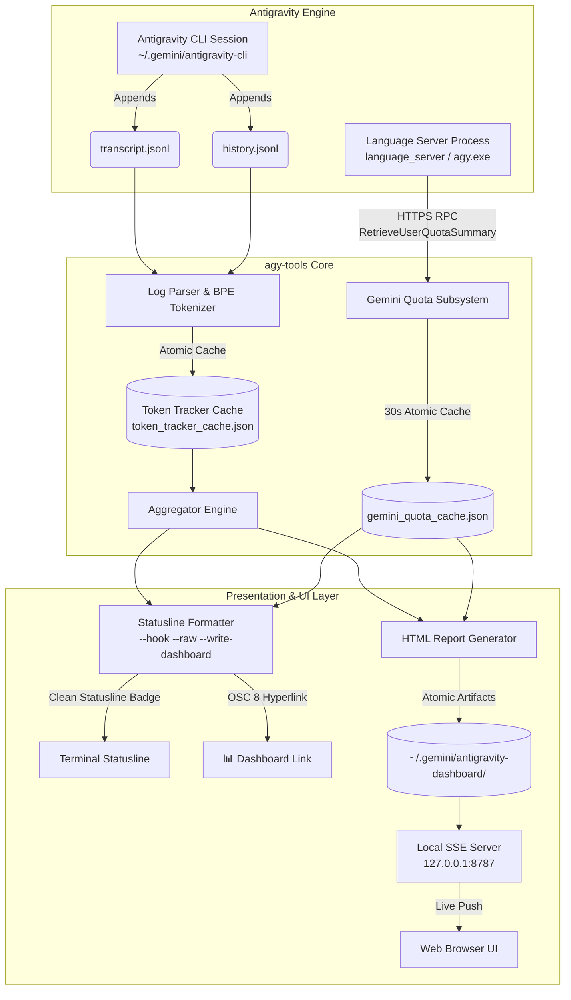
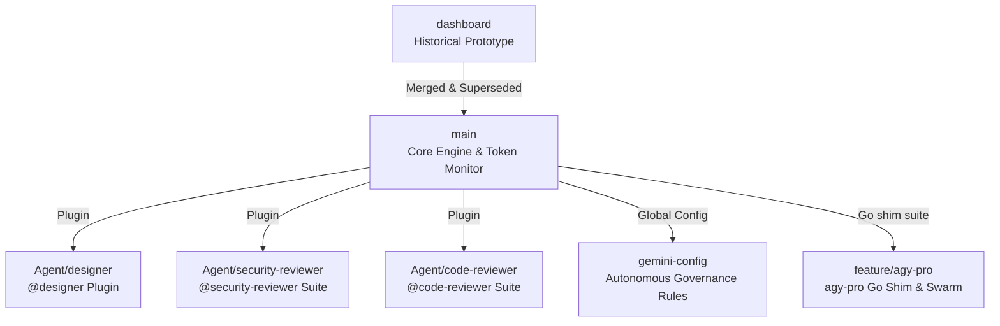

# ⚡ Antigravity CLI Developer Toolkit (`agy-tools`)

<div align="center">

**[English](README.md)** | **[한국어](README.ko.md)**

[](LICENSE)
[-brightgreen.svg)](#zero-dependency-architecture)
[](https://nodejs.org)
[-orange.svg)](#-internationalization-i18n--21-languages)
[](#-installation--quick-start)

**Zero-dependency Developer Toolkit & Real-Time Token/Cost Analytics Suite for Antigravity CLI**

</div>

---

> [!NOTE]
> **Token usage is an estimated value calculated directly by our tokenizer / heuristic estimation engine.**

---

## 🌟 Executive Overview

**Antigravity Developer Toolkit (`agy-tools`)** is a high-precision, zero-dependency CLI and dashboard suite designed specifically for **Antigravity CLI**. Its flagship command **`agy-tokens`** (also aliased as `agy-tools` and `agy-dashboard`) delivers instant statusline analytics, live 1:1 rate limit quota tracking, and an interactive real-time web dashboard.

### Why `agy-tools`?
- **Zero Antigravity Code Modifications**: A single `statusLine` command entry in `~/.gemini/antigravity-cli/settings.json` is the **ONLY** integration point needed.
- **1:1 Gemini Quota Pool Tracking**: Connects directly to the local Language Server via HTTPS/HTTP RPC to display exact **5-Hour (5h)** and **7-Day (7d)** rolling quota buckets with live countdown timers.
- **Real-Time SSE Web Dashboard**: Opens an interactive single-page dashboard on `http://127.0.0.1:8787` powered by Server-Sent Events (SSE) and responsive pure-SVG vector charts.
- **2026 Flagship Model Support**: Full out-of-the-box attribution for **Gemini 3.7 Flash**, **Gemini 3.6 Flash**, **Gemini 3.5 Flash**, **Claude Opus 4.6**, **Claude Sonnet 4.6**, and more.
- **Zero External Dependencies**: Engineered with pure Node.js standard libraries (`http`, `fs`, `path`, `net`, `child_process`) for sub-millisecond execution and instant startup.
- **Full Internationalization (i18n)**: 21 languages with automatic system locale detection and bidirectional RTL support (Arabic, Hebrew).

---

## 🏗 System Architecture



---

## 🌐 Agy-Tools Ecosystem & Branch Catalog

This repository hosts a multi-faceted developer ecosystem beyond the core token tracker. Each major capability lives in its own dedicated branch:



| Branch | Description | Key Capabilities | One-Shot Install (paste into **Command Prompt**) | One-Shot Install (paste into **PowerShell**) | One-Shot Install (paste into **macOS / Linux terminal**) |
|---|---|---|---|---|---|
| [`main`](https://github.com/myk1yt/agy-tools/tree/main) | **Core Engine & Developer Toolkit** | Statusline badge, SSE Web Dashboard, 1:1 Gemini Quota Pool RPC, Dynamic Pricing, 21 languages | `git clone https://github.com/myk1yt/agy-tools.git && cd agy-tools && scripts\install.bat` | `cmd /c "git clone https://github.com/myk1yt/agy-tools.git && cd agy-tools && scripts\install.bat"` | `git clone https://github.com/myk1yt/agy-tools.git && cd agy-tools && bash scripts/install.sh` |
| [`Agent/designer`](https://github.com/myk1yt/agy-tools/tree/Agent/designer) | **Zero-MCP Design Specialist** | `@designer` agent, 5 modular add-on modules (SVG, 3D Canvas, Cyberpunk, Sandbox, QA Harness) | `git clone -b Agent/designer https://github.com/myk1yt/agy-tools.git && cd agy-tools && powershell -ExecutionPolicy Bypass -File scripts\install-designer.ps1` | `cmd /c "git clone -b Agent/designer https://github.com/myk1yt/agy-tools.git && cd agy-tools && powershell -ExecutionPolicy Bypass -File scripts\install-designer.ps1"` | `git clone -b Agent/designer https://github.com/myk1yt/agy-tools.git && cd agy-tools && bash scripts/install-designer.sh` |
| [`Agent/security-reviewer`](https://github.com/myk1yt/agy-tools/tree/Agent/security-reviewer) | **Enterprise Multi-Agent Security Audit** | `@security-reviewer` orchestrator + 4 domain inspectors (OWASP, IAM, Credentials, Supply Chain) | `git clone -b Agent/security-reviewer https://github.com/myk1yt/agy-tools.git && cd agy-tools && powershell -ExecutionPolicy Bypass -File scripts\install-security-reviewer.ps1` | `cmd /c "git clone -b Agent/security-reviewer https://github.com/myk1yt/agy-tools.git && cd agy-tools && powershell -ExecutionPolicy Bypass -File scripts\install-security-reviewer.ps1"` | `git clone -b Agent/security-reviewer https://github.com/myk1yt/agy-tools.git && cd agy-tools && bash scripts/install-security-reviewer.sh` |
| [`Agent/code-reviewer`](https://github.com/myk1yt/agy-tools/tree/Agent/code-reviewer) | **Pre-Merge Code Review & Quality Gate** | `@code-reviewer` agent, 4-stage pipeline, 8-category taxonomy, zero-tolerance P0-P3 gate | `git clone -b Agent/code-reviewer https://github.com/myk1yt/agy-tools.git && cd agy-tools && powershell -ExecutionPolicy Bypass -File scripts\install-code-reviewer.ps1` | `cmd /c "git clone -b Agent/code-reviewer https://github.com/myk1yt/agy-tools.git && cd agy-tools && powershell -ExecutionPolicy Bypass -File scripts\install-code-reviewer.ps1"` | `git clone -b Agent/code-reviewer https://github.com/myk1yt/agy-tools.git && cd agy-tools && bash scripts/install-code-reviewer.sh` |
| [`gemini-config`](https://github.com/myk1yt/agy-tools/tree/gemini-config) | **Autonomous Multi-Agent Governance** | 7-Stage Lifecycle Protocol, Master Zero-Source-Edit Invariant, orchestrator governance | `git clone -b gemini-config https://github.com/myk1yt/agy-tools.git && cd agy-tools && scripts\install.bat` | `cmd /c "git clone -b gemini-config https://github.com/myk1yt/agy-tools.git && cd agy-tools && scripts\install.bat"` | `git clone -b gemini-config https://github.com/myk1yt/agy-tools.git && cd agy-tools && bash scripts/install.sh` |
| [`feature/agy-pro`](https://github.com/myk1yt/agy-tools/tree/feature/agy-pro) | **Go Shim & Multi-Model Swarm (`agy-pro`)** | Transparent `agy` shim, opt-in 2-second model launcher (`AGY_LAUNCHER=1`) with a combined native + external model list, external-model bridge, numbered swarm builder with hybrid native seats, `agy pro` suite (setup / mode / models / swarm / settings / fanout / doctor), one-click Windows install & uninstall (Windows only) | `git clone -b feature/agy-pro https://github.com/myk1yt/agy-tools.git && cd agy-tools && install.cmd` | `cmd /c "git clone -b feature/agy-pro https://github.com/myk1yt/agy-tools.git && cd agy-tools && install.cmd"` | — |
| [`dashboard`](https://github.com/myk1yt/agy-tools/tree/dashboard) | **Historical Prototype** | Original token tracker foundation (fully merged into `main`) | — | — | — |

> [!TIP]
> Each row is a **complete, one-shot command for a fresh machine**: `git clone -b <branch>` checks the branch out *during* the clone, so there is no manual `git checkout` step left to forget (the classic "plugin.json not found" trap). The clone+checkout+installer chain is plain `&&`, which works in Command Prompt, bash (macOS/Linux) and PowerShell 7+. In the default **Windows PowerShell 5.1**, `&&` is not a valid separator — that is why every row also ships a `cmd /c "..."` wrapped version: paste *that one line* into a PowerShell window and it still runs end to end.

#### Install the prerequisites first (git + Node.js) — also one shot

`git` ships with Visual Studio Code and most developer setups; if it is genuinely missing, install it with `winget install --id Git.Git -e --accept-source-agreements --accept-package-agreements` first. Node.js is required **only for `main`** (the `Agent/*` plugin branches call `agy`, not `node`), and is a one-liner per platform:

```powershell
# Windows — install Node.js LTS (skip if `node --version` already works)
winget install --id OpenJS.NodeJS.LTS -e --accept-source-agreements --accept-package-agreements
```

```bash
# macOS (Homebrew)
brew install node

# Debian / Ubuntu
sudo apt-get update && sudo apt-get install -y nodejs npm
```

After installing via winget, **open a brand-new terminal window** before running the install one-liner — a fresh window re-reads PATH so `node` becomes visible.

---

## 🧭 Beginner Guide: Installing Any Branch (No Command-Line Experience Needed)

This section is for first-time users. Follow it top to bottom and you will get any of the 5 installable branches (including `main` and `feature/agy-pro`) working — no prior git or terminal knowledge required.

### Why `git clone -b <branch>` instead of `git checkout`?

This repository keeps each add-on in a **separate git branch** (like a separate room in the same house). A plain `git clone` only unpacks ONE room at a time, so running an installer afterwards without switching reports "plugin.json not found" — the files simply are not in your folder yet. The one-shot commands in the table above solve this for a fresh machine: `git clone -b <branch>` **checks the branch out during the clone itself**, so there is no separate `git checkout` step left to forget. (Use `git checkout <branch>` only when you already cloned the repo earlier and want to switch rooms in the same folder.)

### Step-by-step (Windows, no terminal experience required)

1. **Open a terminal in any folder** (it does not matter where — the command creates its own `agy-tools` folder)
   - Press **Win + R**, type `powershell`, press Enter. (Or use Command Prompt — both work, see step 2.)

2. **Paste ONE line for the branch you want** — the branch checkout is already built into the command:
   - **In PowerShell (the blue window):** paste the **`cmd /c "..."` column** version from the branch table above. PowerShell 5.1 does not understand bare `&&`, so the `cmd /c` wrapper is what makes a single paste work.
   - **In Command Prompt:** paste the **Command Prompt column** version.
   - What each one-shot line does, in order: ① clones the repo **already switched to the right branch** (`git clone -b <branch>`) → ② `cd agy-tools` → ③ runs that branch's installer. Example (designer, PowerShell):
   ```powershell
   cmd /c "git clone -b Agent/designer https://github.com/myk1yt/agy-tools.git && cd agy-tools && powershell -ExecutionPolicy Bypass -File scripts\install-designer.ps1"
   ```

3. **Verify it worked**
   - Any of the above installers ends with a list of active agents. You should see your new agent name there (e.g. `designer` or `security-reviewer`).
   - Or run this anytime:
   ```powershell
   agy agents
   ```

4. **Real usage examples (what you actually do with it)**
   - **Designer**: In the Antigravity chat input type `@designer` and then your request, for example:
     - `@designer draw a 680px SVG architecture diagram of a 3-tier web app`
     - `@designer build an interactive HTML widget with a slider that changes a 3D torus rotation speed`
   - **Security Reviewer**: In the Antigravity chat input type `@security-reviewer` plus the code/folder you want audited, for example:
     - `@security-reviewer audit this repository for hard-coded API keys and OWASP issues`
     - `@security-reviewer check the IAM roles in deploy/terraform/ for least privilege violations`
   - **Code Reviewer**: In the Antigravity chat input type `@code-reviewer` plus the diff or PR you want audited, for example:
     - `@code-reviewer review all uncommitted changes against main before I create a PR`
     - `@code-reviewer perform a pre-merge audit on HEAD~3..HEAD with focus on data-integrity and security`
   - **gemini-config**: Nothing to type — after installing, Antigravity automatically loads the governance rules and orchestrator governance modules; the statusline badge (via the `statusLine` in settings.json) shows live token analytics every turn.

5. **Uninstall (when you no longer want it)**
   - **agy-pro shim** (installed by `install.cmd` / `agy-pro/scripts/install.ps1` on the `feature/agy-pro` branch): one command removes it — double-click `uninstall.cmd` in the repository root, or use the one-liner from the 🧹 Uninstall section above when you no longer have the clone. It deletes the `.agy-pro\bin` entry from your User `PATH` and moves `%USERPROFILE%\.agy-pro` to the Recycle Bin, so a mistaken run can be undone from Explorer. Add `-KeepState` to keep `providers.json`, `state.json` and the backups, or `-RestorePath` to put back the User `PATH` that was saved before the install. If you switched profiles, run `agy pro mode restore` first. No uninstaller at hand? Delete the `%USERPROFILE%\.agy-pro` folder manually and remove the `C:\Users\<you>\.agy-pro\bin` entry via System Properties → Environment Variables.
   - **statusline hook (`main` / `gemini-config` installers)**: remove the `statusLine` block from `~/.gemini/antigravity-cli/settings.json` — that single entry is the only integration point.
   - **Plugin branches (`Agent/designer`, `Agent/security-reviewer`, `Agent/code-reviewer`)**: their installers register a plugin via `agy plugin install` and copy the plugin's capability folders into the Antigravity config directory. Delete those capability folders, and check `agy plugin --help` for the removal command your Antigravity build supports.
   - Run `agy agents` afterwards: the agent name should be gone.

> Already cloned the repo before? You do not need to clone again — open a terminal inside the existing `agy-tools` folder, run `git checkout <branch>` (e.g. `git checkout Agent/designer`; the folder contents swap to that branch — nothing is deleted), and then run only the installer part of the one-liner.

### Frequent errors and the surest fix right now

| Symptom | Why it happens | Surest fix |
|---|---|---|
| PowerShell prints `<path>-File : 잘못된 인수` / `-File` value is cut short, e.g. only `...install-` then stops | The command was pasted from a webpage with a line break or smart quotes inside the path | Type the command by hand OR paste into Notepad first, fix broken lines/quotes, then run. Avoid quotes containing pasted spaces at the end |
| Endless repeated yellow/red `TLS ... handshake` / network flood in the terminal right after install | The statusline quota probe hammers the local Language Server when Antigravity is not running (pre-fix builds) | Update to the newest `main` (it contains a TLS probe cooldown guard), or remove the `statusLine` entry from `~/.gemini/antigravity-cli/settings.json` (the statusline hook ships no uninstaller script — see the Uninstall section above; `uninstall.cmd` on the `feature/agy-pro` branch removes the shim) |
| `agy` is not recognized | The Antigravity CLI is not installed, or PATH does not include it | Install Antigravity CLI first; reopen the PowerShell window (a fresh window re-reads PATH) |
| `plugin.json not found` when running an installer | You cloned without `-b` and ran the installer on the wrong branch | Re-run the full one-shot line from the branch table (it clones with `-b <branch>`), or `git checkout <branch>` inside the existing `agy-tools` folder first, then run the installer again |
| PowerShell says script execution is disabled | Windows default policy blocks .ps1 files | Always launch through: `powershell -ExecutionPolicy Bypass -File scripts\...ps1` exactly as written in this README |

> Each branch also has its own `README.md` with details specific to that branch (open it after checking out that branch).

---

## 🎨 Agent Plugins

### `@designer` — Zero-MCP Self-Contained Design Specialist

> **Branch**: [`Agent/designer`](https://github.com/myk1yt/agy-tools/tree/Agent/designer) · **Author**: myk1yt · **Version**: 1.0.0

Autonomous design agent generating mathematically verified UI/UX designs, interactive widgets, and 3D graphics directly inside Antigravity chat — without Figma, Blender, or any external MCP tools.

**5 Bundled Modular Capabilities:**

| Capability | Description |
|---|---|
| `design-core-harness` | Visual QA verification loop with 4-dimension defect checklist (ascender clipping, z-index collision, placeholder retention, WCAG AAA contrast) |
| `design-vector-svg` | Mathematically precise 680px SVG layout engine with character width formulas and 9-family 4-tier color matrix |
| `design-interactive-sandbox` | Live in-chat HTML sci-widgets with real-time parameter controls and 60fps canvas animation |
| `design-3d-canvas` | WebGL 2.0 procedural geometry and custom GLSL vertex/fragment shaders (toroid, geodesic) |
| `design-cyberpunk-brainmap` | Cyberpunk CRT scanline topology UI with DOM/SVG neural pulse DAG networks |

**Installation & Usage:**
```bash
# Fresh machine — one shot (macOS / Linux terminal; checkout happens inside the clone):
git clone -b Agent/designer https://github.com/myk1yt/agy-tools.git && cd agy-tools && bash scripts/install-designer.sh
```

```powershell
# Fresh machine — one shot (Windows, paste into PowerShell or Command Prompt):
cmd /c "git clone -b Agent/designer https://github.com/myk1yt/agy-tools.git && cd agy-tools && powershell -ExecutionPolicy Bypass -File scripts\install-designer.ps1"
```

```bash
# Already cloned earlier? Switch rooms, then install:
git checkout Agent/designer
powershell -ExecutionPolicy Bypass -File scripts/install-designer.ps1   # Windows
bash scripts/install-designer.sh                                        # Linux / macOS
```

Invoke in Antigravity CLI: `/agent` → select `designer`, or mention `@designer` directly.

---

### `@security-reviewer` — Enterprise Multi-Agent Security Audit Suite

> **Branch**: [`Agent/security-reviewer`](https://github.com/myk1yt/agy-tools/tree/Agent/security-reviewer) · **Author**: myk1yt · **Version**: 1.0.0

Enterprise-grade security audit suite based on OWASP Top 10, CWE Top 25, and Google Cloud `roles/iam.securityReviewer` least-privilege principles. The lead orchestrator dispatches 4 specialized domain inspectors for comprehensive coverage.

**4 Domain Inspector Subagents:**

| Subagent | Coverage |
|---|---|
| `sec-app-vuln` | OWASP Top 10 (2021) & CWE Top 25 — SQL Injection, XSS, Path Traversal, SSRF, Prompt Injection, ReDoS |
| `sec-cloud-iam` | GCP IAM least privilege, Terraform/K8s/Dockerfile security, firewall rules (`0.0.0.0/0`, `allUsers`) |
| `sec-credential-scanner` | Hardcoded API keys, private certs, JWT tokens, `.env` leakage, PII exposure |
| `sec-supply-mcp` | Supply chain CVEs, MCP tool privilege escalation, CORS/CSP headers |

**Standardized Audit Report:** 4-part EGC format — Philosophy Alignment → Scope → Consolidated Findings (Critical/High/Med/Low with exploit PoCs & remediations) → Quality Gate Verdict (PASS / CONDITIONAL PASS / FAIL).

**Installation & Usage:**
```bash
# Fresh machine — one shot (macOS / Linux terminal; checkout happens inside the clone):
git clone -b Agent/security-reviewer https://github.com/myk1yt/agy-tools.git && cd agy-tools && bash scripts/install-security-reviewer.sh
```

```powershell
# Fresh machine — one shot (Windows, paste into PowerShell or Command Prompt):
cmd /c "git clone -b Agent/security-reviewer https://github.com/myk1yt/agy-tools.git && cd agy-tools && powershell -ExecutionPolicy Bypass -File scripts\install-security-reviewer.ps1"
```

```bash
# Already cloned earlier? Switch rooms, then install:
git checkout Agent/security-reviewer
powershell -ExecutionPolicy Bypass -File scripts/install-security-reviewer.ps1   # Windows
bash scripts/install-security-reviewer.sh                                        # Linux / macOS
```

Invoke in Antigravity CLI: `/agent` → select `security-reviewer`, or mention `@security-reviewer` directly.

### `@code-reviewer` — Pre-Merge Diff Reviewer & Deterministic Quality Gate

> **Branch**: [`Agent/code-reviewer`](https://github.com/myk1yt/agy-tools/tree/Agent/code-reviewer) · **Author**: myk1yt · **Version**: 1.0.0

Autonomous pre-merge diff reviewer and deterministic quality gate plugin for Google Antigravity. Built with a strict **read-only hardware constraint** (excluding all file write/edit tools), Code Reviewer audits pull requests and uncommitted working diffs through a robust 4-stage pipeline, catching bugs, security risks, stability flaws, and formatting issues before code merges into production.

**2 Bundled Modular Capabilities:**

| Capability | Description |
|---|---|
| `code-review-taxonomy` | 8-category taxonomy scan (correctness, security, stability, data-integrity, performance, maintainability, test-coverage, style-docs) with P0-P3 severity and 0-100 confidence scoring |
| `quality-gate` | Universal deterministic quality gate running linter, typecheck, format check, and static security scans across changed files |

**Installation & Usage:**
```bash
# Fresh machine — one shot (macOS / Linux terminal; checkout happens inside the clone):
git clone -b Agent/code-reviewer https://github.com/myk1yt/agy-tools.git && cd agy-tools && bash scripts/install-code-reviewer.sh
```

```powershell
# Fresh machine — one shot (Windows, paste into PowerShell or Command Prompt):
cmd /c "git clone -b Agent/code-reviewer https://github.com/myk1yt/agy-tools.git && cd agy-tools && powershell -ExecutionPolicy Bypass -File scripts\install-code-reviewer.ps1"
```

```bash
# Already cloned earlier? Switch rooms, then install:
git checkout Agent/code-reviewer
powershell -ExecutionPolicy Bypass -File scripts/install-code-reviewer.ps1   # Windows
bash scripts/install-code-reviewer.sh                                        # Linux / macOS
```

Invoke in Antigravity CLI: `/agent` → select `code-reviewer`, or mention `@code-reviewer` directly.

---

## 📜 Autonomous Multi-Agent Governance (`gemini-config`)

> **Branch**: [`gemini-config`](https://github.com/myk1yt/agy-tools/tree/gemini-config)

Shareable global configuration bundle that provisions the **7-Stage Multi-Agent Lifecycle Protocol** and engineering governance rules directly into your `~/.gemini` directory.

**Core Components:**
- **`rules/AGENTS.md`**: Master Zero-Source-Edit & Zero-Monolithic-Execution invariants, 7-Stage lifecycle (`Intent → Decompose → Strategy → Adversarial Audit → SRP Plan → Worker Exec → Blind QA → Delivery`)
- **`rules/GEMINI.md`**: Cross-platform, zero-dependency engineering standards
- **`config/agents`**: Multi-agent delegation and double-blind QA runbook (Markdown governance agents)
- **`config/statusLine` in `settings.json`**: Antigravity statusline turn badge (single integration point)

**Installation:**
```bash
# Fresh machine — one shot (macOS / Linux terminal; checkout happens inside the clone):
git clone -b gemini-config https://github.com/myk1yt/agy-tools.git && cd agy-tools && bash scripts/install.sh
```

```powershell
# Fresh machine — one shot (Windows, paste into PowerShell or Command Prompt):
cmd /c "git clone -b gemini-config https://github.com/myk1yt/agy-tools.git && cd agy-tools && scripts\install.bat"
```

```bash
# Already cloned earlier? Switch rooms, then install:
git checkout gemini-config
scripts\install.bat                              # Windows
chmod +x scripts/install.sh && ./scripts/install.sh   # Linux / macOS
```

---

## 📦 Quick Start & Installation

Prerequisites: **Node.js 16+** ([nodejs.org](https://nodejs.org)) and **Antigravity CLI**

### 1️⃣ One-Click Installation (Recommended)

Run ONE line in your terminal (pick the column matching your shell below). This registers global commands **AND automatically configures the statusline (`statusLine`) hook in `settings.json`**:

**Windows — Command Prompt:**
```cmd
git clone https://github.com/myk1yt/agy-tools.git && cd agy-tools && scripts\install.bat
```

**Windows — PowerShell (5.1 does not accept bare `&&`, hence the `cmd /c` wrapper):**
```powershell
cmd /c "git clone https://github.com/myk1yt/agy-tools.git && cd agy-tools && scripts\install.bat"
```

**Linux / macOS:**
```bash
git clone https://github.com/myk1yt/agy-tools.git && cd agy-tools && bash scripts/install.sh
```

The installer registers the global commands via `npm link`, so no separate `npm install -g .` step is needed on a fresh machine (see section 3️⃣ below for later updates).

### 2️⃣ Getting Started
1. **Restart Antigravity CLI (`agy`)**.
2. Your terminal statusline will immediately display real-time token metrics and live Gemini quota pools!
3. To open the real-time browser dashboard, click `📊 Dashboard` in your terminal statusline or run:
```bash
agy-tokens --html --open
```

### 3️⃣ Updating your npm global copy (important: runtime uses the global copy)

The statusline and `agy-tokens` commands run from the **npm global installation**, not directly from this cloned folder. After you `git pull` (or switch branches and re-run the installer), refresh the global copy so the runtime matches the repo:

**Install fresh globally from this repo (Windows):**
```cmd
cd agy-tools
npm install -g .
```

**Update later (after `git pull`):** run the same `npm install -g .` again — this re-links the newest source into `C:\Users\<you>\AppData\Roaming\npm\node_modules\agy-tools\`.

Verify which copy actually runs and where it lives:
```cmd
agy-tokens --version
where agy-tokens
```
If the `where` output does not point at `AppData\Roaming\npm`, the old copy is shadowing the new one: close and reopen the terminal (PATH refresh) and rerun `npm install -g .`.

---

## 🚀 agy-pro: Go Shim, Model Launcher & Swarm Orchestrator

`agy-pro/` is a Go shim that wraps the authentic `agy` binary. It keeps the native TUI, stdio handles, and exit codes intact, and adds an opt-in model launcher (`AGY_LAUNCHER=1`) with a combined native + external model list, a local bridge for external OpenAI-compatible models, profile switching, a numbered swarm builder with hybrid native seats, and one settings panel for everything. Go standard library only.

### 📋 Copy & Paste Install (Windows)

Paste ONE line into a PowerShell window (Windows PowerShell 5.1 or PowerShell 7). It picks the route on its own: with `git` it clones the `feature/agy-pro` branch and runs `install.cmd`; without `git` it downloads the branch ZIP into `%TEMP%` and runs `install.ps1`.

```powershell
powershell -NoProfile -ExecutionPolicy Bypass -Command "if (Get-Command git -ErrorAction SilentlyContinue) { cmd /c 'git clone -b feature/agy-pro https://github.com/myk1yt/agy-tools.git && cd agy-tools && install.cmd' } else { iwr 'https://codeload.github.com/myk1yt/agy-tools/zip/refs/heads/feature/agy-pro' -OutFile '$env:TEMP\agy-tools-agy-pro.zip' -UseBasicParsing; Expand-Archive -Path '$env:TEMP\agy-tools-agy-pro.zip' -DestinationPath '$env:TEMP\agy-tools-agy-pro' -Force; & (Resolve-Path '$env:TEMP\agy-tools-agy-pro\*\install.ps1').Path }"
```

> Every one-liner in this README installs from the **current state of the `feature/agy-pro` branch on GitHub**, so local commits that have not been pushed yet are not part of what you download.

Command Prompt users can skip the wrapper and run the clone line directly: `git clone -b feature/agy-pro https://github.com/myk1yt/agy-tools.git && cd agy-tools && install.cmd`. Already cloned? Run `install.cmd` from the repository root, or call the installer directly with `powershell -NoProfile -ExecutionPolicy Bypass -File agy-pro\scripts\install.ps1`.

The installer provisions the Go toolchain if missing, builds `agy.exe` into `~/.agy-pro/bin/`, prepends that directory to your User `PATH`, and runs `agy pro doctor`. Open a new terminal afterwards so the PATH change is picked up.

### 🧹 Uninstall (Windows, one line)

Paste ONE line into a PowerShell window. It downloads the uninstaller, shows what it is about to do, and waits for your `y/N` confirmation:

```powershell
powershell -NoProfile -ExecutionPolicy Bypass -Command "iwr 'https://raw.githubusercontent.com/myk1yt/agy-tools/feature/agy-pro/agy-pro/scripts/uninstall.ps1' -OutFile '$env:TEMP\agy-pro-uninstall.ps1' -UseBasicParsing; & '$env:TEMP\agy-pro-uninstall.ps1'"
```

It removes exactly what the installer added, and nothing else:

1. the `~/.agy-pro/bin` entry from your User `PATH` (that entry only; every other entry and the registry value kind are preserved),
2. the whole `~/.agy-pro` folder, moved to the **Recycle Bin** (never deleted permanently).

Variants, appended to the same line or run from a clone: `-KeepState` removes the shim but keeps `providers.json`, `state.json` and the backups; `-DryRun` prints the plan and changes nothing; `-RestorePath` restores the User PATH saved before the install (the newest `~/.agy-pro/backups/path-*.json`); `-Force` skips the confirmation prompt for scripted use. Cloned the repository earlier? Double-click `uninstall.cmd` in the repository root instead, or run `.\uninstall.cmd`. If you switched profiles with `agy pro mode`, run `agy pro mode restore` **before** uninstalling (the uninstaller prints that reminder whenever profile backups exist). A run without an interactive console (piped input, scheduled task) answers `no` automatically, so it cannot wipe the installation by accident.

### First run

```bash
agy pro setup          # register a provider (OpenRouter, DeepSeek, Groq, Google AI Studio, ...)
agy                    # default: straight to native Gemini, zero delay
AGY_LAUNCHER=1 agy     # opt in: 2-second picker [1] Native Gemini  [2] External Models  [3] Swarm
```

The picker belongs to a **bare** `agy` (no arguments) with `AGY_LAUNCHER=1` set: any argument skips it and goes straight to the real binary, and without the opt-in the bare launch is native with zero delay. The launcher also prints one community line at startup (`Visit https://www.reddit.com/r/GoogleAntigravityCLI/! A space for antigravity-cli users. Remember r/GoogleAntigravityCLI`); it appears only in the interactive launcher, never in `-p`/piped/machine output. External models and the swarm are also reachable without the launcher (`AGY_PRO_BRIDGE=1 agy`, `agy pro swarm`, the `agypro_swarm` plugin). Profile and per-run overrides:

```bash
agy pro config default-profile gateway   # every `agy` run exposes all registered models in /model
agy pro config default-profile native    # always native Gemini, no prompt
agy -m "gemini-2.5-flash (google)"       # one external model for this run only
agy pro mode full                        # switch to the full-stack orchestrator profile
agy pro status                           # active mode, providers, real agy path
```

Everyday surfaces:

```bash
agy pro models --all                     # combined native + external model list (numbered)
agy pro swarm                            # numbered builder: template + seats by number, then run
agy pro fanout --seats "native:gemini-3.8-flash-high,nw/glm-5.3-flash"   # hybrid swarm
agy pro settings                         # full-screen settings panel (TUI)
```

### Hybrid swarm: native and external models in one run

One swarm mixes Antigravity's own (native) models with your registered external providers, and every seat runs as its own agent. Verified live on 2026-10-13 with two seats (one native, one external): both answered, and when the external provider returned HTTP 401 the seat failed over to another registered provider and the run still completed 2/2.

```bash
# 1. Everything you can assign: native models plus registered providers
agy pro models --all
#   [ 1] gemini-3.8-flash-high     Gemini 3.8 Flash (High)          [native]
#   [11] glm-5.3-flash-flex        tools, vision, thinking(default) [NW]
#   [13] glm-5.3-flash             tools, vision, thinking(default) [Charm]

# 2. Dry-run first: prints the exact fanout command, runs nothing
agy pro swarm --template code-review --seats "1,13" --dry-run
#   agy pro fanout --task review --seats native:gemini-3.8-flash-high,Charm/glm-5.3-flash \
#     --root . --timeout 120 --tools read,search --prompt "..." --json

# 3. Run it: each seat is one agent; artifacts land in ./reports/fanout/<timestamp>/
#    (--timeout 305 pins the native seat's agy --print-timeout at 300s)
agy pro fanout --task review --seats "native:gemini-3.8-flash-high,NW/glm-5.3-flash-flex" \
  --root . --timeout 305 --tools read --prompt "Review the auth flow" --json
```

Seat grammar: `native:<model-id>` for Antigravity's own models, `<provider>/<model-id>` for a registered external provider, comma-separated. `agy pro swarm --seats` also takes numbered picks from the inventory above ("1,13", "2-4", presets "p1".."p3"), and the interactive builder (`agy pro swarm` with no flags on a TTY, or launcher `[3]`) walks the same choices by number. A provider seat that answers 401/403 fails over to another registered provider, and the summary records the hop plus a `degraded` flag instead of failing the run (live example: NW returned 401 "Invalid API key", the seat completed on Charm/qwen3.8-flash, 2/2 seats done).

Every generated artifact (`summary.json`, `reconciliation.md`, per-seat reports) is written owner-only, and any key-shaped value that rides into a report or the console renders as the first 5 characters plus `****`, never a suffix.

### Swarm from inside the agy TUI (`/agypro_swarm:swarm`)

The swarm also runs from inside an `agy` chat session through the `agypro_swarm` plugin command. agy's plugin system namespaces plugin commands, so the invocation is `/agypro_swarm:swarm` (there is no core `/swarm`; the honesty label is mandatory everywhere). The command is agent-mediated: it reads the combined inventory (`agy pro models --all`), collects template / seats / tools / timeout / task through numbered menus, echoes the resolved `agy pro swarm --dry-run` command with a per-seat cost note and an explicit go/no-go, and only then runs the real swarm and presents `summary.json`, `reconciliation.md` and the per-seat reports in chat.

Cost rules that are enforced by the command body: every seat is one full agent turn; native seats spend the Antigravity subscription, provider seats spend that provider's API credits; no real run happens without an explicit go after the dry-run echo. The task prompt travels through `--prompt-file` (a temp file), never spliced raw into a shell line, and API key values are never requested or echoed in chat. The dry-run echo is labeled information-only and is never executed or pasted: when the prompt came from a file it references the file instead of inlining the text, so no prompt content can ride a copy-pasteable shell line.

The XOR boundary is unchanged and stated plainly: this is a command/tool action that runs separate subprocesses; it does not add external models to the session's `/model` popover, which stays native-or-bridge, never both.

### What it adds

| Capability | Command |
|---|---|
| Interactive 2-second model launcher (opt-in) | `AGY_LAUNCHER=1 agy` |
| Combined native + external model list | `agy pro models --all`, launcher `[2]` |
| External models inside the native `/model` picker | `agy -b`, `agy -m "<model> (<provider>)"`, `AGY_PRO_BRIDGE=1` |
| Default startup profile (native / gateway / prompt) | `agy pro config default-profile <value>` |
| Gateway tool loop for external models (default read-only) | `agy pro config bridge-tools read,search`, `agy pro config show` |
| Profile switcher (full-stack / clean) | `agy pro mode full`, `agy pro mode clean` |
| Provider & model setup wizard | `agy pro setup` |
| Numbered swarm builder (hybrid native + external seats) | `agy pro swarm`, `agy pro fanout --seats "native:<model>,<provider>/<model>"` |
| Multi-model fanout swarm | `agy pro fanout -task=security -n=3` |
| Settings panel / in-session settings | `agy pro settings` (TUI), `/setting_agypro` (plugin command) |
| Swarm from inside the chat | `/agypro_swarm:swarm` (plugin slash command; numbered seats, dry-run echo + cost confirm, artifact findings in chat) |
| Diagnostics | `agy pro doctor`, `agy pro status`, `agy pro models` |

`agy pro doctor` probes every configured provider key upstream with zero tokens (`GET <baseURL>/models`, 5s timeout) and prints a masked verdict (`valid` / `invalid` / `indeterminate` / `SKIP`). Key material is always displayed as the first 5 characters followed by `****` (5 characters or fewer render as `****`; no suffix is ever shown). `agy pro doctor --fix-keys` restores a BOM-prefixed environment variable name from a probe-valid variant (backup written first) and `agy pro doctor --rollback-keys <dir>` undoes that repair.

Inside an `agy` session, `/model` stays an all-or-nothing switch: native Antigravity models and bridge (external) models cannot share one catalog, so the single popover is XOR-limited by the binary. The closest in-session equivalent is gateway mode with the `google` (AI Studio) preset registered (`/model` then lists Gemini 2.5 next to your external models); the full native + external list lives at the agy-pro layer (`agy pro models --all`, launcher `[2]`, `agy pro swarm`).

Full details: [`agy-pro/README.md`](agy-pro/README.md), [`agy-pro/docs/bridge-architecture.md`](agy-pro/docs/bridge-architecture.md) and [`agy-pro/docs/swarm-hybrid.md`](agy-pro/docs/swarm-hybrid.md).

---

## ⚡ Statusline Integration & Architecture

`agy-tokens` operates as a statusline-powered real-time token monitor. **No modification of Antigravity core files is required.**

The installer script (`install.bat` / `install.sh`) automatically and safely merges the `statusLine` configuration into `~/.gemini/antigravity-cli/settings.json` (preserving your existing settings and creating automatic backups).

### Clean Statusline Format
The statusline badge renders without redundant prefixes, keeping terminal output clean, dense, and informative:

**English Statusline:**
```text
⚡ Turn: 1.2k ($0.0002) | Today: 45.8k ($0.0068) | Cache: 82% | 5h: ▰▰▰▰▱ 79% (4h 10m) | 7d: ▰▱▱▱▱ 21% (3d 20h) | 📊 Dashboard
```

**Korean Statusline:**
```text
⚡ 이번 턴: 1.2k (₩0.3) | 오늘 누적: 45.8k (₩9.9) | 캐시: 82% | 5h: ▰▰▰▰▱ 79% (4h 10m) | 7d: ▰▱▱▱▱ 21% (3d 20h) | 📊 대시보드
```

- `--hook`: Formats output for Antigravity's `PostInvocation` statusline runner.
- `--raw`: Strips JSON wrapper for direct terminal statusline display.
- `--write-dashboard`: Atomically synchronizes real-time dashboard data on every turn.

### 🔧 Manual Setup & Troubleshooting

If you prefer manual configuration or operate in specialized container/PATH environments:

#### Manual `settings.json` Configuration
Add the `statusLine` hook to `~/.gemini/antigravity-cli/settings.json`:
```json
{
  "statusLine": {
    "type": "command",
    "command": "agy-tokens --hook --raw --write-dashboard",
    "enabled": true,
    "stack_with_default": true
  }
}
```

- **Direct Node path**: `"command": "node /path/to/agy-tools/bin/agy-tokens.js --hook --raw --write-dashboard"`
- **Windows 8.3 short paths (if PATH is not inherited by subprocesses)**:
  `"command": "C:\\PROGRA~1\\nodejs\\node.exe %APPDATA%\\npm\\NODE_M~1\\AGY-TO~1\\bin\\AGY-TO~1.JS --hook --raw --write-dashboard"` (ensure backslashes are escaped as `\\`)

---

## 🤖 Supported AI Models & Pricing Matrix

`agy-tools` supports all 2026 flagship AI models available in Antigravity CLI (`/model`), including subword token pricing, prompt caching discounts, and dynamic price sync:

| Model ID | Display Name | Provider | Context Window | Input / 1M | Cached Input / 1M | Output / 1M |
| :--- | :--- | :--- | :--- | :--- | :--- | :--- |
| `gemini-3.7-flash` | **Gemini 3.7 Flash** | Google | 1M | $0.15 | $0.0375 | $0.60 |
| `gemini-3.7-flash-thinking` | **Gemini 3.7 Flash (Thinking)** | Google | 1M | $0.15 | $0.0375 | $0.60 |
| `gemini-3.6-flash` | **Gemini 3.6 Flash** | Google | 1M | $0.15 | $0.0375 | $0.60 |
| `gemini-3.5-flash` | **Gemini 3.5 Flash** | Google | 1M | $0.15 | $0.0375 | $0.60 |
| `gemini-2.5-pro` | **Gemini 2.5 Pro** | Google | 2M | $1.25 | $0.3125 | $5.00 |
| `gemini-2.0-flash` | **Gemini 2.0 Flash** | Google | 1M | $0.10 | $0.0250 | $0.40 |
| `claude-opus-4.6` (`claude-3-opus`) | **Claude Opus 4.6** | Anthropic | 200k | $15.00 | $1.50 | $75.00 |
| `claude-sonnet-4.6` (`claude-3.7-sonnet`, `claude-3.5-sonnet`) | **Claude Sonnet 4.6** | Anthropic | 200k | $3.00 | $0.30 | $15.00 |
| `claude-3.5-haiku` | **Claude 3.5 Haiku** | Anthropic | 200k | $0.80 | $0.08 | $4.00 |
| `gpt-4o` | **GPT-4o** | OpenAI | 128k | $2.50 | $1.25 | $10.00 |
| `o3-mini` | **o3-mini** | OpenAI | 200k | $1.10 | $0.55 | $4.40 |
| `o1` | **o1** | OpenAI | 200k | $15.00 | $7.50 | $60.00 |

### Dynamic Pricing Sync Engine
Keep your pricing catalog synchronized with official API price updates:
```bash
# Display full official pricing catalog table
agy-tokens --prices --currency krw

# Synchronize latest pricing catalog from remote repository
agy-tokens --sync-prices

# Automatically check and sync pricing if older than 24 hours
agy-tokens --auto-sync
```

### Smart Fuzzy Heuristic Fallback
If custom or newly released models are detected in your session logs, `agy-tools` applies intelligent regex heuristics (`flash`, `pro`, `mini`, `free`, `local`) to assign appropriate rate tiers automatically.

---

## 📊 Real-Time SSE Web Dashboard

The web dashboard is an offline-capable, real-time analytics suite accessible from any web browser:

```bash
# Start local SSE server and open dashboard in browser
agy-tokens --serve --open

# Generate static HTML report and open immediately
agy-tokens --html --open
```

### Highlights
- **Dual Transport Protocol**: Operates via Server-Sent Events (`/events`) on `http://127.0.0.1:8787` or via script-tag polling on `file://` local pages without CORS errors.
- **Dynamic Pure-SVG Charts**: 30-day token volume visualizer with stacked bars (Input, Cached, Output), interactive tooltips, and dynamic Y-axis scaling.
- **Turn-by-Turn Model Attribution**: Full visibility into reasoning effort, multi-model sessions, and tool executions.
- **Interactive Filtering**: Real-time filtering by date range (Today, 7d, 30d, Custom Range) and AI model.
- **VS Code Terminal OSC 8 Integration**: Clicking the `📊 Dashboard` badge inside VS Code terminal automatically starts the background server and opens the browser.

👉 **Read the complete technical specification in [docs/DASHBOARD.md](docs/DASHBOARD.md)**.

---

## ⏱ 1:1 Gemini Quota Pool Integration

`agy-tools` directly queries the **Antigravity Language Server** via HTTPS/HTTP RPC (`RetrieveUserQuotaSummary`) to extract authentic rate limit metrics:

- **5-Hour Limit (`5h`)**: Short-term sliding window burst quota.
- **7-Day Limit (`7d`)**: Weekly sliding window cumulative allowance.
- **Live Countdown Timers**: Real-time remaining duration formatting (e.g. `4h 10m`, `3d 20h`).
- **30-Second Atomic Cache**: Cached at `~/.gemini/gemini_quota_cache.json` for sub-millisecond statusline reading with non-blocking background refreshes.

```bash
# Synchronize and inspect live Gemini quota pool
agy-tokens --sync-quota
```

👉 **Read the complete technical specification in [docs/QUOTA_POOL.md](docs/QUOTA_POOL.md)**.

---

## 🚀 CLI Commands & Options Reference

All CLI capabilities are accessible via `agy-tools`, `agy-dashboard`, or `agy-tokens`:

### Usage Examples

```bash
# View today's usage summary (default)
agy-tokens

# View 7-day breakdown table in Korean Won (KRW)
agy-tokens --7d --currency krw

# View 30-day breakdown table in US Dollars (USD)
agy-tokens --30d --currency usd

# View custom date range in Euro (EUR)
agy-tokens --range 2026-08-01..2026-08-29 --currency eur

# Inspect turn-by-turn breakdown for the latest session
agy-tokens --session

# Inspect turn-by-turn breakdown for a specific conversation UUID
agy-tokens --session <conversation-uuid>

# Free tier / flat subscription mode (pure token metrics, zero cost)
agy-tokens --free

# Programmatic JSON output for scripts and automation
agy-tokens --today --json
```

### 🎛 Complete CLI Options Reference

| Option | Shorthand | Description |
| :--- | :--- | :--- |
| `--today` | `-t` | Display today's usage summary *(default)* |
| `--yesterday` | `-y` | Display yesterday's usage summary |
| `--7d`, `--week` | | Display 7-day daily breakdown table and grand total |
| `--30d`, `--month` | | Display 30-day daily breakdown table and grand total |
| `--range <start..end>` | | Display aggregation for custom date range (`YYYY-MM-DD..YYYY-MM-DD`) |
| `--all` | `-a` | Display full historical breakdown across all recorded sessions |
| `--session [id]` | `-s` | Display turn-by-turn breakdown for latest or specified conversation ID |
| `--currency <code\>` | | Display currency: `usd`, `krw`, `jpy`, `eur`, `gbp` |
| `--lang <code\>` | | UI language code (see 21 supported languages below) |
| `--model <name>` | | Override model pricing (e.g. `gemini-3.7-flash`, `claude-3.7-sonnet`) |
| `--free`, `--no-cost` | | Free/Flat quota mode (hides dollar costs, displays token metrics) |
| `--json` | | Output raw JSON data for programmatic integration |
| `--hook`, `--badge` | | Output statusline badge payload for Antigravity PostInvocation hook |
| `--raw` | | Output raw statusline badge string without JSON envelope |
| `--fresh`, `--no-cache` | | Bypass cache and force full re-parsing of transcript logs |
| `--prices`, `--models` | | Display official API pricing catalog table |
| `--sync`, `--sync-prices` | | Synchronize latest official API pricing catalog |
| `--sync-quota` | | Fetch and synchronize live Gemini quota pool from Language Server |
| `--auto-sync` | | Automatically check and synchronize pricing if older than 24 hours |
| `--html`, `--dashboard` | | Generate self-refreshing HTML dashboard artifact |
| `--serve [port]` | | Start local real-time SSE dashboard server (default: `8787`) |
| `--port <n>` | | Specify custom port for `--serve` (`0` for random port) |
| `--open` | | Automatically open dashboard in default browser after `--html`/`--serve` |
| `--write-dashboard` | | Write dashboard data files during statusline evaluation |
| `--no-link` | | Suppress clickable OSC 8 dashboard link in statusline badge |
| `--refresh <sec>` | | Set dashboard polling interval in seconds (default: `5`) |
| `--no-color` | | Disable ANSI terminal color codes |
| `--help`, `-h` | | Display CLI help screen |
| `--version`, `-v` | | Display version information |

---

## 🌐 Internationalization (i18n) — 21 Languages

`agy-tools` automatically detects the host system locale (`LANG`, `LC_ALL`, etc.) and supports 21 languages out-of-the-box, with dedicated bidirectional Right-to-Left (RTL) formatting:

| Region | Supported Languages & Locale Codes |
| :--- | :--- |
| **East Asia** | English (`en`), 한국어 (`ko`), 日本語 (`ja`), 简体中文 (`zh`), 繁體中文 (`zh-TW`) |
| **South & Southeast Asia** | हिन्दी (`hi`), Tiếng Việt (`vi`), Bahasa Indonesia (`id`), ภาษาไทย (`th`) |
| **Europe** | Deutsch (`de`), Français (`fr`), Español (`es`), Português (`pt`), Italiano (`it`), Nederlands (`nl`), Polski (`pl`), Svenska (`sv`), Русский (`ru`), Türkçe (`tr`) |
| **Middle East (RTL)** | العربية (`ar`), עברית (`he`) |

```bash
# Force Korean language output
agy-tokens --7d --lang ko

# Force Japanese language output
agy-tokens --30d --lang ja

# Force Arabic (RTL) language output
agy-tokens --lang ar
```

---

## 📚 Deep-Dive Technical Documentation

For in-depth architectural specifications, sequence diagrams, and protocol definitions, refer to our technical guides in `docs/`:

- 📖 **[Gemini Quota Pool Architecture (docs/QUOTA_POOL.md)](docs/QUOTA_POOL.md)**: Details HTTPS/HTTP RPC discovery, 5h/7d sliding windows, atomic caching, and sub-millisecond statusline reading.
- 📊 **[Real-Time SSE Web Dashboard Architecture (docs/DASHBOARD.md)](docs/DASHBOARD.md)**: Details the dual transport mechanism (SSE push + script polling), SVG chart engine, VS Code terminal integration, and loopback security.

---

## 📄 License

Distributed under the **MIT License**. See [`LICENSE`](LICENSE) for details.

Developed with ❤️ by **kim,yong-tai**.
