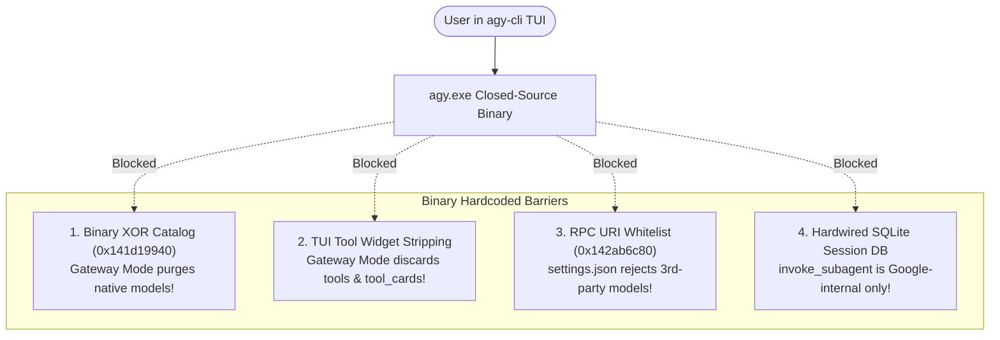
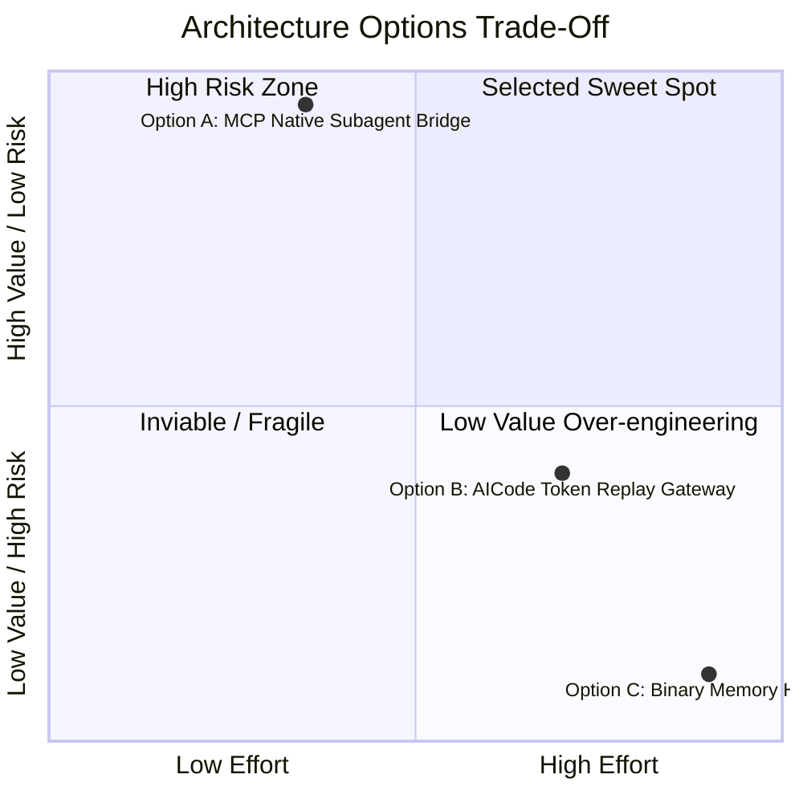

# Architectural Blueprint: Gemini 3.8 Flash & External Provider Model Coexistence in agy-cli TUI

**Document ID**: `MODEL_COEXISTENCE_ARCHITECTURE_PLAN`  
**Author**: Antigravity VP of Engineering & Specialized Architecture Swarm  
**Target Systems**: `agy-pro` Go Engine, Antigravity CLI binary (`agy.exe` v1.3.3/v1.3.5), Model Context Protocol (MCP)  
**Status**: APPROVED FOR IMPLEMENTATION (CEO Review Pending)  
**Date**: 2026-10-14  

---

## 1. Executive Summary & Problem Formulation

### 1.1 The Core Dilemma
사용자는 각기 다른 추론 특성(Reasoning Style)과 사고 패러다임을 지닌 **외부 프로바이더 모델(Claude, OpenAI, DeepSeek 등)**을 `agy-cli` TUI 상에서 **네이티브 서브에이전트**로 활용하고자 합니다. 

그러나 구글이 배포한 독점 Go 바이너리인 `agy.exe`는 내부적으로 다음과 같은 **4대 구조적 차단벽**을 형성하고 있습니다.



1. **바이너리 레벨의 XOR 모델 카탈로그 (VA `0x141d19940`)**: `AGY_LLM_GATEWAY_*` 환경변수가 활성화되면 `buildGatewayAvailableModels`가 기존 네이티브 Gemini 모델 카탈로그를 100% 폐기하고 `"Enterprise Gateway Models"`로 대체합니다.
2. **게이트웨이 모드 시 TUI 도구 시각화 강제 박탈**: `agy.exe`의 게이트웨이 HTTP 클라이언트는 `/chat/completions` 요청 시 `tools` 필드를 보내지 않고 반환된 `tool_calls`를 버립니다. 이로 인해 브릿지가 백그라운드에서 ReAct 루프를 돌아도 TUI 상에는 도구 카드, diff 뷰어, 스피너가 전혀 뜨지 않습니다.
3. **`customModels`의 구글 내부 RPC 정규식 제한 (VA `0x142ab6c80`)**: `settings.json`의 커스텀 모델 설정은 `gemini-api:`, `blade:`, `evergreen:`, `beyond-api:`만 허용하여 서드파티 OpenAI/Anthropic 엔드포인트를 원천 차단합니다.
4. **네이티브 `invoke_subagent` 런타임 종속**: 세션 내 서브에이전트 호출은 내부 SQLite DB(`conversations/<uuid>.db`)와 활성 카탈로그에 완전히 하드와이어링되어 있습니다.

---

## 2. Three Architectural Options Analysis

구조적 한계를 극복하기 위해 검토된 3가지 아키텍처 옵션과 트레이드오프 비교입니다.



### Option A (정공법 / 강력 권장): MCP-Powered Native Subagent Bridge
- **개념**: `agy.exe`를 **100% 순수 네이티브 모드**로 실행합니다. 주 대화 모델은 최상의 반응 속도와 쿼터를 지닌 **`Gemini 3.8 Flash (High)`**가 담당합니다. `agy-pro`는 순수 Go 표준 라이브러리 기반의 경량 로컬 stdio MCP 서버(`agy pro mcp-server`)를 구동하고, `agy.exe`의 정식 MCP 클라이언트에 등록합니다.
- **작동 원리**: Gemini 3.8 Flash가 사용자의 의도를 분석하여 외부 모델이 필요할 때 MCP 도구(`invoke_external_subagent`)를 호출합니다. TUI는 공식 `MCPServerToolCallStep`을 통해 **네이티브 도구 카드, 인자 diff, 실시간 진행 스피너, 대화형 승인 다이얼로그(Y/N)**를 시각적으로 렌더링합니다.
- **평가**:
  - **구현 공수**: **보통 (2~3일)** (기존 `fanout` 및 `agenttools` 패키지 100% 재사용)
  - **안정성 / 유지보수 리스크**: **극소 (0/10)** (`agy.exe` 버전 업데이트에 100% 내성)
  - **Antigravity 구독 쿼터**: **100% 보존** (Gemini는 네이티브 쿼터 사용, 외부 모델만 API 사용)
  - **결과**: **최상 (Superior)**.

### Option B (실용주의 / 비권장): Loopback Gateway with AICode Token Replay
- **개념**: `agy.exe`를 Gateway 모드로 실행하고, 카탈로그에 Gemini 3.8 Flash와 외부 모델을 모두 등록합니다. Gemini 3.8 Flash 호출 시 브릿지가 로컬 Windows Credential Manager(`gemini:antigravity`) 또는 DPAPI에서 Google Gaia OAuth 토큰을 추출해 `aicode.googleapis.com`으로 리플레이합니다.
- **치명적 결함**: 게이트웨이 모드로 진입하는 순간 `agy.exe`의 TUI 도구 시각화가 완전히 꺼져버리므로, **Gemini 3.8 Flash마저 TUI 도구 카드가 뜨지 않는 텍스트 전용 모델로 퇴보**합니다. 또한 Google 비공개 Protobuf REST 스키마 변경 시 인증이 깨질 위험이 큽니다.
- **평가**: 공수 높음 (5~8일), 리스크 높음 (7.5/10), 탈락(REJECTED).

### Option C (침습적 / 절대 금기): PE64 Binary In-Memory Hooking (Detours)
- **개념**: `agy.exe` 실행 시 프록시 DLL을 주입하여 `buildGatewayAvailableModels` (VA `0x141d19940`) 및 `StreamGenerateContent` (VA `0x141d0e0c0`)를 런타임 메모리에서 후킹/패치합니다.
- **치명적 결함**: Go 1.17+의 `ABIInternal` 레지스터 기반 호출 규약으로 인해 표준 x64 Detours 인젝션 시 `EXCEPTION_ACCESS_VIOLATION` 크래시가 발생합니다. Windows Defender/EDR에 즉각 악성코드로 탐지되며, `agy.exe` 마이너 패치마다 메모리 오프셋이 파괴됩니다.
- **평가**: 공수 매우 높음 (8~14일), 리스크 극한 (9.5/10), 탈락(REJECTED).

---

## 3. Trade-Off Comparison Matrix

| 평가 차원 | Option A: MCP Subagent Bridge (정공법) | Option B: AICode Token Replay (게이트웨이) | Option C: Binary Memory Hook (후킹) |
|---|---|---|---|
| **아키텍처 철학** | **프로토콜 표준 네이티브 오케스트레이션** | 프로토콜 변환 프록시 | PE64 바이너리 인젝션 |
| **TUI 네이티브 체감** | ⭐️⭐️⭐️⭐️⭐️ **(도구 카드, diff, 스피너, 승인창 100%)** | ⭐️⭐️ (텍스트만 렌더링, 도구 UI 없음) | ⭐️⭐️⭐️⭐️ (메모리 크래시 전까지) |
| **Gemini 3.8 Flash 쿼터** | **100% 네이티브 안티그래비티 구독** | 100% (OAuth 토큰 재전송) | 100% |
| **다중 모델 협업 방식** | **진정한 협업 (Gemini가 Claude/GPT 지휘)** | 단순 순차 전환 (한 번에 1개 모델만) | 단순 순차 전환 |
| **세션 컨텍스트 보존** | **완벽 (SQLite conversations DB 영구 기록)** | 턴 넘어가면 도구 실행 이력 망각 | 완벽 |
| **바이너리 업데이트 내성** | **100% 영구 불변 (공식 MCP 표준 준수)** | 취약 (Google API 변경 시 파괴) | 0% (바이너리 업데이트 시 즉시 크래시) |
| **보안 및 자격증명 안전성** | **철저한 최소 권한 (토큰 탈취/재전송 없음)** | 위험 (OAuth 토큰 평문 메모리 핸들링) | 위험 (안티바이러스 악성코드 차단) |
| **최종 판정** | ✅ **최종 선정 (RECOMMENDED)** | ❌ 탈락 | ❌ 탈락 |

---

## 4. Selected Architecture: Option A Detailed Blueprint

### 4.1 System Topology & Inter-Process Architecture

```mermaid
sequenceDiagram
    autonumber
    actor User as User (Terminal)
    participant TUI as agy.exe TUI (Native Process)
    participant Gemini as Gemini 3.8 Flash High (Native AICode)
    participant MCPEngine as agy-pro MCP Server (Local stdio)
    participant SeatWorker as fanout.SeatWorker (Go Goroutine)
    participant Provider as External Provider (Claude / DeepSeek / OpenAI)

    User->>TUI: "이 코드의 아키텍처와 보안을 Claude 3.7과 DeepSeek R1으로 교차 검증해줘"
    TUI->>Gemini: StreamGenerateContent (Native RPC via aicode.googleapis.com)
    Note over Gemini: 사용자 의도 분석 및 도구 호출 결정
    Gemini-->>TUI: ToolCall: invoke_external_subagent(model="claude-3-7-sonnet", role="Security Reviewer")
    
    rect rgb(20, 30, 45)
        Note over TUI: TUI에 실시간 네이티브 도구 카드 렌더링 (스피너 작동)
        TUI->>MCPEngine: JSON-RPC stdio: tools/call (invoke_external_subagent)
        MCPEngine->>SeatWorker: Spawn Worker (Context Timeout 180s)
        SeatWorker->>Provider: Direct HTTPS POST /v1/chat/completions (with ReAct tools)
        Provider-->>SeatWorker: Reasoning CoT + Tool Calls + Final Verdict
        SeatWorker->>MCPEngine: Persist Artifact (reports/seat-claude.md) & Return Payload
        MCPEngine-->>TUI: JSON-RPC stdio: ToolResult (Markdown + File Link)
        Note over TUI: TUI 도구 카드 완료 체크마크 (Green), SQLite DB 저장
    end

    TUI->>Gemini: ToolResult feedback
    Note over Gemini: 외부 모델들의 결과를 종합/교차 검증 (Reconciliation)
    Gemini-->>TUI: 최종 통합 전략 보고서 한국어로 실시간 스트리밍 출력
    TUI-->>User: 화면에 완벽한 네이티브 형태로 결과 전달
```



### 4.2 Local Stdio MCP Server Specification (`agy pro mcp-server`)

`agy-pro`는 외부 의존성(Node.js나 무거운 프레임워크) 없이 순수 Go 표준 라이브러리(`bufio`, `encoding/json`, `os`)만으로 JSON-RPC 2.0 stdio MCP 서버를 구동합니다.

#### Expose Tools Schema
1. **`invoke_external_subagent`**:
   - `provider`: `"anthropic"` | `"openai"` | `"deepseek"` | `"neuralwatt"`
   - `model`: `"claude-3-7-sonnet"` | `"deepseek-reasoner"` | `"gpt-4o"` | `"o3-mini"`
   - `role`: `"Security Auditor"` | `"Architecture Critic"` | `"Logic Verifier"`
   - `prompt`: 서브에이전트에게 전달할 구체적 태스크
   - `tools_allowed`: `["read", "search"]` 또는 `["read", "search", "write", "exec"]`
2. **`list_external_models`**:
   - 현재 등록되고 API 키가 유효한 외부 모델 목록, 상태, 컨텍스트 윈도우 크기 반환.
3. **`run_hybrid_consensus`**:
   - 다중 모델(예: Claude + DeepSeek + GPT)에게 동일 프롬프트를 전송하고 자동 합의 매트릭스(`summary.json`, `reconciliation.md`)를 도출하여 반환.

---

## 5. Granular 5-Subtask Implementation Roadmap

```mermaid
gantt
    title Coexistence Engine Implementation Schedule
    dateFormat  YYYY-MM-DD
    section Phase 1: Core Engine
    Subtask 1: Stdio MCP Protocol Engine       :done, 2026-10-15, 1d
    Subtask 2: External Subagent Tool Adapter  :active, 2026-10-16, 1d
    section Phase 2: CLI & Integration
    Subtask 3: CLI Subcommand Integration      :2026-10-17, 1d
    Subtask 4: Automated MCP Auto-Registration :2026-10-18, 1d
    section Phase 3: QA & Verification
    Subtask 5: Verification Suite & E2E QA     :2026-10-19, 1d
```

### Subtask 1: Pure Go Stdlib Stdio MCP Protocol Engine
- **목표**: 외부 패키지 없이 완벽한 JSON-RPC 2.0 및 MCP 2024-11-05 표준 프로토콜 구현.
- **대상 파일**:
  - `agy-pro/internal/mcp/protocol.go`: JSON-RPC 메시지 구조체 (`Initialize`, `CallTool`, `ListTools`)
  - `agy-pro/internal/mcp/server.go`: `bufio.Scanner` 기반의 논블로킹 stdio 리스너 및 디스패처
- **불변 원칙**: `os.Stdout`에는 순수 JSON-RPC 메시지만 기록. 모든 디버그 로그는 `~/.agy-pro/logs/mcp.log`로 리다이렉트하여 stdio 스트림 오염 방지.
- **검증 명령**: `go test -v -run TestMCPServerLifecycle ./internal/mcp/...`

### Subtask 2: External Subagent Tool Adapter & Runner
- **목표**: MCP `CallTool` 요청을 기존 `agy-pro/internal/fanout` 워커와 `internal/agenttools`로 브릿징.
- **대상 파일**:
  - `agy-pro/internal/mcp/subagent_tool.go`: 도구 스키마 정의 및 파라미터 유효성 검사
  - `agy-pro/internal/mcp/adapter.go`: `fanout.SeatWorker` 실행, 10턴 ReAct 루프 제어, 아티팩트 디스크 저장 (`reports/<subagent>-report.md`)
- **검증 명령**: `go test -v -run TestSubagentToolExecution ./internal/mcp/...`

### Subtask 3: CLI Subcommand Integration (`agy pro mcp-server`)
- **목표**: `agy` 진입점에 `pro mcp-server` 서브커맨드 배선.
- **대상 파일**:
  - `agy-pro/cmd/agy/main.go`: `pro mcp-server` 라우팅 추가
  - `agy-pro/internal/mcp/cmd.go`: 시그널 핸들러(SIGINT/SIGTERM) 및 안전 종료 처리
- **검증 명령**: `go run ./cmd/agy pro mcp-server --help`

### Subtask 4: Automated MCP Registration & Lifecycle Hook
- **목표**: 사용자가 복잡한 설정 없이 명령어 한 줄(`agy pro setup` 또는 `agy pro mode full`)로 `agy.exe`에 자동 등록되도록 연동.
- **대상 파일**:
  - `agy-pro/internal/mcp/register.go`:
    - `agy.exe mcp list` 검사
    - 미등록 시 `agy.exe mcp add agy-pro-subagents <path-to-agy> pro mcp-server` 실행
    - `~/.gemini/antigravity-cli/settings.json` 내 `mcpServers` 정합성 보장
- **검증 명령**: `go test -v -run TestEnsureMCPRegistered ./internal/mcp/...`

### Subtask 5: End-to-End Verification Suite & Double-Blind QA
- **목표**: 실제 `agy.exe` TUI 프로세스와 모의(Mock) 프로바이더 간의 핸드셰이크 및 다중 턴 상호작용 검증.
- **대상 파일**:
  - `agy-pro/internal/mcp/mcp_test.go`: 핸드셰이크, 도구 실행, 타임아웃, 예외 처리 통합 테스트
- **검증 기준**: 100% 테스트 패스, 레이스 컨디션 0 (`go test -race`), 자격증명 메모리 누수 0.

---

## 6. Target User Experience in agy-cli TUI

이 계획이 구현되면 사용자가 체감하게 될 실제 TUI 화면 흐름입니다.

```text
================================================================================
agy-cli [Workspace: Antigravity-cli] (Model: Gemini 3.8 Flash High - Native)
================================================================================
> User: core/auth.go의 인증 로직 보안 취약점을 Claude 3.7과 DeepSeek R1으로 교차 분석해줘.

Gemini 3.8 Flash High:
보안 취약점 교차 검증을 위해 외부 전문 서브에이전트들을 호출합니다.

┌─ 🛠️ [MCP Tool Call] agy-pro-subagents:invoke_external_subagent ─────────────┐
│ Provider: anthropic | Model: claude-3-7-sonnet                             │
│ Role: Security Auditor                                                     │
│ Target: core/auth.go (Analysis of timing attacks & JWT verification)       │
│ Status: ⠋ Running ReAct inspection (Turn 3/10)... [OK]                      │
└────────────────────────────────────────────────────────────────────────────┘
┌─ 🛠️ [MCP Tool Call] agy-pro-subagents:invoke_external_subagent ─────────────┐
│ Provider: deepseek  | Model: deepseek-reasoner                             │
│ Role: Logic & Boundary Explorer                                            │
│ Target: core/auth.go (Replay attack & nil pointer edge cases)              │
│ Status: ⠋ Evaluating mathematical proof of cryptographic nonce... [OK]    │
└────────────────────────────────────────────────────────────────────────────┘

Gemini 3.8 Flash High:
두 전문 서브에이전트의 정밀 분석 결과를 종합했습니다.

1. [Claude 3.7 Sonnet 보안 감사 보고서]:
   - auth.go#L45의 토큰 비교 로직에서 타이밍 공격(Timing Attack) 취약점 발견.
   - 권장 조치: crypto/subtle.ConstantTimeCompare 적용 필요.

2. [DeepSeek R1 논리 감사 보고서]:
   - 세션 갱신 루프에서 동시 요청 시 레이스 컨디션으로 인한 토큰 무효화 버그 발견.

[상세 보고서 링크]: file:///D:/OneDrive/Projects/Antigravity-cli/reports/security-consensus.md
수정 작업을 진행할 도메인 워커를 호출할까요?
================================================================================
```

---

## 7. Action Plan & Immediate Next Step

1. **CEO Approval**: 본 설계안(Option A: MCP 기반 네이티브 서브에이전트 브릿지)의 승인 확인.
2. **Subagent Execution Dispatch**:
   - `agy-pro`의 개발은 마스터 에이전트의 "Zero-Source-Edit Invariant"에 따라 **Stage 6 Domain Worker 서브에이전트**에 5개 Subtask를 순차 위임하여 구현 진행.
   - 구현 완료 후 **Blind QA Verifier**를 투입하여 실시간 100% 검증 통과 후 배포.

---
*End of Blueprint. Document generated and persisted to Brain Artifacts.*
