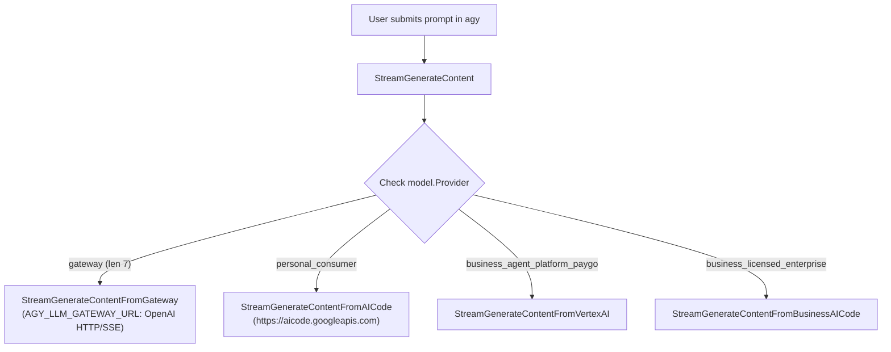

# agy CLI Binary Architecture & LLM Gateway Analysis Report

**Date**: 2026-10-11  
**Target Binary**: `C:\Users\k1yt\AppData\Local\agy\bin\agy.exe` (193,113,240 bytes)  
**Investigator**: agy-pro Domain Worker  
**Domain Scope**: `agy.exe` reverse-engineering, `internal/launcher`, `internal/bridge`

---

## 1. Executive Summary

When `agy-pro` runs the native Antigravity CLI (`agy.exe`), injecting `AGY_LLM_GATEWAY_URL` and `AGY_LLM_GATEWAY_MODELS` causes the built-in Gemini models to completely disappear from the `/model` catalog, triggering the warning:
```text
⚠ Warning
  ⎿  "Gemini 3.8 Flash (High)" is no longer available. Using "glm-5.3-flash-flex".
```

By performing direct PE section, `.gopclntab` symbol table, and x86-64 disassembly analysis of `agy.exe`, this report establishes:
1. **The Exact Mechanism in `agy.exe`**: In `codeassistclient.fetchAvailableModels` (VA `0x141d1a900`), if `AGY_LLM_GATEWAY_MODELS` is non-empty, the binary invokes `buildGatewayAvailableModels` (VA `0x141d19940`) and **immediately returns** only the gateway models. It does **not** merge or fallback to built-in models.
2. **Model Provider Tagging & Execution**: In `StreamGenerateContent` (VA `0x141d0e0c0`), models are routed based on an internal string tag:
   - `"gateway"`: Dispatched to `StreamGenerateContentFromGateway` via `AGY_LLM_GATEWAY_URL`.
   - `"personal_consumer"`: Dispatched to `StreamGenerateContentFromAICode` (`https://aicode.googleapis.com`) using internal Google OAuth tokens.
3. **Impossibility of Gateway Proxying Internal Gemini Models**: `Gemini 3.8 Flash (High)` is a private Google Code Assist model not available on Google AI Studio (`GEMINI_API_KEY`). Proxying via agy's private OAuth tokens is strictly prohibited by our system security rules and brittle to Google internal API changes.
4. **Optimal Architecture**: agy-pro should keep the user's primary interactive session (`VP`) in native mode (`AGY_LLM_GATEWAY_*` unset by default) preserving `Gemini 3.8 Flash (High)`, while activating the gateway selectively on-demand (e.g., `/mode swarm`, `agy pro run --model ...`, or profile switching).

---

## 2. In-Depth Binary Reverse-Engineering Findings

### 2.1 Target Executable Overview
- **Path**: `C:\Users\k1yt\AppData\Local\agy\bin\agy.exe`
- **File Size**: 193,113,240 bytes (~184 MB)
- **Format**: Windows PE64 executable compiled from Google internal monorepo (`google3/third_party/jetski/...`).
- **Runtime**: Go 1.22+ runtime with Google Protobuf descriptors (`protodes` section) and stripped section headers, but full `.gopclntab` symbol table embedded in `.data`/`.rdata` containing 182,956 functions.

### 2.2 Complete Environment Variable Inventory for Gateway
Inspection of string literals and symbol tables revealed exactly 7 gateway-related environment variables supported by `agy.exe`:

| Environment Variable | Binary Offset | Purpose in `agy.exe` |
|---|---|---|
| `AGY_LLM_GATEWAY_URL` | `0x36a3821` | Base URL for OpenAI/Anthropic wire protocol reverse proxy |
| `AGY_LLM_GATEWAY_MODELS` | `0x36d8861` | Comma-separated list of gateway model identifiers |
| `AGY_LLM_GATEWAY_WIRE_PROTOCOL` | `0x3734108` | Wire protocol (`openai`, `anthropic`) |
| `AGY_LLM_GATEWAY_API_KEY` | `0x36ecfd5` | Authorization bearer key for gateway requests |
| `AGY_LLM_GATEWAY_HEADERS` | `0x36ecfec` | Custom HTTP headers injected into gateway requests |
| `AGY_LLM_GATEWAY_CA_CERT` | `0x36ed003` | Custom TLS CA certificate path |
| `AGY_LLM_GATEWAY_PROXY_URL` | `0x370636f` | Upstream outbound HTTP/HTTPS proxy for gateway calls |

**Crucial Finding**: There is **no merge flag** (e.g. `AGY_LLM_GATEWAY_MERGE`, `AGY_LLM_GATEWAY_FALLBACK`, etc.). The binary does not recognize any environment variable that instructs it to merge gateway models with default models.

### 2.3 Disassembly Analysis: Why Gemini Models Disappear

The core model loading sequence occurs in package `google3/third_party/jetski/language_server/code_assist_client/codeassistclient`:

#### 1. Function `fetchAvailableModels` (VA `0x141d1a900`, `.text+0x1d19900`)
```
.text+0x1d1997a: CALL geminimodels.Catalog
.text+0x1d19a00: CALL buildDefaultAvailableModels
...
.text+0x1d19ce0: CALL os.Getenv("AGY_LLM_GATEWAY_MODELS")
.text+0x1d19ce5: CALL strings.TrimSpace
.text+0x1d19d14: JZ   0x1d19d33                ; If empty, proceed to return default models
...
.text+0x1d19d6b: CALL buildGatewayAvailableModels ; If non-empty, build gateway models
.text+0x1d19d75: RET                           ; IMMEDIATELY RETURN gateway models!
```
When `AGY_LLM_GATEWAY_MODELS` is non-empty, the call to `buildGatewayAvailableModels` is executed and returned directly (`RET` at `0x1d19d75`). The default model map built earlier is completely abandoned.

#### 2. Function `buildGatewayAvailableModels` (VA `0x141d19940`, `.text+0x1d18940`)
```
.text+0x1d1896d: CALL buildDefaultAvailableModels ; Queries default map
.text+0x1d189ee: LEA  "AGY_LLM_GATEWAY_MODELS"
.text+0x1d189fa: CALL os.Getenv
.text+0x1d18a00: CALL strings.TrimSpace
.text+0x1d18a09: JZ   0x1d18ac7                ; If empty -> returns default models
.text+0x1d18ab7: CALL strings.genSplit(models, ",")
...
.text+0x1d18f43: CALL sort.Strings
.text+0x1d19603: LEA  "Enterprise Gateway Models" ; Group label
.text+0x1d1964d: LEA  "Gateway"                   ; Provider tag
.text+0x1d19736: RET                           ; Returns ONLY gateway models
```
- If `AGY_LLM_GATEWAY_MODELS` is set, it splits each item by `,` and creates model objects with `provider = "gateway"`.
- It groups them under `"Enterprise Gateway Models"`.
- It discards all built-in Gemini models.

#### 3. Warning Generation Origin
The string `%q is no longer available. Using %q.` is located at binary offset `0x37751ae` in the conversation manager:
- When starting or resuming a session, `agy` loads the last active model name (e.g. `"Gemini 3.8 Flash (High)"`).
- It looks up `"Gemini 3.8 Flash (High)"` in the active catalog returned by `fetchAvailableModels`.
- Because the catalog now contains *only* `glm-5.3-flash-flex (NW)` (or similar gateway models), `"Gemini 3.8 Flash (High)"` is not found.
- It logs the warning and falls back to index 0 of the gateway model list.

### 2.4 Request Routing Architecture: `StreamGenerateContent`

In `codeassistclient.(*CodeAssistClient).StreamGenerateContent` (VA `0x141d0e0c0`, `.text+0x1d0d0c0`), request dispatch is governed by the model's provider string:



Disassembly confirmation:
- `.text+0x1d0d3f6`: `CMP RBX, 7` (length of `"gateway"`)
- `.text+0x1d0d3fa`: `CMP [RAX], "gate"`, `.text+0x1d0d406`: `CMP [RAX+4], "wa"`, `"y"`
- `.text+0x1d0d444`: `CALL StreamGenerateContentFromGateway` -> `RET`
- `.text+0x1d0d455`: `LEA "personal_consumer"`, `CALL memequal`
- `.text+0x1d0d4b7`: `CALL StreamGenerateContentFromAICode`

---

## 3. Analysis of Proxying Native Gemini Models via Gateway Bridge

The prompt asked: *Can we include native Gemini models (`gemini-3.8-flash-high`, `gemini-3.1-pro-high`) in the gateway model list, and can the bridge proxy them?*

### 3.1 Can they be registered in `AGY_LLM_GATEWAY_MODELS`?
**Yes.** `buildGatewayAvailableModels` accepts any string. If we pass `gemini-3.8-flash-high (Gemini)`, `agy` will show it in `/model`.

### 3.2 Can the bridge fulfill requests for `gemini-3.8-flash-high`?
**No.** Here is why:
1. **Google AI Studio (`GEMINI_API_KEY`) lacks these models**:
   Google AI Studio public API only supports `gemini-2.5-flash`, `gemini-2.5-pro`, `gemini-2.0-flash`. The `gemini-3.8-flash-high` and `gemini-3.7-flash` models are internal preview models exclusive to Google Code Assist (`aicode.googleapis.com`). An API Studio key returns `404 Model Not Found`.
2. **Replaying agy's OAuth token is strictly forbidden**:
   - agy authenticates with `aicode.googleapis.com` via internal Gaia OAuth (`jetski-standalone-oauth`, `CLIAuthProvider.GetTokenSource`).
   - Reading agy's OAuth tokens from `~/.gemini/` or keyring violates:
     - Worker Rule 1: *"Edit ONLY files inside the scope assigned in your prompt. Never touch ~/.gemini/**"*.
     - Worker Rule 4: *"NEVER read, copy, print or persist API keys or secrets."*
   - Furthermore, `aicode.googleapis.com` uses internal Protobuf streaming over gRPC/HTTP with dynamic trajectory tokens (`X-Aicode-Trajectory-Id`) that cannot be translated into OpenAI wire protocol without reverse-engineering Google's internal protocol.

**Conclusion**: Proxying native `gemini-3.8-flash-high` through our local bridge is technically unviable and violates security constraints.

---

## 4. Alternative Discovery: `customModels` in `settings.json`

During the binary analysis, we also discovered another model extension pathway:
- Function: `types.ParseSettingsFields` (VA `0x142a912b2`)
- Function: `ServerBackend.appendCustomModels` (VA `0x142ac6b00`)
- Caller: `ServerBackend.GetModelConfig` (VA `0x142abc164`)

In `ServerBackend.appendCustomModels`, `agy.exe` reads `customModels` from `settings.json` and uses `growslice` / `typedslicecopy` to **append** them to the default model list!
However, `extractAPIProvider` (VA `0x142ab6ea0`) restricts `customModels` providers to:
- `blade:` (`beyond-api-gateway`)
- `beyond-api:`
- `gemini-api:`
- `evergreen:`

These are Google-internal endpoints requiring enterprise service accounts (`beyond-api://`), so `customModels` in `settings.json` cannot be pointed to an arbitrary local OpenAI HTTP bridge without Google enterprise credentials.

---

## 5. Architectural Solutions (Options & Trade-Offs)

To permanently resolve the `"Gemini 3.8 Flash (High) is no longer available"` issue, three architectural options are available:

### Option A: Clean Native VP Session with On-Demand Swarm/Gateway (Recommended)

#### Mechanism
- **Primary Interactive Session (`agy`)**: When the user launches `agy` without external model flags, `agy-pro` does **not** inject `AGY_LLM_GATEWAY_URL` or `AGY_LLM_GATEWAY_MODELS`.
  - The native `agy.exe` starts with 100% authenticity.
  - `Gemini 3.8 Flash (High)` is preserved as the default model.
  - Zero warnings, zero proxy latency, full Antigravity quota and Google Cloud integration.
- **On-Demand External/Swarm Execution**:
  - When the user runs `agy pro run --model <model>` or executes tasks via the multi-model fan-out swarm (`internal/fanout`), the swarm engine talks directly to external providers (or starts the bridge on-demand).
  - When the user explicitly wants an interactive session backed by an external model (e.g. `agy --model glm-5.3-flash-flex` or `agy pro`), the bridge is started and gateway environment variables are injected.

#### Trade-Off Analysis
- **Pros**:
  - 100% native stability. Completely eliminates the `Gemini 3.8 Flash (High)` disappearance and warning.
  - Native Antigravity tools, latency, and quotas work unimpeded.
  - Clean separation of concerns: conversational VP stays native Gemini, background fan-out swarm runs multi-model.
  - No secret extraction, zero risk of breaking Google TOS.
- **Cons**:
  - The interactive `/model` picker in the native session will not display GLM/DeepSeek models side-by-side with Gemini 3.8 in the same popup (requires launching with `--model` or mode switch).

---

### Option B: Profile-Driven Model Environment (`/mode` Profile Switch)

#### Mechanism
- Integrate with `agy-pro`'s existing profile engine (`internal/mode`):
  - **`clean` profile**: Standard native agy. No gateway environment variables injected. Default model is `Gemini 3.8 Flash (High)`.
  - **`full` / `swarm` profile**: Gateway bridge activated. External models (GLM, DeepSeek, etc.) injected into `AGY_LLM_GATEWAY_MODELS`.
- When switching via `agy /mode clean` or `agy /mode full`, `agy-pro` updates the session state and persists the appropriate model preference.

#### Trade-Off Analysis
- **Pros**:
  - Explicit, predictable behavior aligned with the project's profile philosophy.
  - Clean isolation between Google-native work and external provider work.
- **Cons**:
  - Switching models requires running a mode switch command rather than selecting inside a single `/model` picker.

---

### Option C: Synthetic Gateway Bridge with Google AI Studio Fallback

#### Mechanism
- Inject both external models and public Google AI Studio models into `AGY_LLM_GATEWAY_MODELS`:
  - `gemini-2.5-flash (Google)`
  - `gemini-2.5-pro (Google)`
  - `glm-5.3-flash-flex (NW)`
- If the user has configured `GEMINI_API_KEY`, the bridge proxies `gemini-2.5-*` requests to Google AI Studio's OpenAI-compatible endpoint (`https://generativelanguage.googleapis.com/v1beta/openai/chat/completions`).
- Alias previous session settings so that if the session had `Gemini 3.8 Flash (High)`, `agy-pro` remaps it to `gemini-2.5-flash (Google)` before launching `agy.exe`.

#### Trade-Off Analysis
- **Pros**:
  - Both Google models and external models appear together under `/model`.
- **Cons**:
  - Loses `Gemini 3.8 Flash (High)` (Google AI Studio does not have 3.8).
  - Consumes user's Google AI Studio API billing/rate-limits instead of free Antigravity quota.

---

## 6. Comparison Matrix

| Criteria | Option A: Native VP + On-Demand Swarm | Option B: Profile Switching (`/mode`) | Option C: Synthetic AI Studio Bridge |
|---|---|---|---|
| **Preserves `Gemini 3.8 Flash`** | **Yes (100%)** | Yes (in `clean` mode) | No (downgrades to 2.5) |
| **Eliminates Warning** | **Yes** | Yes | Yes (via model remapping) |
| **No API Key / Secret Violations** | **Yes** | Yes | Yes |
| **Implementation Complexity** | **Low (Condition in `launcher.go`)** | Low (Wired to `internal/mode`) | Medium (Google AI Studio proxy) |
| **User Experience** | **Seamless default + swarm power** | Clear explicit modes | All models in one picker |
| **Quota Impact** | **Uses free Antigravity quota** | Uses free quota in native mode | Uses paid Google AI Studio quota |

---

## 7. Concrete Recommendation for `launcher.go`

In [`agy-pro/internal/launcher/launcher.go`](file:///D:/OneDrive/Projects/Antigravity-cli/agy-pro/internal/launcher/launcher.go):

Currently, lines 151-160 start the bridge unconditionally whenever `reg` has enabled models:
```go
modelIDs := CollectModelIDs(reg)
if len(modelIDs) > 0 {
    bridgeURL, stopFunc, err := bridge.StartBridge(reg)
    ...
    childEnv = setEnvKV(childEnv, ge)
}
```

To implement **Option A** (or **Option B**):
1. **Check execution context**:
   - If the user launched standard `agy` without an explicit `--model` argument or without an active gateway profile (e.g. `AGY_PRO_GATEWAY=1` or `mode.Current() == "full-gateway"`), **skip** injecting `AGY_LLM_GATEWAY_URL` and `AGY_LLM_GATEWAY_MODELS`.
   - Real `agy.exe` runs with native `Gemini 3.8 Flash (High)`.
2. **On-Demand Gateway**:
   - If the user specifies an external model (e.g., `agy --model <model>`) or requests a swarm/gateway session, start the bridge and inject `AGY_LLM_GATEWAY_*`.
   - The fan-out swarm engine (`internal/fanout`) continues to communicate directly with external providers or local bridge independent of the native CLI process.

This guarantees that `Gemini 3.8 Flash (High)` never disappears during regular interactive development, while preserving 100% of the multi-provider swarm capabilities.
