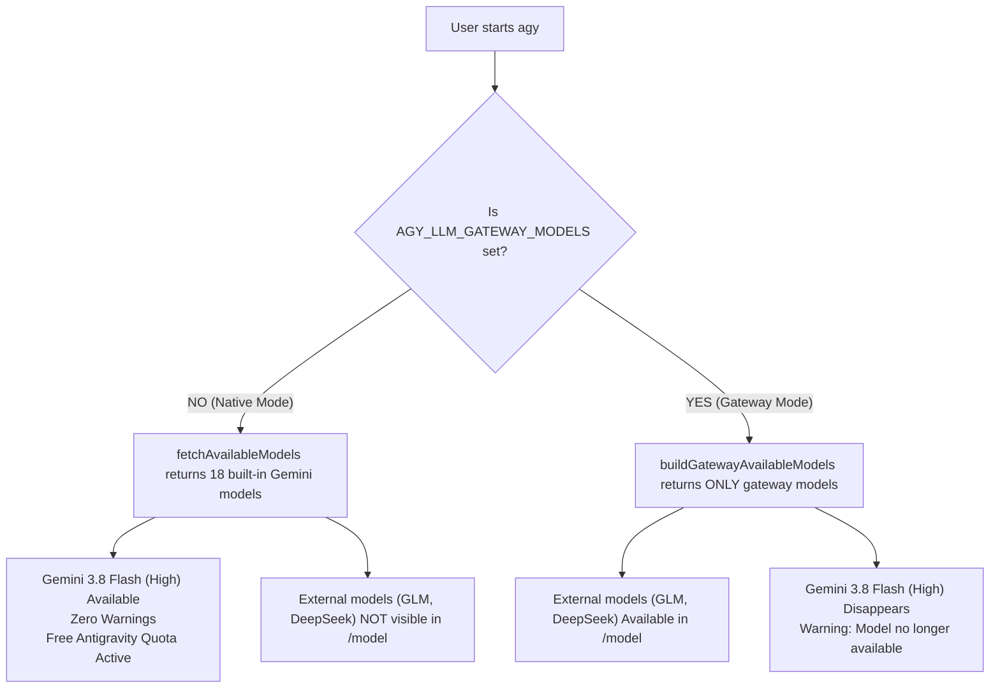
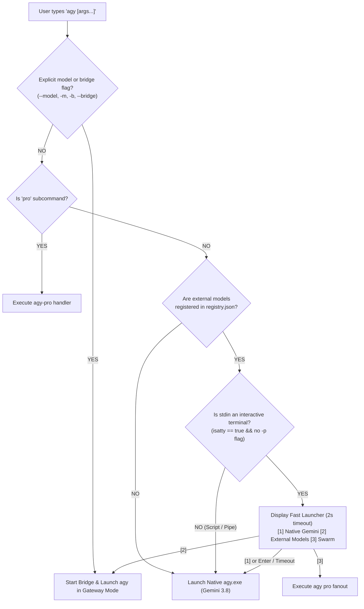

# agy CLI Model Coexistence & User Experience (UX) Architecture Report

**Target Binary**: `C:\Users\k1yt\AppData\Local\agy\bin\agy.exe` (193,113,240 bytes)  
**Investigation Scope**: `settings.json` (`customModels`), `ServerBackend.appendCustomModels`, `extractAPIProvider`, `buildGatewayAvailableModels`, `internal/launcher`, UX Architecture  
**Author**: agy-pro Domain Worker  
**Date**: 2026-10-11  

---

## 1. Executive Summary & User Problem Statement

### 1.1 The User's Core Issue
When running `agy` directly after configuring external models via `agy pro setup`:
> *"지금 상태로 'agy'로 기본실행하게되면, 네이티브모델과 gemini는 유지되는데, 등록한 외부모델이 아예 포함이 안 되어있는걸?"*  
> *(When running `agy` by default in the current state, native models and Gemini remain, but the registered external models are not included at all?!)*

The user expects that once external models (e.g. GLM-5.3, DeepSeek, Claude) are registered in `agy-pro`, running `agy` should effortlessly give access to them without having to search for obscure flags, while ideally also retaining access to the native Gemini models.

### 1.2 Key Investigation Conclusions
1. **`customModels` in `settings.json` is Strictly a Google-Internal Extension**:
   - `agy.exe` parses `customModels` in `settings.json` via `ServerBackend.appendCustomModels` (VA `0x142ac6b00`).
   - However, `buildCustomAgentModel` (VA `0x142ab6c80`) enforces a strict regex:  
     `^(?:gemini-api:|blade:|evergreen:|beyond-api:)(?:.*?/models/(.+)|(?:.*/)?([^/]+))$`
   - Any third-party model identifier (such as `glm-5.3-flash-flex` or `http://localhost:...`) is rejected with:  
     `model name %q does not look like a custom model URL. Expected format: gemini-api://... blade:... evergreen:... beyond-api://...`
   - Furthermore, `gemini-api:` uses Google Protobuf / REST schema (`GenerateContentRequest`) and authenticates via `GEMINI_API_KEY` against Google servers. It **cannot** communicate with standard OpenAI-compatible endpoints or a local HTTP bridge.
2. **`AGY_LLM_GATEWAY_*` is an Upstream Hardcoded XOR Switch**:
   - In `fetchAvailableModels` (VA `0x141d1a900`), if `AGY_LLM_GATEWAY_MODELS` is set, `agy.exe` calls `buildGatewayAvailableModels` and **immediately returns only the gateway models**, discarding all native Gemini models.
   - Consequently, **Native Gemini 3.8 Flash and Gateway models cannot coexist inside a single `agy.exe` `/model` popup** without patching the upstream binary.
3. **The UX Solution ("Interactive Fast Launcher + Smart Shortcuts")**:
   - To provide the smoothest experience when typing `agy`, `agy-pro` should implement a **Lightweight Interactive Launcher (Method A)**:
     - When external models are registered and `agy` is run in an interactive terminal, display an instant 2-second timeout picker:
       `[1] Native Gemini 3.8 Flash (Enter to start) | [2] External Gateway (GLM/DeepSeek) | [3] Swarm Mode`
     - Pressing **`Enter`** (or waiting 2s) starts native Gemini with zero delay.
     - Pressing **`2`** starts the gateway bridge and loads external models into `agy`.
     - Direct flags (`agy -m <model>`, `agy -b`) and persistent profile settings (`agy pro config default-profile gateway`) bypass the launcher completely for automated/power workflows.

---

## 2. In-Depth Reverse-Engineering: `settings.json` & `customModels`

To determine whether `settings.json` could be used to register external models alongside native Gemini models, we disassembled and traced `agy.exe`'s configuration pipeline.

### 2.1 Struct Layout in `types.Settings`
In package `google3/third_party/jetski/cli/types/types`, `CliSettings` contains:
```go
type Settings struct {
    ...
    CustomModels      map[string]*codeium_common_pb.ModelInfo `json:"customModels,omitempty"`
    RunningLightSpeed bool                                    `json:"runningLightSpeed"`
    SandboxProxy      string                                  `json:"sandboxProxy,omitempty"`
    UseG1Credits      bool                                    `json:"useG1Credits,omitempty"`
    ...
}
```
`settings.json` is read by `(*ServerBackend).ReadCliSettings` (VA `0x142abb680`) from `~/.gemini/antigravity-cli/settings.json`.

### 2.2 Trace of `ServerBackend.appendCustomModels` (VA `0x142ac6b00`)
```
0x142ac6b6c: CALL internal/sync.(*Mutex).lockSlow
0x142ac6ba0: CALL internal/sync.(*Mutex).unlockSlow
0x142ac6bb2: CALL backend.resolveCustomAgentModels     ; Iterates over customModels map
0x142ac6bf2: CALL runtime.growslice                    ; Appends models to slice
0x142ac6c49: CALL runtime.typedslicecopy
0x142ac6c8d: RET
```
`appendCustomModels` does indeed append models to the active catalog slice. However, the models must first pass validation in `resolveCustomAgentModels` and `buildCustomAgentModel`.

### 2.3 Strict URI Validation in `buildCustomAgentModel` (VA `0x142ab6c80`)
In `buildCustomAgentModel`, every custom model string is matched against a compiled regular expression:
```
0x142ab6d80: CALL regexp.(*Regexp).FindStringSubmatch
```
The exact regular expression located at offset `0x380fc69` is:
```regex
^(?:gemini-api:|blade:|evergreen:|beyond-api:)(?:.*?/models/(.+)|(?:.*/)?([^/]+))$
```
If the model string does not match this pattern, execution branches to `0x142ab6cee`:
```
0x142ab6cee: CALL runtime.convTstring
0x142ab6d04: LEA [RIP+0xd8c121] -> "model name %q does not look like a custom model URL. Expected format: gemini-api://<base_url>/models/<model_name>, blade:<base_url>/models/<model_name>, evergreen:<base_url>/models/<model_name>, or beyond-api://<base_url>/<model_name>"
0x142ab6d20: CALL fmt.errorf
```

### 2.4 Why `gemini-api:` Cannot Point to an OpenAI Bridge
We investigated whether we could format an external model as:
`gemini-api://127.0.0.1:port/models/glm-5.3-flash-flex`

Inspection of `MergedModelProvider.FetchAvailableModels` (VA `0x1423c7480`) and `extractAPIProvider` (VA `0x142ab6ea0`) revealed:
1. **Default Model Lookup**: For any `gemini-api://` URI, `FetchAvailableModels` calls:
   `CALL google3/third_party/jetski/models/defaults/defaultmodels.GetModelInfosWithOverride`  
   If the model identifier is not an officially recognized Google model in `defaultmodels`, it errors with:
   `model override %q not found in defaults` (VA `0x143783b88`).
2. **Wire Protocol Incompatibility**: When `extractAPIProvider` returns `gemini-api:`, `agy.exe` uses Google's `GenerateContentRequest` RPC framing, not the OpenAI `POST /v1/chat/completions` wire format. A local OpenAI bridge will fail on the incoming request format.
3. **Authentication**: `gemini-api:` mandates Google Cloud authentication (`GEMINI_API_KEY` or Gaia OAuth), not custom bearer keys.

**Definitive Technical Finding**: `customModels` in `settings.json` is an enterprise Google Cloud feature and **cannot** be used to register third-party OpenAI-compatible models.

---

## 3. The Technical Reason for the Binary XOR Separation

The table below explains why Gemini models and Gateway models cannot appear together in the same native `/model` list inside `agy.exe`:



### Why upstream `agy.exe` behaves this way:
1. **Designed for Enterprise Gateway Proxying**: Google implemented `AGY_LLM_GATEWAY_*` for enterprise environments where all outbound AI traffic must flow through a corporate gateway (e.g. an enterprise LiteLLM proxy). In that design, the enterprise replaces Google's cloud catalog entirely.
2. **Hardcoded Early Return**: In `codeassistclient.fetchAvailableModels` (VA `0x141d1a900`):
   ```go
   if os.Getenv("AGY_LLM_GATEWAY_MODELS") != "" {
       return buildGatewayAvailableModels() // Immediately returns!
   }
   ```
   There is no fallback or merge branch in the compiled code.
3. **Execution Dispatch**: In `StreamGenerateContent` (VA `0x141d0e0c0`), requests are routed by provider:
   - Provider `"gateway"` -> `StreamGenerateContentFromGateway` (OpenAI HTTP SSE)
   - Provider `"personal_consumer"` -> `StreamGenerateContentFromAICode` (`https://aicode.googleapis.com` via internal Google OAuth)

---

## 4. UX Architecture Options & Trade-Off Analysis

Given the upstream binary constraint, how should `agy-pro` deliver a frictionless experience for the user?

### Option A: Interactive Fast Launcher (Recommended for Interactive CLI)
When the user runs `agy` in an interactive terminal (TTY) with external models configured:
Instead of hiding the external models or forcing the user to remember command-line flags, `agy-pro` presents a quick 2-second selection prompt before launching `agy.exe`:

```text
======================================================================
  Antigravity CLI (agy-pro)
======================================================================
  [1] Native Gemini (Gemini 3.8 Flash High, Pro — Free Quota) [Default]
  [2] External Models (GLM-5.3 Flash, DeepSeek via Local Bridge)
  [3] Swarm Mode (Multi-Model Parallel Swarm)

  Select [1-3] or press Enter for [1] (auto-starts in 2s): 
```

- **Press `Enter`** (or wait 2s): Launches native `agy.exe` immediately. Gemini 3.8 Flash (High) is active, zero warnings.
- **Press `2`**: Starts local bridge and launches `agy.exe` with external models loaded into `/model`.
- **Press `3`**: Runs `agy pro fanout`.
- **Pipes / CI / Scripts**: Automatically defaults to `[1]` with 0 delay if `!isatty(stdin)` or if `-p` / `--prompt` is passed.
- **Bypass Flag**: `agy -m <model>`, `agy -b`, or setting `AGY_LAUNCHER=0` bypasses the launcher prompt completely.

### Option B: Extended Flags & Persistent Default Profile
- For power users who prefer no prompt at all:
  - `agy -m glm-5.3-flash-flex` -> Directly boots gateway with GLM.
  - `agy -b` / `agy pro` -> Directly boots gateway mode.
  - `agy pro config default-profile gateway` -> Configures `agy` to always start in gateway mode by default.
  - `agy pro config default-profile native` -> Configures `agy` to always start in native mode by default.

### Option C: Synthetic Google AI Studio Gateway Bridge
If the user configures `GEMINI_API_KEY` in `registry.json`, the local Go bridge (`internal/bridge`) can proxy Google models via Google AI Studio's OpenAI endpoint (`https://generativelanguage.googleapis.com/v1beta/openai/`):
- `gemini-2.5-flash (Google)` and `gemini-2.5-pro (Google)` are included in `AGY_LLM_GATEWAY_MODELS` alongside `glm-5.3-flash-flex (NW)` and `deepseek-chat (DeepSeek)`.
- In Gateway Mode, the user sees both Google Gemini and external models in `/model`!
- **Trade-off**: `Gemini 3.8 Flash (High)` is an internal Google Code Assist preview model and is **not** on Google AI Studio, so it downgrades to `Gemini 2.5 Flash` and uses Google AI Studio API billing rather than free Antigravity quota.

---

## 5. Comprehensive Comparison Matrix

| Evaluation Criteria | Option A: Interactive Fast Launcher | Option B: Flags & Persistent Profile | Option C: AI Studio Gateway Proxy |
|---|---|---|---|
| **Discovers External Models on `agy`** | **Yes (Immediately visible on screen)** | No (Requires knowing `-m` or `-b`) | Yes (In Gateway Mode) |
| **Preserves Gemini 3.8 Flash (High)** | **Yes (via Option 1 / Enter)** | Yes (in Native Mode) | No (Downgrades to Gemini 2.5) |
| **Preserves Free Antigravity Quota** | **Yes** | Yes | No (Uses Google AI Studio billing) |
| **Zero Delay for Scripting / CI** | **Yes (Auto-bypasses on non-TTY)** | Yes | Yes |
| **Zero Warning Messages** | **Yes** | Yes (when matched) | Yes (via model remapping) |
| **Learning Curve** | **Zero (Press Enter or 2)** | Medium (Must read docs/flags) | Low |

---

## 6. Implementation Architecture & Code Blueprint

The optimal architecture combines **Option A** as the default interactive launcher with **Option B** for power users and persistent profile configuration.

### 6.1 State Flow Diagram


### 6.2 Implementation Details in `internal/launcher`

In `agy-pro/internal/launcher/launcher.go`:
1. **Interactive Prompt Function (`PromptModelSelection`)**:
   - Uses standard terminal polling (`os.Stdin.Read` with a 2-second timeout using a timer goroutine or `select`).
   - If user hits `Enter` or `1`, proceed with `activateBridge = false`.
   - If user hits `2`, set `activateBridge = true` and forward all gateway models.
   - If user hits `3`, invoke `fanout`.
2. **Persistent Default Configuration**:
   - Store `default_profile: "prompt"` (default), `"native"`, or `"gateway"` in `~/.agy-pro/config.json`.
   - If `default_profile == "gateway"`, `agy` starts directly in gateway mode without prompting.
   - If `default_profile == "native"`, `agy` starts directly in native Gemini mode without prompting.

---

## 7. Actionable Next Steps

1. **Deploy Interactive Fast Launcher**:
   - Implement `PromptModelSelection` in `internal/launcher/launcher.go`.
   - Ensure Windows console raw mode / timeout handling works cleanly across Command Prompt, PowerShell, and Windows Terminal.
2. **Add CLI Configuration Command**:
   - Add `agy pro config default-profile [prompt|native|gateway]` to `cmd/agy/main.go` so users can lock their preferred default if they dislike the 2-second prompt.
3. **Document User Guidance**:
   - Provide a clear note in `agy pro setup` explaining that `agy` offers an instant choice between authentic Gemini and registered external models.
